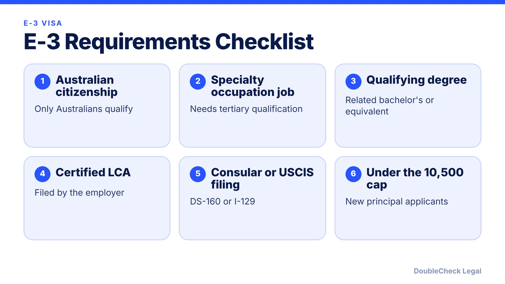
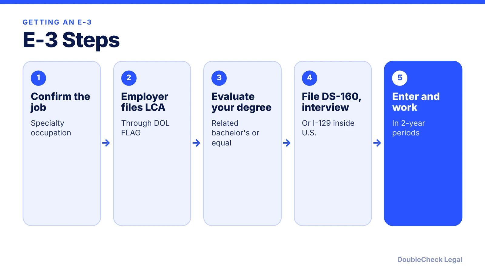

*Australian and working in tech? The E-3 skips the H-1B lottery, but it has its own cap, LCA and degree rules.*

**Key takeaways:**

- Only Australian citizens in specialty occupations requiring a tertiary qualification qualify.
- 10,500 new E-3 principal visas are available per fiscal year; DFAT and Fisher Phillips describe this as a separate annual limit for Australians.
- The employer files an LCA; you apply at a consulate abroad, or seek a change of status with USCIS inside the U.S.
- Two-year periods, renewable indefinitely; spouses can work.

## 1. The quick answer

**Quick answer:** The E-3 is a U.S. work visa reserved for Australian citizens in "specialty occupation" jobs that require a tertiary (bachelor's-level) qualification. There are 10,500 new E-3 principal visas available each fiscal year, but there is no lottery: employers do not take part in the H-1B registration process, and demand has historically stayed below the cap. The employer files a Labor Condition Application (LCA) with the Department of Labor, and status is granted in two-year periods that can be renewed. Spouses are entitled to work.

## 2. Who qualifies

Per Australia's Department of Foreign Affairs and Trade (DFAT), only Australians can apply, and the job must be a specialty occupation that requires a tertiary qualification and sponsorship by a U.S. employer. Fisher Phillips says specialty occupations require at least a bachelor's degree in a specific field, and applicants must have the required degree or the equivalent in education or work experience. Whether a particular Australian degree or experience qualifies is a question for counsel. The role itself must require degree-level specialized knowledge, and the employer has to show the link.

For software engineers, data scientists and similar roles, that usually means a degree in computer science or a closely related field and a job description that actually requires it. Compare this with the [H-1B](/blog/startup-sponsor-h1b-employee-requirements/), which has the same specialty-occupation idea but a registration lottery.

## 3. The cap, the LCA, and how to apply

**The cap.** DFAT and Fisher Phillips both state 10,500 per fiscal year. How the cap treats family members and returning principals is a question for counsel, and the cap is still a limit, so check with an attorney whether it is relevant this year.

**The LCA.** The employer files Form ETA-9035 or 9035E through the Department of Labor's FLAG system before you apply. Timing and review details are set by the Department of Labor, so check its current guidance. Certification does not confirm that the job qualifies as a specialty occupation.

**Applying.**
- From abroad: complete the DS-160, pay the visa fee and attend a consular interview. Interview-waiver rules have changed recently, so confirm current consular rules with the U.S. embassy.
- From inside the U.S.: per Fisher Phillips, Australians in the U.S. may apply to USCIS to change status to E-3. Ask counsel when the new job can start and whether a visa stamp is needed for later travel.

## 4. Duration, renewals, spouses, and why no lottery

**Duration.** Per DFAT, the visa can be renewed indefinitely in two-year increments, while H-1B is generally limited to six years. Each extension requires continued eligibility, and an updated LCA may be needed. If you eventually want permanent residence, see our guide to [H-1B limits beyond six years](/blog/h-1b-6-year-limit-extensions-beyond-six-years/) for the comparison and the [green card timeline](/blog/h-1b-to-green-card-timeline-tech-workers/). Check with an attorney how E-3 interacts with a green card plan.

**Spouses.** DFAT says a spouse does not need to be Australian and is entitled to work in the U.S., unlike most H-1B spouses (see [H-4 EAD](/blog/h-4-ead-spouses-of-h-1b/)). Fisher Phillips says spouses are eligible to apply for work authorization, so confirm what documentation you need.

**Why not a lottery?** The E-3 sits outside the H-1B registration, so Australians skip the selection step. It is worth comparing it against the [weighted H-1B lottery](/blog/h1b-weighted-lottery-wage-levels-explained/) and other [visa options](/blog/us-visa-options-for-startup-founders-compared/).

## Where DoubleCheck fits

[DoubleCheck](https://www.contactdoublecheck.com) helps businesses and founders start legal work with AI, verify it, and, when professional advice is warranted, connect with an independent attorney, including for immigration questions. Attorney availability and practice areas vary. Attorneys on DoubleCheck are independent professionals; an attorney-client relationship forms only if an attorney accepts your engagement.

**Sources:** [DFAT, E-3 visas](https://www.dfat.gov.au/geo/united-states-of-america/Pages/e-3-visas-for-the-united-states); [Fisher Phillips, E-3 for Australian citizens](https://www.fisherphillips.com/Cross-Border-Employer/E-3-Visa-for-Australian-Citizens).

## FAQ

**Is there a lottery for the E-3 visa?**

No lottery applies to the E-3 as described by DFAT, which lists it as a separate Australians-only category with 10,500 visas per fiscal year, but that is still a limit. Check with an attorney whether the cap matters this year.

**How long does E-3 status last?**

Two-year periods that can be renewed indefinitely, per DFAT, as long as you remain eligible. Extensions may need an updated LCA, so ask the employer's immigration counsel.

**Can my spouse work on an E-3?**

Yes. DFAT says a spouse is entitled to work in the U.S. and need not be an Australian citizen. Fisher Phillips says spouses are eligible to apply for work authorization; confirm the current documentation with counsel.

**Does the E-3 need a USCIS petition?**

Not when you apply at a consulate abroad, per DFAT. If you are already in the U.S. and want to change to E-3, Fisher Phillips says you may apply to USCIS for a change of status. Confirm the process with an attorney.

---

*General information only. This article is not legal, tax, investment, or accounting advice.*
