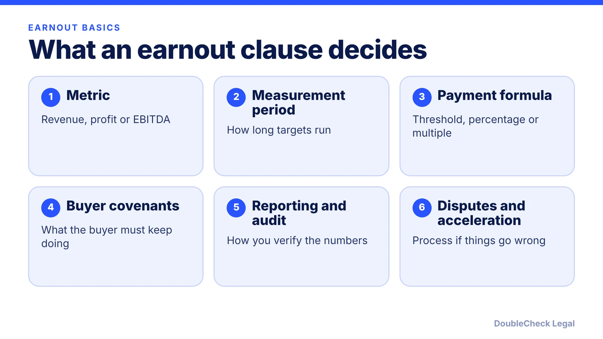
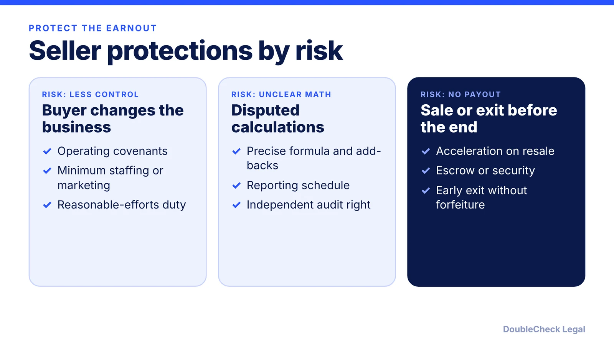

*Earnout clauses explained for owners selling a small business: how the clause works, what to negotiate, and what to verify, as of November 2026.*

**Key takeaways:**

- An earnout makes part of the price depend on post-closing performance, so you carry risk after you lose control.
- The metric and formula decide how easily a buyer can affect your payment; write them so a third party could compute them.
- Negotiate operating covenants, reporting and audit rights, acceleration and a clear dispute process.
- Taxes depend on deal structure and entity type; have a CPA and attorney review before you sign.

## 1. The quick answer

**Quick answer:** An earnout clause is a term in a purchase agreement that makes part of the price depend on how the business performs after closing. If you are selling a small business, you get some money at closing and the rest only if agreed targets are met, such as revenue, gross profit or EBITDA. Earnout clauses explained in one line: they bridge a valuation gap, but they move risk onto the seller, who no longer controls the business. As of November 2026, the practical questions are which metric is used, how long the measurement period lasts, what the buyer must do to protect the target, and how disputes get resolved.

This post is for owners considering a deal that includes an earnout. For the full sale process see the [legal checklist for buying or selling a small business](/blog/how-to-buy-or-sell-a-small-business-legal-checklist/) and the [sell-side M&A legal checklist](/blog/sell-side-ma-legal-checklist/).

## 2. How an earnout works in a small business sale

Per Reed Smith (October 2023), buyers and sellers often disagree on value, and an earn-out bridges that gap by making part of the price payable only if post-completion targets are met. The seller receives part of the price at closing, and the rest depends on performance.

Why use one? Per the Harvard Law School Forum on Corporate Governance (July 2025), earn-outs help bridge valuation gaps when revenue or growth is uncertain, when comparable deals or reliable projections are scarce, or when the parties disagree on price. They also keep sellers engaged and reduce the buyer's upfront payment. The same article warns that an earn-out can "convert today's disagreement over price into tomorrow's litigation over the outcome."

**Size and length vary widely.** Reed Smith says the measurement period is usually one to three years after completion. The Harvard Law School Forum reports a median of 24 months outside life sciences (often 3 to 5 years or longer in life sciences), and a 2024 median of about 31% of closing payments outside life sciences, including escrowed amounts. Treat any figure as an opening position to negotiate, not a norm, and note that these are larger-deal statistics that may not match a small business sale.

**Holdbacks and escrows are different.** An earnout is payable only if targets are met, while escrowed amounts are counted as closing payments in the Harvard Law School Forum's measurements. See [indemnification clause explained](/blog/indemnification-clause-explained-small-business/).

## 3. Choosing the metric and writing the formula

The metric decides who can influence the outcome. Per the Harvard Law School Forum, revenue is the most common metric, followed by earnings or EBITDA, and newer deals often combine financial and non-financial metrics such as customer retention. Reed Smith likewise lists EBITDA, revenue or sales, with non-financial measures such as client retention or product milestones possible. The Forum adds that sellers favor revenue because it is harder for buyers to manipulate through cost or accounting changes, while buyers prefer net income or EBITDA because they reflect actual profitability.

Why this matters: a profit-based target can be lowered by the buyer's own choices. The Forum says buyers can affect profit-based metrics by changing cost structures or accounting treatment, or by shifting costs into the earn-out period. Reed Smith gives an example: a buyer could front-load capital expenditure to depress EBITDA during the earn-out period. It says revenue or sales targets are harder to manipulate and that agreeing a budget at the outset can mitigate the risk.

Write the formula so a third party could compute it. King & Spalding notes that ambiguous terms cause disputes, such as parties disagreeing over the meaning of "distribution" in a calculation. It advises quantifying and defining key trigger items and including illustrative calculation schedules that conform to the agreement. Reed Smith similarly recommends clear, objective terms and worked examples.

A realistic period matters too. Reed Smith says the period should be long enough for the metrics to be met but should not encourage short-term decisions, such as accepting low-margin work or cutting capital expenditure. A letter of intent often sets the first outline, so see [how to write a letter of intent](/blog/how-to-write-a-letter-of-intent-business-deal/) before you sign anything that locks in the structure.

## 4. Seller protections to negotiate

Once closing happens, you rely on the contract. The protections below are the ones the sources return to most often.

- **Operating covenants.** The Harvard Law School Forum says sellers typically seek commitments to run the business consistently with past practice or a business plan, use commercially reasonable efforts, avoid bad-faith actions that impair the earn-out, operate as a standalone unit with separate books, and limit new debt or disposal of key assets. Reed Smith notes buyers resist onerous restrictions on integration or management changes, so expect a negotiation.
- **Reporting and audit rights.** The Forum says agreements should require reporting of key data and allow commercially reasonable verification.
- **Acceleration.** The Forum says acceleration can be triggered by events such as a change of control or termination of key employees, and that drafting should specify whether all earn-out payments or only earned, unpaid amounts accelerate.
- **Role protections if you stay.** If you remain as an employee or consultant, Reed Smith warns that leaver provisions can cut off some or all of the earn-out if a founder leaves, and says they should be reasonable. The Forum adds that buyers typically seek to exclude for-cause terminations and resignations without good reason from acceleration. For restrictive covenants in general, see [non-compete vs non-solicit vs NDA](/blog/non-compete-vs-non-solicit-vs-nda-which-to-use-after-the-ftc-rule/).

**Legal backdrop.** Per King & Spalding, the implied covenant of good faith bars arbitrary or unreasonable conduct that deprives the other party of the benefits of the agreement and prohibits actively sabotaging an earnout, but it does not generally require the buyer to maximize the payout. In Johnson & Johnson v. Fortis Advisors (Del. Jan. 12, 2026), the Delaware Supreme Court described the covenant as a narrow gap-filling tool of last resort that cannot be used to rewrite a contract, per the Harvard Law School Forum. That is a safety net, not a substitute for clear covenants, and it depends on the governing law in your agreement.

## 5. Disputes, taxes and how the sale structure interacts

**Disputes.** The Harvard Law School Forum reports that earn-out and M&A court filings nearly doubled in Q1 2023 compared with the prior year, though that quarter was unusually high, and that disputes become more likely as the earn-out share of price and the period length increase. King & Spalding says ambiguous language is generally a fact question for a jury, so summary judgment is rare and discovery is prolonged and costly. The Forum suggests stating explicitly whether a third-party accountant acts as an expert or an arbitrator, limiting that person's authority to accounting questions, and using short deadlines for any escalation or mediation step. For the tradeoffs of arbitration clauses see [arbitration clause explained](/blog/arbitration-clause-explained-small-business-contracts-pros-cons/).

**Taxes.** Tax outcomes depend on the deal structure, your entity type and whether the earnout qualifies for IRS installment-sale rules, so consult a tax advisor. The IRS (Publication 537, 2025 returns) defines an installment sale as a sale where you receive at least one payment after the tax year of the sale, and it describes a contingent payment sale as one where the total selling price cannot be determined by year-end, using a sale of a business with a percentage of future profits as its example. It also says that if a contract provides little or no interest, you may have to figure unstated interest. The IRS excludes some sales from the installment method, including regular sales of inventory. How all this applies to your deal depends on facts a CPA must review. See [asset sale vs stock sale](/blog/asset-sale-vs-stock-sale-small-business-buyer-seller-differences/) and [QSBS exit checklist](/blog/qsbs-exit-checklist-what-to-verify-before-you-sell-your-stock/) if you hold startup stock.

**Not guaranteed.** Per the Harvard Law School Forum, after closing, buyer decisions on integration, investment and strategy can hurt earn-out performance, so the seller may receive less than the full amount.

## 6. When to handle it yourself and when to get an attorney

AI can help you sort a draft into a table of metric, period, buyer duties and dispute steps, but verify what it returns.

Bring in an attorney, and a tax adviser, when:

- The earnout is a meaningful share of your total price.
- You will keep working in the business after closing.
- The buyer controls the books that determine your payment.
- The agreement mentions a financing source, a later resale, or a merger of the business with another.
- Anything in the draft is vague (for example, "commercially reasonable efforts" with no definition).

Reed Smith advises involving financial and tax specialists early, since earn-outs are complex and increase the potential for disputes. For help picking counsel, see [how to choose a good lawyer](/blog/how-to-choose-good-lawyer/) and [when to hire a lawyer for a small business](/blog/when-to-hire-lawyer-small-business/). For contract terms that often sit nearby, see [limitation of liability clause explained](/blog/limitation-of-liability-clause-explained/) and [how to verify an AI-generated legal document](/blog/verify-ai-generated-legal-document/).

## Where DoubleCheck fits

[DoubleCheck](https://www.contactdoublecheck.com) helps businesses and founders start legal work with AI, verify it, and, when professional advice is warranted, connect with an independent attorney, including for immigration questions. Attorney availability and practice areas vary. Attorneys on DoubleCheck are independent professionals; an attorney-client relationship forms only if an attorney accepts your engagement.

**Sources:** [Harvard Law School Forum on Corporate Governance, The Art and Science of Earn-Outs in M&A (July 11, 2025)](https://corpgov.law.harvard.edu/2025/07/11/the-art-and-science-of-earn-outs-in-ma); [Harvard Law School Forum on Corporate Governance, Delaware Supreme Court's earnout decision reinforces primacy of contract (Feb. 9, 2026)](https://corpgov.law.harvard.edu/2026/02/09/delaware-supreme-courts-earnout-decision-reinforces-primacy-of-contract-and-illustrates-the-limits-of-the-implied-covenant); [Reed Smith, The rise of earn-outs: bridging the valuation gap (Oct. 2023)](https://www.reedsmith.com/de/perspectives/2023/10/the-rise-of-earn-outs-bridging-the-valuation-gap-uncertain-market); [King & Spalding, Problems with M&A Earnouts](https://www.kslaw.com/attachments/000/008/342/original/Problems_with_M_A_Earnouts.pdf); [IRS, Publication 537 (2025)](https://irs.gov/publications/p537). Several statistics come from larger deals and may not match a small business sale; Reed Smith's piece is written from a UK perspective.

## FAQ

**What is an earnout clause in selling a small business?**

It is a purchase agreement term under which the buyer pays part of the price later, only if the business meets agreed targets. Per Reed Smith, earn-outs bridge a valuation gap by making part of the price payable only if post-completion targets are met.

**How long does an earnout last?**

It varies. Reed Smith says one to three years after completion is usual, and the Harvard Law School Forum reports a median of 24 months outside life sciences, with life sciences deals often running 3 to 5 years or longer. Negotiate the period for your deal.

**Which earnout metric is best for the seller?**

The Harvard Law School Forum says sellers favor revenue because it is harder for buyers to manipulate through cost or accounting changes, while buyers prefer net income or EBITDA because they reflect actual profitability. Reed Smith says similar about revenue and EBITDA. Your attorney can advise on your facts.

**Is earnout money taxed as capital gain or installment income?**

It depends on the structure, entity type and facts. Whether installment-sale rules apply is one factor, and the IRS describes contingent payment sales in Publication 537. Ask a CPA to model it before you sign.

**Can I sue if the buyer blocks my earnout?**

Possibly, but it depends on the contract and governing law. Per King & Spalding, the implied covenant of good faith bars arbitrary or unreasonable conduct that deprives the other party of the benefits of the agreement, but it does not generally require a buyer to maximize the payout. Clear covenants and a dispute process are safer than relying on a lawsuit.

---

*General information only. This article is not legal, tax, investment, or accounting advice.*
