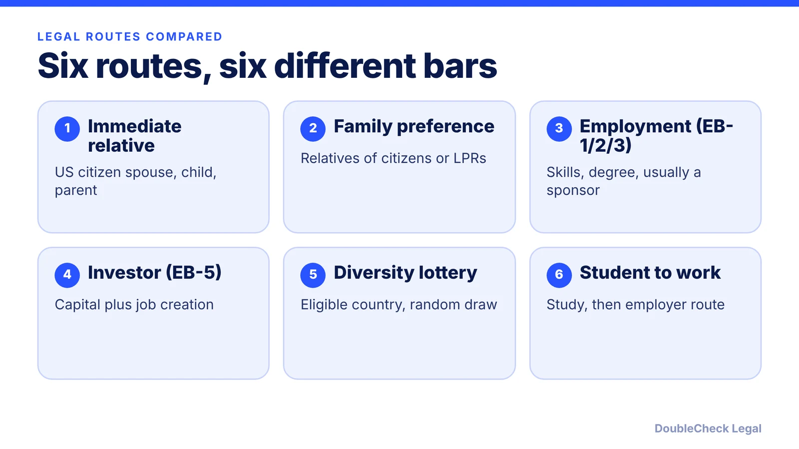
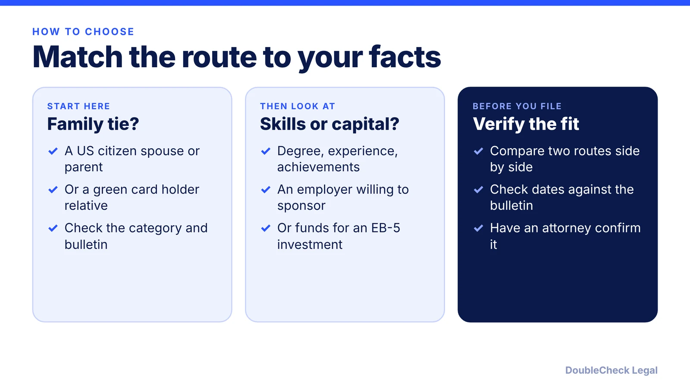

*There is no universally easiest path to the US; the easiest one is the route you already qualify for.*

**Key takeaways:**

- Immediate relatives of US citizens have no annual cap or resulting wait, per Nolo; other routes involve caps, sponsors, capital, or a lottery.
- Wait times depend on category and country of birth, so check the monthly Visa Bulletin.
- EB-5 minimums are $800,000 (targeted area) or $1,050,000, per Global Immigration (May 2026), with an adjustment scheduled for 2027.
- Verify your fit with a licensed attorney before filing when more than one route could apply.

## 1. The quick answer

**Quick answer:** There is no single easiest way to immigrate to the US. The easiest path is the one you already qualify for, and that depends on your family ties, your skills and employer, your capital, and your country of birth. Per Nolo, the shortest route is usually being the spouse, unmarried child under 21, or parent of a US citizen aged 21 or older: these immediate relatives have no annual limit and no resulting wait. Everything else involves a cap, an employer, a large investment, or a random draw. This guide compares the main legal routes by eligibility bar, what drives the wait, and what drives the cost, with sources dated as of November 2026.

## 2. Family-based routes: the lowest bar for some, the longest wait for others

Family is the only category where the main requirement is a relationship, not a skill or money. Per the Migration Policy Institute (MPI), the immigration law sets the family-sponsored total at 480,000 including immediate relatives, who are not numerically limited. The preference categories (adult children, siblings, and spouses and children of green card holders) are capped, and the family preference level may not fall below 226,000.

What drives the wait is the category and your country of birth. As examples from the November 2026 Visa Bulletin as reported by Wolfsdorf Rosenberg (the State Department page itself did not load for us): F2A (spouses and minor children of green card holders) was at October 22, 2026 for most countries; F1 (unmarried adult children of citizens) at January 22, 2021; F3 at October 22, 2015, and for Mexico at July 15, 2001. A priority date must be earlier than the listed cutoff. See [how to read the visa bulletin](/blog/visa-bulletin-explained-priority-dates-eb-categories/).

What drives the cost: filing fees, the sponsor's financial support obligation (see [the I-864 affidavit of support](/blog/affidavit-of-support-i-864-sponsor-requirements/)), medical exams, and attorney fees if you hire one. For the marriage route, see [marriage-based green card timeline](/blog/marriage-based-green-card-process-timeline/) and [the I-130 petition](/blog/i-130-petition-spouse-green-card-marriage-based-process/). A relationship must be genuine; a sham marriage is a crime and a bar to future benefits.

## 3. Employment, investment, and the diversity lottery

**Employment (EB-1, EB-2, EB-3).** US law allows 140,000 employment-based green cards a year, per Shusterman, with a 7% per-country limit that causes long backlogs for people born in India and mainland China. Eligibility bars differ:

- **EB-1:** extraordinary ability, outstanding professors and researchers, or multinational executives and managers. No PERM labor certification.
- **EB-2:** an advanced degree or exceptional ability. PERM is generally required unless a national interest waiver is granted.
- **EB-3:** professionals, skilled workers (at least two years of training or experience), and other workers (capped at 10,000).

Wait time drivers are category and birth country. In the November 2026 bulletin (per Wolfsdorf), EB-1 was current for most countries, EB-2 was April 1, 2025, and India EB-2 was November 1, 2013. Costs are driven by the employer's recruitment and legal work for PERM and by the petition fees. Read more in [EB-2 vs EB-3](/blog/eb-2-vs-eb-3-green-card-categories/), [PERM](/blog/perm-labor-certification-green-card-process/), [EB-1A for tech employees](/blog/eb-1a-for-software-engineers-and-tech-employees/), and [the national interest waiver](/blog/niw-eb-2-national-interest-waiver-founders/).

**Investment (EB-5).** Per Global Immigration (updated May 2026), the current minimums are $800,000 in a targeted employment area and $1,050,000 otherwise. A CanAm Marketing article says an inflation adjustment is scheduled for January 1, 2027, with final figures still to be published in the Federal Register. The cost driver here is the capital at risk, plus fees. Details: [EB-5 requirements](/blog/eb-5-investor-visa-requirements-2026/).

**Diversity lottery.** About 50,000 visas are made available a year (the law provides 55,000, reduced by up to 5,000, per a CRS report). Per Nolo, applicants need minimum education, must show they can support themselves, and must not be inadmissible; selection is random and more people are selected than visas exist. A State Department final rule, reported by Greenberg Traurig as published April 10, 2026, requires passport information at registration starting with DV-2027. Check the State Department site for current registration dates. See [the diversity visa guide](/blog/diversity-visa-lottery-green-card-lottery-eligibility-how-to-apply/).

## 4. Student-to-work routes, humanitarian status, and how to choose

Studying in the US is not itself an immigration path, but it can lead to one. A common sequence is F-1 student status, then OPT, then an employer-sponsored work visa, then an employment-based green card. Each step has its own cap or lottery; the H-1B step is covered in [H-1B lottery alternatives for students](/blog/h-1b-lottery-lost-alternatives-international-students/) and the whole sequence in [the student-to-green-card roadmap](/blog/student-to-green-card-roadmap-f-1-opt-h-1b-niw-eb-1/).

Humanitarian routes (refugee status and asylum) exist for people who face persecution. Per MPI, they have no numerical limit on green card adjustments. They are legal protections with their own evidence rules, not a general alternative, and anyone considering them should speak to a licensed attorney or an accredited representative.

Handle the early research yourself: list your relationships, degrees, employer, and any achievements, and see which routes fit. Get an attorney to verify before you file when more than one route could apply, when you have prior overstays or denials, or when a deadline is involved. For fees, see [immigration lawyer fees](/blog/immigration-lawyer-fees-flat-fee-vs-hourly/) and [how to avoid notario scams](/blog/immigration-notario-scam-how-to-avoid/). For a broader decision guide, see [which US visa is right for you](/blog/which-us-visa-is-right-for-you-by-situation-decision-guide/).

## Where DoubleCheck fits

[DoubleCheck](https://www.contactdoublecheck.com) helps businesses and founders start legal work with AI, verify it, and, when professional advice is warranted, connect with an independent attorney, including for immigration questions. Attorney availability and practice areas vary. Attorneys on DoubleCheck are independent professionals; an attorney-client relationship forms only if an attorney accepts your engagement.

**Sources:** [Nolo, What is the easiest way to get a US green card](https://www.nolo.com/legal-encyclopedia/whats-the-easiest-way-get-us-green-card.html); [MPI, How the US legal immigration system works](https://www.migrationpolicy.org/explainer/how-us-legal-immigration-system-works); [CRS, Permanent Legal Immigration to the United States (Nov 2024)](https://www.everycrsreport.com/files/2024-11-04_R42866_45adab25e6609dc1a2884659162539e205019e77.html); [Shusterman, employment-based categories](https://www.shusterman.com/?p=99384); [Wolfsdorf Rosenberg, November 2026 Visa Bulletin](https://wolfsdorf.com/november-2026-visa-bulletin-selected-employment-categories-make-gains-family-categories-advance/); [Global Immigration, EB-5 investment amount](https://www.globalimmigration.com/eb-5-investment-amount-tea-requirements-explained/); [CanAm Enterprises, 2027 EB-5 adjustment](https://www.canamenterprises.com/2026/07/eb-5-investment-amount-increase-2027/); [Greenberg Traurig, DV-2027 final rule](https://www.gtlaw-insidebusinessimmigration.com/u-s-department-of-state-dos/state-department-final-rule-reinstates-passport-requirement-for-diversity-visa-lottery-entries-beginning-with-dv-2027/). The State Department visa bulletin page did not load, so bulletin dates are attributed to Wolfsdorf Rosenberg.

## FAQ

**What is the easiest way to get a green card?**

There is no single easiest way. Per Nolo, spouses, unmarried children under 21, and parents of US citizens over 21 are immediately eligible with no annual limit and no resulting wait, but you need a qualifying relationship. Other routes depend on a sponsor, skills, capital, or a lottery.

**Is the diversity visa lottery an easy option?**

It is open only to eligible countries and selection is random. Per Nolo, more people are selected than visas available, and winners must still meet education and admissibility requirements. Check the State Department site for current registration status.

**Which route has the shortest wait?**

Immediate relatives of US citizens have no visa number wait. In the November 2026 Visa Bulletin as reported by Wolfsdorf Rosenberg, EB-1 was current for most countries, while some categories for India, China, and Mexico had much older cutoff dates.

**Can I switch routes if I do not qualify for the one I want?**

Sometimes. People often qualify under more than one category, for example family and employment, or EB-1 and EB-2. An immigration attorney can compare the options for your facts before you file.

---

*General information only. This article is not legal, tax, investment, or accounting advice.*
