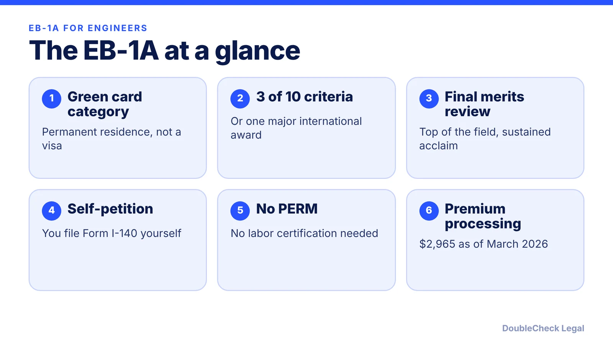
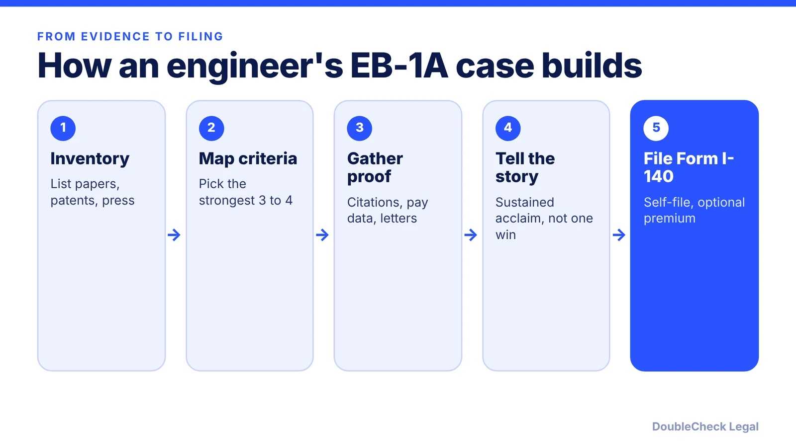

*Can a software engineer self-petition for an EB-1A green card? Here are the ten criteria, the evidence engineers use, and how the founder route differs.*

**Key takeaways:**

- The EB-1A needs a one-time major award or at least three of ten criteria, then a final merits review.
- It is a self-petition: no employer, job offer, or PERM labor certification.
- Engineers lean on judging, citations, papers, patents, and critical roles; founders lean on press and leadership.
- Beyond Border reports premium processing at $2,965 as of March 2026; confirm current fees.

## 1. The quick answer

**Quick answer:** The EB-1A is a green card category for people with extraordinary ability, and a software engineer or tech employee can file it without an employer. Under 8 CFR 204.5(h), you show either a one-time major internationally recognized award or evidence meeting at least three of ten criteria, then USCIS makes a final merits judgment on whether you are among the small percentage at the very top of your field. No job offer and no PERM labor certification is needed, per Beyond Border.

## 2. The ten criteria, read as an engineer

The regulation lists ten types of evidence. Per the text of 8 CFR 204.5(h)(3), you need at least three:

- Lesser nationally or internationally recognized prizes or awards for excellence.
- Membership in associations that require outstanding achievement, as judged by recognized experts.
- Published material about you in professional or major trade publications or other major media.
- Participation as a judge of the work of others in your field or an allied field.
- Original contributions of major significance in the field.
- Authorship of scholarly articles in professional or major trade publications or other major media.
- Display of your work at artistic exhibitions or showcases.
- A leading or critical role for organizations with a distinguished reputation.
- A high salary or other significantly high remuneration compared with others in the field.
- Commercial success in the performing arts.

The regulation also allows comparable evidence if these standards do not readily apply to your occupation. Beyond Border notes that the performing-arts criterion does not apply to STEM or business petitions, and that the exhibitions criterion is mostly artistic.

## 3. What evidence engineers actually use

Beyond Border's general guidance on each criterion maps naturally to technical careers. Treat this as an illustration, not a checklist that guarantees approval:

- **Judging:** peer review for journals or conferences, grant review panels, editorial boards, or judging recognized industry competitions.
- **Original contributions:** frequently cited research, methods or products others adopted, and patents with practical use. Unlicensed patents and routine work are weak.
- **Scholarly articles:** peer-reviewed papers and recognized conference proceedings, not blogs.
- **Leading or critical role:** a senior or critical technical role at an organization that is itself distinguished. Titles without real authority are weak.
- **High salary:** top-tier pay for your field and career stage, ideally including equity and bonuses in the comparison.
- **Membership and press:** selective societies where peers judge applicants, and coverage that discusses your specific contributions, not employer press releases.

Beyond Border stresses that quality outweighs quantity: strong evidence in three or four criteria is usually more persuasive than thin evidence in six. Internal company awards are weak evidence. Expert letters should come from independent experts and explain why your work places you at the top tier.

## 4. Self-petition, timing, and how this differs from the founder angle

You file Form I-140 on your own behalf, so changing employers does not restart the sponsorship. Beyond Border reports standard processing of 4.5 to 22.5 months, premium processing at $2,965 as of March 1, 2026 with a 15-business-day USCIS action clock, and an approval rate of 66.6% in the third quarter of 2025, down from 77.8% in fiscal 2022. Fees and times change, so confirm on USCIS before filing. USCIS also reviews the record as a whole, and you must show you intend to keep working in your field in the U.S., per Ashoori Law.

The legal standard is the same for engineers and founders. What differs is the evidence. Founders usually lean on press, a leading or critical role, high remuneration such as equity, and the impact of the company. Engineers more often lean on judging, citations, scholarly articles, patents, and a critical technical role. A founder who also publishes or reviews can use both. See [EB-1A vs. O-1 for founders](/blog/eb-1a-vs-o-1-founder-which-path/) and the [O-1A evidence guide](/blog/o-1a-visa-for-startup-founders-evidence/).

If your record is more modest, compare the [national interest waiver for engineers](/blog/niw-for-software-engineers-and-researchers/), which needs an advanced degree or exceptional ability but not sustained acclaim. For waiting times after approval, read the [visa bulletin explained](/blog/visa-bulletin-explained-priority-dates-eb-categories/), and for a sponsored route see the [H-1B to green card timeline](/blog/h-1b-to-green-card-timeline-tech-workers/). Choosing between paths is a strategy question for [an immigration lawyer](/blog/how-to-find-good-immigration-lawyer-startup-founder/).

## Where DoubleCheck fits

[DoubleCheck](https://www.contactdoublecheck.com) helps businesses and founders start legal work with AI, verify it, and, when professional advice is warranted, connect with an independent attorney, including for immigration questions. Attorney availability and practice areas vary. Attorneys on DoubleCheck are independent professionals; an attorney-client relationship forms only if an attorney accepts your engagement.

**Sources:** [8 CFR 204.5 (GovInfo)](https://www.govinfo.gov/content/pkg/CFR-2012-title8-vol1/pdf/CFR-2012-title8-vol1-sec204-5.pdf); [Beyond Border EB-1A requirements](https://www.beyondborderglobal.com/resources/eb-1a-requirements); [Ashoori Law](https://www.ashoorilaw.com/blog/eb1a-criteria).

## FAQ

**Do software engineers qualify for the EB-1A?**

Some do. The test is extraordinary ability shown by sustained national or international acclaim, not job title. Under 8 CFR 204.5(h), you need a major award or at least three of ten criteria, then USCIS weighs the whole record.

**Do I need my employer to file an EB-1A?**

No. Beyond Border says the EB-1A is a self-petition with no employer sponsorship, job offer, or PERM labor certification required.

**How is the EB-1A different for founders and engineers?**

The legal standard is the same. The evidence differs: founders lean on press, a leading role, and high remuneration, while engineers more often rely on judging, citations, papers, and patents.

**How long does an EB-1A take?**

Beyond Border reports standard processing of 4.5 to 22.5 months and premium processing with a 15-business-day action clock, at $2,965 as of March 1, 2026. Check USCIS for current figures.

---

*General information only. This article is not legal, tax, investment, or accounting advice.*
