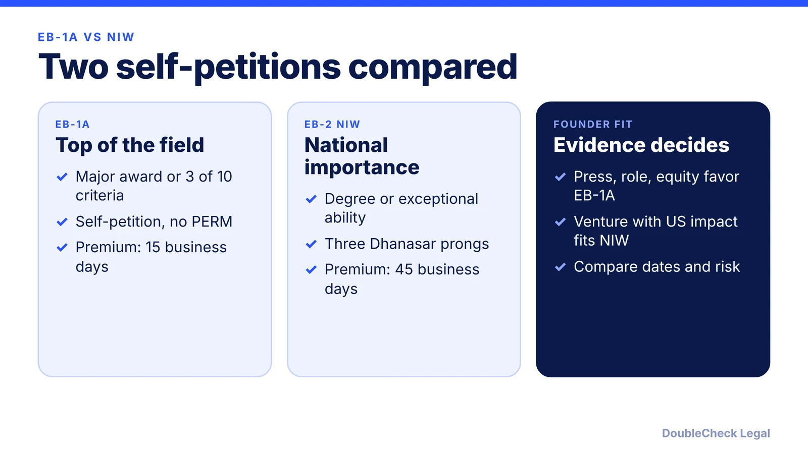
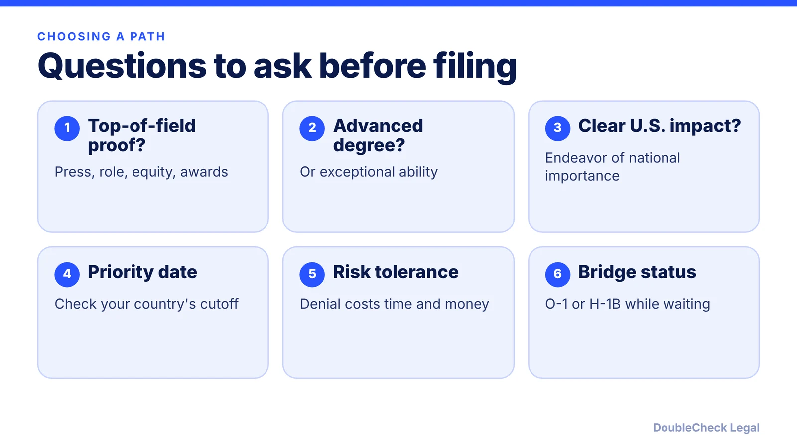

*EB-1A or NIW? Both are self-petitions, but the standards, timelines, and evidence differ. Here is how a founder can compare them.*

**Key takeaways:**

- Both are self-petitions with no job offer or PERM; EB-1A has the higher standard.
- Beyond Border reports Q3 FY2026 approval rates of 32.2% for EB-1A and 55.3% for NIW.
- Premium processing is 15 business days for EB-1A and 45 for NIW, per Beyond Border.
- Pick based on evidence and priority dates, not labels; check the current visa bulletin.

## 1. The quick answer

**Quick answer:** Neither is better for everyone. Both are self-petitions with no job offer or labor certification. EB-1A requires you to be among the small percentage at the very top of your field, with a major award or three of ten criteria. EB-2 NIW requires an advanced degree or exceptional ability plus three Dhanasar prongs, a lower evidentiary bar. Per Beyond Border, the Q3 FY2026 approval rate was 32.2% for EB-1A and 55.3% for NIW, though approval rates reflect overall outcomes, not your odds.

## 2. How the standards differ

**EB-1A:** per Beyond Border, applicants must be among the small percentage who have risen to the very top of their field, shown by a one-time major award or at least three of ten regulatory criteria, then a final merits review. Founders often use press, a leading or critical role, high remuneration such as equity, and original contributions. See [EB-1A for tech employees](/blog/eb-1a-for-software-engineers-and-tech-employees/).

**NIW:** you first qualify for EB-2 through an advanced degree or exceptional ability, then show your proposed work has substantial merit and national importance, that you are well positioned to advance it, and that waiving the job offer benefits the U.S. The waiver is discretionary. See [NIW for founders](/blog/niw-eb-2-national-interest-waiver-founders/) and [NIW for engineers and researchers](/blog/niw-for-software-engineers-and-researchers/).

The practical difference: EB-1A asks whether you are at the top of your field; NIW asks whether your specific endeavor matters to the U.S. and whether you can advance it. A startup with traction and a clear U.S. impact story may fit NIW even without major awards, while a founder with strong press and a record of recognition may fit EB-1A.

## 3. Timing, speed, and approval data

Per Beyond Border:

- **I-140 standard processing:** 4.5 to 22.5 months for EB-1A, 8 to 26.5 months for NIW.
- **Premium processing:** 15 business days for EB-1A and 45 business days for NIW.
- **Q3 FY2026 approval rate:** 32.2% for EB-1A (66.9% in FY2025) and 55.3% for NIW.

Beyond Border's page gave inconsistent details in places (for example the EB-2 cut-off date), and says these rates are overall figures, so treat them as directional and verify current numbers. Priority dates matter after approval: EB-1 and EB-2 can have different cut-offs by country, so check the [visa bulletin explained](/blog/visa-bulletin-explained-priority-dates-eb-categories/) and the current bulletin. Premium fees are on the [premium processing guide](/blog/premium-processing-fees-and-timelines-2026/).

## 4. A founder's decision framework

Start by inventorying evidence, not by picking a label. If you can document at least three EB-1A criteria with strong, independent proof, EB-1A deserves a serious look. If your recognition is thinner but you have a degree or exceptional ability and a credible plan with U.S. impact, NIW may be the more realistic route. Some people file one then pivot, but a denial has costs; see [NIW denial options](/blog/niw-denial-rfe-reapply-options/).

Beyond Border notes the O-1 can be a starting point because it is dual intent and can be used while preparing an EB-1A or NIW petition. See [EB-1A vs. O-1 for founders](/blog/eb-1a-vs-o-1-founder-which-path/) and [visa options for founders compared](/blog/us-visa-options-for-startup-founders-compared/). Because this is a strategy decision, review it with [an immigration lawyer](/blog/how-to-find-good-immigration-lawyer-startup-founder/). Confirm all figures as of November 2026.

## Where DoubleCheck fits

[DoubleCheck](https://www.contactdoublecheck.com) helps businesses and founders start legal work with AI, verify it, and, when professional advice is warranted, connect with an independent attorney, including for immigration questions. Attorney availability and practice areas vary. Attorneys on DoubleCheck are independent professionals; an attorney-client relationship forms only if an attorney accepts your engagement.

**Sources:** [Beyond Border: O-1 vs EB-1A vs EB-2 NIW](https://www.beyondborderglobal.com/resources/o-1-vs-eb-1a-vs-eb-2-niw); [Locke Immigration: NIW denial](https://www.lockeimmigration.com/federal-litigation/niw-denial).

## FAQ

**Is EB-1A or NIW easier for a founder?**

NIW has a lower evidentiary bar, per Beyond Border, and a higher Q3 FY2026 approval rate (55.3% versus 32.2%). But rates reflect overall outcomes, so your result depends on your evidence.

**Can a founder file EB-1A and NIW at the same time?**

This is a strategy question for an immigration attorney. The records overlap, per Locke Immigration, but a denial has costs. Do not assume dual filing is right without advice.

**How long do EB-1A and NIW take?**

Per Beyond Border, standard I-140 processing is 4.5 to 22.5 months for EB-1A and 8 to 26.5 months for NIW, with premium processing of 15 and 45 business days respectively.

**Do I need a job offer for EB-1A or NIW?**

No. Per Beyond Border, both are self-petitions, with the job offer and PERM labor certification not required for EB-1A and waived for NIW.

---

*General information only. This article is not legal, tax, investment, or accounting advice.*
