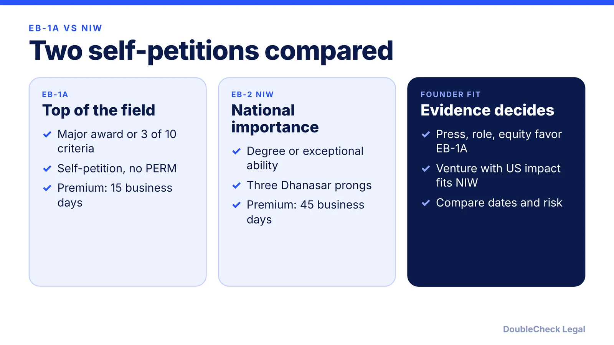
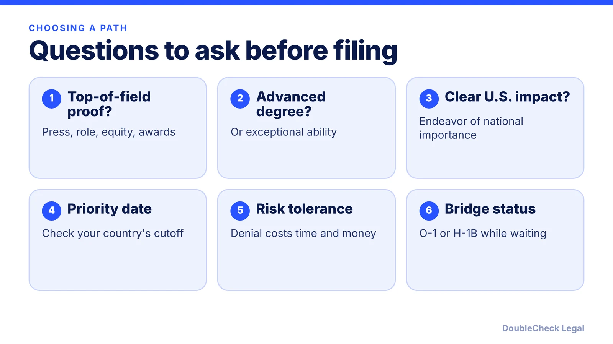

*EB-1A or NIW? Both are self-petitions, but the standards, timelines, and evidence differ. Here is how a founder can compare them.*

**Key takeaways:**

- Both are self-petitions with no job offer or PERM; EB-1A has the higher standard.
- NIW generally has a lower evidentiary bar than EB-1A; approval rates and processing times change, so check USCIS.
- Pick based on evidence and priority dates, not labels; check the current visa bulletin.

## 1. The quick answer

**Quick answer:** Neither is better for everyone. Both are self-petitions with no job offer or labor certification. EB-1A requires you to be among the small percentage at the very top of your field, with a major award or three of ten criteria. EB-2 NIW requires an advanced degree or exceptional ability plus three Dhanasar prongs, a lower evidentiary bar. Approval rates and processing times change, so check USCIS data for current figures.

## 2. How the standards differ

**EB-1A:** under 8 CFR 204.5(h), applicants must be among the small percentage who have risen to the very top of their field, shown by a one-time major award or at least three of ten regulatory criteria, then a final merits review. Founders often use press, a leading or critical role, high remuneration such as equity, and original contributions. See [EB-1A for tech employees](/blog/eb-1a-for-software-engineers-and-tech-employees/).

**NIW:** you first qualify for EB-2 through an advanced degree or exceptional ability, then show, under Matter of Dhanasar, 26 I&N Dec. 884 (AAO 2016), that your proposed work has substantial merit and national importance, that you are well positioned to advance it, and that waiving the job offer benefits the U.S. The waiver is discretionary. See [NIW for founders](/blog/niw-eb-2-national-interest-waiver-founders/) and [NIW for engineers and researchers](/blog/niw-for-software-engineers-and-researchers/).

The practical difference: EB-1A asks whether you are at the top of your field; NIW asks whether your specific endeavor matters to the U.S. and whether you can advance it. A startup with traction and a clear U.S. impact story may fit NIW even without major awards, while a founder with strong press and a record of recognition may fit EB-1A.

## 3. Timing, speed, and approval data

We did not rely on third-party approval-rate or processing-time figures here, because they change often and vary by source. Check USCIS's processing times page and premium processing page for current numbers. Priority dates matter after approval: EB-1 and EB-2 can have different cut-offs by country, so check the [visa bulletin explained](/blog/visa-bulletin-explained-priority-dates-eb-categories/) and the current bulletin. Premium fees are on the [premium processing guide](/blog/premium-processing-fees-and-timelines-2026/).

## 4. A founder's decision framework

Start by inventorying evidence, not by picking a label. If you can document at least three EB-1A criteria with strong, independent proof, EB-1A deserves a serious look. If your recognition is thinner but you have a degree or exceptional ability and a credible plan with U.S. impact, NIW may be the more realistic route. Some people file one then pivot, but a denial has costs; see [NIW denial options](/blog/niw-denial-rfe-reapply-options/).

The O-1 can be a starting point because it is dual intent and can be used while preparing an EB-1A or NIW petition. See [EB-1A vs. O-1 for founders](/blog/eb-1a-vs-o-1-founder-which-path/) and [visa options for founders compared](/blog/us-visa-options-for-startup-founders-compared/). Because this is a strategy decision, review it with [an immigration lawyer](/blog/how-to-find-good-immigration-lawyer-startup-founder/). Confirm all figures as of November 2026.

## Where DoubleCheck fits

[DoubleCheck](https://www.contactdoublecheck.com) helps businesses and founders start legal work with AI, verify it, and, when professional advice is warranted, connect with an independent attorney, including for immigration questions. Attorney availability and practice areas vary. Attorneys on DoubleCheck are independent professionals; an attorney-client relationship forms only if an attorney accepts your engagement.

**Sources:** 8 CFR 204.5(h) (EB-1A criteria); Matter of Dhanasar, 26 I&N Dec. 884 (AAO 2016) (NIW standard); USCIS processing-time and premium-processing pages (check current figures). No linked sources were verified for this update, so confirm against uscis.gov.

## FAQ

**Is EB-1A or NIW easier for a founder?**

NIW generally has a lower evidentiary bar than EB-1A, but your result depends on your evidence. Check USCIS for current approval data.

**Can a founder file EB-1A and NIW at the same time?**

This is a strategy question for an immigration attorney. The evidence can overlap, but a denial has costs. Do not assume dual filing is right without advice.

**How long do EB-1A and NIW take?**

Standard I-140 processing times vary and change often; check the USCIS processing times page. USCIS premium processing is available for both.

**Do I need a job offer for EB-1A or NIW?**

No. Both can be self-petitions; a job offer and PERM labor certification are not required for EB-1A and can be waived for NIW.

---

*General information only. This article is not legal, tax, investment, or accounting advice.*
