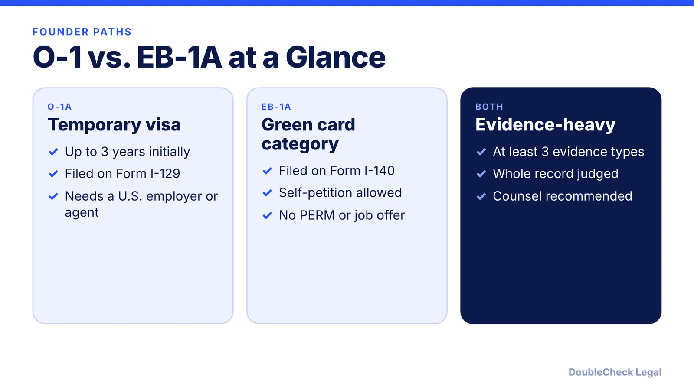
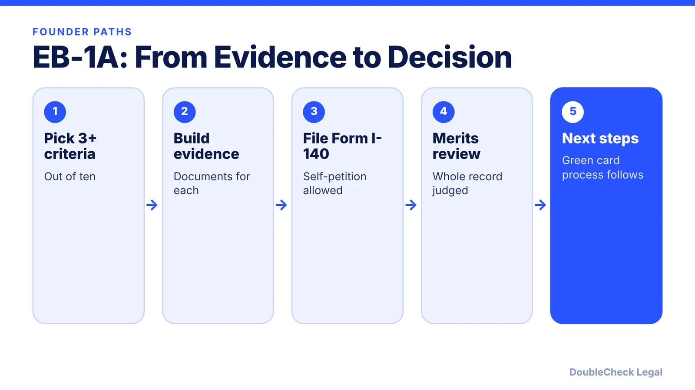
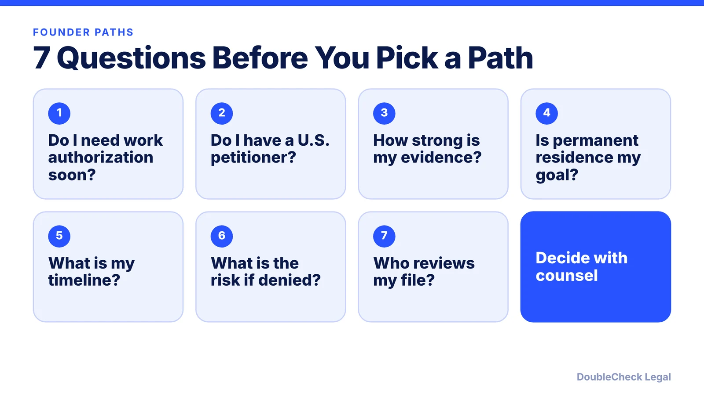

*Weighing an O-1 against an EB-1A? Here is how they differ for founders, with the ten EB-1A criteria and questions to settle the choice.*

**Key takeaways:**

- The O-1 is temporary; the EB-1A is a green card category.
- The EB-1A can be self-petitioned on Form I-140 without an employer or PERM labor certification.
- The EB-1A needs a one-time major award or at least three of ten criteria, then a final merits review.
- Choosing between them is an attorney-level strategy decision.

## 1. The quick answer

**Quick answer:** The O-1 is a temporary work visa; the EB-1A is a green card category. Both ask for evidence of extraordinary ability, but the EB-1A can be self-petitioned on Form I-140 with no employer sponsor, job offer, or PERM labor certification. The EB-1A uses a ten-criteria list (at least three, or a one-time major award) followed by a final merits review, while USCIS says the O-1 needs at least three types of qualifying documentation.

## 2. The EB-1A criteria

Under 8 CFR 204.5(h)(3), per a summary from Ashoori Law, the ten criteria are: lesser nationally or internationally recognized prizes; memberships requiring outstanding achievement; published material about you; judging the work of others; original contributions of major significance; scholarly articles; artistic exhibitions; a leading or critical role for a distinguished organization; high remuneration; and commercial success in the performing arts. You need either a one-time major internationally recognized achievement or evidence of at least three of the ten.

USCIS then does a final merits review of the entire record. Meeting three criteria does not guarantee approval. You must also show you intend to keep working in your field in the U.S.

## 3. How founders choose

Founders often compare the paths on speed to a first filing, permanence, and whether they have a U.S. petitioner. A temporary O-1 can fit someone who needs work authorization soon and has an employer or agent; an EB-1A fits someone whose evidence is already strong enough for a permanent filing. Some people file both, in sequence. This is a strategy decision for an immigration attorney, who can read your full record.

## 4. Related guides

Read [O-1A for startup founders](/blog/o-1a-visa-for-startup-founders-evidence/), the [O-1 documents checklist](/blog/o-1-visa-documents-checklist-founder/), and the [national interest waiver explained](/blog/niw-eb-2-national-interest-waiver-founders/). To compare against H-1B, see [the H-1B fee status](/blog/h1b-100000-fee-status-2026/).

## Where DoubleCheck fits

[DoubleCheck](https://www.contactdoublecheck.com) helps businesses and founders start legal work with AI, verify it, and, when professional advice is warranted, connect with an independent attorney, including for immigration questions. Attorney availability and practice areas vary. Attorneys on DoubleCheck are independent professionals; an attorney-client relationship forms only if an attorney accepts your engagement.

**Sources:** [Ashoori Law](https://www.ashoorilaw.com/blog/eb1a-criteria); [USCIS O-1](https://uscis.gov/o-1).

## FAQ

**Can I self-petition for an EB-1A?**

Yes, per Ashoori Law's summary, the EB-1A is filed on Form I-140 without an employer sponsor, job offer, or PERM labor certification.

**How many EB-1A criteria must I meet?**

At least three of ten, or a one-time major internationally recognized achievement, followed by a final merits determination.

**Is the O-1 a green card?**

No. It is a temporary nonimmigrant visa, with an initial stay of up to three years per USCIS.

**Can I file an O-1 and an EB-1A?**

Some people pursue both in sequence, but the strategy depends on your facts. Ask an immigration attorney.

---

*General information only. This article is not legal, tax, investment, or accounting advice.*
