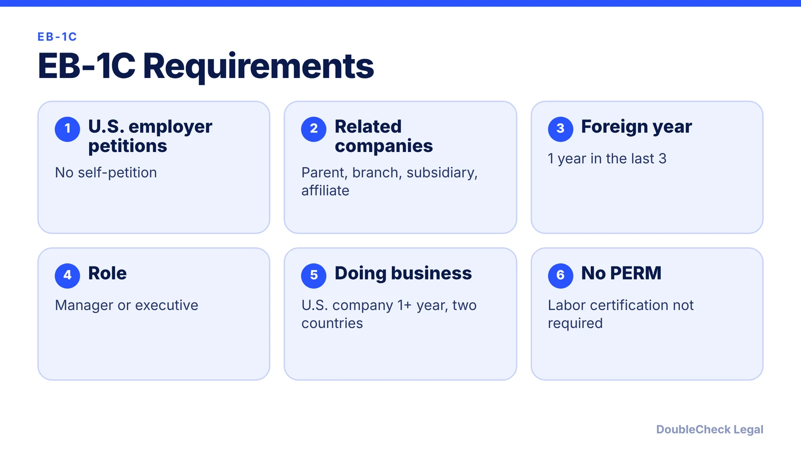
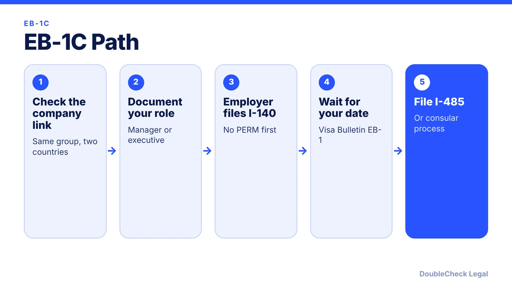

*A first-preference green card for managers and executives transferring within a multinational group, without a PERM labor certification.*

**Key takeaways:**

- The U.S. employer files; there is no self-petition.
- You need one year of qualifying work abroad in the prior three years.
- Per the USCIS Policy Manual, labor certification is not required.
- Country backlogs still apply: India and China EB-1 dates lag.

## 1. The quick answer

**Quick answer:** EB-1C is a first-preference green card for multinational managers and executives. The U.S. employer files the petition, you generally must have worked abroad for a related company for at least one year in the three years before filing, and, per the [USCIS Policy Manual](https://www.uscis.gov/policy-manual/volume-6-part-f-chapter-4), no labor certification (PERM) is required. You cannot self-petition.

## 2. What you must prove

Per the [USCIS Policy Manual](https://www.uscis.gov/policy-manual/volume-6-part-f-chapter-4), the petition rests on these requirements:

- **Foreign employment.** At least one year in the three years before filing, working abroad for a qualifying related organization. The year need not be continuous.
- **Qualifying relationship.** The U.S. employer and the foreign employer must be the same employer, or related as parent and subsidiary or as affiliates. The U.S. employer must have been doing business for at least one year before filing.
- **A managerial or executive role in the U.S.** The petitioner must show a permanent job offer in a primarily managerial or executive role, and the ability to pay the salary.
- **A qualifying petitioner.** A U.S. citizen or U.S. legal entity files Form I-140; a foreign branch cannot petition, and a sole proprietorship cannot petition for its owner.

The statute (INA 101(a)(44)) defines a manager as someone who manages the organization, a department, subdivision, or function, and either supervises professional or managerial staff or manages an essential function; an executive directs the management, sets goals and policies, and has wide latitude in decision-making. First-line supervisors are generally excluded unless they supervise professionals. Per the Policy Manual, titles alone are not enough, and the petitioner must describe the duties and time allocation in detail.

## 3. EB-1C and the L-1A link

Many founders and transferees reach EB-1C after working in L-1A status in the U.S. The roles are similar: a manager or executive moving between related companies. The L-1A is a visa with a seven-year limit; EB-1C is a permanent residence category. See the [L-1A visa for foreign founders opening a U.S. office](/blog/l-1a-visa-new-office-foreign-founders/) for the visa side.

Two cautions:

- The one-year foreign employment test and the one-year U.S. doing-business test are separate. A brand-new U.S. subsidiary may qualify for an L-1A new office but not yet meet the EB-1C doing-business test.
- An L-1A approval is a separate decision. Per the [USCIS Policy Manual](https://www.uscis.gov/policy-manual/volume-6-part-f-chapter-4), a prior L-1A approval is relevant but not binding, and each petition is judged on its own record.

Per [USCIS](https://www.uscis.gov/forms/all-forms/how-do-i-request-premium-processing), premium processing for Form I-140 E13 multinational executive and manager petitions runs on a 45-calendar-day clock. Check the [Form I-907 page](https://www.uscis.gov/i-907) for the current fee before filing.

## 4. After the I-140: the Visa Bulletin wait

Skipping PERM removes a step that [DOL's processing-times page](https://flag.dol.gov/processingtimes) shows averaging about 300 to 360 calendar days for analyst review, depending on the measurement window, as of Oct. 31, 2026. But EB-1C is still subject to the Visa Bulletin. In the November 2026 bulletin, EB-1 Final Action Dates were current for most countries, Aug. 1, 2023 for China, and Feb. 1, 2023 for India, per the [State Department bulletin](https://travel.state.gov/content/travel/en/legal/visa-law0/visa-bulletin/2027/visa-bulletin-for-november-2026.html) as summarized by [UT Southwestern](https://www.utsouthwestern.edu/about-us/administrative-offices/international-affairs/immigration-updates/november-2026-visa-bulletin.html). So a manager born in India or China may wait even though PERM is skipped. Read the [Visa Bulletin explainer](/blog/visa-bulletin-explained-priority-dates-eb-categories/).

Once your priority date is current under the chart USCIS designates, you file Form I-485 ([guide](/blog/i-485-adjustment-of-status-guide/)). If you are comparing routes, an executive founder might also look at [EB-1A](/blog/eb-1a-vs-o-1-founder-which-path/); and see the [PERM process](/blog/perm-labor-certification-green-card-process/) for what EB-1C avoids.

## Where DoubleCheck fits

[DoubleCheck](https://www.contactdoublecheck.com) helps businesses and founders start legal work with AI, verify it, and, when professional advice is warranted, connect with an independent attorney, including for immigration questions. Attorney availability and practice areas vary. Attorneys on DoubleCheck are independent professionals; an attorney-client relationship forms only if an attorney accepts your engagement.

**Sources:** [USCIS Policy Manual, Vol. 6 Part F Ch. 4, Multinational Executive or Manager](https://www.uscis.gov/policy-manual/volume-6-part-f-chapter-4); [USCIS, Employment-Based Immigration: First Preference EB-1](https://www.uscis.gov/working-in-the-united-states/permanent-workers/employment-based-immigration-first-preference-eb-1); [USCIS, How Do I Request Premium Processing?](https://www.uscis.gov/forms/all-forms/how-do-i-request-premium-processing); [DOL, Foreign Labor Certification processing times](https://flag.dol.gov/processingtimes); [UT Southwestern, November 2026 Visa Bulletin](https://www.utsouthwestern.edu/about-us/administrative-offices/international-affairs/immigration-updates/november-2026-visa-bulletin.html); [State Department, Visa Bulletin for November 2026](https://travel.state.gov/content/travel/en/legal/visa-law0/visa-bulletin/2027/visa-bulletin-for-november-2026.html). Confirm requirements at uscis.gov.

## FAQ

**Does EB-1C require PERM?**

No. The USCIS Policy Manual states that no labor certification is required for this category.

**How much foreign experience do I need?**

At least one year in the three years before filing, working abroad for a qualifying related organization, per the USCIS Policy Manual. The year need not be continuous.

**Can I self-petition for EB-1C?**

No. A U.S. employer must file the I-140, and a sole proprietorship cannot petition for its owner, per the USCIS Policy Manual.

**Is an L-1A the same as EB-1C?**

No. The L-1A is a temporary visa and EB-1C is a green card category. Many EB-1C petitioners come from L-1A status, but USCIS may look at the managerial or executive role again.

---

*General information only. This article is not legal, tax, investment, or accounting advice.*
