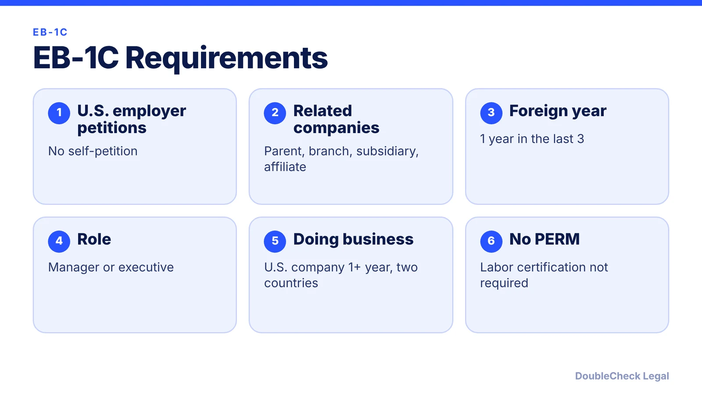
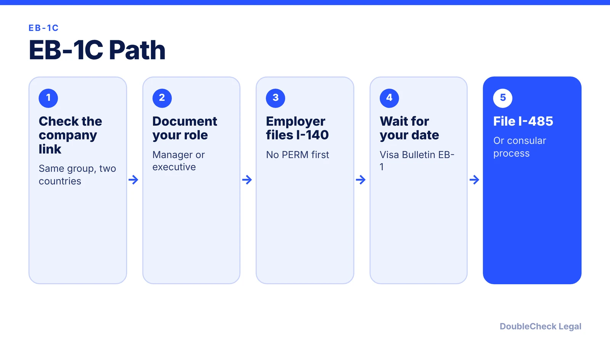

*A first-preference green card for managers and executives transferring within a multinational group, without a PERM labor certification.*

**Key takeaways:**

- The U.S. employer files; there is no self-petition.
- You need one year of qualifying work abroad in the prior three years.
- Per WeGreened, labor certification is not required.
- Country backlogs still apply: India and China EB-1 dates lag.

## 1. The quick answer

**Quick answer:** EB-1C is a first-preference green card for multinational managers and executives. The U.S. employer files the petition, you generally must have worked abroad for a related company for at least one year in the three years before filing, and, per WeGreened, no labor certification (PERM) is required. You cannot self-petition.

## 2. What you must prove

Per WeGreened, the petition rests on four things:

- **Foreign employment.** At least one year in the three years before filing, working for a firm or related entity (affiliate, parent, subsidiary, or branch) of the U.S employer. The time can be aggregated within the window.
- **Qualifying relationship.** The U.S. employer must be the same employer as the overseas one or a subsidiary or affiliate. It must do business in two or more countries, including the U.S., and have been doing business in the U.S. for at least one year before filing. A U.S. company acquired by a foreign corporation may file right away.
- **A managerial or executive role in the U.S.** You must be coming to keep serving the same employer in that capacity.
- **A letter from an authorized official** covering your overseas employment, the company relationship, and how long the U.S. company has done business.

A manager manages a corporation, department, subdivision, or function, and either supervises professional or managerial staff or manages an essential function. An executive sets goals and policies, has wide latitude, and receives only general supervision. First-line supervisors are generally excluded unless they supervise professionals. Business owners can qualify, but USCIS scrutinizes these petitions closely.

## 3. EB-1C and the L-1A link

Many founders and transferees reach EB-1C after working in L-1A status in the U.S. The roles are similar: a manager or executive moving between related companies. The L-1A is a visa with a seven-year limit; EB-1C is a permanent residence category. See the [L-1A visa for foreign founders opening a U.S. office](/blog/l-1a-visa-new-office-foreign-founders/) for the visa side.

Two cautions:

- The one-year foreign employment test and the one-year U.S. doing-business test are separate. A brand-new U.S. subsidiary may qualify for an L-1A new office but not yet meet the EB-1C doing-business test.
- An L-1A approval is a separate decision. For EB-1C, WeGreened notes USCIS may request more evidence to assess managerial or executive capacity.

Premium processing for EB-1 Multinational Executive or Manager I-140s runs on a 45-business-day clock, per Immi-USA, who list the fee at $2,965 as of 2026. Confirm both against USCIS before filing.

## 4. After the I-140: the Visa Bulletin wait

Skipping PERM removes a step that DOL data put at an average of 336 days in September 2026 (per Manifest Law), but EB-1C is still subject to the Visa Bulletin. In the November 2026 bulletin, EB-1 Final Action Dates were current for most countries, Aug. 1, 2023 for China, and Feb. 1, 2023 for India, per Cilaw Group. So a manager born in India or China may wait even though PERM is skipped. Read the [Visa Bulletin explainer](/blog/visa-bulletin-explained-priority-dates-eb-categories/).

Once your priority date is current under the chart USCIS designates, you file Form I-485 ([guide](/blog/i-485-adjustment-of-status-guide/)). If you are comparing routes, an executive founder might also look at [EB-1A](/blog/eb-1a-vs-o-1-founder-which-path/); and see the [PERM process](/blog/perm-labor-certification-green-card-process/) for what EB-1C avoids.

## Where DoubleCheck fits

[DoubleCheck](https://www.contactdoublecheck.com) helps businesses and founders start legal work with AI, verify it, and, when professional advice is warranted, connect with an independent attorney, including for immigration questions. Attorney availability and practice areas vary. Attorneys on DoubleCheck are independent professionals; an attorney-client relationship forms only if an attorney accepts your engagement.

**Sources:** [WeGreened, EB-1C overview](https://www.wegreened.com/EB1C-Multinational-Executives-or-Managers); [Immi-USA, premium processing](https://www.immi-usa.com/premium-processing/); [Cilaw Group, November 2026 bulletin](https://cilawgroup.com/?p=16977); [Manifest Law, PERM times](https://manifestlaw.com/blog/perm-dol-processing-times). USCIS pages could not be loaded; confirm requirements at uscis.gov.

## FAQ

**Does EB-1C require PERM?**

No. WeGreened states that labor certification is not required for this category.

**How much foreign experience do I need?**

At least one year in the three years before filing, working for a firm or related entity of the U.S. employer, per WeGreened. Time can be aggregated within the window.

**Can I self-petition for EB-1C?**

No. The U.S. employer must file, per WeGreened.

**Is an L-1A the same as EB-1C?**

No. The L-1A is a temporary visa and EB-1C is a green card category. Many EB-1C petitioners come from L-1A status, but USCIS may look at the managerial or executive role again.

---

*General information only. This article is not legal, tax, investment, or accounting advice.*
