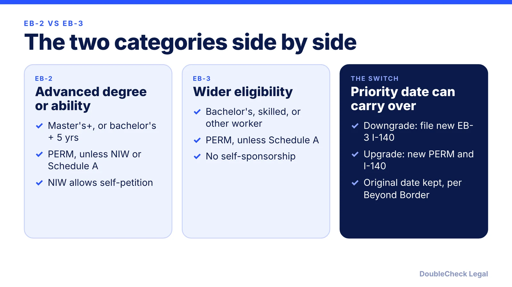
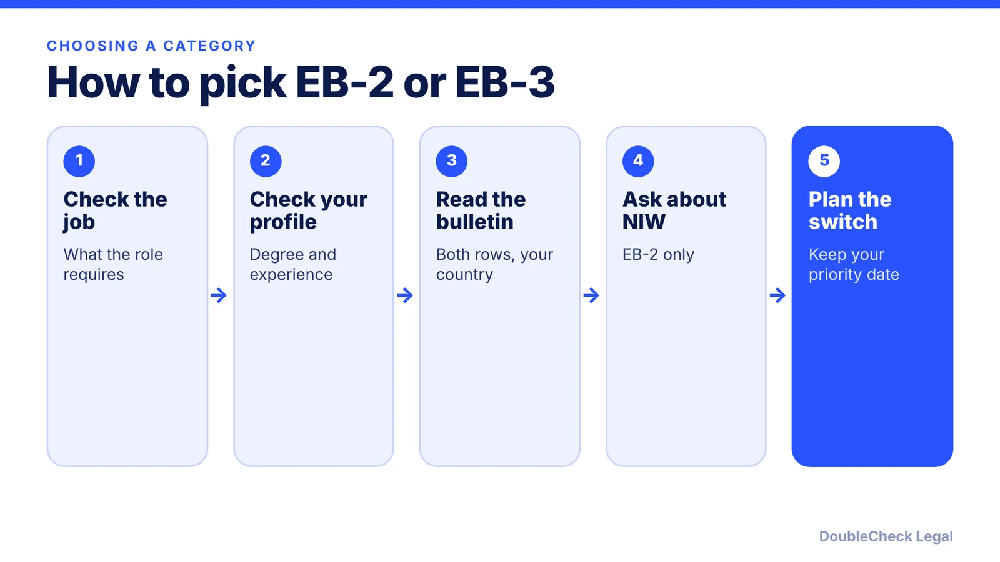

*Same employer, same PERM step, different degree rules and different queues.*

**Key takeaways:**

- EB-2 needs an advanced degree or exceptional ability; EB-3 covers bachelor's-level, skilled, and other workers.
- Only EB-2 offers an NIW self-petition (per Manifest).
- In the November 2026 bulletin, EB-3 dates for China and India are later than EB-2 (per Wolfsdorf).
- You can often switch categories and keep your priority date (per Beyond Border).

## 1. The quick answer

**Quick answer:** EB-2 is for professionals with an advanced degree (or a bachelor's plus five years of progressive experience) or exceptional ability; EB-3 is the broader category for professionals with a bachelor's degree, skilled workers with at least two years of experience, and other workers. Both usually require an employer sponsor and PERM labor certification, but only EB-2 offers the National Interest Waiver (NIW) self-petition. Which one moves faster depends on your country and the month, so compare both rows of the Visa Bulletin.

## 2. Eligibility and the PERM step

Per [Beyond Border](https://www.beyondborderglobal.com/resources/eb-2-vs-eb-3) (updated July 2026), EB-2 requires a master's degree or higher, a bachelor's plus five years of progressive post-bachelor's experience, or exceptional ability. EB-3 covers professionals with a bachelor's degree and skilled workers with at least two years of experience or training; "other workers" with less than two years sit in a separate EB-3 sub-row.

[Manifest](https://manifestlaw.com/blog/eb2-vs-eb3) (updated August 2026) adds that EB-2 generally requires PERM except under an NIW or Schedule A designation, and EB-3 requires it except under Schedule A.  See [the PERM process](/blog/perm-labor-certification-green-card-process/) and, for the self-petition route, [NIW for founders](/blog/niw-eb-2-national-interest-waiver-founders/).

## 3. Which is faster? Read the bulletin, not the folklore

For most countries EB-2 is generally faster, and for India and China both categories face long backlogs, per Beyond Border. But the order can flip. As of the November 2026 Visa Bulletin, per [Wolfsdorf](https://wolfsdorf.com/november-2026-visa-bulletin-selected-employment-categories-make-gains-family-categories-advance/), the Final Action Dates are:

| Chargeability | EB-2 | EB-3 (skilled/professionals) |
|---|---|---|
| Rest of world | April 1, 2025 | June 15, 2024 |
| China | October 1, 2021 | January 22, 2022 |
| India | November 1, 2013 | January 22, 2014 |

For China and India, the EB-3 date is later (better) than EB-2 right now, which is the situation where a downgrade can help. Dates change monthly, so verify on the State Department bulletin and see [how the Visa Bulletin works](/blog/visa-bulletin-explained-priority-dates-eb-categories/). Also check each month which chart (Final Action or Dates for Filing) USCIS designates for adjustment filings.

## 4. Switching categories and the trade-offs

Per Beyond Border, if EB-3 dates move ahead of EB-2 for your country you can file a new EB-3 I-140 and keep the original EB-2 priority date ("interfiling" is the term it uses), and going the other way you file a new PERM and I-140 for EB-2 and your EB-3 date carries over. Beyond Border also reports that EB-2 prevailing wages are typically 10-30% higher than EB-3, which affects the employer's cost, and that filing costs in both are similar.

After the I-140, the next stage is [Form I-485](/blog/i-485-adjustment-of-status-guide/); keep your job-change options in mind via [I-140 portability](/blog/i-140-portability-ac21-changing-jobs/).

## Where DoubleCheck fits

[DoubleCheck](https://www.contactdoublecheck.com) helps businesses and founders start legal work with AI, verify it, and, when professional advice is warranted, connect with an independent attorney, including for immigration questions. Attorney availability and practice areas vary. Attorneys on DoubleCheck are independent professionals; an attorney-client relationship forms only if an attorney accepts your engagement.

**Sources:** [Beyond Border, EB-2 vs EB-3, updated July 1, 2026](https://www.beyondborderglobal.com/resources/eb-2-vs-eb-3); [Manifest Law, EB-2 vs EB-3](https://manifestlaw.com/blog/eb2-vs-eb3); [Wolfsdorf, November 2026 Visa Bulletin](https://wolfsdorf.com/november-2026-visa-bulletin-selected-employment-categories-make-gains-family-categories-advance/).

## FAQ

**Can I file for both EB-2 and EB-3 at once?**

Beyond Border describes filing a new I-140 in the other category while keeping the original priority date. Whether and how to do this depends on your job and case, so ask an immigration attorney.

**Is EB-2 always faster than EB-3?**

No. Beyond Border says EB-2 is generally faster for most countries, but in the November 2026 bulletin, per Wolfsdorf, the China and India EB-3 Final Action Dates are later than their EB-2 dates.

**Do I need PERM for EB-2?**

Generally yes, except under an NIW or Schedule A designation, per Manifest. EB-3 requires it except under Schedule A.

**Does EB-2 cost the employer more?**

Beyond Border reports that EB-2 prevailing wages are typically 10-30% higher than EB-3, while direct filing costs are similar.

---

*General information only. This article is not legal, tax, investment, or accounting advice.*
