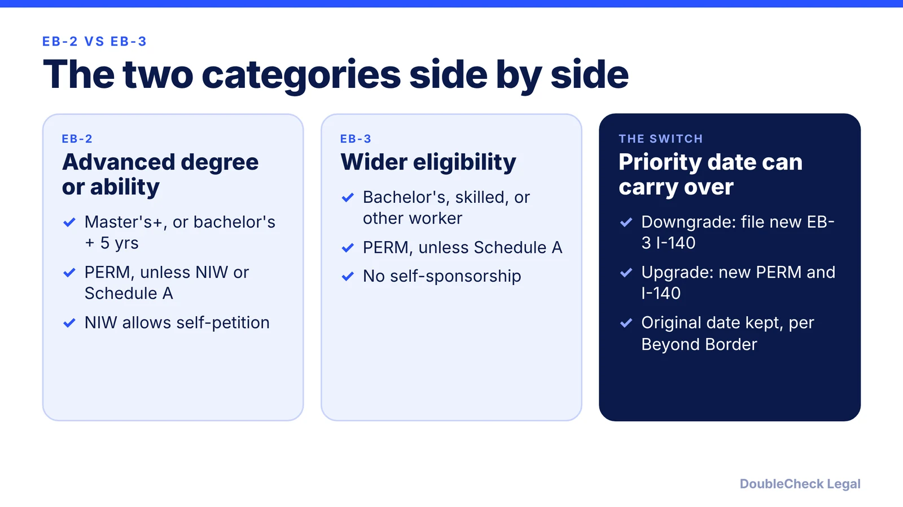
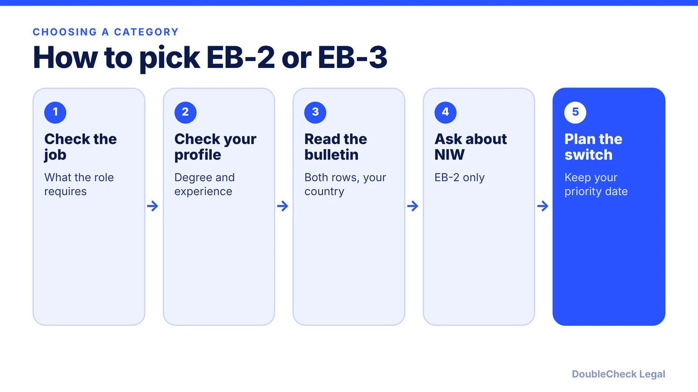

*Same employer, same PERM step, different degree rules and different queues.*

**Key takeaways:**

- EB-2 needs an advanced degree or exceptional ability; EB-3 covers bachelor's-level, skilled, and other workers.
- Only EB-2 offers an NIW self-petition (per USCIS).
- In the November 2026 bulletin, EB-3 dates for China and India are later than EB-2 (per the State Department).
- You can often switch categories and keep your priority date; ask an attorney how it works in your case.

## 1. The quick answer

**Quick answer:** EB-2 is for professionals with an advanced degree (or a bachelor's plus five years of progressive experience) or exceptional ability; EB-3 is the broader category for professionals with a bachelor's degree, skilled workers with at least two years of experience, and other workers. Both usually require an employer sponsor and PERM labor certification, but only EB-2 offers the National Interest Waiver (NIW) self-petition. Which one moves faster depends on your country and the month, so compare both rows of the Visa Bulletin.

## 2. Eligibility and the PERM step

Per [USCIS](https://uscis.gov/working-in-the-united-states/permanent-workers/employment-based-immigration-second-preference-eb-2), EB-2 generally requires a master's degree or higher, a bachelor's plus five years of progressive post-bachelor's experience, or exceptional ability. EB-3 covers professionals with a bachelor's degree and skilled workers with at least two years of experience or training; "other workers" with less than two years sit in a separate EB-3 sub-row (see [USCIS, permanent workers](https://uscis.gov/working-united-states/permanent-workers)).

Both categories generally require PERM labor certification, with exceptions such as an NIW or Schedule A designation for EB-2 and Schedule A for EB-3 (USCIS). See [the PERM process](/blog/perm-labor-certification-green-card-process/) and, for the self-petition route, [NIW for founders](/blog/niw-eb-2-national-interest-waiver-founders/).

## 3. Which is faster? Read the bulletin, not the folklore

For most countries EB-2 is often faster, and for India and China both categories face long backlogs. But the order can flip. As of the [November 2026 Visa Bulletin](https://travel.state.gov/content/travel/en/legal/visa-law0/visa-bulletin/2027/visa-bulletin-for-november-2026.html), the Final Action Dates are:

| Chargeability | EB-2 | EB-3 (skilled/professionals) |
|---|---|---|
| Rest of world | April 1, 2025 | June 15, 2024 |
| China | October 1, 2021 | January 22, 2022 |
| India | November 1, 2013 | January 22, 2014 |

For China and India, the EB-3 date is later (better) than EB-2 right now, which is the situation where a downgrade can help. Dates change monthly, so verify on the State Department bulletin and see [how the Visa Bulletin works](/blog/visa-bulletin-explained-priority-dates-eb-categories/). Also check each month which chart (Final Action or Dates for Filing) USCIS designates for adjustment filings.

## 4. Switching categories and the trade-offs

If EB-3 dates move ahead of EB-2 for your country, it is often possible to file a new EB-3 I-140 and keep the original EB-2 priority date, and going the other way generally means a new PERM and I-140 for EB-2 with your earlier priority date carried over. The rules depend on the facts, including whether the earlier petition was approved, so ask an attorney. A higher-level role can also carry a higher prevailing wage, which affects the employer's cost.

After the I-140, the next stage is [Form I-485](/blog/i-485-adjustment-of-status-guide/); keep your job-change options in mind via [I-140 portability](/blog/i-140-portability-ac21-changing-jobs/).

## Where DoubleCheck fits

[DoubleCheck](https://www.contactdoublecheck.com) helps businesses and founders start legal work with AI, verify it, and, when professional advice is warranted, connect with an independent attorney, including for immigration questions. Attorney availability and practice areas vary. Attorneys on DoubleCheck are independent professionals; an attorney-client relationship forms only if an attorney accepts your engagement.

**Sources:** [USCIS, EB-2](https://uscis.gov/working-in-the-united-states/permanent-workers/employment-based-immigration-second-preference-eb-2); [USCIS, permanent workers](https://uscis.gov/working-united-states/permanent-workers); [U.S. Department of State, Visa Bulletin for November 2026](https://travel.state.gov/content/travel/en/legal/visa-law0/visa-bulletin/2027/visa-bulletin-for-november-2026.html).

## FAQ

**Can I file for both EB-2 and EB-3 at once?**

In many cases you can file a new I-140 in the other category and keep the original priority date. Whether and how to do this depends on your job and case, so ask an immigration attorney.

**Is EB-2 always faster than EB-3?**

No. EB-2 is often faster for most countries, but in the November 2026 bulletin, per the State Department, the China and India EB-3 Final Action Dates are later than their EB-2 dates.

**Do I need PERM for EB-2?**

Generally yes, except under an NIW or Schedule A designation. EB-3 requires it except under Schedule A.

**Does EB-2 cost the employer more?**

Costs depend on the job and the case. A higher-level role can mean a higher prevailing wage, so ask your employer's counsel what applies.

---

*General information only. This article is not legal, tax, investment, or accounting advice.*
