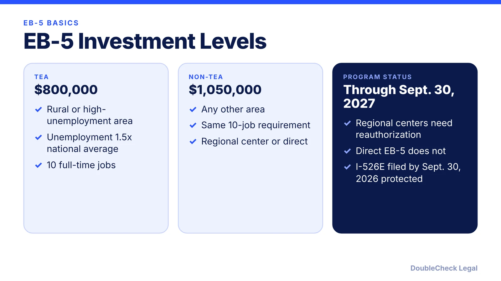
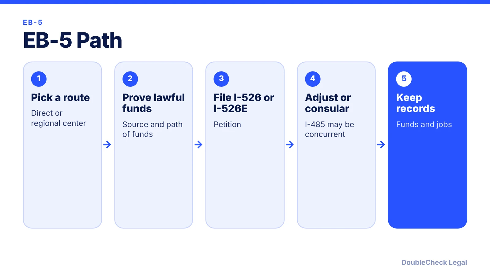

*What the EB-5 immigrant investor program requires as of November 2026, and where regional center authorization stands.*

**Key takeaways:**

- TEA minimum: $800,000. Non-TEA: $1,050,000.
- The business must create 10 full-time jobs.
- Regional center authorization runs through September 30, 2027.
- Petitions filed by September 30, 2026 are protected if the program later lapses.

## 1. The quick answer

**Quick answer:** As of November 2026, the EB-5 minimum investment is $800,000 in a targeted employment area (TEA) and $1,050,000 elsewhere, and the business must create 10 full-time jobs, per Legal Services Incorporated. The Regional Center Program is authorized through September 30, 2027, under the 2022 reform law. Direct EB-5 does not need reauthorization.

## 2. Requirements in plain English

- **Minimum investment.** $800,000 in a TEA or $1,050,000 outside one. A TEA is a rural area or an area where unemployment is at least 1.5 times the national average, per Legal Services Incorporated. The government determines what counts as a TEA, and the 2022 law made qualification harder.
- **Jobs.** The business must create 10 full-time jobs for qualifying workers.
- **Two routes.** Direct investment in your own new commercial enterprise, or investment through a regional center. For direct investment only one EB-5 petition may be filed per entity.
- **Set-asides.** Under the 2022 law, 20% of EB-5 visas are reserved for rural areas, 10% for high-unemployment areas, and 2% for infrastructure, per Brownstein.
- **Integrity rules.** USCIS must audit each regional center at least every five years, regional centers file annual statements, source-of-funds requirements apply, and U.S. securities law covers EB-5 offerings. People with certain recent convictions or large civil fraud liability cannot take part (Brownstein).

Founders sometimes ask about EB-5 as an alternative to visas that need an employer. Compare it with the [visa options for startup founders](/blog/us-visa-options-for-startup-founders-compared/).

## 3. Status in 2026 and the September 30 dates

Two dates matter, and they are easy to mix up.

- **September 30, 2027.** The regional center authorization currently runs through this date (Legal Services Incorporated; Fredrikson). The program lapsed once before, in June 2021, and USCIS stopped adjudicating regional center filings during the lapse.
- **September 30, 2026.** This is a filing cutoff for protection, not a sunset. Petitions filed on or before that date must continue to be processed even if the program is not reauthorized after 2027 (Brownstein). That date has passed as of today.

Concurrent filing is now allowed: an I-485 may be filed together with the I-526, which can allow work and travel authorization while pending, and Section 245(k) relief extends to EB-5 applicants with up to six months of overstay or unauthorized work.

One more point to check: 3G Fund, a regional center operator, says the minimum amounts adjust for inflation on January 1, 2027, with DHS to announce the figures, and projects roughly $900,000 to $937,500 for TEA. Treat that as a marketing projection, not an official number, and confirm with USCIS or an attorney.

## 4. Before you invest

EB-5 involves real securities risk as well as immigration risk. Brownstein notes that new source-of-funds requirements apply, and the business must meet the 10-job requirement. Read the offering documents as you would any [term sheet](/blog/term-sheet-key-terms-explained/) or investment contract, and do not rely on a promoter's summary.

For how monthly cutoff dates work generally, see the [Visa Bulletin explainer](/blog/visa-bulletin-explained-priority-dates-eb-categories/). If you are mostly looking for a way to work in the U.S. for your own company, the [E-2 treaty investor visa](/blog/e-2-treaty-investor-visa-for-founders/) has no fixed dollar amount, though it is not a green card.

Ask whether the project's TEA designation is current, what happens to your petition if the regional center changes, and who holds your funds before approval.

## Where DoubleCheck fits

[DoubleCheck](https://www.contactdoublecheck.com) helps businesses and founders start legal work with AI, verify it, and, when professional advice is warranted, connect with an independent attorney, including for immigration questions. Attorney availability and practice areas vary. Attorneys on DoubleCheck are independent professionals; an attorney-client relationship forms only if an attorney accepts your engagement.

**Sources:** [Legal Services Incorporated](https://legalservicesincorporated.com/immigration-law/investor-visas/eb5-visa/eb-5-regional-center-program-shutdown-update/); [Brownstein, March 2022 alert](https://www.bhfs.com/insight/eb-5-immigrant-investor-program-returns/); [Fredrikson alert](https://fredlaw.com/alert-omnibus-spending-bill-signed-eb-5-regional-center-program-reauthorized); [3G Fund](https://3gfund.com/eb-5-visa-information/eb-5-visa-update-2026-2027/). USCIS's EB-5 page could not be loaded; confirm at uscis.gov.

## FAQ

**How much is the EB-5 minimum investment?**

$800,000 in a targeted employment area and $1,050,000 elsewhere, per Legal Services Incorporated and Brownstein, who cite the 2022 reform law.

**How many jobs must EB-5 create?**

10 full-time jobs, per Legal Services Incorporated.

**Is the EB-5 regional center program still authorized?**

Yes. Legal Services Incorporated and Fredrikson say it is authorized through September 30, 2027. Direct EB-5 has indefinite authorization.

**Will the minimum investment rise in 2027?**

One regional center operator, 3G Fund, says an inflation adjustment applies on January 1, 2027, with figures to be announced by DHS. Treat projected amounts as unofficial until DHS publishes them.

---

*General information only. This article is not legal, tax, investment, or accounting advice.*
