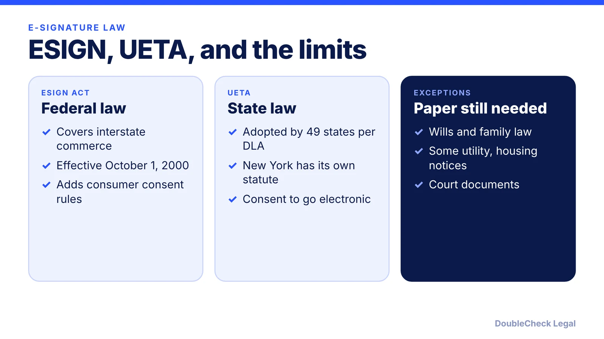
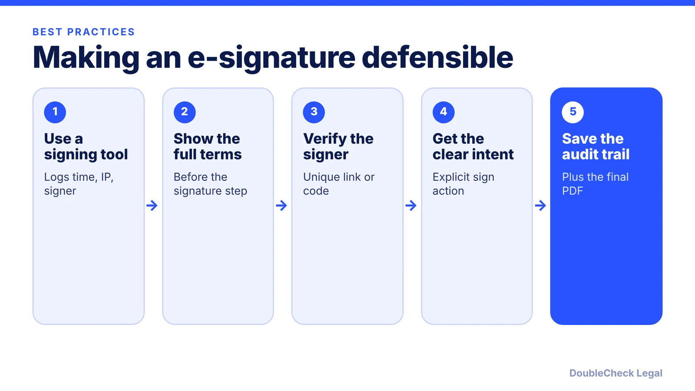

*E-signatures count, with exceptions. Here is what ESIGN and UETA cover, what they exclude, and how to keep a signed contract defensible.*

**Key takeaways:**

- ESIGN (effective October 1, 2000) and UETA give electronic signatures and records the same footing as paper.
- UETA is adopted by 49 states per DLA Piper; New York has its own statute.
- Exceptions include wills, family law, court documents, and certain utility, housing, and insurance notices.
- Keep proof of intent and identity: assent, authentication, and an audit trail.

## 1. The quick answer

**Quick answer:** Yes, electronic signatures are generally legally valid for business contracts in the United States. The federal ESIGN Act, effective October 1, 2000 per FindLaw, and the state Uniform Electronic Transactions Act (UETA), adopted by 49 states per DLA Piper (New York relies on its own statute), give electronic signatures and records the same footing as paper. A short list of documents is excluded, including wills, certain family-law matters, and some notices. Valid also means provable: you need intent to sign and a record showing who signed.

## 2. What ESIGN and UETA actually say

Per [Troutman Pepper](https://www.troutman.com/insights/e-sign-works-how-the-legal-system-got-electronic-contracting-laws-right/), both laws give electronic signatures, records, and contracts the same legal footing as paper. Under UETA they "may not be denied legal effect because they are in an electronic form."

An electronic signature, per [FindLaw](https://corporate.findlaw.com/law-library/the-new-electronic-signatures-in-global-and-national-commerce.html), is an electronic sound, symbol, or process attached to or associated with a record and adopted with intent to sign. That can be a typed name, a click-to-sign, or a drawn signature in a signing tool.

How the two fit together, per Troutman:

- **UETA** is a model state law. It requires that the parties agree to conduct the transaction electronically, which courts often infer when a party purposely used an online portal or signing tool.
- **ESIGN** governs interstate and foreign commerce and can preempt state e-signature laws that deviate from the model UETA.
- **ESIGN consumer rules** add disclosure and consent requirements, mainly when an electronic record is used to satisfy a legal requirement that information be given to a consumer in writing.

Per [DLA Piper](https://www.dlapiper.com/insights/publications/2021/07/with-illinoiss-adoption-of-ueta-united-states-near-full-adoption), Illinois became the 49th state to adopt UETA in June 2021; New York is the only state that has not, and has its own Electronic Signatures and Records Act.

## 3. What e-signatures cannot be used for

Under [15 U.S.C. 7003](https://www.govinfo.gov/link/uscode/15/7003), ESIGN's validity rule does not apply to a contract or record to the extent it is governed by:

- laws on wills, codicils, and testamentary trusts
- state laws on adoption, divorce, or other family law matters
- the Uniform Commercial Code, other than sections 1-107 and 1-206 and Articles 2 and 2A (so sales of goods and leases are covered by ESIGN)

It also does not apply to court orders and official court documents, to notices of cancellation or termination of utility services, to certain default, foreclosure, repossession, or eviction notices tied to a primary residence, to cancellation of health or life insurance benefits, to product recall or safety notices, and to documents accompanying the transport of hazardous materials.

For ordinary business agreements such as service contracts, NDAs, and vendor terms, none of these usually applies. Still, some state laws add their own rules for particular documents such as real estate or remote notarization, which vary by state. Ask an attorney before relying on a click-to-sign for anything on the exceptions list.

## 4. Making an e-signature hold up

A valid-in-principle signature can still be challenged. Per Troutman, courts generally look for assent to the terms, not just an acknowledgment, and for authentication that ties the signature to the alleged signer, often through unique logins or codes sent by email or text.

Our own practical suggestions: keep the signed PDF and the audit trail together, and make sure the person signing has authority for the company. For which terms to read first, see [contract red flags](/blog/contract-red-flags-small-business/) and [what makes a contract legally binding](/blog/what-makes-a-contract-legally-binding/). For freelance and customer agreements, see [how to write a freelance contract](/blog/how-to-write-a-freelance-contract/) and [reviewing customer contract redlines](/blog/review-customer-contract-redlines/).

## Where DoubleCheck fits

[DoubleCheck](https://www.contactdoublecheck.com) helps businesses and founders start legal work with AI, verify it, and, when professional advice is warranted, connect with an independent attorney, including for immigration questions. Attorney availability and practice areas vary. Attorneys on DoubleCheck are independent professionals; an attorney-client relationship forms only if an attorney accepts your engagement.

**Sources:** [15 U.S.C. 7003 via GovInfo](https://www.govinfo.gov/link/uscode/15/7003); [Troutman Pepper, E-SIGN Works](https://www.troutman.com/insights/e-sign-works-how-the-legal-system-got-electronic-contracting-laws-right/); [DLA Piper, Illinois adoption of UETA](https://www.dlapiper.com/insights/publications/2021/07/with-illinoiss-adoption-of-ueta-united-states-near-full-adoption); [FindLaw, The New E-SIGN Act](https://corporate.findlaw.com/law-library/the-new-electronic-signatures-in-global-and-national-commerce.html).

## FAQ

**Are electronic signatures legally binding?**

Generally yes. Per Troutman Pepper, ESIGN and UETA give electronic signatures, records, and contracts the same legal footing as paper, with statutory exceptions. A court may still ask whether the signer assented and can be identified.

**Does a typed name count as a signature?**

It can. Per FindLaw, an electronic signature is an electronic sound, symbol, or process attached to or associated with a record and adopted with intent to sign. Intent to sign and proof of who signed are the key points.

**What documents cannot be signed electronically?**

Per 15 U.S.C. 7003, ESIGN's rule does not apply to wills and testamentary trusts, family-law matters like adoption and divorce, court documents, and certain notices such as utility cancellation, default or eviction on a primary residence, health or life insurance cancellation, and product recalls.

**Is UETA adopted in every state?**

Not quite. Per DLA Piper, 49 states have adopted UETA and New York is the only state that has not; New York has its own Electronic Signatures and Records Act.

---

*General information only. This article is not legal, tax, investment, or accounting advice.*
