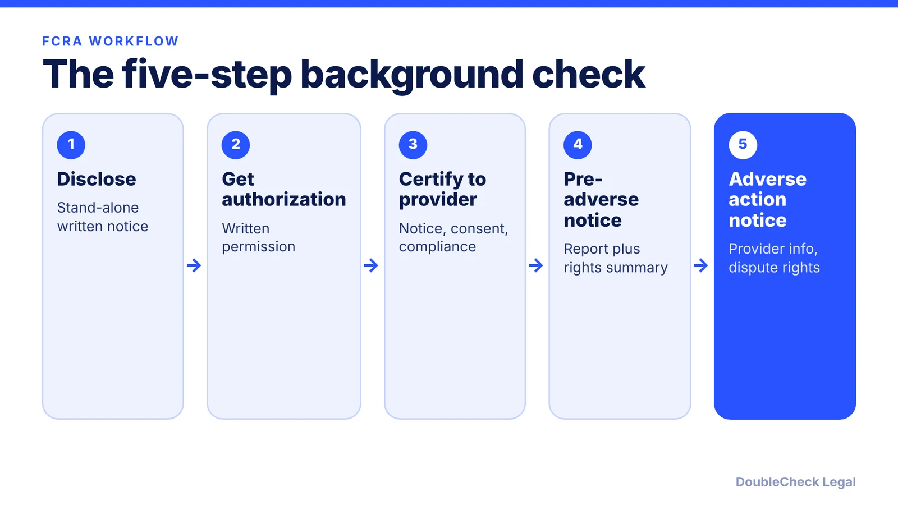
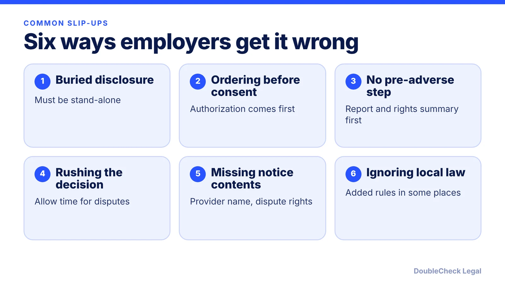

*Background reports come with a notice-and-consent routine. Skip a step and a simple hiring decision becomes a legal problem.*

**Key takeaways:**

- Disclose in writing in a stand-alone document and get written authorization before you order the report.
- Before an adverse action, send the report copy and the FCRA rights summary.
- After the action, send a notice with the provider's details and dispute rights (free report if requested within 60 days).
- State and local laws may add requirements; vendors do not remove your duties.

## 1. The quick answer

**Quick answer:** If you use a third-party background report to make a hiring or employment decision, the Fair Credit Reporting Act (FCRA) applies, and the FTC's employer guidance describes no size exemption. You must (1) give a stand-alone written disclosure, (2) get written authorization, (3) certify to the report provider, (4) send a copy of the report and the FCRA rights summary before any adverse action, and (5) send an adverse action notice afterward. State and local laws may add more.

## 2. Before you order the report

Per the [FTC's guidance for employers](https://ftc.gov/business-guidance/resources/using-consumer-reports-what-employers-need-know):

- **Written disclosure.** Tell the applicant or employee in writing that you may use a report for employment decisions. The notice must be in a stand-alone format, not part of the employment application.
- **Authorization.** Get written permission. It may be in the same document as the disclosure. If you want it to cover the whole period of employment, say so clearly and conspicuously.
- **Certification.** Certify to the company providing the report that you gave notice, got permission, complied with the FCRA, and will not discriminate or misuse the information.

[Venable's August 2026 analysis](https://www.venable.com/insights/publications/2026/08/background-check-authorizations-and-process) warns against burying the disclosure in the application and says to give it and get authorization before the check is ordered. It also notes that third-party screening vendors do not eliminate your responsibility to comply.

Investigative reports (based on personal interviews) carry extra requirements, per the FTC. For the rest of your hiring paperwork, see the [first employee legal checklist](/blog/how-to-hire-first-employee-legal-checklist/) and [employee handbook contents](/blog/employee-handbook-small-business-what-to-include/).

## 3. Pre-adverse and adverse action

If the report might lead you to reject a candidate, rescind an offer, or take another adverse action, the FTC says you must first give the person:

- a notice that includes a copy of the consumer report you relied on, and
- a copy of *A Summary of Your Rights Under the Fair Credit Reporting Act*.

This lets the person review the report and flag errors. The FTC page does not set a waiting period; Venable says employers generally must wait the required time and consider any response before deciding, and that skipping steps or moving too fast invites litigation.

If you then take the action, notify the person orally, in writing, or electronically. The notice must include:

- the name, address, and phone number of the reporting company,
- a statement that the company did not make the decision and cannot give specific reasons,
- notice of the right to dispute accuracy or completeness, and
- notice of the right to a free additional report if requested within 60 days.

## 4. State rules, records, and what to avoid

**State and local overlay.** Venable notes some jurisdictions add disclosure requirements, longer response periods, or localized forms, and others limit when and how criminal history can be considered. A national template without periodic review can create real liability. Check the rules where the person will work, especially for remote hires ([multi-state employees](/blog/multi-state-remote-employees-compliance-startups/)).

**Disposal.** The FTC says that when you finish using a report you must securely dispose of it and the information from it, for example by shredding paper or disposing of electronic data so it cannot be read or reconstructed.

**Discrimination.** The FTC page notes that if a criminal record was the reason for a rejection, the person can contact the EEOC. Apply any screening criteria consistently.

**Do not DIY the forms blindly.** Disclosure and authorization language is where many disputes start. Have an attorney review your template. For related processes, see [how to terminate an employee legally](/blog/how-to-terminate-an-employee-legally-small-business/) and the [contractor vs. employee](/blog/employee-vs-independent-contractor-classification-startups/) question, since the FCRA steps apply to employment decisions.

## Where DoubleCheck fits

[DoubleCheck](https://www.contactdoublecheck.com) helps businesses and founders start legal work with AI, verify it, and, when professional advice is warranted, connect with an independent attorney, including for immigration questions. Attorney availability and practice areas vary. Attorneys on DoubleCheck are independent professionals; an attorney-client relationship forms only if an attorney accepts your engagement.

**Sources:** [FTC, Using Consumer Reports: What Employers Need to Know](https://ftc.gov/business-guidance/resources/using-consumer-reports-what-employers-need-know); [Venable, Background Check Authorizations and Process: Small Missteps, Significant Risk (Aug. 2026)](https://www.venable.com/insights/publications/2026/08/background-check-authorizations-and-process).

## FAQ

**Does the FCRA apply to small businesses?**

The FTC's employer guidance says that when employers use consumer reports to make employment decisions they must comply with the FCRA, and it mentions no size threshold or exemption.

**Can the disclosure be part of the job application?**

No. Per the FTC, the written disclosure must be in a stand-alone format and cannot be part of the employment application. The authorization may be in the same document as the disclosure.

**What must I send before rejecting a candidate based on a report?**

Per the FTC, a notice that includes a copy of the consumer report you relied on and a copy of A Summary of Your Rights Under the Fair Credit Reporting Act, so the person can review it and flag errors.

**What must the final adverse action notice include?**

Per the FTC: the reporting company's name, address and phone number; a statement that it did not make the decision and cannot give specific reasons; the right to dispute accuracy; and the right to a free additional report if requested within 60 days.

---

*General information only. This article is not legal, tax, investment, or accounting advice.*
