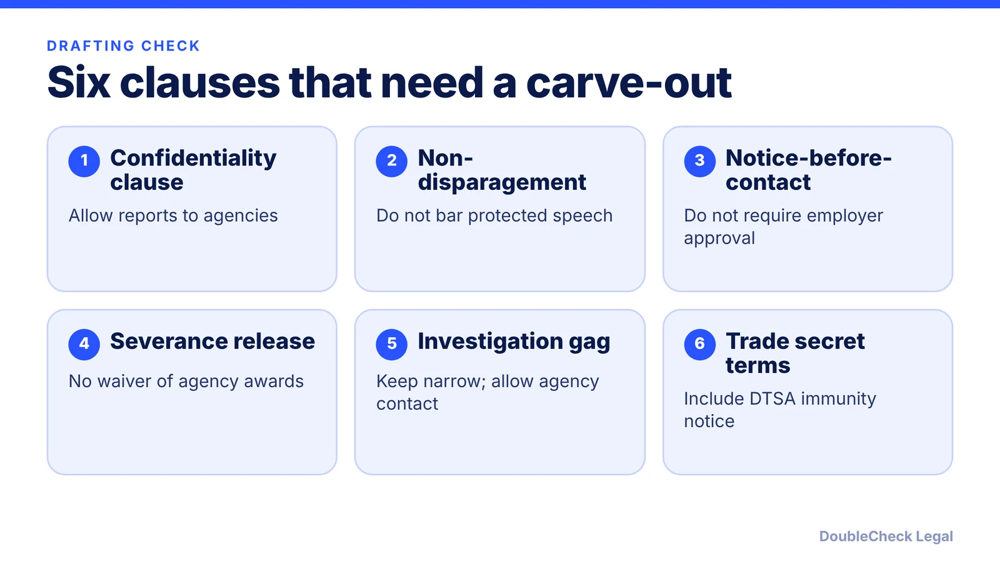
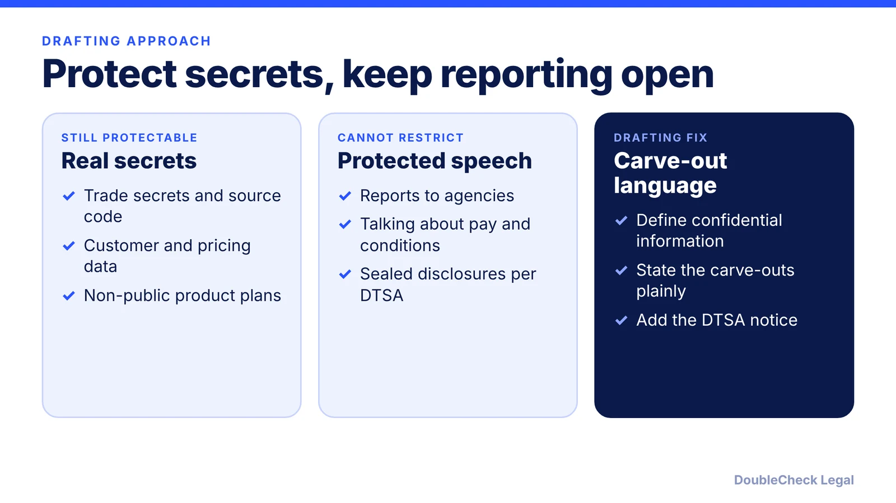

*What employers cannot restrict in confidentiality agreements when employees have whistleblower rights, as of November 2026. General information, not legal advice.*

**Key takeaways:**

- Confidentiality clauses generally cannot stop employees from reporting suspected violations of law to government agencies.
- The DTSA requires a whistleblower immunity notice in agreements covering confidential information; without it, an employer loses punitive damages and attorney fees under that law.
- The SEC fined KBR $130,000 (2015) and Brink's $400,000 (2022) over clauses that could impede reporting.
- As of an August 2026 memo, the NLRB had not yet overruled McLaren Macomb or Stericycle, so overbroad clauses still carry risk.

## 1. The quick answer

**Quick answer:** An employer can protect trade secrets and genuinely confidential business information, but it generally cannot use a confidentiality or non-disparagement clause to stop employees from reporting suspected violations of law to government agencies. Several federal rules point the same way: SEC Rule 21F-17 bars impeding communications with SEC staff, the Defend Trade Secrets Act requires a whistleblower immunity notice in agreements that cover confidential information, the Speak Out Act limits certain pre-dispute gag clauses on sexual harassment claims, and the NLRA protects talk about pay and working conditions. As of November 2026, the NLRB position on severance gag clauses is in flux. The practical fix is a clear carve-out in every agreement.

This post is the agreement-drafting companion to [how employers should respond to a workplace investigation complaint](/blog/workplace-investigation-complaint-how-employers-should-respond/). For the basics of the documents themselves, see [confidentiality and IP assignment agreements for startups](/blog/confidentiality-ip-assignment-agreements-startups/).

## 2. The federal rules that limit confidentiality clauses

No single statute says what a confidentiality clause may contain. Instead, several rules each limit what an employer can restrict. Here are the ones most relevant to a small U.S. employer, with dates.

**SEC Rule 21F-17.** Adopted in August 2011 under Dodd-Frank, it bars companies from impeding people from reporting possible securities violations to the SEC, including by enforcing or threatening to enforce confidentiality agreements, per Goodwin. The rule text (17 CFR 240.21F-17(a)) says no person may take any action to impede an individual from communicating directly with the SEC staff, and Epstein Becker Green reports the SEC has applied it to other agreement terms too, such as a non-compete in the 2022 Brink's matter. It is written for securities law, but SEC enforcement has reached private companies as well, so do not assume it never applies to you. Ask counsel.

**Defend Trade Secrets Act (DTSA), May 2016.** Per 18 U.S.C. § 1833(b), an employer must give notice of immunity in any contract or agreement with an employee that governs trade secrets or other confidential information. The immunity covers confidential disclosure of a trade secret to a government official or attorney to report or investigate a suspected violation of law, and disclosure in a sealed court filing, including a sealed filing in a retaliation lawsuit. An employer that omits the notice may not receive exemplary damages or attorney fees against an employee who was not notified, and the term "employee" includes contractors and consultants. See also [trade secret protection for small business](/blog/trade-secret-protection-small-business-startups/).

**Speak Out Act, December 7, 2022.** Per Sullivan & Cromwell, courts cannot enforce non-disclosure or non-disparagement clauses agreed to before a dispute arose, as to sexual assault and sexual harassment disputes. It does not cover agreements made after a dispute arises, such as settlements, and it does not override state laws at least as protective. It applies to claims arising on or after December 7, 2022.

**OSHA and Sarbanes-Oxley.** OSHA's whistleblower program says it will not approve settlement agreements containing gag provisions that restrict or discourage protected activity, or terms that waive the right to share information with a government agency, join investigations, testify or file complaints. It also lists waivers of the right to government whistleblower award payments among the terms it will not approve.

## 3. SEC enforcement examples: what regulators objected to

Real cases show how ordinary-looking clauses draw scrutiny, even when nobody was actually blocked.

- **KBR, April 1, 2015.** The SEC's first action of this kind involved a confidentiality statement for witnesses in internal investigations that warned of discipline for discussing interviews without Law Department approval. KBR paid $130,000, and the SEC found no apparent case where KBR actually stopped anyone from contacting the SEC, per Goodwin. KBR changed the wording to say employees can report possible violations to the SEC and other federal agencies without prior approval or fear of retaliation.
- **The Brink's Company, June 22, 2022.** Per Epstein Becker Green, Brink's agreed to pay $400,000. Its restrictive covenant agreements barred disclosing financial or business information to third parties without company approval, had no SEC carve-out, and carried $75,000 in liquidated damages plus attorney fees. The SEC said employees faced a choice between identifying themselves to the company as whistleblowers and risking those costs. Epstein Becker Green described this as the first time the SEC found that omitting an SEC carve-out from a post-employment restrictive covenant violated the rule.

The pattern is consistent. The risky terms are approval requirements, notice-before-contact provisions, penalties for disclosure, and waivers of whistleblower awards.
## 4. The NLRB question: pay talk, severance and what is unsettled in 2026

The National Labor Relations Act protects employees' right to act together about wages and working conditions, which can include non-union workplaces. Overbroad confidentiality rules can chill that activity. In a 2016 case summarized by Epstein Becker Green, an administrative law judge in Quicken Loans found phrases such as "anything with a dollar figure attached to it" and a broad ban on "confidential information" overbroad, while a narrower rule covering the employer's own financial performance, strategy and forecasts was upheld.

For severance, the Board's 2023 McLaren Macomb decision (372 NLRB No. 58) held broad confidentiality and non-disparagement clauses presumptively unlawful. Stericycle (372 NLRB No. 113) did the same for facially neutral work rules with a reasonable tendency to chill protected activity. As of an August 26, 2026 General Counsel memo, as summarized by Maynard Nexsen, the Board had not yet overruled either decision. The General Counsel was asking the Board to revisit them, and the Board had a 3-1 Republican majority. Those decisions remain Board law until changed. Practically, assume overbroad clauses still carry risk, and check current status before relying on any change. For severance in particular, see [severance agreement review before you sign](/blog/severance-agreement-review-before-you-sign/).

A separate 2026 point: the BE HEARD Act of 2026 was introduced in Congress but, per Epstein Becker Green, not enacted. It would end mandatory arbitration and pre-employment nondisclosure agreements if passed, so it is only worth watching. State law is a patchwork on its own, and some states restrict NDAs in harassment or discrimination matters, so confirm your state rules before you finalize forms.

## 5. What you can still protect, and how to draft it

None of this means employers must stay silent about everything. Legitimate confidentiality is allowed. The aim is a narrow clause with a clear carve-out.

Practical drafting steps:

1. **Define confidential information with examples.** Epstein Becker Green recommends limiting it to specific proprietary business information, such as financial performance, strategy and forecasts, rather than broad categories.
2. **Add a whistleblower and protected-activity paragraph.** It should say employees may notify authorities of suspected violations, do not need employer permission, and cannot face reprisals, and that nothing restricts discussing wages or working conditions.
3. **Include the DTSA notice** wherever the agreement governs trade secrets or confidential information.
4. **Check non-disparagement and release terms** for anything that requires pre-approval, forfeits agency awards or requires affirming no protected activity.
5. **Re-read old templates.** Per 18 U.S.C. § 1833(b), the DTSA notice requirement applies to contracts entered into or updated after May 11, 2016, so an old template or an updated agreement may need the notice.

For templates and clause comparisons, see [how to write an NDA for startups](/blog/how-to-write-an-nda-startups/), [mutual vs one-way NDAs](/blog/mutual-vs-one-way-nda-which-to-use/), and [non-compete vs non-solicit vs NDA](/blog/non-compete-vs-non-solicit-vs-nda-which-to-use-after-the-ftc-rule/). If you are the employee, [reviewing an NDA you received](/blog/review-nda-you-received/) and the [FTC noncompete guidance for employees](/blog/ftc-noncompete-ban-what-employees-should-do-now-to-check-their-own-noncompete/) help you read what you signed.

## 6. When to get an attorney to review your agreements

A standard template is often enough for a small team, but certain situations justify a lawyer reading the final forms. Those include a financing or an acquisition, a public or SEC-regulated company, a layoff with releases, a harassment or discrimination matter, and employees in multiple states, as covered in [multi-state remote employees compliance](/blog/multi-state-remote-employees-compliance-startups/).

AI can help you spot clauses that look like approval requirements, penalties or gag language and suggest carve-out wording. It can miss state-specific rules and the latest agency stance, so verify its output. See the [AI employment agreement review checklist](/blog/ai-employment-agreement-review-checklist/) and [verifying AI-generated legal documents](/blog/verify-ai-generated-legal-document/). Also look at your [employee handbook](/blog/employee-handbook-small-business-what-to-include/) for confidentiality rules that go beyond what the agreement says, since the same overbreadth problems can appear there.

## Where DoubleCheck fits

[DoubleCheck](https://www.contactdoublecheck.com) helps businesses and founders start legal work with AI, verify it, and, when professional advice is warranted, connect with an independent attorney, including for immigration questions. Attorney availability and practice areas vary. Attorneys on DoubleCheck are independent professionals; an attorney-client relationship forms only if an attorney accepts your engagement.

**Sources:** [Goodwin, SEC applies whistleblower protections to confidentiality arrangements (2015)](https://www.goodwinlaw.com/en/insights/publications/2015/04/04_15_15-sec-applies-whistleblower-protections-to-confidentiality-arrangements); [Cornell LII, 18 U.S.C. § 1833](https://www.law.cornell.edu/uscode/text/18/1833); [Cornell LII, 17 CFR 240.21F-17](https://www.law.cornell.edu/cfr/text/17/240.21F-17); [OSHA Whistleblower Protection Program, Settling a Case](https://www.whistleblowers.gov/settling-a-case); [Epstein Becker Green, SEC and Brink's (June 30, 2022)](https://www.ebglaw.com/workforce-bulletin/employers-beware-sec-renews-enforcement-initiative-against-agreements-this-time-a-non-compete-that-interfere-with-whistleblowers-unfettered-access-to-the-sec); [Epstein Becker Green, What issues might SEC and NLRB have with employee confidentiality agreements (Apr. 21, 2016)](https://natlawreview.com/article/what-issues-might-sec-andor-nlrb-have-employee-confidentiality-agreements); [Sullivan & Cromwell, Speak Out Act](https://www.sullcrom.com/new-speak-out-law-bans-pre-dispute-sexual-assault-and-harassment-non-disclosure-and-non-disparagement-agreements); [Maynard Nexsen, NLRB General Counsel roadmap (GC 26-04, Aug. 26, 2026)](https://www.maynardnexsen.com/publication-nlrb-general-counsel-issues-roadmap-for-reversing-biden-era-labor-decisions-what-employers-need-to-know); [Epstein Becker Green, Harassment prevention in 2026](https://www.ebglaw.com/workforce-bulletin/harassment-prevention-in-2026). The DTSA and SEC rule points come from the statute and rule text, and some sources are older than 2026, so confirm current status with counsel.

## FAQ

**Can an employer restrict employees from talking to the SEC or other agencies?**

Generally no. SEC Rule 21F-17 bars impeding communications with SEC staff, including by enforcing or threatening to enforce confidentiality agreements, per Goodwin. The SEC fined KBR $130,000 in 2015 and Brink's $400,000 in 2022 over such language.

**What is the DTSA whistleblower immunity notice?**

Per 18 U.S.C. § 1833(b), agreements governing trade secrets or confidential information must give employees notice that confidential reports to a government official or attorney, and sealed court filings, are protected from liability. Without the notice, the employer may not receive exemplary damages or attorney fees under the DTSA against that employee.

**Does the Speak Out Act ban all NDAs about harassment?**

No. Per Sullivan & Cromwell, it makes pre-dispute non-disclosure and non-disparagement clauses unenforceable for sexual harassment and assault disputes, for claims arising on or after December 7, 2022. It does not cover agreements made after a dispute arises, and it does not override more protective state laws.

**Are confidentiality and non-disparagement clauses in severance agreements still risky in 2026?**

Yes, they can be. McLaren Macomb (2023) treats broad clauses as presumptively unlawful, and per Maynard Nexsen the Board had not overruled it as of an August 26, 2026 General Counsel memo, though a change is being sought. Check the current status and state law.

**What should a confidentiality clause include?**

Define confidential information narrowly with examples, add a carve-out saying employees may report to authorities without employer permission and may discuss pay and working conditions, and include the DTSA notice. Have an attorney review high-stakes forms.

---

*General information only. This article is not legal, tax, investment, or accounting advice.*
