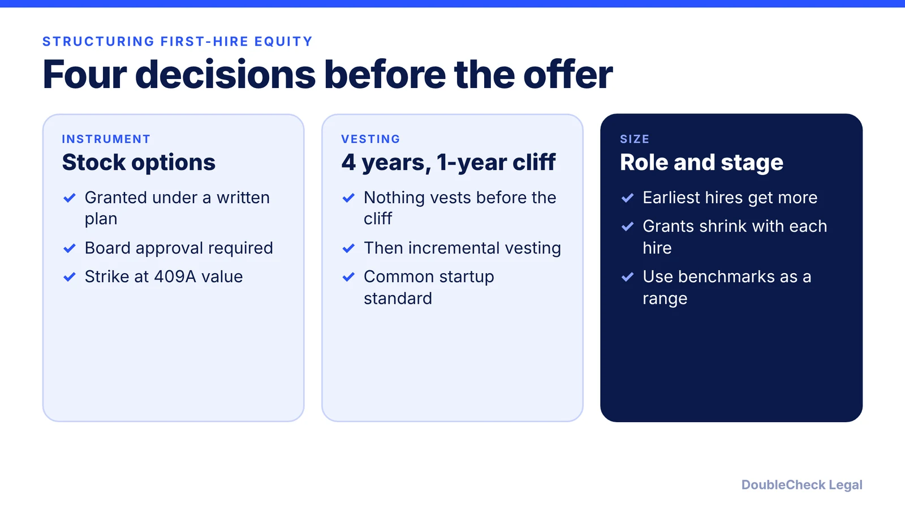
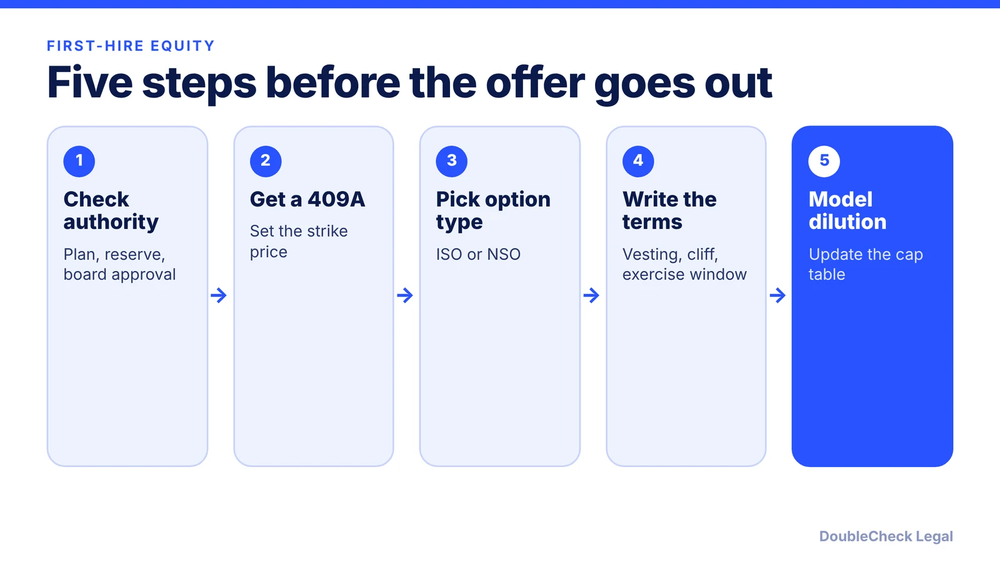

*Your first hires take real risk on your startup; here is how to size, document and vest their equity without creating tax or legal problems.*

**Key takeaways:**

- Grant options under a board-approved plan, priced at a current 409A valuation.
- There is no legal formula for grant size: it varies by role, seniority and stage, and percentages generally shrink with each later hire.
- Standard vesting is four years with a one-year cliff; decide the post-termination exercise window up front.
- Never promise a percentage in an offer letter before board approval.

## 1. The quick answer

**Quick answer:** To structure employee equity grants for your first hires, issue stock options (not stock) under a board-approved plan, priced at a current 409A valuation, vesting over four years with a one-year cliff, and sized by role and stage. There is no legal formula for grant size, so treat any benchmark as a range, not a rule. Get board approval, a signed option agreement, and a clear exercise-window policy before you promise anything in an offer letter.

## 2. How much equity to give early hires

There is no legal formula, only market benchmarks. Use them as ranges and adjust for salary trade-off, seniority and how early the hire is.

- **No published formula:** we did not rely on any single benchmark for exact percentages, because published figures vary by sample and period. Ask your attorney or advisor for current ranges for your stage, role and location.

Salary and equity usually trade off: a candidate who accepts a lower salary may reasonably expect a larger grant, and as your company can afford market pay, equity percentages generally fall. Remember dilution: later rounds shrink everyone's percentage, so a smaller slice can still be worth more if valuation rises. For the mechanics of your pool and ownership math, see [cap table basics](/blog/cap-table-basics-for-first-time-founders/) and [how to divide founder equity](/blog/founder-equity-split-how-to-divide/).

## 3. Options, 409A and approvals

Most early startups grant stock options, which give the employee the right to buy shares at a fixed strike price later. Fenwick says RSUs are rarely granted by early-stage startups because they require cash for taxes, and are more often used by mature companies.

**Price options at a current 409A valuation.** Per Fenwick, options must generally have an exercise price at least equal to fair market value on the grant date to be exempt from Section 409A; if the price is lower, the holder faces income recognition each year plus an additional 20% federal tax. An independent appraisal can generally be relied on for up to 12 months unless intervening events materially affect value, and Fenwick notes venture-backed companies usually rely on independent appraisals. Details are in [409A valuations for startups](/blog/stock-options-409a-valuation-startups/).

**ISO or NSO.** Per Haynes Boone, ISOs can be granted only to employees, are capped at $100,000 of grant-date value first becoming exercisable in a calendar year (the excess is treated as NSOs), and gains on exercise may be subject to the alternative minimum tax. Per Fenwick, NSOs may also go to independent contractors and non-employee directors. The IRS says that for most NSOs you include in income the difference between the stock's fair market value and what you paid at exercise (Topic no. 427). Compare them in [ISOs vs. NSOs](/blog/isos-vs-nsos-employee-stock-options/).

**Document the grant.** Record the grant through board approval by written consent or minutes, naming the shares, recipient, vesting schedule, ISO or NSO type, and strike price with the supporting 409A date, and check whether your investors or plan require additional sign-off. Baker Botts, for example, recommends a complete minute book with board and stockholder consents.

Do not promise a percentage in an offer letter before the board approves it; see [offer letter vs. employment contract](/blog/offer-letter-vs-employment-contract-differences-startup/) and [drafting a job offer letter](/blog/draft-job-offer-letter-with-ai/).

## 4. Vesting, cliffs and the exercise window

The common structure is a four-year vest with a one-year cliff: an employee who leaves before the cliff receives nothing, and after it, equity vests incrementally. Orrick calls four years with a one-year cliff the market standard for employees, with 48 monthly increments and 25% vesting at the one-year mark. Founders have a parallel concept in [cofounder vesting and cliffs](/blog/cofounder-vesting-cliff-explained/).

**Post-termination exercise window.** Per Haynes Boone, an ISO generally stays exercisable for three months after employment ends (one year after death or disability); NSO windows are set by your plan and grant documents. This is a real cost to employees, who must pay the strike price in cash, so decide your policy deliberately and state it in the grant documents.

**Early exercise and 83(b).** If you allow early exercise, an 83(b) election generally has to be filed within 30 days of the transfer of the property, per RSM. See [83(b) election basics](/blog/83b-election-startup-founders/).

Rules differ by state, and a short window can be challenged in some places, so have a lawyer confirm yours.

## 5. A first-hire equity checklist

Before you offer equity to your first hire:

1. **Check authority.** Confirm the plan, share reserve and board approvals.
2. **Get a current 409A** and confirm the strike price.
3. **Pick the form and type:** options, and ISO or NSO.
4. **Set vesting and exercise terms** in writing.
5. **Model dilution** on your cap table.

Hiring is also a payroll and classification decision; read the [first employee legal checklist](/blog/how-to-hire-first-employee-legal-checklist/) and [employee vs. independent contractor classification](/blog/employee-vs-independent-contractor-classification-startups/). Equity for advisors follows different rules: see [advisor agreements](/blog/advisor-agreement-equity-startups/). If AI drafts your grant documents, [verify them](/blog/verify-ai-generated-legal-document/) and consider an attorney review.

## Where DoubleCheck fits

[DoubleCheck](https://www.contactdoublecheck.com) helps businesses and founders start legal work with AI, verify it, and, when professional advice is warranted, connect with an independent attorney, including for immigration questions. Attorney availability and practice areas vary. Attorneys on DoubleCheck are independent professionals; an attorney-client relationship forms only if an attorney accepts your engagement.

**Sources:** [Fenwick, Choosing the Right Type of Equity Compensation](https://assets.fenwick.com/legacy/FenwickDocuments/Choosing-the-Right-Type-of-Equity-Compensation.pdf); [Orrick, Equity Vesting for Startups (Apr. 2026)](https://www.orrick.com/en/Insights/2026/04/Equity-Vesting-for-Startups-What-founders-and-employees-need-to-know); [Haynes Boone, Refresher on Incentive Stock Options](https://www.haynesboone.com/news/blogs/refresher-on-incentive-stock-options.pdf); [IRS, Topic no. 427, Stock options](https://www.irs.gov/taxtopics/tc427); [RSM, Section 83(b) considerations for employees receiving stock compensation](https://www.rsmus.com/insights/services/business-tax/section-83b-consideration-employees-receiving-stock-compensation.html); [Baker Botts, Getting your company ready for a financing](https://ourtake.bakerbotts.com/post/102l0zt/getting-your-company-ready-for-a-financingbuilding-a-solid-foundation-for-growth).

## FAQ

**How much equity should I give my first employee?**

There is no legal formula. It depends on role, seniority, salary trade-off and stage, and later hires usually receive smaller percentages. Use any market benchmark as a range, not a rule, and confirm with your attorney or advisor.

**What vesting schedule should first hires have?**

Per Orrick, the market standard for employees is four years with a one-year cliff. Nothing vests if the person leaves before the cliff; after it, equity vests incrementally.

**Should early employees get options or restricted stock?**

Most early startups grant stock options, and Fenwick says RSUs are rarely granted by early-stage startups because they require cash for taxes. Your tax adviser should confirm the best fit for your situation.

**Do I need a 409A valuation before granting options?**

Generally yes. Per Fenwick, options must generally have an exercise price at least equal to fair market value on the grant date to be exempt from Section 409A, and an independent appraisal can generally be relied on for up to 12 months unless intervening events materially affect value.

**How long do employees have to exercise options after leaving?**

Per Haynes Boone, an ISO generally stays exercisable for three months after employment ends (one year after death or disability). NSO windows are set by your plan and grant documents. Set your policy deliberately and state it in the grant documents.

---

*General information only. This article is not legal, tax, investment, or accounting advice.*
