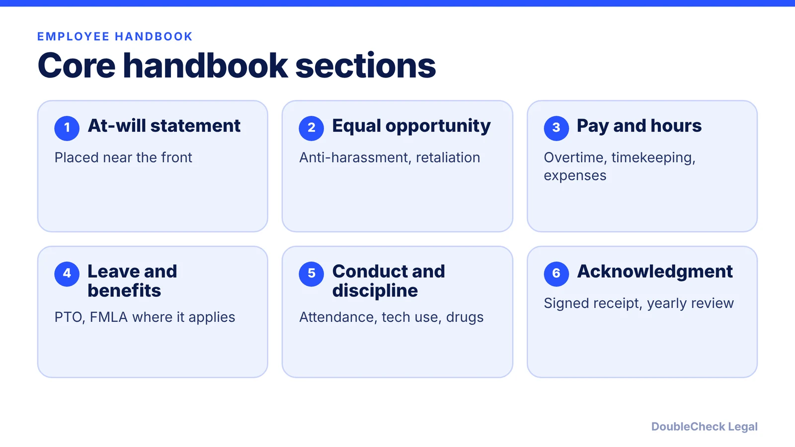
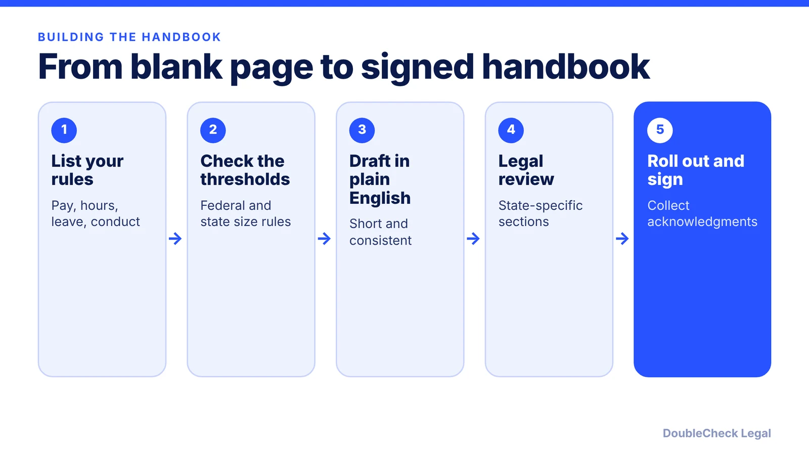

*What belongs in a small business handbook, which rules depend on how many employees you have, and where handbooks backfire.*

**Key takeaways:**

- Most small businesses are not federally required to have a handbook, but FMLA-covered employers must give the general FMLA notice.
- Core sections: at-will, EEO and anti-harassment, pay, leave, conduct, acknowledgment.
- Thresholds: FMLA 50, Title VII and ADA 15, ADEA 20, COBRA 20 employees.
- State law adds requirements that vary, so avoid copying another state's handbook.

## 1. The quick answer

**Quick answer:** Federal law does not require most small businesses to have a handbook, but one puts your pay, conduct, leave, and anti-discrimination rules in writing. One notable exception: the U.S. Department of Labor says a business covered by the FMLA (50 or more employees) that has eligible employees and a handbook must include the general FMLA notice in it, and with no handbook the notice goes to each new hire. Start with a short, accurate handbook, have new hires sign an acknowledgment, and review it every year.

## 2. The policies most handbooks include

Genova Burns's list of top handbook policies and Business Management Daily's small-business checklist agree on a core set:

- **At-will employment disclaimer,** usually near the front. Check your state's rules.
- **Equal employment opportunity,** prohibited harassment and discrimination, and a no-retaliation policy.
- **Family and medical leave and disability accommodation** (ADAAA).
- **Discipline,** monitoring of electronic communications, alcohol and drugs, and confidentiality.
- **Classification, timekeeping, and pay:** exempt vs. nonexempt, pay frequency, overtime, meal and rest periods, a ban on falsifying time records, and expense reimbursement. Business Management Daily notes nonexempt employees are owed overtime for hours beyond 40 in a workweek under the FLSA.
- **Benefits and leave:** PTO rules, health and retirement eligibility, and leave policies.
- **Acknowledgment and updates:** new hires sign a receipt, and you review the handbook annually for new employment laws.

Classification matters before any of this applies: see [employee vs. independent contractor](/blog/employee-vs-independent-contractor-classification-startups/). Payroll tax and workplace safety obligations sit outside the handbook, for example [workers' compensation](/blog/workers-compensation-insurance-requirements-startups/) and [I-9 and E-Verify](/blog/i-9-and-e-verify-for-startups/).

## 3. Which laws depend on your size

Some handbook sections are only legally required once you hit an employee count. Verified thresholds:

- **FMLA:** covered private employers have 50 or more employees in 20 or more workweeks in the current or previous calendar year, per DOL Fact Sheet 28D. Employees are eligible only at a location with at least 50 employees within 75 miles. Every covered employer must display the FMLA poster even with no eligible employees.
- **Title VII and the ADA:** employers with 15 or more employees, per Lorman and Nolo. **ADEA** (age 40 and over): 20 or more.
- **COBRA:** group health plans of employers with 20 or more employees in the prior year, per the DOL.

Your state may add laws with lower thresholds or more requirements, for example paid sick leave or state harassment-prevention training. Those vary by state and some are new, so check your state labor agency's page or ask an attorney instead of copying another state's handbook.

## 4. Handbook mistakes that create risk

A handbook is a promise you will be held to.

- **Accidentally creating a contract.** Homebase explains that in some states a handbook listing termination reasons or required process can support an implied-contract claim. A clear at-will statement helps, but only if your actual practices match it. Not all states recognize this theory, so ask counsel about yours.
- **Copying a template written for another state.** Final pay, leave, meal breaks, and notice rules are state-specific.
- **Writing rules you do not enforce.** If the handbook promises progressive discipline, skipping it can hurt you later. See [how to terminate an employee](/blog/how-to-terminate-an-employee-legally-small-business/).
- **Never updating it.** Business Management Daily recommends a yearly review for new employment laws.
- **Mixing in agreements.** Non-competes and confidentiality terms usually belong in separate signed agreements; see the [employment agreement checklist](/blog/ai-employment-agreement-review-checklist/).

Business Management Daily recommends consulting an employment attorney before finalizing. AI can produce a first draft quickly, but do not publish it without checking each rule against your state and your actual practice. See [when to hire a lawyer](/blog/when-to-hire-lawyer-small-business/). This is general information, not legal advice.

## Where DoubleCheck fits

[DoubleCheck](https://www.contactdoublecheck.com) helps businesses and founders start legal work with AI, verify it, and, when professional advice is warranted, connect with an independent attorney, including for immigration questions. Attorney availability and practice areas vary. Attorneys on DoubleCheck are independent professionals; an attorney-client relationship forms only if an attorney accepts your engagement.

**Sources:** [DOL Fact Sheet 28D: FMLA employer notification](https://www.dol.gov/agencies/whd/fact-sheets/28d-fmla-employer%20notification); [Business Management Daily](https://businessmanagementdaily.com/63526/what-you-need-to-include-in-a-small-business-employee-handbook); [Genova Burns](https://www.genovaburns.com/news/labor-law/2013-08-23-top-ten-policies-every-employee-handbook-should-have); [Lorman EEO overview](https://www.lorman.com/resources/overview-of-eeo-laws-title-vii-adea-ada-17175); [Nolo](https://www.nolo.com/legal-encyclopedia/content/antidiscrim-act.html); [DOL COBRA fact sheet (archived)](https://webarchive.library.unt.edu/web/20130220200615/http://www.dol.gov/ebsa/newsroom/fscobra.html); [Homebase](https://www.joinhomebase.com/blog/at-will-employment-exceptions).

## FAQ

**Is an employee handbook legally required?**

Federal law does not require most employers to have one. But the DOL says an FMLA-covered employer with eligible employees must include the general FMLA notice in its handbook if it has one, or give it to each new hire if not.

**What should a small business employee handbook include?**

Per Genova Burns and Business Management Daily: an at-will disclaimer, EEO and anti-harassment, retaliation, leave and accommodation, discipline, pay and timekeeping, conduct, confidentiality, and a signed acknowledgment.

**Does an at-will statement protect me?**

It helps, but Homebase notes some states recognize implied-contract claims from handbook language or practices. Whether it applies depends on your state, so have counsel review.

**How often should I update the handbook?**

Business Management Daily recommends reviewing it annually for new employment laws. Also update when you cross a headcount threshold or add employees in a new state.

---

*General information only. This article is not legal, tax, investment, or accounting advice.*
