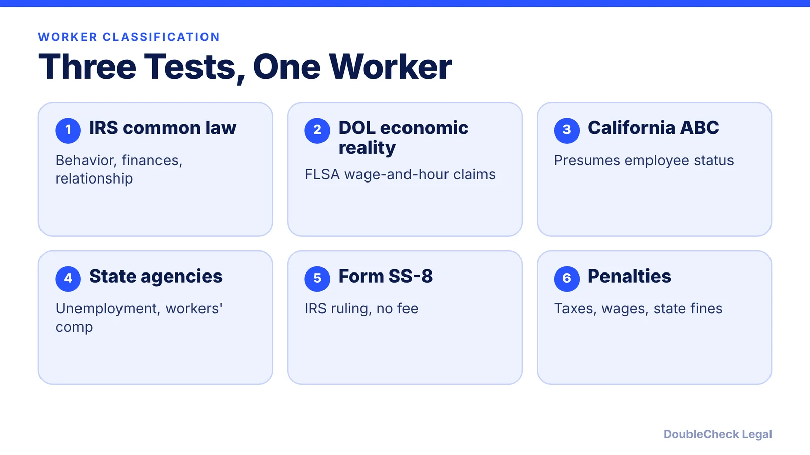
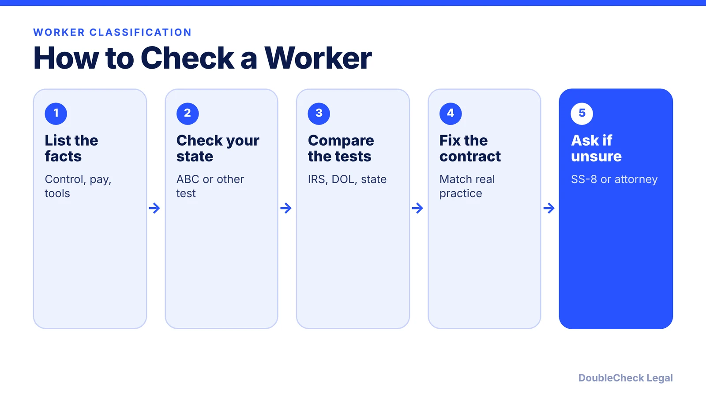

*How startups should classify workers in 2026: the IRS, DOL, and California tests, what changed, and what misclassification can cost.*

**Key takeaways:**

- The IRS looks at behavioral control, financial control, and the type of relationship.
- The DOL proposed a two-factor test in February 2026; the final rule was at OIRA review in late September.
- California's ABC test presumes employee status; willful misclassification penalties run $5,000 to $25,000 per violation.
- Form SS-8 asks the IRS for a determination; it takes at least six months and has no fee.

## 1. The quick answer

**Quick answer:** There is no single test. The IRS uses a common-law test (behavioral control, financial control, type of relationship), the Department of Labor uses an "economic reality" test for wage-and-hour law, and California uses the stricter ABC test. As of November 2026, the DOL is in the middle of replacing its 2024 rule with a two-factor, control-and-profit-or-loss approach, but the same worker can still be a contractor under one test and an employee under another. If you are unsure, the IRS lets either side file Form SS-8 for an official determination.

## 2. The IRS common-law test and Form SS-8

Per the IRS, the common-law test looks at the degree of control and independence in three areas:

- **Behavioral:** does the business control, or have the right to control, what the worker does and how?
- **Financial:** who controls the business side of the job, such as how the worker is paid, whether expenses are reimbursed, and who supplies tools and materials?
- **Type of relationship:** written contracts, employee-type benefits, whether the relationship is ongoing, and whether the work is a key part of the business.

No single factor decides it. If the answer is still unclear, the business or the worker can file **Form SS-8**, "Determination of Worker Status for Purposes of Federal Employment Taxes and Income Tax Withholding." The IRS says a determination can take at least six months and there is no fee. The IRS also describes an optional Voluntary Classification Settlement Program (Form 8952) that lets a business reclassify workers as employees going forward with partial relief from federal employment taxes, subject to eligibility.

For the payment side of freelancers, see [1099-NEC rules for hiring freelancers](/blog/1099-nec-2000-threshold-hiring-freelancers/). For the basics, see [independent contractor vs. employee](/blog/independent-contractor-vs-employee/).

## 3. DOL economic reality test: where it stands

The DOL's test governs claims under the Fair Labor Standards Act (minimum wage and overtime). Here is the timeline, per DLA Piper:

- **March 2024:** a Biden-era rule took effect using a "totality of the circumstances" analysis.
- **May 2025:** Field Assistance Bulletin 2025-1 told DOL investigators to stop applying the 2024 rule in enforcement and return to the earlier approach.
- **February 26-27, 2026:** the DOL proposed rescinding the 2024 rule and returning to a framework similar to the 2021 rule, with two core factors: the nature and degree of control over the work, and the worker's opportunity for profit or loss through initiative or investment. Other factors include skill, permanence, and whether the work is part of an integrated unit of production. The same analysis would apply to the FMLA and the Migrant and Seasonal Agricultural Worker Protection Act.
- **April 28, 2026:** the comment period closed.
- **Late September 2026:** Littler reported that the final rule was sent to the White House's OIRA for review on September 28.

We did not find a published final rule as of November 5, 2026, so check the DOL's site before relying on any version. Courts also apply their own versions of the test, and the DOL rule does not bind the IRS or states.

## 4. California's ABC test and the penalties

Per California's Labor and Workforce Development Agency, a worker is presumed to be an employee unless the hiring entity shows all three:

- **A:** the worker is free from your control and direction, in the contract and in practice;
- **B:** the work is outside the usual course of your business;
- **C:** the worker is customarily engaged in an independently established trade or business of the same nature.

AB 5 took effect January 1, 2020 and applies to the Labor Code, the Unemployment Insurance Code, and wage orders, with exceptions. Prong B is the one that trips up startups: a freelance developer at a software company usually does work within the usual course of business. California governing-law clauses do not remove this risk for work performed in the state.

Penalties differ by regime. Under California Labor Code section 226.8, willful misclassification carries civil penalties of $5,000 to $15,000 per violation, or $10,000 to $25,000 for a pattern or practice, per the Hunton law firm. Separate exposure can include unpaid payroll taxes, back wages, and workers' compensation issues. Related reading: [workers' compensation for startups](/blog/workers-compensation-insurance-requirements-startups/) and [hiring international workers](/blog/hire-international-employees-remote-eor-vs-contractor-vs-sponsorship/).

## Where DoubleCheck fits

[DoubleCheck](https://www.contactdoublecheck.com) helps businesses and founders start legal work with AI, verify it, and, when professional advice is warranted, connect with an independent attorney, including for immigration questions. Attorney availability and practice areas vary. Attorneys on DoubleCheck are independent professionals; an attorney-client relationship forms only if an attorney accepts your engagement.

**Sources:** [IRS fact sheet FS-15-21](https://www.irs.gov/pub/irs-news/FS-15-21.pdf); [DLA Piper on the DOL proposal](https://www.dlapiper.com/insights/publications/2026/03/dol-proposes-independent-contractor-rule); [Littler Policy Week Review, Oct. 2, 2026](https://www.littler.com/news-analysis/asap/policy-week-review-october-2-2026); [California Labor and Workforce Development Agency](https://www.labor.ca.gov/employmentstatus/employers/); [Hunton Andrews Kurth](https://www.hunton.com/hunton-employment-labor-perspectives/new-legislation-magnifies-the-consequences-of-misclassification-of-independent-contractors-in-california).

## FAQ

**What is the difference between an employee and an independent contractor?**

Per the IRS, it turns on the degree of control and independence across behavioral control, financial control, and the type of relationship. A contractor controls how the work is done and runs an independent business.

**Is the 2024 DOL independent contractor rule still in effect?**

The DOL told investigators in May 2025 (FAB 2025-1) to stop applying it and proposed rescinding it in February 2026. We found no published final rule as of November 5, 2026; check the DOL site.

**What is the California ABC test?**

A worker is presumed an employee unless the business proves freedom from control, work outside the usual course of its business, and an independently established trade, per California's Labor and Workforce Development Agency.

**What is Form SS-8?**

It is the IRS form either a business or a worker can file to get an official worker-status determination. The IRS says it can take at least six months and has no fee.

---

*General information only. This article is not legal, tax, investment, or accounting advice.*
