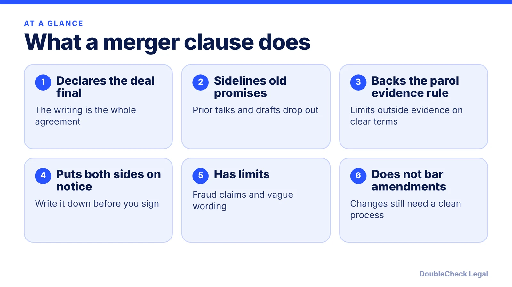
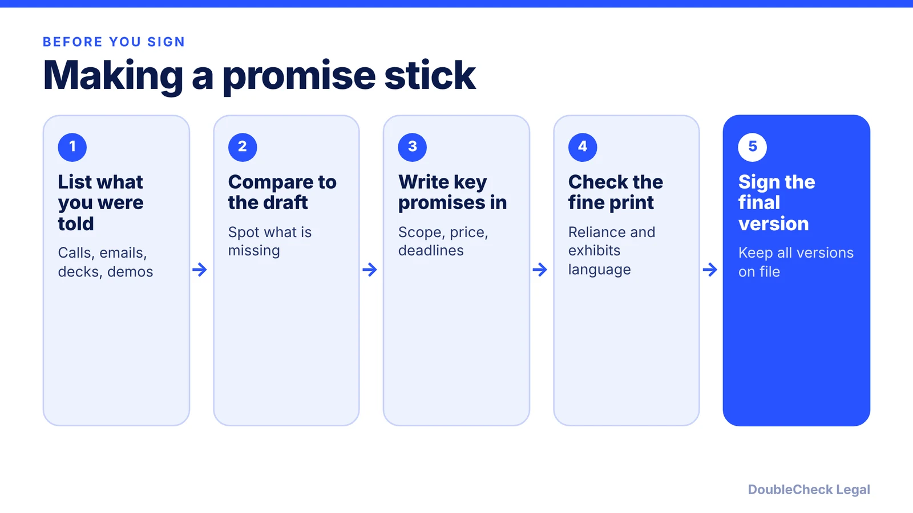

*A plain-English guide to the entire agreement clause: what the merger or integration language does to pre-signing promises, and what to check before you sign. Information as of November 2026.*

**Key takeaways:**

- An entire agreement clause says the signed writing is the complete deal, so prior talks, drafts and verbal promises generally drop out.
- It works with the parol evidence rule, which limits outside evidence when the contract is clear.
- Fraud claims, vague wording and incorporated documents are the main gray areas, and state law varies.
- If a promise matters, write it into the contract before you sign, and use a signed amendment for later changes.

## 1. The quick answer

**Quick answer:** An entire agreement clause (also called a merger or integration clause) says the signed document is the final and complete deal, so earlier emails, pitches, drafts and verbal promises that are not written into it are generally not part of the contract. It works alongside the parol evidence rule, which limits the use of outside evidence to change a clear written contract. The clause does not cancel everything: courts differ on fraud claims, vague boilerplate may carry less weight, and later changes need their own handling. The safe habit is simple: if a promise matters, get it into the signed text.

## 2. What an entire agreement clause actually says

The wording is usually short. A typical version says the agreement is the entire agreement between the parties on its subject and supersedes all prior and contemporaneous agreements, understandings, negotiations and discussions, whether oral or written.

Two ideas sit behind it:

- **Integration.** The clause states that the written contract is the final and complete agreement, so prior discussions the contract does not mention are not part of the deal.
- **The parol evidence rule.** Per the same guide, the clause works with this rule so that a court generally looks only at the written contract when it is clear, and prior negotiations or statements are barred as evidence in that situation.

In plain terms: the sales call where someone said "we will also include onboarding at no charge" is the kind of statement that can disappear once you sign a contract that says nothing about onboarding and contains a merger clause. For how binding terms get formed in the first place, see [what makes a contract legally binding](/blog/what-makes-a-contract-legally-binding/) and [when a verbal contract is enforceable](/blog/verbal-contract-enforceable-small-business/).

**Where the clause sits.** It is usually in the closing "miscellaneous" or "general" section, next to governing law, notices and assignment. Because it is boilerplate-looking, it is the clause people skim. It deserves a read, especially when negotiations ran long or involved many emails and decks.

## 3. What it wipes out, and what it does not

**Usually wiped out (the clause's job):**

- Verbal promises made on calls or at meetings.
- Pitch decks, proposals and email assurances that are not repeated in the contract.
- Earlier drafts and term sheets on the same subject, unless the contract says otherwise.
- Earlier agreements on the same subject, depending on the wording. Some versions keep prior NDAs in place while others expressly terminate them, so the exact text matters.

**Not automatically wiped out:**

- **Fraud and fraudulent inducement.** A law firm article republished on Mondaq (updated October 20, 2025) says a merger clause does not always block a claim that a party was induced to sign by a false statement it relied on. It notes courts differ: some enforce the contract as written, some enforce the clause only if the specific representation is disclaimed, and some weigh the parties' sophistication. It adds that New York courts require the clause to reference the specific misrepresentation. Treat this as an area where state law decides the outcome.
- **Vague or generic wording.** The same Mondaq article says boilerplate such as "entire agreement" may not bar claims unless it specifically disclaims reliance on the representation at issue, and that unclear terms can open the door to outside evidence.
- **Documents you incorporate.** Exhibits and schedules should be incorporated by reference to be safely part of the agreement. A [master services agreement and SOW](/blog/master-services-agreement-and-sow-small-business/) setup, for example, should say which documents form the contract and which controls in a conflict.
- **Other live agreements.** Some versions expressly keep obligations under other agreements, such as a license or services agreement, in full force. Check whether yours does.

## 4. How a merger clause interacts with changes after signing

A merger clause is about what came before the signature. It is not the clause that governs later changes, and the two are often confused.

Per the Mondaq article, a merger and integration clause protects against claims that the contract was later amended by an oral agreement, but it recommends drafting a separate no-oral-modification clause for that purpose. In practice, many commercial contracts say amendments must be in writing and signed by both parties. If yours does, an email chat saying "sure, extend it by 30 days" may not be the clean change you think it is, depending on your state's law.

Practical consequences:

- If the deal evolves, document it with a signed amendment or a new agreement. See [contract amendment vs. new contract](/blog/contract-amendment-vs-new-contract-how-to-change-a-signed-agreement/) for how to choose.
- If you are the party who relied on an earlier statement, find out whether the contract disclaims reliance. A reliance disclaimer is stronger than a one-line merger clause.
- If a contract is fundamentally flawed from the start, that is a different question. See [how to void or cancel a contract](/blog/how-to-void-or-cancel-a-contract-grounds-and-limits/).

**Governing law matters.** The Mondaq article also advises choosing governing law carefully, because enforcement varies by state. Read the merger clause together with [the governing law and venue clause](/blog/governing-law-and-venue-clause-explained-which-state-law-applies/).

## 5. A practical checklist for the clause you are signing

Before you sign any contract that has an entire agreement clause, work through this list.

1. **Inventory the promises.** Write down every commitment from the negotiation: pricing, scope, service levels, timelines, exclusivity, support and anything described as "included."
2. **Match them to the text.** Anything important that is not in the contract should be added now. A merger clause makes this the last easy moment.
3. **Read the clause wording.** Does it say the agreement supersedes prior discussions? Does it list the documents that make up the contract? Does it disclaim reliance on outside statements?
4. **Look for the fraud carve-out.** Balanced drafts often state that nothing limits liability for fraud or intentional misrepresentation. Notice if yours does not.
5. **Check the amendment clause.** The same Mondaq article recommends a separate no-oral-modification clause. Know how a change must be made.
6. **Confirm related documents.** Exhibits, order forms, statements of work and policies should be incorporated by reference, with an order of precedence.
7. **Keep the record.** Even if outside promises do not become terms, the emails still show what happened, and they may matter in a dispute about fraud.

If you are the drafter, use recognized language such as "completely integrated" rather than vague phrasing, per the Mondaq article, and tailor the clause to identify which prior documents are replaced. For a broader look at warning signs in a draft, see [contract red flags for small businesses](/blog/contract-red-flags-small-business/) and [what to check before signing an AI-reviewed contract](/blog/ai-contract-review-what-to-check-before-signing/).

**When to get a lawyer.** If a large amount of money, an exclusive relationship or a heavily negotiated deal rides on statements made outside the contract, have an attorney read the clause before you sign. Courts in different states treat these clauses differently, and that is a state-law question as of November 2026.

**Related reading:** [Offer Letter vs Employment Contract: Differences for a Startup](/blog/offer-letter-vs-employment-contract-differences-startup/)

## Where DoubleCheck fits

[DoubleCheck](https://www.contactdoublecheck.com) helps businesses and founders start legal work with AI, verify it, and, when professional advice is warranted, connect with an independent attorney, including for immigration questions. Attorney availability and practice areas vary. Attorneys on DoubleCheck are independent professionals; an attorney-client relationship forms only if an attorney accepts your engagement.

**Sources:** [Mondaq, They Promised Me Everything Before I Signed: Why Doesn't It Matter (article updated October 20, 2025)](https://www.mondaq.com/unitedstates/contracts-and-commercial-law/1799176/they-promised-me-everything-before-i-signed-why-doesnt-it-matter), read via the summary of the fetched page. Blocked: the Legal 500 copy of the Mondaq article did not load.

## FAQ

**What does an entire agreement clause do?**

It states that the written contract is the final and complete agreement, so prior discussions that the contract does not mention are not part of the deal. It works with the parol evidence rule, which limits outside evidence when the contract is clear.

**Is a merger clause the same as an entire agreement clause?**

Yes, in practice. Merger, integration and entire agreement clauses are different names for language saying the written contract is the complete agreement. The wording and scope still vary by contract, so read the actual text.

**Does a merger clause stop a fraud claim?**

Not always. A law firm article republished on Mondaq (updated October 20, 2025) says courts differ: some enforce the contract as written, some require the clause to disclaim the specific representation, and some weigh the parties sophistication. Ask an attorney about your state.

**Can I change a contract after signing if it has a merger clause?**

Yes, but follow the contract amendment process. The same article says a merger clause protects against claims of later oral amendments and recommends a separate no-oral-modification clause, so use a signed written amendment.

**Should I ask to remove the entire agreement clause?**

Usually no. It protects both sides by fixing the deal in writing. A better approach is to add the key promises to the contract and make sure the clause names the documents it covers.

---

*General information only. This article is not legal, tax, investment, or accounting advice.*
