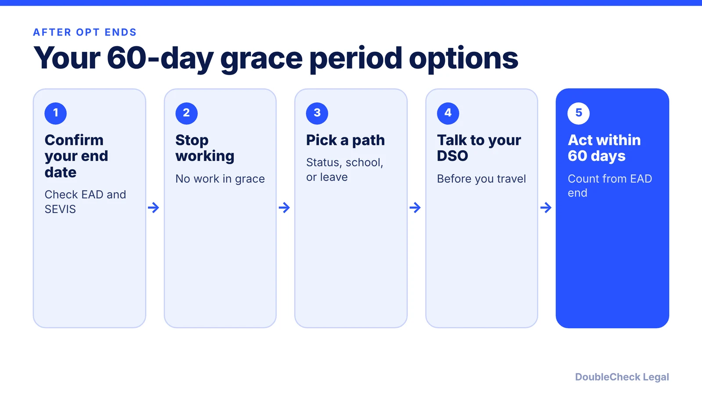
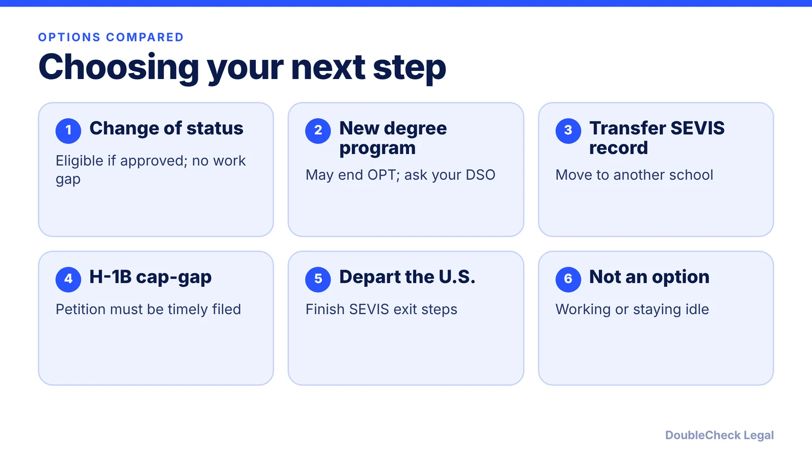

*OPT ending starts a short clock. Here is what you can and cannot do in the grace period, as of November 2026.*

**Key takeaways:**

- After OPT or STEM OPT, F-1 students generally get 60 days to prepare to leave, transfer, start a new program, or change status.
- You cannot work during the grace period, and leaving the U.S. does not let you re-enter on the completed F-1 program.
- H-1B cap-gap can extend F-1 status to April 1, but students already in grace are not authorized to work.
- A rule cutting the grace period to 30 days for new entrants was blocked by a court on September 14, 2026; confirm with your DSO.

## 1. The quick answer

**Quick answer:** After OPT or STEM OPT ends, F-1 students generally get a 60-day grace period to prepare to leave, transfer to another school, start a new program, or change to another status. You cannot work during it. Per [Stony Brook University](https://www.stonybrook.edu/visa/f-1-students/employment-training/post-graduation/opt-stem-resources/ending-opt-stem.html), it applies if you maintained status and did not exceed your unemployment days. As of November 2026 a court order keeps the current 60-day framework in place; a DHS rule that would cut it to 30 days for new entrants is blocked.

## 2. What you can and cannot do

The grace period is for wrapping up, not for continuing the F-1 life you had. Per [Boston University's ISSO](https://www.bu.edu/isso/exiting-bu/grace-periods), it starts after your OPT end date if you use OPT, and it also applies to F-2 dependents on the same timing.

**Allowed (per BU and Stony Brook):**

- Travel within the U.S.
- Prepare to leave, such as selling belongings.
- Transfer your SEVIS record to another school, if eligible.
- Start a higher degree level.
- Apply to change your immigration status, if eligible.

**Not allowed:**

- Working. Stony Brook states you cannot continue working during the grace period.
- Continuing studies or research, or applying for a program extension (BU).
- Leaving the U.S. intending to re-enter on your completed F-1 status. Per BU, you cannot re-enter on the completed program's I-20 after leaving during the grace period.

Per Stony Brook, these actions can invalidate OPT or STEM OPT and can cancel a pending I-765: starting a new degree program, transferring, re-entering in a status other than F-1, changing or ending your status, and exceeding 90 days of unemployment. Talk to your designated school official (DSO) before any of them. For the unemployment count, see [the OPT 90-day unemployment limit](/blog/opt-unemployment-limit-90-days-stem-opt/).

Leaving the U.S. does not automatically complete your SEVIS record. Per Stony Brook, you must notify your school.

## 3. Your options, one by one

**1. Change of status.** Another category, such as H-1B, can start while you are inside the grace period if the petition is approved and eligible. Per ASU's international student center, you submit your I-797 approval notice through the school's F-1 record closing form. Alternatives for people without H-1B include [O-1 for recent graduates](/blog/o-1-visa-recent-graduates-international-students/) and the options in [US visa options for startup founders](/blog/us-visa-options-for-startup-founders-compared/).

**2. A new program.** A new degree can restart F-1 life, but it can end your OPT. Per Stony Brook, starting a new degree program or transferring can invalidate OPT, so confirm timing with your DSO. Per ASU, you request an updated I-20 for a new program at the same school or a SEVIS transfer for another school.

**3. H-1B cap-gap.** If your employer files a cap-subject H-1B petition requesting a change of status while you are still in F-1 status, cap-gap can extend your F-1 status and work authorization. Per USCIS cap-gap guidance (a copy hosted by [Adhikari Law](https://www.adhikarilaw.com/wp-content/uploads/2026/07/Extension-of-Post-Completion-Optional-Practical-Training-OPT-and-F-1-Status-for-Eligible-Students-under-the-H-1B-Cap-Gap-Regulations-_USCIS_Jan-2026.pdf)), it lasts until April 1 of the fiscal year for which H-1B status is requested, or the petition's validity start date if earlier. Students already in the 60-day grace period receive the extension of status but are not authorized to work. If the petition is denied, rejected, revoked, withdrawn or not selected, cap-gap ends and the student generally has a 60-day grace period to leave. See [F-1 cap-gap and the H-1B change of status](/blog/f-1-cap-gap-change-of-status-to-h-1b/) and [what to do if you lose the lottery](/blog/h-1b-lottery-lost-alternatives-international-students/).

**4. Leave the U.S.** Depart within 60 days and complete the SEVIS exit steps your school requires. You may later return in another status; a new F-1 start needs a new I-20 and visa interview readiness, see [F-1 visa interview questions](/blog/f-1-visa-interview-questions-international-students-214b/).

## 4. The 2026 rule change that is on hold

The grace period length is changing on paper. DHS published a final rule on July 17, 2026, effective September 15, 2026, which replaces open-ended "duration of status" with fixed admission periods (per [Faegre Drinker](https://www.faegredrinker.com/en/insights/publications/2026/7/dhs-final-rule-ending-duration-of-status-effective-september-15-2026)). Under it, the F-1 post-completion grace period would drop from 60 to 30 days for students entering or reentering on or after September 15, 2026. Students already in the U.S. on that date would generally keep 60 days unless they travel or file for an extension.

Per [NAFSA](https://www.nafsa.org/legal-defense-DS) (last updated November 5, 2026), a federal judge in the District of Massachusetts granted nationwide preliminary relief on September 14, blocking the rule. The government appealed on September 30, and the longstanding duration-of-status framework remains in place nationwide. Because rules can change quickly, confirm the current grace period with your DSO before you plan around a specific number of days.

**Plan with margin.** Count the 60 days from your EAD end date, not from when you last worked. File anything time-sensitive early, and keep your I-20, EAD, and approval notices. For the earlier steps in the process, read [how to apply for OPT](/blog/how-to-apply-for-opt-step-by-step-i-765-timeline/) and [STEM OPT and the I-983](/blog/stem-opt-i-983-training-plan-startup-employers/). If you are leaving a H-1B job instead, a different 60-day clock applies; see [H-1B layoff 60-day grace period](/blog/h-1b-layoff-60-day-grace-period/).

## Where DoubleCheck fits

[DoubleCheck](https://www.contactdoublecheck.com) helps businesses and founders start legal work with AI, verify it, and, when professional advice is warranted, connect with an independent attorney, including for immigration questions. Attorney availability and practice areas vary. Attorneys on DoubleCheck are independent professionals; an attorney-client relationship forms only if an attorney accepts your engagement.

**Sources:** [Stony Brook University, Ending OPT and STEM OPT](https://www.stonybrook.edu/visa/f-1-students/employment-training/post-graduation/opt-stem-resources/ending-opt-stem.html); [Boston University ISSO, Grace Periods](https://www.bu.edu/isso/exiting-bu/grace-periods); [ASU ISSC, Graduation and next steps](https://issc.asu.edu/news/graduation-and-next-steps-f-1-students); [USCIS cap-gap guidance via Adhikari Law](https://www.adhikarilaw.com/wp-content/uploads/2026/07/Extension-of-Post-Completion-Optional-Practical-Training-OPT-and-F-1-Status-for-Eligible-Students-under-the-H-1B-Cap-Gap-Regulations-_USCIS_Jan-2026.pdf); [Faegre Drinker, DHS final rule](https://www.faegredrinker.com/en/insights/publications/2026/7/dhs-final-rule-ending-duration-of-status-effective-september-15-2026); [NAFSA, D/S litigation tracker](https://www.nafsa.org/legal-defense-DS).

## FAQ

**What is the 60-day grace period after OPT?**

Per Stony Brook University, it is up to 60 days after your work authorization ends if you maintained F-1 status and did not exceed your unemployment days. Use it to leave, transfer, start a higher degree, or change status.

**Can I work during the grace period?**

No. Stony Brook states you cannot continue working during the grace period, and ASU says a paycheck after your end date does not make the work permitted.

**Can I travel abroad during the grace period?**

Per Boston University's ISSO, leaving the U.S. in the grace period with the intent to re-enter on your completed F-1 status is not allowed, and you cannot re-enter on the completed program's I-20. Talk to your DSO before any trip.

**Is the grace period 30 days now?**

Not as of November 2026. DHS's final rule would cut the F-1 grace period to 30 days for new entrants, but per NAFSA a federal court blocked it nationwide on September 14, 2026, and the duration-of-status framework remains in place. Check with your DSO for updates.

---

*General information only. This article is not legal, tax, investment, or accounting advice.*
