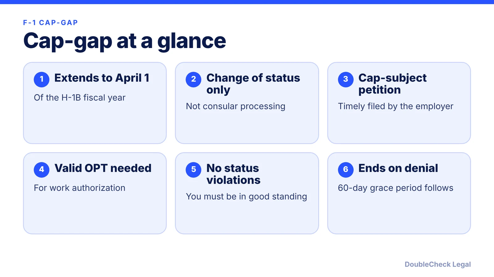
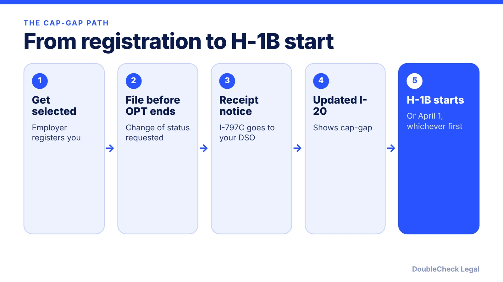

*How long can an F-1 student keep working while an H-1B change of status is pending? Here is the cap-gap rule, who qualifies, and what ends it.*

**Key takeaways:**

- Cap-gap now extends F-1 status and work authorization to April 1 of the H-1B fiscal year, per DHS (rule effective January 17, 2025).
- It needs a timely filed cap-subject petition requesting a change of status, not consular processing.
- For work authorization you must be in valid OPT or STEM OPT when the petition is filed.
- Denial, withdrawal, rejection, or revocation ends it, followed by a 60-day grace period.

## 1. The quick answer

**Quick answer:** Cap-gap automatically extends an F-1 student's status and work authorization while a cap-subject H-1B change of status is pending. Under the rule DHS implemented on January 17, 2025, the extension now runs until April 1 of the fiscal year for which H-1B status is requested, instead of ending October 1, per DHS Study in the States. You need a timely filed cap-subject petition that requests a change of status, and to extend work authorization you must also be in a valid post-completion OPT or STEM OPT period.

## 2. Who qualifies

Per DHS Study in the States, you qualify if all of these are true:

- You are in a valid F-1 status period. To extend employment, you must also be in a valid post-completion OPT or STEM OPT period.
- You have not violated the terms of your status.
- You are the beneficiary of a timely filed cap-subject H-1B petition.
- The petition requests a change of status to H-1B, not consular processing, and an employment start date in the fiscal year for which H-1B status is requested.

Timing is the point people miss. Per F1Jobs, the trigger is the H-1B filing date, not the lottery selection or approval, and work authorization is covered only if the petition was filed before your OPT or STEM OPT expired. If it was filed after expiration, you keep status maintenance but must stop working until the H-1B starts. Employers should plan filing around that date. See the [FY2028 cap registration timeline](/blog/h-1b-cap-registration-fy2028-timeline-employers/) and the [weighted lottery explainer](/blog/h1b-weighted-lottery-wage-levels-explained/).

## 3. Documents, travel, and what ends cap-gap

Per F1Jobs (a secondary source, so confirm with your DSO):

- Your DSO issues an updated I-20 reflecting cap-gap after receiving the I-797C receipt notice.
- You do not get a new EAD card. The I-20 and your expired EAD serve as proof during cap-gap.
- Leaving the U.S. while the petition is pending is treated as abandoning the change of status, which ends cap-gap. Plan travel with your DSO and attorney before you go.
- Cap-gap applies only to change-of-status petitions. A petition requesting consular notification gets none.

Per DHS, if the H-1B petition is denied, withdrawn, rejected, or revoked, the extension ends immediately. You are then no longer authorized to work under F-1 status and have a 60-day grace period to prepare to depart.

F1Jobs notes that the 90-day OPT unemployment limit still matters, but its explanation of how cap-gap affects the count was unclear, so verify the calculation with your DSO. See [OPT unemployment limits](/blog/opt-unemployment-limit-90-days-stem-opt/) for the basics.

## 4. Planning for a startup employer

A startup sponsoring its first H-1B should talk to the student early. Confirm the OPT end date, the filing plan, and who will track the receipt notice. If the student is on STEM OPT, the employer's [Form I-983 duties](/blog/stem-opt-i-983-training-plan-startup-employers/) continue, per F1Jobs, so check that compliance stays current through cap-gap.

If the petition is not selected or is denied, other routes exist. A founder planning a company may compare [OPT and STEM OPT for founders](/blog/f1-opt-stem-opt-start-your-own-startup/), [CPT vs. OPT](/blog/cpt-vs-opt-f1-students/), and the [O-1A route](/blog/o-1a-visa-for-startup-founders-evidence/). Because an RFE can affect the outcome, see [how to respond to a USCIS RFE](/blog/how-to-respond-to-uscis-request-for-evidence-rfe/). Rules and dates change, so confirm everything as of November 2026 with your DSO and an [immigration attorney](/blog/how-to-find-good-immigration-lawyer-startup-founder/).

## Where DoubleCheck fits

[DoubleCheck](https://www.contactdoublecheck.com) helps businesses and founders start legal work with AI, verify it, and, when professional advice is warranted, connect with an independent attorney, including for immigration questions. Attorney availability and practice areas vary. Attorneys on DoubleCheck are independent professionals; an attorney-client relationship forms only if an attorney accepts your engagement.

**Sources:** [DHS Study in the States: cap-gap rule](https://studyinthestates.dhs.gov/2025/04/recent-h-1b-rule-extends-f-1-cap-gap-extension); [F1Jobs: H-1B cap-gap explained](https://www.f1jobs.io/resources/blog/h1b-cap-gap-extension-explained).

## FAQ

**How long does the F-1 cap-gap extension last?**

Per DHS Study in the States, it runs until April 1 of the fiscal year for which the H-1B petition is filed, under a rule implemented January 17, 2025. F1Jobs adds that the earlier of the approved start date or April 1 controls.

**Does cap-gap work if I leave the U.S.?**

Per F1Jobs, leaving the U.S. while the petition is pending is treated as abandoning the change of status, which ends cap-gap. Talk to your DSO and an attorney before any travel.

**Do I get a new EAD during cap-gap?**

No. Per F1Jobs, your DSO issues an updated I-20 reflecting cap-gap, and that I-20 with your expired EAD serves as proof.

**What happens if my H-1B petition is denied?**

Per DHS, the extension ends immediately and you are no longer authorized to work under F-1 status. You have a 60-day grace period to prepare to depart.

---

*General information only. This article is not legal, tax, investment, or accounting advice.*
