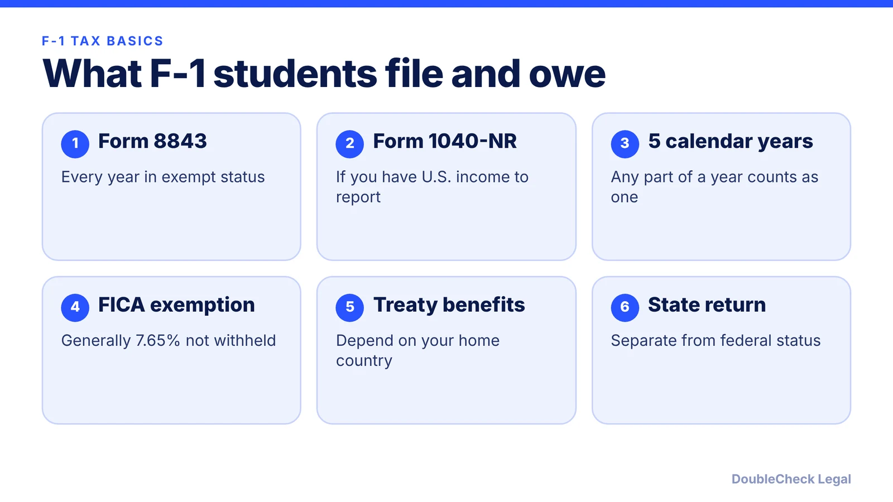
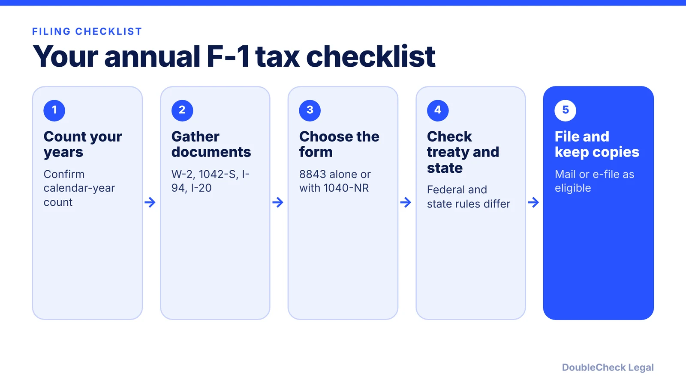

*What an F-1 student has to file with the IRS, and when the nonresident rules end. Facts as of November 2026.*

**Key takeaways:**

- F-1 students are generally nonresident aliens for tax purposes for up to five calendar years; any part of a year counts as a full year.
- Form 8843 is required every year in exempt status, even with no income; Form 1040-NR is for U.S.-source income.
- Wages from OPT, CPT, and on-campus work are generally FICA-exempt while you are a nonresident.
- Treaties and state rules vary, so check your country's treaty article and your state's filing rules.

## 1. The quick answer

**Quick answer:** F-1 students are generally treated as nonresident aliens for tax purposes for their first five calendar years in the U.S., because those days are excluded when counting toward the substantial presence test. During that time you file Form 8843 every year, even with no income, and Form 1040-NR if you have U.S. income that requires a return. Wages from on-campus work, CPT, and OPT are generally exempt from FICA (Social Security and Medicare) while you remain a nonresident.

## 2. Nonresident status and the 5-calendar-year rule

Tax residency is not the same as immigration status. A foreign national becomes a U.S. resident for tax purposes by holding a green card or by meeting the substantial presence test: 31 days in the current year and a weighted total of 183 days over three years. F-1 students are "exempt individuals," which means their U.S. days are excluded from that count.

Per [Taxes for Expats](https://www.taxesforexpats.com/articles/non-us-citizens/f-1-international-student-tax-return-101.html), qualifying F, J, M, and Q students can exclude days for up to five calendar years, and partial years count: a December 2021 arrival uses 2021 as year one. After the fifth year, days generally count under the substantial presence test. Per [Greenback Tax Services](https://www.greenbacktaxservices.com/blog/student-visa-rule-changes-tax-residency/) (updated August 2026), a student who arrived in 2021 is exempt for 2021 through 2025 and generally becomes a resident alien for tax purposes in 2026.

Once you become a resident for tax purposes, you report worldwide income on Form 1040 and may have additional reporting for foreign accounts, per Greenback. Plan this change before your sixth calendar year, especially if you are on OPT or starting a company. Founders should also read [foreign founder U.S. taxes and the substantial presence test](/blog/foreign-founder-us-taxes-substantial-presence-test/), which covers what happens when the exemption ends.

Note that the five-year rule is separate from your immigration status. Your school's international office (the DSO) can confirm your status dates; see [SEVIS and the I-20 explained](/blog/sevis-i-20-explained-maintaining-f-1-status/).

## 3. Form 8843 and Form 1040-NR

**Form 8843** is an information statement, not a tax return. Per [Taxes for Expats](https://www.taxesforexpats.com/articles/non-us-citizens/form-8843-statement-for-exempt-inidividuals-and-individuals-with-medical-condition.html), each exempt individual files their own, including F-2 dependents, and the requirement depends on visa status, not income. The form has no flat late fee, but the real risk is losing the day exclusion, which could make you a tax resident.

**Form 1040-NR** is the nonresident return. You generally need it if you have U.S.-source income such as wages, taxable scholarship amounts, or stipends. Per Greenback, scholarships used for tuition and required fees are tax-free, while amounts for room, board, or living expenses are taxable.

For the 2025 tax year (filed in 2026), the same sources list these deadlines:

- **April 15, 2026:** 1040-NR with Form 8843 attached, if you had wages subject to U.S. withholding.
- **June 15, 2026:** Form 8843 alone, or 1040-NR if you had no wages subject to withholding.
- **October 15, 2026:** if you filed Form 4868 for an extension, which does not extend time to pay.

Deadlines for the 2026 tax year will fall in 2027; confirm exact dates on IRS.gov. Nonresidents also usually cannot claim the standard deduction, per Taxes for Expats, with limited treaty exceptions such as for students from India. Do not file a resident Form 1040 simply because it is more familiar; the wrong form can create errors.

## 4. FICA, treaties, and state returns

**FICA.** Nonresident F-1 students are generally exempt from FICA on authorized on-campus work, CPT, and OPT, per Taxes for Expats. FICA is 6.2% Social Security plus 1.45% Medicare, or 7.65% combined; on $10,000 of wages that is $765. Income tax still applies. If an employer withheld FICA in error, ask the employer to correct it first; the IRS refund process is a fallback. Once you become a resident alien for tax purposes, FICA generally applies.

**Treaty benefits.** Some countries have tax treaties that reduce or exempt certain student income. Per Greenback, the U.S.-China treaty is one example, with up to $5,000 excludable under Article 20. Per Taxes for Expats, some treaties cap the benefit by dollar amount or years, so read your country's article. Treaty claims use forms such as Form 8233 or W-8BEN with an employer, or Form 8833 with a return. A tax professional can confirm what applies to you.

**State returns.** Taxes for Expats notes that state filing depends on residence, source income, and withholding, not federal exempt status. Texas and Florida have no broad individual income tax; California uses Form 540NR for nonresidents.

**Business income.** Earning from a side business or a startup is a different analysis from wages and may require different forms; see [F-1 OPT and STEM OPT for starting your own startup](/blog/f1-opt-stem-opt-start-your-own-startup/) and [CPT vs OPT](/blog/cpt-vs-opt-f1-students/). Whatever your visa, the IRS expects accurate reporting. If your situation spans several years or countries, speak to a tax professional or attorney.

## Where DoubleCheck fits

[DoubleCheck](https://www.contactdoublecheck.com) helps businesses and founders start legal work with AI, verify it, and, when professional advice is warranted, connect with an independent attorney, including for immigration questions. Attorney availability and practice areas vary. Attorneys on DoubleCheck are independent professionals; an attorney-client relationship forms only if an attorney accepts your engagement.

**Sources:** [Taxes for Expats, F-1 international student tax return](https://www.taxesforexpats.com/articles/non-us-citizens/f-1-international-student-tax-return-101.html); [Taxes for Expats, Form 8843 guide](https://www.taxesforexpats.com/articles/non-us-citizens/form-8843-statement-for-exempt-inidividuals-and-individuals-with-medical-condition.html); [Greenback Tax Services, F-1 and J-1 tax rules](https://www.greenbacktaxservices.com/blog/student-visa-rule-changes-tax-residency/).

## FAQ

**Do F-1 students have to file taxes?**

Yes, in the sense that every F-1 student claiming excluded days files Form 8843, even with no income, per Taxes for Expats. Form 1040-NR is also required if you have U.S.-source income, such as wages or taxable scholarships.

**How long is an F-1 student a nonresident alien for taxes?**

Up to five calendar years, with any part of a calendar year counting as a full year, per Taxes for Expats and Greenback. After that, days generally count under the substantial presence test.

**Do F-1 students pay Social Security and Medicare taxes on OPT?**

Generally no while a nonresident. Per Taxes for Expats, nonresident F-1 students are generally exempt from FICA on authorized OPT, CPT, or on-campus work, but income tax still applies.

**Can I use TurboTax or another resident tax program?**

Resident return software is built for Form 1040, which nonresidents generally do not file. Per Taxes for Expats, you would need nonresident forms, so use a tool or preparer that supports Form 1040-NR.

---

*General information only. This article is not legal, tax, investment, or accounting advice.*
