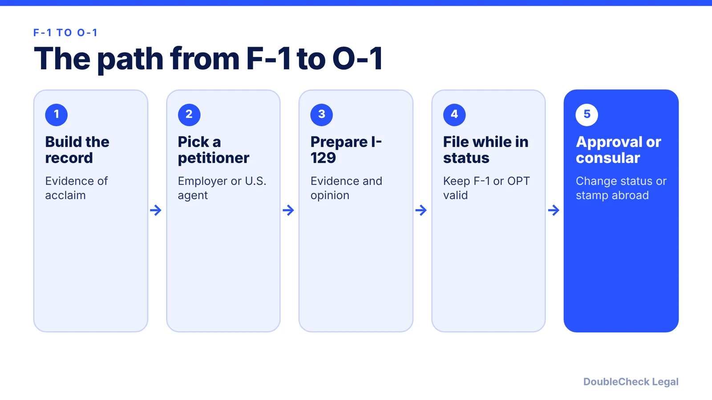
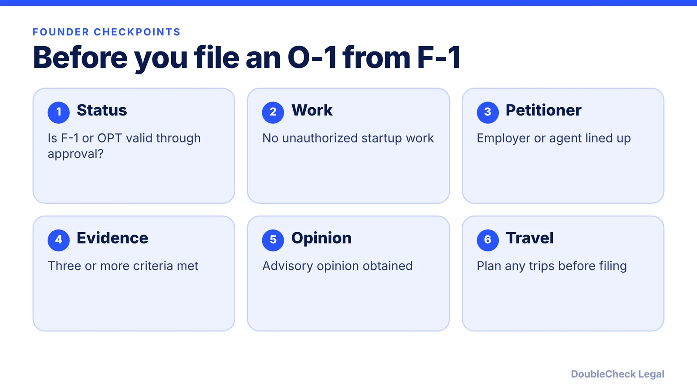

*Moving from student status to O-1 is possible, but the petitioner, the OPT clock, and the unauthorized-work line decide whether it works.*

**Key takeaways:**

- A U.S. employer or U.S. agent files Form I-129; a student cannot simply self-file (per USCIS).
- Do not assume an O-1 filing extends OPT; USCIS cap-gap rules address pending H-1B petitions.
- Keep valid F-1 or OPT status while the petition is pending.
- Running a startup on F-1 can violate student status if it earns revenue or is a business.

## 1. The quick answer

**Quick answer:** An F-1 student or OPT holder can change status to O-1 from inside the U.S. if a qualifying U.S. petitioner (an employer or U.S. agent) files Form I-129 and you keep valid underlying status while it is pending. Do not assume that filing an O-1 extends OPT work authorization: USCIS cap-gap rules address pending H-1B petitions, so if OPT ends before approval you should plan to stop working unless an attorney confirms otherwise. For founders, the extra trap is that running a business on F-1 can itself violate student status.

## 2. Who files, and why a founder cannot just self-petition

Per [USCIS](https://uscis.gov/o-1), a U.S. employer, a U.S. agent, or a foreign employer acting through a U.S. agent files Form I-129, and filing can occur no more than one year before services begin. In practice this means a student cannot simply self-file a personal petition: a single job offer can come from an employer, while founders or people with several projects may use an agent structure that needs legal review.

USCIS also requires a written advisory opinion from a peer group or field expert in most cases, and at least three types of evidence matching the regulatory categories. For the evidence side, read [O-1A evidence for startup founders](/blog/o-1a-visa-for-startup-founders-evidence/), the [documents checklist](/blog/o-1-visa-documents-checklist-founder/), and [recommendation letters](/blog/o-1-recommendation-letters-expert-opinion/).

## 3. Timing with OPT and STEM OPT

Many students move from OPT or STEM OPT to O-1 because the OPT period gives time to build evidence and find a petitioner. Keep these points in mind:

- Do not assume an O-1 filing extends OPT. [USCIS cap-gap rules](https://uscis.gov/working-in-the-united-states/temporary-workers/h-1b-specialty-occupations/extension-of-post-completion-optional-practical-training-opt-and-f-1-status-for-eligible-students) address pending H-1B petitions.
- While the petition is pending you must maintain underlying F-1 or OPT status.
- If OPT ends before approval, you must stop working and may need to complete visa processing abroad.

Premium processing (Form I-907) is an optional expedite, and the fee for many I-129 classifications including O-1 rose to $2,965 for requests postmarked on or after March 1, 2026, per [Ogletree Deakins](https://ogletree.com/?p=84207) and [AILA](https://assets.aila.org/files/b72f7a37-2fff-4e59-af08-d48278fde9fc/26010902.pdf); check the USCIS premium processing page for the current decision timeframe. Premium processing does not guarantee approval, and standard processing times vary, so check the USCIS processing times page. Related: [OPT unemployment limits](/blog/opt-unemployment-limit-90-days-stem-opt/) and [starting a startup on F-1 OPT](/blog/f1-opt-stem-opt-start-your-own-startup/).

## 4. Founder-specific risks

- **Unauthorized work.** Per [Nolo](https://www.nolo.com/legal-encyclopedia/f-1-students-work-violations.html), any unauthorized employment is a failure to maintain status, and the [ICE SEVIS employment page](https://ice.gov/sevis/employment) lists the work F-1 students may do. A venture that earns revenue, takes investment, or operates as a business can raise this risk, so get advice before you start.
- **Travel while pending.** Travel during a pending change of status can create problems. Get legal advice before leaving the U.S.
- **Change of status vs. consular stamping.** Change of status is requested inside the U.S. and suits students in valid F-1 status who do not need to travel; consular processing adds appointment time but suits those who must travel or are abroad.
- **Thin evidence.** Degree-only or standard-job profiles are unlikely to meet the O-1 evidence standard, and cases can fail when impact is not explained.

Compare options in [EB-1A vs NIW](/blog/eb-1a-vs-niw-which-is-better-for-founders/) and [US visa options for founders](/blog/us-visa-options-for-startup-founders-compared/).

## Where DoubleCheck fits

[DoubleCheck](https://www.contactdoublecheck.com) helps businesses and founders start legal work with AI, verify it, and, when professional advice is warranted, connect with an independent attorney, including for immigration questions. Attorney availability and practice areas vary. Attorneys on DoubleCheck are independent professionals; an attorney-client relationship forms only if an attorney accepts your engagement.

**Sources:** [USCIS, O-1 Visa](https://uscis.gov/o-1); [USCIS, OPT and F-1 status extension (cap-gap)](https://uscis.gov/working-in-the-united-states/temporary-workers/h-1b-specialty-occupations/extension-of-post-completion-optional-practical-training-opt-and-f-1-status-for-eligible-students); [Nolo, F-1 students and work violations](https://www.nolo.com/legal-encyclopedia/f-1-students-work-violations.html); [ICE SEVIS, employment](https://ice.gov/sevis/employment); [Ogletree Deakins, premium processing fees](https://ogletree.com/?p=84207); [AILA, premium processing fees](https://assets.aila.org/files/b72f7a37-2fff-4e59-af08-d48278fde9fc/26010902.pdf).

## FAQ

**Can I change from F-1 to O-1 without leaving the U.S.?**

Often yes. A change of status is requested inside the U.S. through the I-129 petition, and you need to keep valid F-1 or OPT status while it is pending. Consular processing abroad is the alternative if you must travel.

**Does an O-1 filing extend my OPT?**

Do not assume it does. USCIS cap-gap rules extend OPT only for certain pending H-1B cap-subject petitions, not for an O-1 filing, so confirm your work authorization end date with your school and an attorney.

**How fast is premium processing for an O-1?**

Premium processing (Form I-907) can speed up the I-129 decision for an extra fee, which rose to $2,965 for many I-129 classifications including O-1 for requests postmarked on or after March 1, 2026. Check the current USCIS premium processing page for the decision timeframe.

**Can I be my own O-1 petitioner as a founder?**

Not by simply self-filing. USCIS says a U.S. employer, a U.S. agent, or a foreign employer acting through a U.S. agent files the I-129. Founders may use an agent structure, but the arrangement needs legal review.

---

*General information only. This article is not legal, tax, investment, or accounting advice.*
