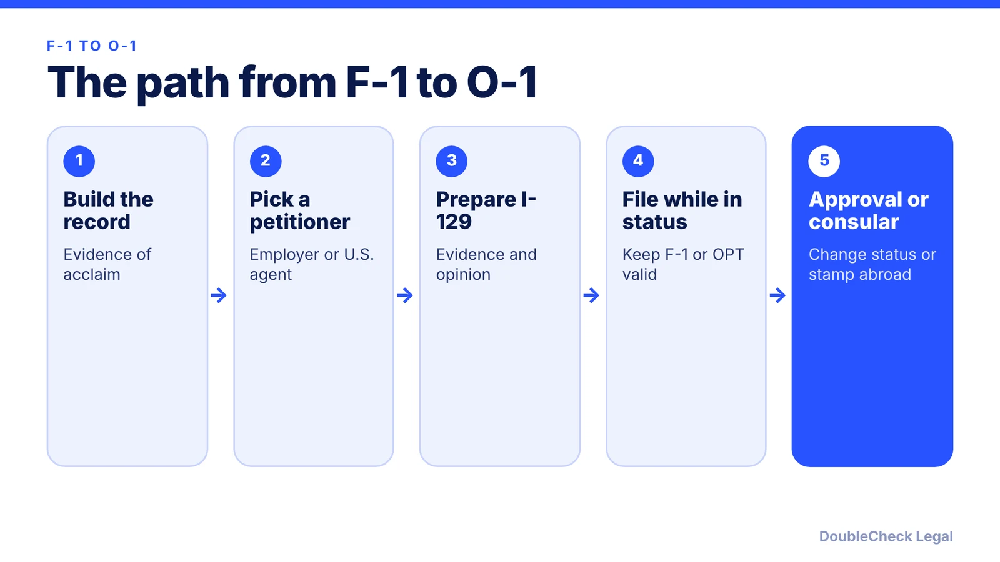
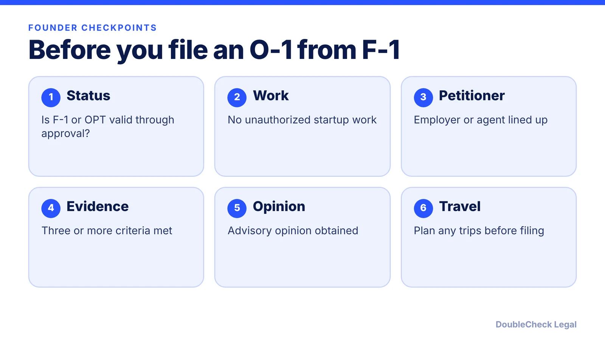

*Moving from student status to O-1 is possible, but the petitioner, the OPT clock, and the unauthorized-work line decide whether it works.*

**Key takeaways:**

- A U.S. employer or U.S. agent files Form I-129; a student cannot simply self-file (per Beyond Border).
- Filing an O-1 does not extend OPT or create cap-gap protection (per Manifest).
- Keep valid F-1 or OPT status while the petition is pending.
- Running a startup on F-1 can violate student status if it earns revenue or is a business.

## 1. The quick answer

**Quick answer:** An F-1 student or OPT holder can change status to O-1 from inside the U.S. if a qualifying U.S. petitioner (an employer or U.S. agent) files Form I-129 and you keep valid underlying status while it is pending. Per Manifest (updated September 2026), filing an O-1 does not extend OPT work authorization, so if OPT ends before approval you must stop working. For founders, the extra trap is that running a business on F-1 can itself violate student status.

## 2. Who files, and why a founder cannot just self-petition

Per [USCIS](https://uscis.gov/o-1), a U.S. employer, a U.S. agent, or a foreign employer acting through a U.S. agent files Form I-129, and filing can occur no more than one year before services begin. [Beyond Border](https://www.beyondborderglobal.com/resources/f1-to-o1-visa) (updated April 2026) says a student "cannot simply self-file in the same way they might prepare a personal application," and that a single job offer can come from an employer while founders or people with several projects may use an agent structure.

USCIS also requires a written advisory opinion from a peer group or field expert in most cases, and at least three types of evidence matching the regulatory categories. For the evidence side, read [O-1A evidence for startup founders](/blog/o-1a-visa-for-startup-founders-evidence/), the [documents checklist](/blog/o-1-visa-documents-checklist-founder/), and [recommendation letters](/blog/o-1-recommendation-letters-expert-opinion/).

## 3. Timing with OPT and STEM OPT

Per Beyond Border, many students move from OPT or STEM OPT to O-1 because the OPT period gives time to build evidence and find a petitioner. Manifest adds that STEM OPT can give you more time to build employment-based evidence, and warns:

- Filing an O-1 does not extend OPT, and it does not create cap-gap protection.
- While the petition is pending you must maintain underlying F-1 or OPT status.
- If OPT ends before approval, you must stop working and may need to complete visa processing abroad.

Premium processing targets a decision within 15 business days per Manifest, and the fee for many I-129 classifications including O-1 rose to $2,965 on March 1, 2026, per Beyond Border. Premium processing does not guarantee approval, and standard processing times vary, so check the USCIS processing times page. Related: [OPT unemployment limits](/blog/opt-unemployment-limit-90-days-stem-opt/) and [starting a startup on F-1 OPT](/blog/f1-opt-stem-opt-start-your-own-startup/).

## 4. Founder-specific risks

- **Unauthorized work.** Manifest warns that academic projects can violate student status if they earn revenue, take investment, or operate as a business, and that "freelance and consulting roles also count as work, even when the service is unpaid."
- **Travel while pending.** Beyond Border notes that travel during a pending change of status can create problems. Get legal advice before leaving the U.S.
- **Change of status vs. consular stamping.** Per Beyond Border, change of status is done inside the U.S. and suits students in valid F-1 status who do not need to travel; consular stamping adds appointment time but suits those who must travel or are abroad.
- **Thin evidence.** Beyond Border says degree-only or standard-job profiles are unlikely to qualify, and cases often fail when impact is not explained.

Compare options in [EB-1A vs NIW](/blog/eb-1a-vs-niw-which-is-better-for-founders/) and [US visa options for founders](/blog/us-visa-options-for-startup-founders-compared/).

## Where DoubleCheck fits

[DoubleCheck](https://www.contactdoublecheck.com) helps businesses and founders start legal work with AI, verify it, and, when professional advice is warranted, connect with an independent attorney, including for immigration questions. Attorney availability and practice areas vary. Attorneys on DoubleCheck are independent professionals; an attorney-client relationship forms only if an attorney accepts your engagement.

**Sources:** [USCIS, O-1 Visa](https://uscis.gov/o-1); [Beyond Border, F-1 to O-1](https://www.beyondborderglobal.com/resources/f1-to-o1-visa); [Manifest Law, F-1 to O-1](https://manifestlaw.com/blog/f1-visa-to-o1-visa).

## FAQ

**Can I change from F-1 to O-1 without leaving the U.S.?**

Yes, in many cases. Beyond Border describes change of status inside the U.S. for students in valid F-1 status who do not need to travel. Consular processing is the alternative if you must travel.

**Does an O-1 filing extend my OPT?**

No. Manifest states that filing for an O-1 does not extend OPT work authorization and does not create cap-gap protection.

**How fast is premium processing for an O-1?**

Manifest says premium processing targets a decision within 15 business days. Beyond Border lists the fee at $2,965 for many I-129 classifications since March 1, 2026.

**Can I be my own O-1 petitioner as a founder?**

Not by simply self-filing, per Beyond Border. Founders may use an agent structure, but the arrangement needs legal review.

---

*General information only. This article is not legal, tax, investment, or accounting advice.*
