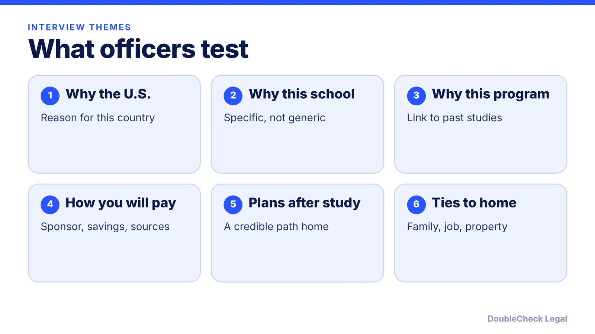
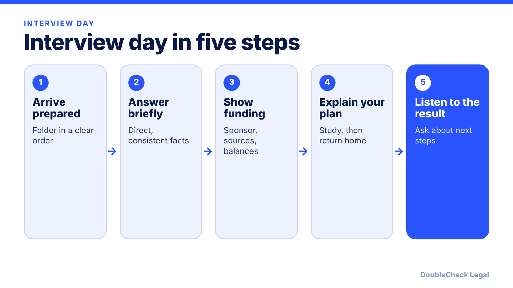

*What F-1 visa officers ask, how Section 214(b) works, what changed for 2026, and your options after a refusal.*

**Key takeaways:**

- Officers test three things: genuine student intent, ability to pay, and plans to return home.
- As of November 2026, most F-1 applicants need an in-person interview and online presence is reviewed.
- A 214(b) refusal cannot be appealed, but you can reapply with new information or significant changes.
- Keep answers short, consistent with your DS-160, and supported by documents.

## 1. The quick answer

**Quick answer:** An F-1 visa interview is usually short, and the officer is mainly deciding whether you are a genuine student, can pay for the program, and will leave the U.S. when it ends. A refusal under Section 214(b) means you did not show you qualify for the category or did not overcome the presumption of immigrant intent. Per the State Department, that refusal applies only to that application and cannot be appealed, but you may reapply with new information or significant changes. As of November 2026, most applicants need an in-person interview, and officers review online presence.

## 2. What officers ask and what to bring

Per EduConnect USA's May 2026 guide, questions fall into five groups: why the U.S., this school, and this program; academic background; funding and sponsors; post-graduation plans; and ties to your home country. It describes the post-graduation answer as the most consequential, and says a credible answer ends in your home country. It also says large recent deposits with no clear source are a common financial red flag.

Practical points drawn from that guide:

- Keep answers short, around 30 to 45 seconds, and know your facts rather than reciting a script.
- Make sure answers match your DS-160. If something is inconsistent, explain it directly.
- Do not say you plan to stay in the U.S. EduConnect says stating a wish to stay can lead to a 214(b) refusal. The State Department notes H-1B and L applicants are excluded from the ties requirement, which F-1 applicants are not.

Per the State Department's [student visa page](https://travel.state.gov/content/travel/en/us-visas/study/student-visa.html), your school issues Form I-20, you must pay the separate SEVIS I-901 fee, and you present the I-20 at the interview and at the port of entry. New students can receive a visa up to 365 days before the course start date, but cannot enter more than 30 days before the program starts.

A typical folder, per EduConnect: DS-160 confirmation, Form I-20, passport, SEVIS fee receipt, financial documents, admission letter, and test scores if relevant. Officers may ask for only some of them. Check your embassy or consulate website for its exact list.

## 3. 2025-2026 changes: interview waivers and vetting

**Interview waivers.** The State Department announced on September 18, 2025 that, effective October 1, 2025, all visa applicants need an in-person interview with a consular officer, with listed exceptions, per [Colorado's international office](https://www.colorado.edu/isss/node/3461). The exceptions it lists are mostly diplomatic and official categories plus certain B-1/B-2 renewals; student visas are not on the list. A waiver also requires applying in your country of nationality or usual residence, no prior refusal (unless overcome or waived), and no apparent ineligibility. Another page dated July 2026 says most F-1 and J-1 renewal applicants are now required to attend an in-person interview.

**Online presence.** Per [Fragomen](https://www.fragomen.com/insights/united-states-state-department-resumes-student-visa-appointment-scheduling-with-enhanced-vetting-of-applicants-online-presence.html) and [Eiglaw](https://eiglaw.com/us-expands-vetting-for-student-visa-applicants-including-social-media-review/), a June 2025 State Department announcement said F, M, and J applicants would be directed to set social media to public, and officers review accounts and online activity. Fragomen reports that keeping part of an account private may lead officers to draw a negative inference. Treat your public profiles as part of your application: they should be accurate and consistent with what you tell the officer. Do not delete content to mislead; a misstatement is a bigger problem than the post.

**Appointments.** Waiting times vary by post and change often. Per Colorado's page, delays are likely, and anyone who needs a new visa to return should book an appointment before leaving the U.S. If you travel on an existing visa, see [H-1B visa stamping and travel](/blog/h-1b-visa-stamping-travel-abroad-tech-workers/) for how re-entry risk works in a related setting.

## 4. After a denial: what to do next

A denial letter states the section of law. For 214(b), the State Department's [visa denials page](https://travel.state.gov/content/travel/en/us-visas/visa-information-resources/visa-denials.html) says:

- The refusal applies only to that application and there is no appeal.
- You may reapply if you have additional relevant information or significant changes in circumstances.
- You must submit a new application, pay the fee again, and schedule a new interview.

Reapplying with the same facts and the same answers rarely changes the outcome. A useful review:

1. **Write down what you were asked and answered** while it is fresh.
2. **Find the gap.** Was it funding, a vague study plan, an inconsistent form, or weak ties?
3. **Fix what is fixable**, such as clearer sponsor documents or a stronger explanation of the program, and state new facts truthfully.
4. **Ask your school's international office** before booking. If the refusal was a different section, or you were told to provide documents (see [221(g) administrative processing](/blog/visa-221g-administrative-processing/)), the path differs.

Do not hire anyone who promises a guaranteed visa. If you want help reading the letter or preparing, see [how to find a good immigration lawyer](/blog/how-to-find-good-immigration-lawyer-startup-founder/) and [immigration lawyer fees](/blog/immigration-lawyer-fees-flat-fee-vs-hourly/). Once approved, [SEVIS and the I-20](/blog/sevis-i-20-explained-maintaining-f-1-status/) explain how to stay in status, and [CPT vs OPT](/blog/cpt-vs-opt-f1-students/) covers work options.

## Where DoubleCheck fits

[DoubleCheck](https://www.contactdoublecheck.com) helps businesses and founders start legal work with AI, verify it, and, when professional advice is warranted, connect with an independent attorney, including for immigration questions. Attorney availability and practice areas vary. Attorneys on DoubleCheck are independent professionals; an attorney-client relationship forms only if an attorney accepts your engagement.

**Sources:** [State Department student visa](https://travel.state.gov/content/travel/en/us-visas/study/student-visa.html); [State Department visa denials](https://travel.state.gov/content/travel/en/us-visas/visa-information-resources/visa-denials.html); [Colorado ISSS on interview waivers](https://www.colorado.edu/isss/node/3461); [Fragomen on online vetting](https://www.fragomen.com/insights/united-states-state-department-resumes-student-visa-appointment-scheduling-with-enhanced-vetting-of-applicants-online-presence.html); [Eiglaw](https://eiglaw.com/us-expands-vetting-for-student-visa-applicants-including-social-media-review/); [EduConnect USA](https://educonnectusa.com/?p=1096714).

## FAQ

**What does 214(b) mean on a student visa refusal?**

Per the State Department, it means you did not sufficiently show you qualify for the visa category or did not overcome the presumption of immigrant intent by showing strong ties to your home country.

**Can I appeal a 214(b) denial?**

No. The State Department says the refusal applies only to that application and there is no appeal. You may reapply with additional relevant information or significant changes, with a new form, fee, and interview.

**Can F-1 students still skip the interview?**

Per State Department policy effective October 1, 2025, as reported by Colorado's international office, most applicants need an in-person interview. Waivers require applying in your country of nationality or residence and no prior refusal. Check your embassy for current status.

**How early can I get an F-1 visa and enter the U.S.?**

Per the State Department, new students can receive a visa up to 365 days before the course start date, but cannot enter more than 30 days before the program starts.

---

*General information only. This article is not legal, tax, investment, or accounting advice.*
