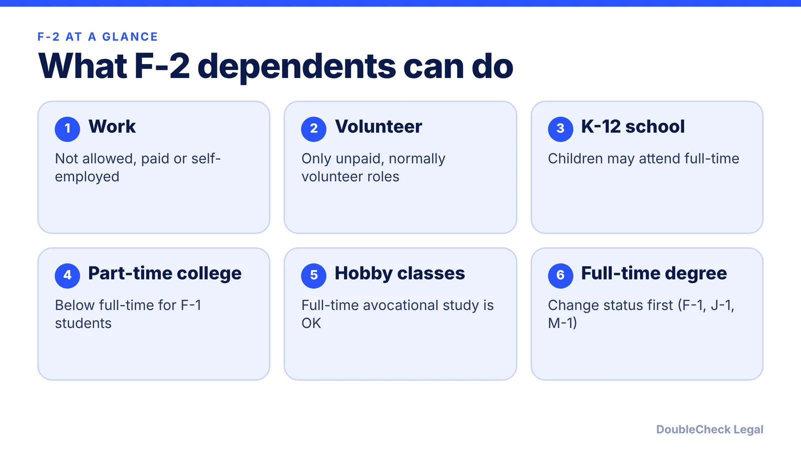
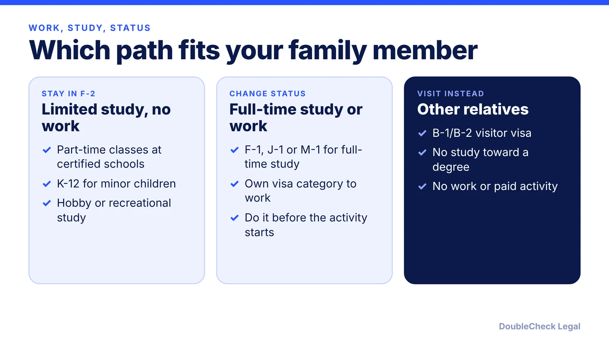

*F-2 lets a family live in the U.S. with an F-1 student, but it comes with a work ban and study limits. Here is the picture as of November 2026.*

**Key takeaways:**

- F-2 covers a spouse and unmarried children under 21 of an F-1 student; F-2 holders may not work.
- Allowed study: K-12 for children, part-time postsecondary classes, and recreational study; full-time degree study needs a status change first.
- F-2 stay depends on the F-1 student's status, and both get a 60-day grace period after the program or OPT ends.
- The 2026 fixed-admission rule that would have changed F-2 dates was blocked by a court on September 14, 2026; confirm with your DSO.

## 1. The quick answer

**Quick answer:** F-2 is the status for the spouse and unmarried children under 21 of an F-1 student. F-2 dependents cannot work in the United States. They can study only in limited ways: part-time postsecondary classes, hobby-type study, and K-12 school for children. Anyone who wants a full-time degree or a job needs a different status, and F-2 stay depends on the F-1 student keeping status. As of November 2026, a court order is also pausing a DHS rule that would have given F-2 dependents fixed end dates.

## 2. Who qualifies and how long F-2 lasts

Per the [University of Michigan International Center](https://internationalcenter.umich.edu/students/f1-students/f2-dependents), only a spouse and unmarried children under 21 who accompany the F-1 student qualify. A dependent who turns 21 loses F-2 eligibility and must change to another status, such as F-1 for a full-time student. Other relatives, such as parents or siblings, would need to apply for a B-1 or B-2 visitor visa; see [B-1/B-2 visitor rules](/blog/b-1-b-2-visa-business-visitor-what-founders-can-do/) for what a visitor may do.

Per [Freeman Law](https://freemanlaw.com/international-students-and-their-dependents-f-2-visas-and-work-and-study-authorization/), each dependent needs an individual SEVIS Form I-20 in their own name. A dependent who follows to join the student must show the F-1 student has been admitted and is enrolled, or will be within 30 days, in a full course of study or approved practical training (8 C.F.R. 214.2(f)(3)). For how the student's own I-20 works, see [SEVIS and I-20 explained](/blog/sevis-i-20-explained-maintaining-f-1-status/).

Stay is tied to the student. Per Michigan, F-2 legal stay depends on the F-1 holder maintaining status and extending the program on time. After the program ends there is a 60-day grace period, and once the F-1 student leaves the U.S., F-2 dependents must leave too.

## 3. Work and study rules in detail

**Work.** The regulation is blunt. Per Freeman Law, 8 C.F.R. 214.2(f)(15)(i) says the F-2 spouse and children "may not accept employment." Michigan adds that volunteering is allowed only if the person receives no compensation of any kind and the role is one usually done by volunteers. Freelancing, paid online work, and unpaid internships that would normally be paid are the grey areas where families get into trouble, so ask the school's designated school official (DSO) before starting anything.

**Study.** Under the same sources:

- **K-12:** F-2 children may attend kindergarten through 12th grade full-time (8 C.F.R. 214.2(f)(15)(ii)(B)). Minor children must meet compulsory education requirements. Per [Stony Brook University](https://www.stonybrook.edu/commcms/visa/immigration-status/f1-students/f-2-dependents), families enroll through the local school district.
- **Part-time postsecondary study:** allowed at an SEVP-certified school as long as it stays below the regulatory definition of full-time study for F-1 students. Schools publish their own ceilings; Stony Brook, for example, lists 11 credits for undergraduate and 8 for graduate study.
- **Avocational or recreational study:** full-time classes in hobbies are allowed.
- **Full-time degree or vocational study:** requires approval to change to F-1, J-1, or M-1 before it begins. Per Freeman Law, enrolling in study the regulations do not permit violates F-2 status.

A spouse who wants to build a career has one realistic route in F-2: study first. A full-time F-1 program does not itself grant work rights, so see [CPT vs OPT](/blog/cpt-vs-opt-f1-students/) for what a student can do later, and [US visa options for startup founders](/blog/us-visa-options-for-startup-founders-compared/) for employment-based routes.

## 4. What happens when the F-1 goes on OPT

F-2 dependents can stay while the F-1 student is on OPT, but nothing about their rights improves. Per Freeman Law, the employment bar continues during the student's authorized practical training and any optional practical training period. The student's OPT work card does not extend to a spouse.

Practical points, per Stony Brook:

- F-2 dependents can stay without the F-1 as long as the F-1 keeps status.
- For travel, the dependent needs a valid passport, an F-2 visa (except Canadian dependents), and an I-20 with a travel signature. That signature is valid for one year while the F-1 is enrolled but six months while the F-1 is on OPT or STEM OPT.
- If the F-1 is on OPT, re-entry paperwork also includes the OPT I-20, EAD card, and proof of employment or an offer letter.
- When OPT ends, the 60-day grace period applies to both, and the F-1 student's loss of status ends the dependents' status as well. Read [the 60-day grace period after OPT](/blog/f-1-60-day-grace-period-after-opt-ends-options/) and [the OPT unemployment limit](/blog/opt-unemployment-limit-90-days-stem-opt/).

**Where a long-term plan changes things.** If the F-1 student moves to H-1B, the spouse generally moves to H-4; see [H-4 EAD for spouses of H-1B workers](/blog/h-4-ead-spouses-of-h-1b/). 

**The 2026 rule that is on hold.** DHS published a final rule on July 17, 2026 to replace "duration of status" with fixed admission periods, effective September 15, 2026 (per [Morgan Lewis](https://www.morganlewis.com/pubs/2026/07/new-f-1-rule-could-delay-opt-hiring-and-interrupt-employment)). Per [Buffalo's international student services](https://www.buffalo.edu/international-student-services/immigration-visa/fixed-admission-rule.html), F-2 dependents would also receive an admit-until date and would file Form I-539 for more time. Per [NAFSA](https://www.nafsa.org/legal-defense-DS) (updated November 5, 2026), a federal court in Massachusetts blocked the rule on September 14, the government appealed, and the longstanding duration-of-status framework remains in place nationwide. Check with your DSO for the current position.

## Where DoubleCheck fits

[DoubleCheck](https://www.contactdoublecheck.com) helps businesses and founders start legal work with AI, verify it, and, when professional advice is warranted, connect with an independent attorney, including for immigration questions. Attorney availability and practice areas vary. Attorneys on DoubleCheck are independent professionals; an attorney-client relationship forms only if an attorney accepts your engagement.

**Sources:** [University of Michigan International Center, F-2 Dependents](https://internationalcenter.umich.edu/students/f1-students/f2-dependents); [Freeman Law, F-2 visas and work and study authorization](https://freemanlaw.com/international-students-and-their-dependents-f-2-visas-and-work-and-study-authorization/); [Stony Brook University, F-2 dependents](https://www.stonybrook.edu/commcms/visa/immigration-status/f1-students/f-2-dependents); [Morgan Lewis, new F-1 rule](https://www.morganlewis.com/pubs/2026/07/new-f-1-rule-could-delay-opt-hiring-and-interrupt-employment); [Buffalo ISS, fixed admission rule](https://www.buffalo.edu/international-student-services/immigration-visa/fixed-admission-rule.html); [NAFSA, D/S litigation tracker](https://www.nafsa.org/legal-defense-DS).

## FAQ

**Can an F-2 spouse work in the U.S.?**

No. Per Freeman Law, 8 C.F.R. 214.2(f)(15)(i) says the F-2 spouse and children may not accept employment, and the bar continues while the F-1 student is on practical training or OPT. The University of Michigan adds that volunteering is allowed only if unpaid and normally done by volunteers.

**Can F-2 children go to school?**

Yes. Per Freeman Law, F-2 children may attend kindergarten through 12th grade full-time, and per Michigan, minor children must meet compulsory education requirements. Full-time college generally requires changing to F-1, J-1 or M-1 first.

**Can an F-2 spouse take college classes?**

Part-time postsecondary study is allowed at an SEVP-certified school if it stays below the regulatory definition of full-time study for F-1 students, per Michigan. Full-time academic or vocational study requires a status change before it begins.

**What happens to my F-2 family when my OPT ends?**

Per Stony Brook, the F-1 student and F-2 dependents get a 60-day grace period after the program or OPT ends, and dependents must leave once the F-1 student leaves. Use the grace period to change status or plan departure.

---

*General information only. This article is not legal, tax, investment, or accounting advice.*
