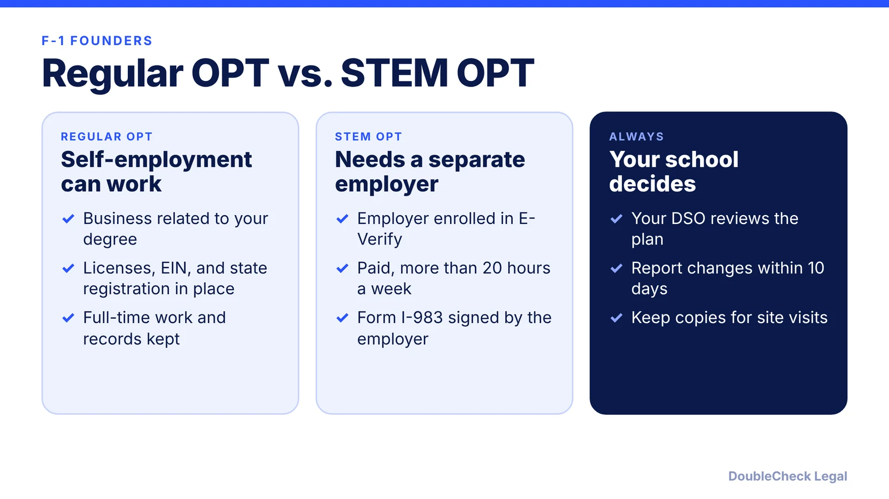
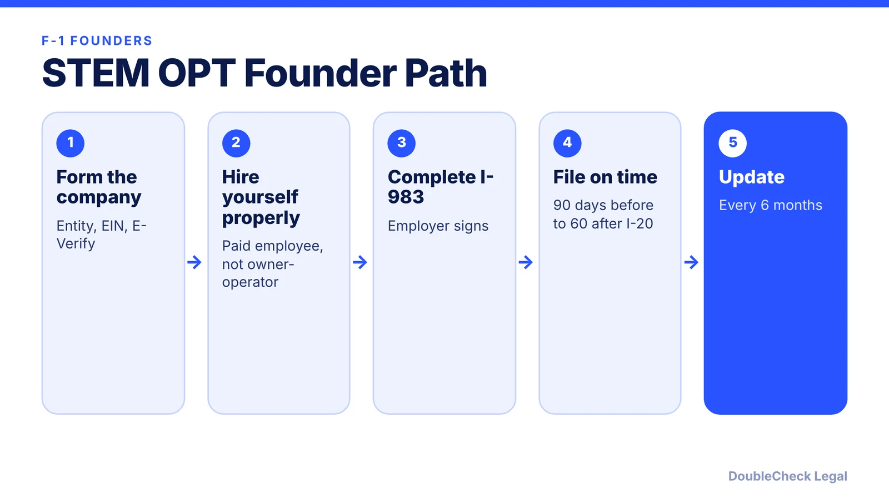

*Can you work for your own company on OPT? Regular OPT and STEM OPT have different rules, and the STEM rules are strict.*

**Key takeaways:**

- Regular OPT can allow self-employment if the business is real and related to your degree, per law-firm and school guidance.
- STEM OPT needs an E-Verify employer, pay, and an I-983; you cannot sign your own I-983.
- Sole proprietorships, unpaid work, and labor-for-hire usually do not qualify for STEM OPT.
- A December 2024 rule moved cap-gap's end date to April 1; confirm with your school.

## 1. The quick answer

**Quick answer:** On regular post-completion OPT, F-1 students can generally work for their own company if it is a real business that is related to the degree, and keep records to show it. On the 24-month STEM OPT extension the rules are stricter: the employer must be enrolled in E-Verify, you must be paid, and you need a bona fide employer-employee relationship documented on Form I-983. You cannot sign your own I-983 or act as your own employer.

## 2. What a founder structure needs

According to Berardi Immigration Law and the University of Chicago's international office, for STEM OPT you must be a bona fide employee of the entity that signs your I-983. Sole proprietorships, temp agencies, labor-for-hire consulting, and unpaid or volunteer work generally do not qualify, and the STEM job must be directly related to your STEM degree. Equity ownership is not barred, but the company must meet every requirement, including E-Verify and an EIN ([how to incorporate](/blog/how-to-incorporate-a-company-in-the-us/), [EIN](/blog/how-to-get-an-ein-for-your-business-free/)).

Schools describe the limits differently, such as how many STEM extensions you can have and how many unemployment days apply. Confirm the current rule with your designated school official (DSO) and the government's STEM OPT page before you rely on any one summary.

## 3. Deadlines to track

Per Carnegie Mellon's international office: USCIS must receive the STEM request no more than 90 days before your current EAD expires and no later than 60 days after the STEM I-20 is issued. You may keep working up to 180 days after the OPT EAD expires while a timely STEM application is pending. Keep a copy of the I-983 for site visits, update it every six months, and report name, address, or employer changes within 10 days, per UChicago.

## 4. Cap-gap and the next visa

Per RN Law Group, a December 2024 DHS final rule moved the end of cap-gap protection from September 30 to April 1 of the following year, when a timely H-1B cap petition requests a change of status filed before your OPT expires. Some school pages have not updated, so ask your DSO. Founders often compare [H-1B ownership limits](/blog/start-company-on-h1b-visa-ownership-vs-work/), the [weighted lottery](/blog/h1b-weighted-lottery-wage-levels-explained/), and [O-1A](/blog/o-1a-visa-for-startup-founders-evidence/). Talk to an immigration attorney ([how to find one](/blog/how-to-find-good-immigration-lawyer-startup-founder/)).

## Where DoubleCheck fits

[DoubleCheck](https://www.contactdoublecheck.com) helps businesses and founders start legal work with AI, verify it, and, when professional advice is warranted, connect with an independent attorney, including for immigration questions. Attorney availability and practice areas vary. Attorneys on DoubleCheck are independent professionals; an attorney-client relationship forms only if an attorney accepts your engagement.

**Sources:** [Berardi Immigration Law](https://berardiimmigrationlaw.com/f1-students-start-business-opt-stem/); [UChicago International Affairs](https://internationalaffairs.uchicago.edu/students/current-students/stem-opt-extension); [Carnegie Mellon OIE](https://www.cmu.edu/oie/docs/power-points/stem-opt-slides.pdf); [RN Law Group](https://www.rnlawgroup.com/cap-gap-after-the-2024-final-rule-what-every-employer-needs-to-know/).

## FAQ

**Can I start a company on OPT?**

Generally yes on regular OPT if the work is related to your degree and you can document the business, per Berardi Immigration Law. STEM OPT has stricter rules. Ask your DSO first.

**Can I be my own employer on STEM OPT?**

No. UChicago says you cannot sign your own I-983 or act as your own employer; you must be a bona fide employee of the entity.

**Does the company need E-Verify?**

For STEM OPT, yes. The employer must be enrolled in E-Verify and have an EIN.

**When must I file for the STEM extension?**

Per CMU, USCIS must receive it no more than 90 days before your EAD expires and no later than 60 days after the STEM I-20 is issued.

---

*General information only. This article is not legal, tax, investment, or accounting advice.*
