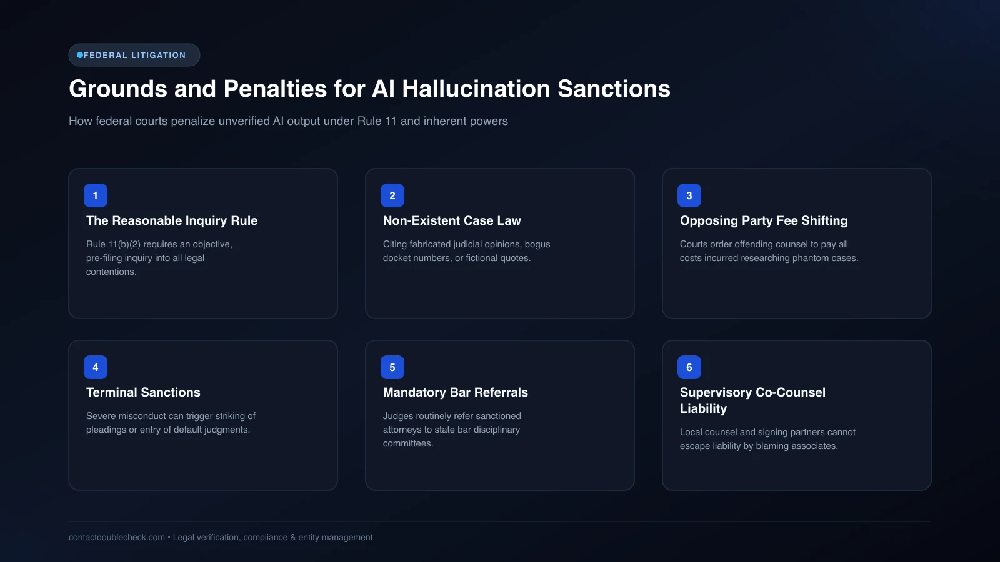
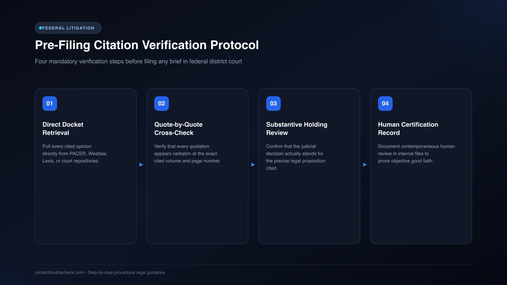

*A practical analysis of Federal Rule of Civil Procedure 11 sanctions, judicial enforcement trends, and citation verification requirements when handling AI-generated legal text, updated through November 2026. General information, not legal advice.*

**Key takeaways:**

- Federal Rule of Civil Procedure 11(b) imposes an objective standard of reasonableness; claiming ignorance of an AI hallucination does not protect counsel from sanctions.
- Submitting nonexistent judicial opinions, fabricated Federal Reporter citations, or altered quotations routinely results in mandatory attorney fee awards to the opposing party.
- Federal judges possess inherent authority to issue terminal sanctions, including striking pleadings or entering default judgment, in egregious cases of AI fabrication.
- Local counsel who signs a filing cannot shield themselves by blaming out-of-district lead counsel or third-party automated tools.
- Every legal authority cited in a federal pleading must be personally cross-referenced and verified against primary court records by a licensed attorney.

## 1. The quick answer

**Quick answer:** Under Federal Rule of Civil Procedure 11(b)(2), an attorney’s signature on a pleading, written motion, or brief certifies that to the best of their knowledge, information, and belief formed after an inquiry reasonable under the circumstances, the legal contentions are warranted by existing law. Federal courts across the country have established that submitting an AI-hallucinated brief containing nonexistent case citations or fabricated quotations violates Rule 11 as a matter of law.

Sanctions for submitting AI-generated false authorities range from direct monetary penalties and formal reprimands to mandatory payment of the opposing party’s attorney fees, dismissal of claims, and formal referral to state bar disciplinary boards. "Checking" an AI output with another AI chatbot does not satisfy the reasonable inquiry requirement—only contemporaneous human verification against primary sources protects litigators.

For commercial litigators and founders drafting corporate filings, see our guides on [identifying hallucinated citations in business contracts](/blog/ai-hallucinated-citations-business/) and [evaluating AI contract review prompts](/blog/ai-contract-review-prompts-what-to-ask-and-what-to-verify/).

## 2. Rule 11(b) and the objective reasonable inquiry standard

Rule 11 is not an ethics aspirational guideline; it is an enforceable procedural mechanism designed to deter baseless litigation practices:

- **The Objective Standard:** The court does not evaluate whether counsel subjectively believed the hallucinated cases were real. The inquiry is purely objective: would a reasonably competent practitioner, acting under similar circumstances, have caught the error prior to filing? Because a simple search on Lexis, Westlaw, or court dockets reveals nonexistent cases in seconds, failing to perform that check fails the objective reasonableness test.
- **Rule 11(b)(2) Warranty:** Counsel warrants that claims and defenses are supported by existing law or a non-frivolous argument for extending or reversing law. A legal argument built upon fictional judicial precedent is inherently frivolous.
- **Rule 11(b)(3) Factual Contentions:** If an AI model fabricates factual assertions regarding prior proceedings, discovery exchanges, or evidentiary records, counsel violates subsection (b)(3).

## 3. Federal case law developments and sanctions

The legal landscape surrounding AI hallucinations has matured rapidly beyond early warnings into aggressive judicial intervention:

1. **The Precedent-Setting Wave:** Following the widely reported decision in *Mata v. Avianca, Inc.*, where counsel was sanctioned for relying on fictional ChatGPT decisions complete with fabricated docket numbers and fake judge quotes, courts established that AI tools are prone to subtle fabrication.
2. **Terminal Sanctions in S.D.N.Y.:** In *Flycatcher Corp. v. Affable Ave. LLC*, Judge Katherine Polk Failla utilized Rule 11 and the court's inherent authority to strike defense pleadings and enter a default judgment after counsel submitted multiple briefs citing nonexistent cases and bogus quotations, followed by an award of nearly $39,000 in opposing attorneys' fees.
3. **Magistrate Orders on Reasonable Inquiry:** In *Virgil v. Experian Information Solutions Inc.* (S.D. Ind. 2026), the magistrate judge emphasized that the duty of reasonable inquiry completely bars unverified reliance on consumer AI tools, recommending substantial financial penalties against offending counsel.
4. **State Disciplinary Repercussions:** In *Coomer v. Lindell* (D. Colo.), the submission of an AI-fabricated proposed order resulted in formal disciplinary proceedings that led to a multi-month suspension of the responsible attorney.

## 4. Fee-shifting, admonitions, and terminal sanctions

When a party submits a brief riddled with fake AI citations, the harm extends directly to the opposing party and the judiciary:

- **Compensatory Fee Awards:** Opposing counsel must spend valuable client hours searching through federal reporters, regional digests, and state dockets attempting to locate citations that do not exist. Courts routinely order the offending lawyer to reimburse every dollar of those fees.
- **Striking Briefs and Pleadings:** Judges frequently strike the offending motion entirely, refusing to allow substituted filings or denying the underlying relief with prejudice.
- **Default Judgments:** Where counsel demonstrates bad faith, persistent evasion, or continues to defend fabricated citations upon an order to show cause, federal judges have exercised inherent powers to terminate the litigation in favor of the innocent party.
- **Mandatory CLE and Public Admonitions:** Sanction orders are published in federal reporters and legal databases, permanently staining counsel's professional reputation, often accompanied by mandatory coursework in legal ethics and technological literacy.

## 5. Supervisory partner and local counsel liability

A common defense raised by litigators is shifting blame down the ladder or to third parties. Federal courts have uniformly shut down these arguments:

### Local Counsel Cannot Act as a Rubber Stamp
In cases like *Lifetime Well LLC v. IBSPOT.Com, Inc.* (E.D. Pa. 2026), the federal court levied Rule 11 sanctions against local counsel who signed a brief drafted by out-of-state attorneys without independently verifying the citations. Local counsel is not a mere transmission channel; their signature certifies compliance with federal standards.

### Supervisory Partner Responsibility
Senior partners cannot deflect liability by pointing to a first-year associate or external contractor. Federal district courts hold lead trial counsel accountable for any paper bearing their name, emphasizing that senior attorneys have an affirmative duty to supervise associates and implement internal verification checkpoints.

## 6. Procedural citation verification checklist

Litigation teams should institute an airtight pre-filing workflow to prevent hallucinated citations from ever entering the docket:

1. **Mandatory Primary Source Pull:** Every cited case must be pulled from a reputable reporter system (e.g., F.4th, F. Supp. 3d) or verified docket before being incorporated into a brief.
2. **Direct Quotation Verification:** Never accept a quotation from an AI summary. An attorney must match the quote word-for-word against the official reporter text, including page pin-cites.
3. **Validate Procedural Posture:** Ensure the cited holding reflects the actual judgment of the court rather than dissenting opinions, headnotes, or dicta.
4. **Maintain Contemporaneous Verification Logs:** Keep internal research records documenting the date, database, and identity of the attorney who verified each authority cited in the filing.
5. **Comply with Judge Standing Orders:** Review the presiding judge’s individual practice rules to verify if specialized AI disclosures or human certification affidavits are mandatory.

## Where DoubleCheck fits

[DoubleCheck](https://www.contactdoublecheck.com) provides businesses, general counsel, and enterprise teams with automated contract review, AI-assisted verification, and legal workflow assurance. DoubleCheck helps teams verify citations, audit regulatory compliance across California, Colorado, New York, and federal agencies, and connect with experienced attorneys to ensure compliance with emerging AI standards.

**Related reading:**
- [AI Hallucinated Citations in Business Filings](/blog/ai-hallucinated-citations-business/)
- [ABA Formal Opinion 512 Generative AI Compliance](/blog/aba-formal-opinion-512-generative-ai-legal-ethics-compliance/)
- [AI Contract Review: What to Check Before Signing](/blog/ai-contract-review-what-to-check-before-signing/)
- [Agentic AI for Lawyers and Legal Workflows](/blog/agentic-ai-lawyers-entrepreneurs-legal-work/)

**Sources:** [Legal Information Institute, Federal Rule of Civil Procedure 11 (Signing Pleadings, Motions, and Other Papers; Representations to the Court; Sanctions)](https://www.law.cornell.edu/rules/frcp/rule_11); [United States District Court for the Southern District of New York, Mata v. Avianca, Inc. Opinion and Sanctions Order](https://www.nysd.uscourts.gov/); [United States Courts, Federal Rules of Practice and Procedure](https://www.uscourts.gov/rules-policies/current-rules-practice-procedure); [Federal Judicial Center, Sanctions Under Rule 11 of the Federal Rules of Civil Procedure](https://www.fjc.gov/).

## FAQ

**Does Rule 11 apply if an attorney did not know an AI tool fabricated a citation?**

Yes. Rule 11 applies an objective standard of reasonableness under the circumstances. Subjective ignorance or lack of bad faith does not excuse the failure to conduct a reasonable pre-filing inquiry into cited authorities.

**Can local counsel be sanctioned for an AI hallucination drafted by lead counsel?**

Yes. Federal courts have explicitly ruled that local counsel who signs or submits a brief bears an independent, non-delegable duty to verify the citations and cannot blindly vouch for out-of-state co-counsel.

**What are the typical financial penalties for submitting AI-generated fake cases?**

Sanctions frequently include thousands of dollars in direct court fines, mandatory payment of the opposing party’s reasonable attorney fees incurred in investigating the false citations, and mandatory ethics CLE.

**Can a judge dismiss a case entirely because of an AI-hallucinated brief?**

Yes. Under inherent judicial powers and Rule 11, federal judges can issue terminal sanctions—such as striking a motion to dismiss, dismissing claims with prejudice, or entering default judgment—where bad faith or systemic falsehood is found.

**Does running a brief through another AI tool satisfy Rule 11 verification?**

No. Federal courts have rejected the defense that a brief was checked by a secondary AI program. Rule 11 requires a human attorney to personally review primary legal authorities.

---

*General information only. This article is not legal, tax, investment, or accounting advice.*
