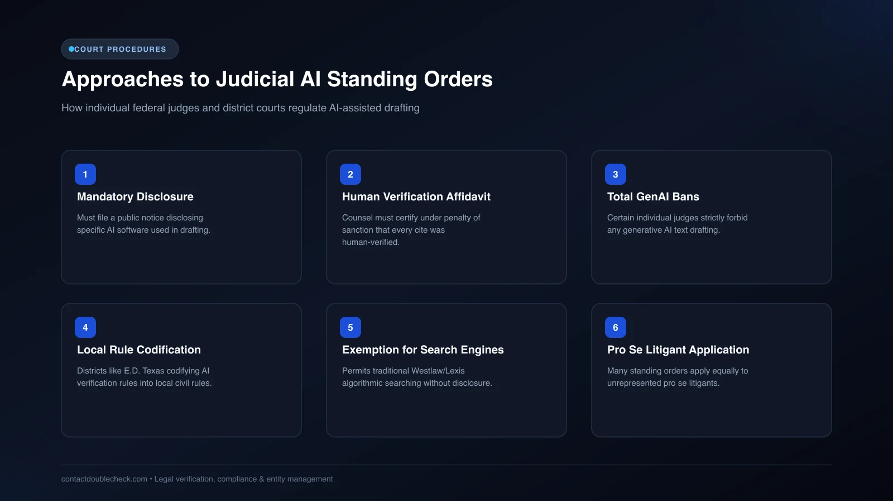
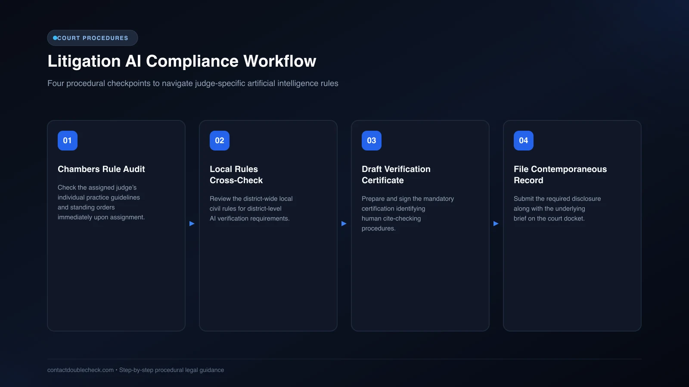

*A strategic guide to navigating federal judge standing orders, district-level local rules, and mandatory disclosure requirements for artificial intelligence in litigation, current as of November 2026. General information, not legal advice.*

**Key takeaways:**

- Federal courts lack a single, uniform AI rule; regulation is governed by individual judge standing orders and emerging district local rules.
- The most prevalent model permits AI usage but requires a mandatory public disclosure and an affirmative attorney certification of human verification.
- A minority of federal judges have enacted total prohibitions on using generative AI to draft court submissions.
- Standing orders routinely distinguish between generative drafting tools (LLMs) and traditional database search engines (Westlaw, Lexis, Google).
- Litigators must audit assigned chambers' individual rules at the onset of every case to avoid having pleadings stricken from the docket.

## 1. The quick answer

**Quick answer:** Over the past three years, dozens of federal district judges and several whole districts have enacted binding **standing orders on generative artificial intelligence**. Because the Federal Rules of Civil Procedure have not yet codified a universal AI amendment, judicial regulation is highly fragmented.

Depending on the assigned judge, litigators face three distinct regimes: (1) mandatory disclosure and certification that a human attorney verified every citation; (2) total bans on generative AI drafting; or (3) standard enforcement under Rule 11 with heightened judicial scrutiny. Violating a judge's standing order can lead to immediate striking of filings, contempt findings, or monetary sanctions.

For litigation support and legal operations teams, review our analysis on [federal court Rule 11 sanctions for hallucinations](/blog/federal-court-rule-11-sanctions-ai-hallucinations-citations/) and [using AI tools in commercial legal workflows](/blog/agentic-ai-lawyers-entrepreneurs-legal-work/).

## 2. The fragmentation of judicial standing orders

Federal judges possess broad inherent authority to manage their dockets and regulate attorney practice before their courts under 28 U.S.C. § 2071 and Federal Rule of Civil Procedure 83. Following widespread reports of fabricated citations, judges began publishing individual orders:

- **Courtroom-by-Courtroom Variation:** In large metropolitan federal courthouses (such as S.D.N.Y., N.D. Ill., or C.D. Cal.), two judges sitting on the same floor may maintain radically different rules. One may mandate a two-page sworn declaration detailing the exact AI prompt parameters, while another may have no standing order at all.
- **The Pitfall for Out-of-State Litigators:** National litigation practices that rely on standardized filing templates frequently run afoul of local chamber rules when filing motions pro hac vice.

## 3. The three primary regulatory approaches

Judicial orders typically fall into one of three distinct categories:

### 1. Mandatory Disclosure and Human Certification (Prevalent Model)
Pioneered by judges like Judge Brantley Starr (N.D. Tex.), this model permits generative AI use but enforces transparency:
- **Identification of Software:** The party must disclose that AI was used and name the specific platform (e.g., ChatGPT, Claude, CoCounsel).
- **Affirmative Verification:** Counsel must certify that an attorney personally read the cited cases in a primary reporter or verified database to confirm that the quotations and propositions are accurate.

### 2. Complete Prohibitions
Several judges have instituted outright bans on utilizing generative AI for any document drafting, motion preparation, or brief writing:
- **Scope of Ban:** Covers all text generation, summarization, and legal drafting.
- **Carve-Outs:** Most orders explicitly clarify that traditional, non-generative search algorithms in LexisNexis, Westlaw, HeinOnline, or standard search engines remain permitted.

### 3. Responsibility-Based Orders (Rule 11 Reaffirmation)
Judges taking this approach decline to add administrative disclosure burdens, emphasizing instead that Rule 11 already makes counsel strictly liable for every word in the brief. However, these judges frequently add stern warnings that AI hallucinations will be met with maximum permissible sanctions without a safe-harbor warning.

## 4. District-wide local rules and codification

While individual standing orders led the initial wave, several federal districts have moved toward formal codification:

- **Eastern District of Texas Local Rule CV-11(g):** Requires attorneys using generative AI tools to certify that they reviewed and verified all AI-assisted content.
- **Fifth Circuit Proposed Rules:** Circuit-level committees have debated and advanced proposed rules governing disclosure of AI in appellate briefs, signaling that formal codified rules will eventually supersede individual standing orders.
- **Bankruptcy Courts:** Many U.S. Bankruptcy Courts have issued standing orders requiring debtors' counsel to certify that fee applications, asset schedules, and disclosure statements were not generated using unverified AI platforms.

## 5. Sanctions and penalties for order violations

Failing to comply with an individual judge's standing order carries swift procedural consequences:

- **Pleadings Stricken:** Clerks or judges will routinely strike a non-conforming brief, requiring refiling with leave of court and potentially causing the party to miss statutory or scheduling deadlines.
- **Civil Contempt:** Knowingly violating a court's standing order can support a finding of civil contempt under the court's inherent powers.
- **Cost Awards:** The court may order counsel to pay the expenses and attorney fees incurred by opposing counsel in moving to enforce the standing order.
- **Evidentiary Preclusion:** In complex commercial litigation, failure to disclose AI tools used in preparing expert witness disclosures or discovery responses can lead to preclusion of that evidence under Rule 37.

## 6. Chambers compliance protocol for litigators

Litigators should embed a standard chambers check into their case initiation procedures:

1. **Review Chambers Guidelines on Day One:** The moment a case is assigned to a district or magistrate judge, immediately pull their individual rules and standing orders from the district court website.
2. **Flag AI Requirements in Case Calendar:** Note whether mandatory certifications must accompany every motion or only primary briefs.
3. **Establish a Verification File:** Keep an internal audit trail showing which human attorney verified each cited case, page pin-cite, and statutory quote.
4. **Draft Conforming Certification Attachments:** If the judge requires a certificate of compliance, attach it as a formal exhibit or include it within the signature block as specified.
5. **Educate Local Counsel:** Ensure local counsel reviews the brief and the accompanying AI certification prior to electronic filing.

## Where DoubleCheck fits

[DoubleCheck](https://www.contactdoublecheck.com) provides businesses, general counsel, and enterprise teams with automated contract review, AI-assisted verification, and legal workflow assurance. DoubleCheck helps teams verify citations, audit regulatory compliance across California, Colorado, New York, and federal agencies, and connect with experienced attorneys to ensure compliance with emerging AI standards.

**Related reading:**
- [Federal Rule 11 Sanctions for AI Hallucinations in Briefs](/blog/federal-court-rule-11-sanctions-ai-hallucinations-citations/)
- [ABA Formal Opinion 512 Generative AI Compliance](/blog/aba-formal-opinion-512-generative-ai-legal-ethics-compliance/)
- [AI Chats Are Not Privileged: Heppner Decision](/blog/ai-chats-not-privileged-heppner/)
- [AI Contract Review Prompts: What to Ask and Verify](/blog/ai-contract-review-prompts-what-to-ask-and-what-to-verify/)

**Sources:** [United States District Court for the Northern District of Texas, Mandatory AI Verification Standing Order](https://www.txnd.uscourts.gov/); [United States District Court for the Eastern District of Texas, Local Civil Rule CV-11](https://www.txed.uscourts.gov/); [United States Courts, Understanding Local Rules and Standing Orders](https://www.uscourts.gov/about-federal-courts/court-role-and-structure); [Cornell Legal Information Institute, 28 U.S.C. § 2071 (Rule-Making Power Generally)](https://www.law.cornell.edu/uscode/text/28/2071).

## FAQ

**Are standing orders on generative AI uniform across federal courts?**

No. There is no nationwide federal rule. Requirements vary widely by individual judge and district, ranging from complete bans on generative AI drafting to mandatory disclosure certifications or simple reliance on Rule 11.

**Does using Lexis or Westlaw require an AI disclosure filing?**

Generally, no. Most judicial standing orders distinguish between traditional algorithmic research platforms (like standard search in Westlaw or Lexis) and generative large language models that draft text or synthesize novel legal propositions.

**What happens if an attorney fails to file a mandatory AI certification?**

Failing to file a required AI disclosure or submitting a non-conforming filing can result in the court striking the pleading, ordering counsel to show cause, or imposing monetary sanctions.

**Do judicial AI standing orders apply to pro se litigants?**

Yes. Many federal judges explicitly draft their standing orders to cover both licensed attorneys and pro se litigants, recognizing that unrepresented parties frequently rely on consumer AI chatbots.

**Can a judge ban all generative AI tools entirely in their courtroom?**

Yes. Several federal judges have exercised their inherent authority to regulate proceedings by issuing standing orders that strictly forbid any generative AI assistance in preparing submissions.

---

*General information only. This article is not legal, tax, investment, or accounting advice.*
