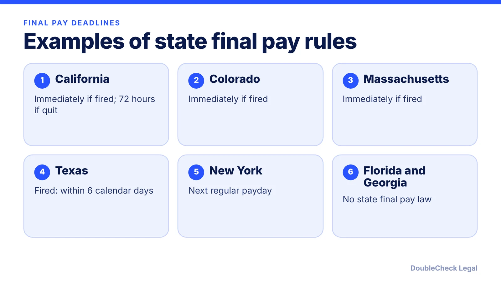
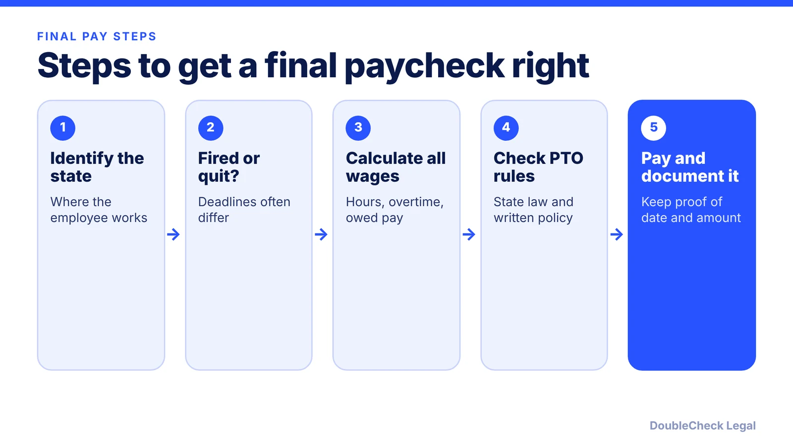

*Final pay deadlines are mostly set by states and differ for fired and resigning employees. Here are the main patterns, PTO payout rules and penalties, with sources.*

**Key takeaways:**

- The U.S. Department of Labor says federal law does not require employers to give a final paycheck immediately, so state law usually controls.
- California requires immediate pay on termination; Texas allows six calendar days; New York uses the next payday.
- PTO payout depends on the state and often on your written policy.
- Late pay can trigger penalties; California waiting time penalties cap at 30 days of wages.

## 1. The quick answer

**Quick answer:** Final paycheck laws are set mostly by states, not the federal government, so the deadline depends on where the employee works and whether they were fired or quit. The U.S. Department of Labor says federal law does not require immediate final pay, and FindLaw's state chart shows the rules. Some states require payment immediately on termination (California, Colorado, Massachusetts), some within days (Texas: six days), many by the next scheduled payday (New York, Washington), and a few (Alabama, Florida, Georgia, Mississippi) have no final-pay law. As of November 2026, confirm the exact rule with your state labor agency before you pay.

## 2. Final paycheck laws by state: the main patterns

There are four patterns. The examples below come from FindLaw's state chart, the U.S. Department of Labor and, for California, the state labor agency. Charts can differ on some states and change over time, so treat them as a starting point and verify.

- **Immediately on termination:** California (per FindLaw, Epstein Becker Green and the California DIR), Colorado and Massachusetts (per FindLaw).
- **Within a set number of days:** Texas requires final pay within six days when an employee is fired, per FindLaw. Oregon is by the end of the next business day for a firing, per FindLaw. Utah allows 24 hours for a firing, and FindLaw lists Minnesota as immediate for a firing.
- **Next scheduled payday:** New York and Washington, per FindLaw.
- **No state law:** Alabama, Florida, Georgia and Mississippi, per FindLaw. Where a state has no law, the safe practice is to pay by the next regular payday.

Charts can describe other states differently or lag behind law changes. That is a reason to read the state agency page rather than trust any single chart. Our guide to [at-will employment by state](/blog/at-will-employment-by-state-exceptions-employers/) explains why the ability to terminate quickly does not change the pay deadline.

## 3. Quit vs fired, and what is owed at separation

Many states set a different clock when the employee resigns. Per FindLaw, California requires payment within 72 hours of a resignation, or immediately if the employee gave more than 72 hours' notice. Epstein Becker Green describes the same rule: on the last day with 72 hours' notice, within 72 hours without it, and the employer may mail the pay if the employee asks and provides an address. In Oregon, FindLaw lists immediate payment if the employee gave at least 48 hours' notice. In Texas, an employee who resigns is paid by the next scheduled payday, per FindLaw.

What goes into the check:

- **All wages earned:** the FLSA requires pay for all hours worked, including overtime. See [overtime exempt vs non-exempt](/blog/overtime-exempt-vs-nonexempt-small-business/).
- **Commissions and bonuses:** some states have separate rules for commissions, bonuses and other special pay. Check your state and your plan documents.
- **Withholding:** FindLaw says employers cannot withhold wages past the legal deadline because of poor performance, property damage, a voluntary resignation, a customer's unpaid bill or the company claiming it cannot afford to pay. FindLaw's state chart notes South Dakota as a stated exception (pay is due at the next scheduled payday or when company property is returned).
- **Payroll accounts:** if you are a new employer, see [registering for state payroll taxes](/blog/register-for-state-payroll-taxes-new-employer/).

## 4. Do employers have to pay out unused PTO?

It depends on the state and, in many states, on your written policy. Some states require payout of accrued vacation at termination, some let employers forfeit it if a written policy says so, and some have no specific rule. FindLaw's state chart does not address vacation payout, so check your state labor agency's guidance and your own written policy.

For California specifically, accrued vacation is treated as vested wages that cannot be forfeited and must be paid at the final rate, per the California Department of Industrial Relations (Labor Code section 227.3). If all leave is combined into one PTO bank, a state may treat sick leave like vacation. For sick leave rules in general, see [paid sick leave laws by state](/blog/paid-sick-leave-laws-by-state-small-business-2026/) and [PTO and vacation pay laws](/blog/pto-vacation-pay-laws-small-business/). Put your policy in writing in your [employee handbook](/blog/employee-handbook-small-business-what-to-include/).

## 5. Penalties and what to do when a final check is late

Penalties vary widely by state. California is the best-documented example. Under Labor Code section 203, late final pay can trigger waiting time penalties equal to the employee's daily rate for each day late, up to 30 days, per Epstein Becker Green and the California DIR. A worker earning $20 an hour for 8 hours a day could face up to $4,800, per Epstein Becker Green's example. The California DIR says the penalty cannot be imposed where there is a good faith dispute over whether any wages are due, and that inability to pay is not a defense.

If you are the employer and you realize a check is late:

- pay the undisputed amount now and document the date;
- confirm whether your state requires penalties or interest;
- review any [termination steps you took](/blog/how-to-terminate-an-employee-legally-small-business/) and the [separation or severance paperwork](/blog/severance-agreement-review-before-you-sign/).

If you are an employee, FindLaw suggests notifying the employer in writing, then filing a complaint with the Department of Labor Wage and Hour Division or your state agency if it continues.

**When to get an attorney:** a multi-state workforce, a disputed commission plan, a layoff of several people at once, or a claim for penalties are good moments to have an employment attorney look at the facts. Related: [multi-state remote employees](/blog/multi-state-remote-employees-compliance-startups/) and [independent contractor misclassification penalties](/blog/independent-contractor-misclassification-penalties-employers/).

## Where DoubleCheck fits

[DoubleCheck](https://www.contactdoublecheck.com) helps businesses and founders start legal work with AI, verify it, and, when professional advice is warranted, connect with an independent attorney, including for immigration questions. Attorney availability and practice areas vary. Attorneys on DoubleCheck are independent professionals; an attorney-client relationship forms only if an attorney accepts your engagement.

**Sources:** [U.S. Department of Labor, Last paycheck](https://www.dol.gov/general/topic/wages/lastpaycheck); [FindLaw, Final paycheck laws by state](https://www.findlaw.com/smallbusiness/employment-law-and-human-resources/final-paycheck-laws-by-state.html); [FindLaw, Last paycheck laws](https://www.findlaw.com/employment/losing-a-job/last-paycheck-laws.html); [Epstein Becker Green, California final pay](https://www.ebglaw.com/workforce-bulletin/time-is-money-a-quick-wage-hour-tip-on-final-payment-of-wages-to-terminated-employees-in-california); [California DIR, Waiting time penalty](https://dir.ca.gov/dlse/faq_waitingtimepenalty.htm); [California DIR, Vacation](https://www.dir.ca.gov/dlse/faq_vacation.htm).

## FAQ

**When must an employer give a final paycheck?**

It depends on the state and on whether the employee was fired or quit. Examples per FindLaw: California immediately on termination, Texas within six days, and New York by the next scheduled payday. Always confirm with your state labor agency.

**Do I have to pay a final paycheck immediately when I fire someone?**

Only in some states. California, Colorado and Massachusetts require immediate payment on termination per FindLaw, while many others allow the next scheduled payday. Charts disagree on a few states, so verify with your state agency.

**Do employers have to pay out unused vacation or PTO at termination?**

In some states yes, in others it depends on written policy. California treats accrued vacation as vested wages that must be paid at termination, per the California Department of Industrial Relations. Other states differ, so check your state labor agency and your written policy.

**What states have no final paycheck law?**

Per FindLaw, Alabama, Florida, Georgia and Mississippi have no final paycheck law, and Missouri has one only for fired employees. The U.S. Department of Labor says federal law does not require immediate final pay, and the safe practice is to pay by the next regular payday.

**What happens if an employer pays a final paycheck late?**

Penalties vary by state. In California, waiting time penalties equal the daily rate of pay for each day late, up to 30 days, per Epstein Becker Green. Other states may add interest or fines, so check your state rules.

---

*General information only. This article is not legal, tax, investment, or accounting advice.*
