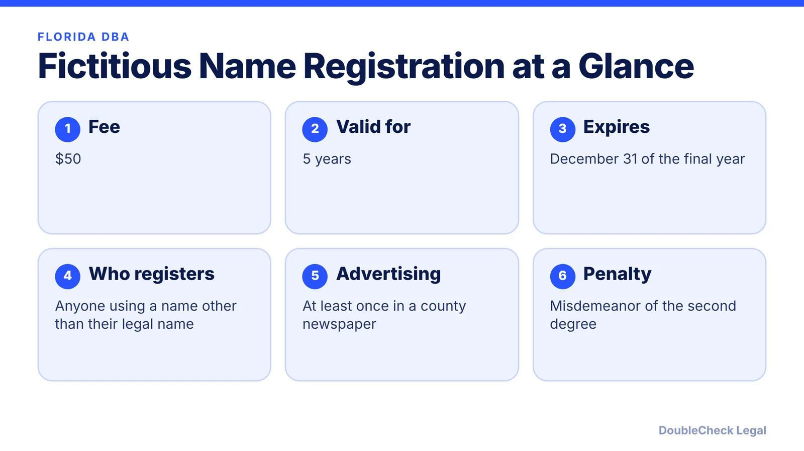
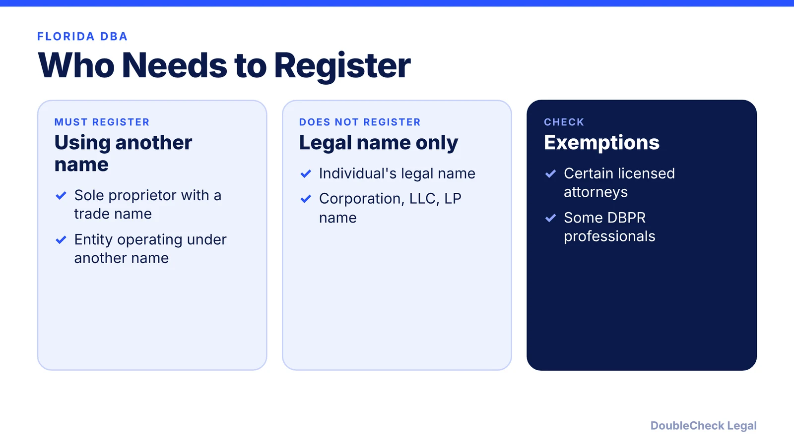
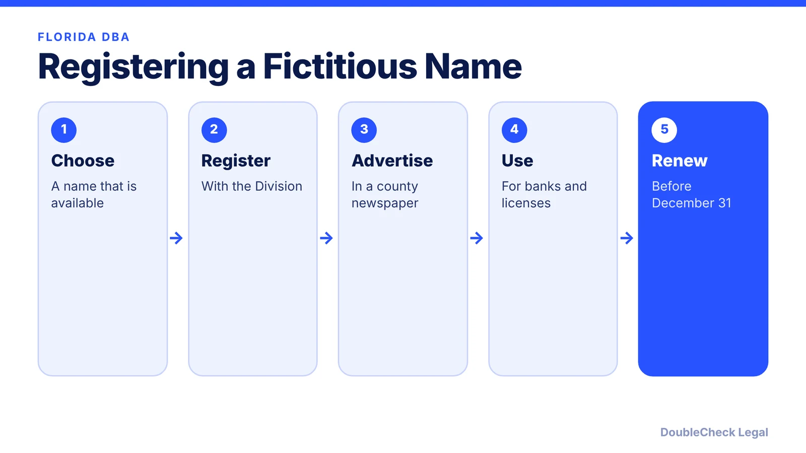

*Doing business in Florida under a different name? Here is how fictitious name registration works.*

**Key takeaways:**

- Registration costs $50 and is valid for 5 years, expiring on December 31 of the final year.
- A sole proprietor must register a name that differs from their personal name.
- The name must be advertised at least once in a newspaper in your county.
- Registration does not give you ownership of the name.

## 1. The quick answer

**Quick answer:** In Florida you register a fictitious name (DBA) with the Division of Corporations for **$50**, and it is valid for **5 years**, expiring on December 31 of the final year. A sole proprietor must register a name that differs from their personal name; a personal legal name does not need registration. The name must also be advertised at least once in a newspaper in the county of your principal place of business.

## 2. Who must register

Any person, including an individual or business entity, that does business in Florida under a name other than its legal name must register before doing business, under the Fictitious Name Act (section 865.09, Florida Statutes). Registration is not needed for an individual's legal name or for the name of a corporation, LLC, or limited partnership operating under that name. The Division lists exemptions for certain licensed attorneys, some professionals registered with DBPR, active legal entities not operating under another name, and federally chartered corporations not operating under another name.

## 3. Advertising and renewal

The name must be advertised at least once in a newspaper in the county where your principal place of business is located (Chapter 50, Florida Statutes). You do not submit proof of publication; by signing the application you certify that the name was advertised. You can renew online or by mail and update a registration before it expires. Failure to file is a misdemeanor of the second degree, per the Division.

## 4. What registration does not do

Registration does not give you ownership of the name and does not stop others from using or registering it, per the Division. You will need proof of registration to apply for a local occupational license or transfer a business license, and many banks request it. See [trademark and business name checks](/blog/trademark-business-name-check/) and [LLC formation costs](/blog/llc-formation-cost-california-texas-florida-new-york/).

## Where DoubleCheck fits

[DoubleCheck](https://www.contactdoublecheck.com) is built for businesses that start legal work with AI. Bring your question or draft, use an AI-first workflow to understand and verify it, and when professional advice is warranted, you can connect with an independent attorney. Attorneys on DoubleCheck are independent professionals; an attorney-client relationship forms only if an attorney accepts your engagement.

**Sources:** [Florida Division of Corporations: Fictitious name registration](https://dos.fl.gov/sunbiz/start-business/efile/fl-fictitious-name-registration/).

## FAQ

**How much does a Florida DBA cost?**

$50 for the registration, according to the Division of Corporations.

**How long is it valid?**

5 years, expiring on December 31 of the final year.

**Does a sole proprietor need to register?**

Only if operating under a name other than their personal legal name.

**Do I have to advertise the name?**

Yes, at least once in a newspaper in the county of your principal place of business; you certify this on the application.

---

*General information only. This article is not legal, tax, investment, or accounting advice.*
