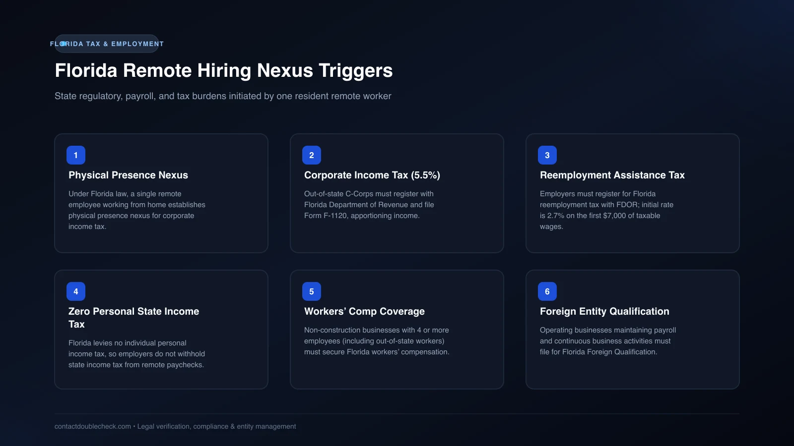
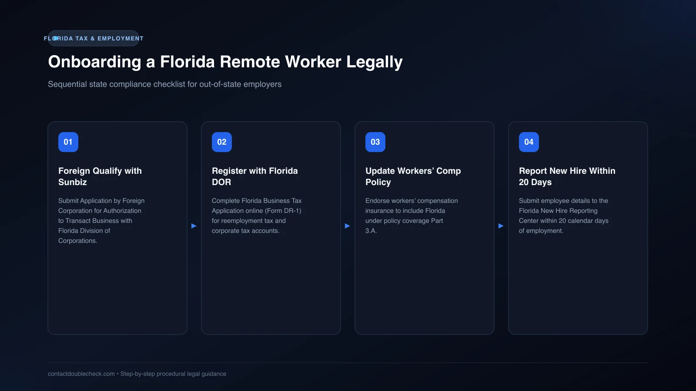

*Compliance and tax nexus guide for out-of-state employers and startups hiring remote workers in Florida, as of November 2026. General information, not legal advice.*

**Key takeaways:**

- Hiring a single full-time or part-time remote employee living in Florida establishes physical presence nexus under Florida law.
- Out-of-state C-corporations with Florida nexus must file Florida Corporate Income/Franchise Tax Return Form F-1120 annually.
- Florida levies zero personal state income tax, so employers do not withhold state income tax from employee paystubs.
- Employers must register with the Florida Department of Revenue (FDOR) for Reemployment Tax (initial rate 2.7% on first $7,000 wages).
- Employers with four or more total employees must provide Florida-endorsed workers’ compensation insurance coverage.

## 1. The quick answer

**Quick answer:** While Florida is celebrated as one of the most tax-friendly states in the nation with **no individual state income tax**, hiring a single remote employee located in Florida immediately triggers significant regulatory obligations for an out-of-state employer. Under Florida Administrative Code Rule 12C-1.011, placing an employee on Florida soil establishes **physical presence nexus**.

For an out-of-state C-corporation, this nexus requires registering with the **Florida Department of Revenue (FDOR)** and filing an annual corporate income tax return (**Form F-1120**), apportioning business income to Florida. Additionally, every employer must establish a Florida **Reemployment Tax** account (paying 2.7% on the first $7,000 of wages per worker), report the hire to the Florida New Hire Reporting Center within 20 days, secure Florida workers’ compensation coverage, and evaluate whether foreign entity qualification is required with the Florida Department of State (Sunbiz).

For multi-state hiring strategy, explore our guides on [multi-state remote employees compliance](/blog/multi-state-remote-employees-compliance-startups/) and [sales tax nexus for online small businesses](/blog/sales-tax-nexus-small-business-online/).

## 2. Physical presence nexus under Florida law

Tax nexus is the minimum legal and economic connection required for a state to impose statutory tax obligations on an out-of-state business. 

Under Florida Statutes § 220.11 and Fla. Admin. Code R. 12C-1.011(1), a corporation has physical nexus if it:
- Maintains an office, warehouse, or tangible property in Florida; OR
- Has employees, agents, or independent contractor representatives regularly conducting business operations or performing services in Florida.

Even if your remote employee is a software engineer or customer support representative working quietly from a home office in Miami or Orlando, Florida law deems their physical presence sufficient to subject the out-of-state employer to Florida jurisdiction.

**Pass-Through Entity Note:** If your business is structured as an LLC taxed as a partnership or sole proprietorship, Florida does not impose entity-level corporate income tax. However, all reemployment tax, payroll registration, and workers' compensation requirements remain fully enforceable.

## 3. Florida corporate income tax filing and apportionment

If your out-of-state entity is a **C-corporation**, establishing Florida nexus triggers the requirement to file **Form F-1120** (Florida Corporate Income/Franchise Tax Return) annually.

Key aspects of Florida Corporate Tax:
- **Tax Rate:** Florida imposes a flat corporate income tax rate of **5.5%** on Florida-apportioned taxable income.
- **Exemption:** Florida allows a statutory **$50,000 exemption** of Florida net income (apportioned based on Florida business activity). Consequently, early-stage startups and small businesses often owe $0 in actual tax, but the **filing of Form F-1120 is strictly mandatory** to claim the exemption and report presence.
- **Single Sales Factor Apportionment:** Florida primarily uses market-based sourcing and sales factor apportionment to calculate tax liabilities, preventing out-of-state firms from being taxed on global enterprise revenues.

Failure to file Form F-1120 can result in late filing penalties of $50 or 10% of tax due per month, and leaves the statute of limitations open indefinitely for audit.

## 4. Reemployment tax registration and wage reporting

Florida’s version of state unemployment insurance (SUI) is called **Reemployment Assistance Tax**, governed by Florida Statutes Chapter 443.

- **Registration Requirement:** Out-of-state employers paying $1,500 or more in wages during any calendar quarter, or employing at least one worker for any day across 20 different calendar weeks, must register for Florida Reemployment Tax via **Florida Form DR-1** online.
- **Tax Rate:** For new employers without an established claims history, the initial statutory rate is **2.7% (0.0270)**.
- **Taxable Wage Base:** The tax applies to the first **$7,000** of gross wages paid to each Florida employee per calendar year (a maximum tax burden of $189 per employee annually).
- **Zero Personal Income Tax Withholding:** Because Article VII, Section 5 of the Florida Constitution prohibits personal income taxes, employers do not make state withholding deductions from paychecks. Only federal taxes apply.

## 5. Workers’ compensation and new hire reporting rules

Hiring in Florida requires immediate compliance with state employee safety and reporting laws:

### Workers' Compensation Insurance
Under Florida Statutes Chapter 440, non-construction businesses employing **four or more employees** must maintain workers’ compensation insurance. 
- *Crucial Remote Rule:* Florida counts all employees company-wide (not just Florida residents) when calculating the four-employee threshold. If your tech company has three employees in New York and hires its fourth in Tampa, you are legally required to obtain a Florida workers' compensation policy endorsement (Part 3.A of your policy).

### Florida New Hire Reporting
Under Florida Statutes § 409.2576 and federal child support enforcement regulations, every employer must report newly hired or rehired employees to the **Florida State Directory of New Hires within 20 calendar days** of the employee’s official hire date. Reports are submitted online through the Florida Department of Revenue New Hire Reporting portal.

See also [workers' compensation insurance requirements for startups](/blog/workers-compensation-insurance-requirements-startups/).

## 6. When foreign qualification with Sunbiz is required

A common legal question is whether an out-of-state Delaware or California corporation must formally register as a foreign entity with the Florida Department of State Division of Corporations (**Sunbiz**).

Under Florida Statutes § 607.1501, a foreign corporation may not "transact business" in Florida without authorization. While the statute provides safe harbors for isolated transactions or maintaining bank accounts, maintaining permanent employees routinely performing core operational business functions within Florida creates a strong presumption of transacting business.

Filing the **Application by Foreign Corporation for Authorization to Transact Business in Florida** incurs a one-time $70 filing fee, requires appointing a Florida registered agent, and necessitates an annual report filing ($150 due by May 1).

## Where DoubleCheck fits

[DoubleCheck](https://www.contactdoublecheck.com) helps startups and expanding companies manage multi-state remote hiring compliance, verify employment contracts, and track state payroll registrations. When navigating multi-state corporate tax apportionment or state agency registrations, DoubleCheck connects you directly with qualified corporate and tax attorneys.

**Related reading:**
- [Multi-State Remote Employees Compliance for Startups](/blog/multi-state-remote-employees-compliance-startups/)
- [How to Start an LLC in Florida](/blog/how-to-start-an-llc-in-florida/)
- [Florida Fictitious Name Registration (DBA)](/blog/florida-fictitious-name-registration-dba/)
- [Workers’ Compensation Insurance Requirements for Startups](/blog/workers-compensation-insurance-requirements-startups/)

**Sources:** [Florida Department of Revenue, Corporate Income Tax Overview](https://floridarevenue.com/taxes/taxesfees/Pages/corporate.aspx); [Florida Administrative Code, Rule 12C-1.011 (Tax Nexus)](https://www.flrules.org/gateway/ruleNo.asp?id=12C-1.011); [Florida Department of Revenue, Reemployment Tax Instructions](https://floridarevenue.com/taxes/taxesfees/Pages/reemployment.aspx); [Florida Division of Workers’ Compensation, Employer Coverage Requirements](https://www.myfloridacfo.com/division/wc/employer); [Florida Division of Corporations (Sunbiz), Foreign Entity Qualification](https://dos.fl.gov/sunbiz/start-business/foreign-entities/).

## FAQ

**Does hiring one remote worker in Florida create corporate tax nexus?**

Yes. Under Florida Administrative Code Rule 12C-1.011, having an employee regularly performing services within Florida establishes physical presence nexus, requiring out-of-state C-corporations to file Florida Form F-1120.

**Do employers withhold state personal income tax for Florida remote employees?**

No. Florida’s state constitution prohibits personal income tax. Employers only withhold federal income taxes, FICA, and Medicare.

**What is the Florida Reemployment Tax rate for new out-of-state employers?**

The initial standard tax rate for new employers in Florida is 2.7% on the first $7,000 of taxable wages paid to each employee during the calendar year, administered by the Florida Department of Revenue.

**Are remote employees counted toward Florida workers’ compensation thresholds?**

Yes. In Florida, non-construction businesses with four or more employees (counting full-time or part-time staff across all locations) must carry workers’ compensation insurance covering the Florida employee.

**Do LLCs pay Florida corporate income tax when hiring in Florida?**

Single-member LLCs and multi-member LLCs treated as partnerships for federal income tax purposes generally do not pay Florida corporate income tax, though they must comply with payroll and reemployment registration.

---

*General information only. This article is not legal, tax, investment, or accounting advice.*
