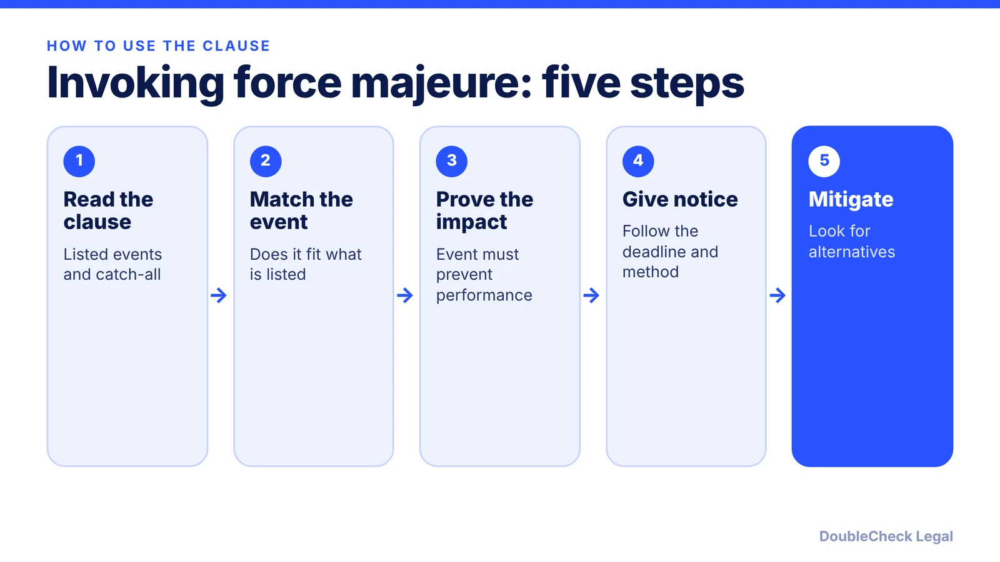
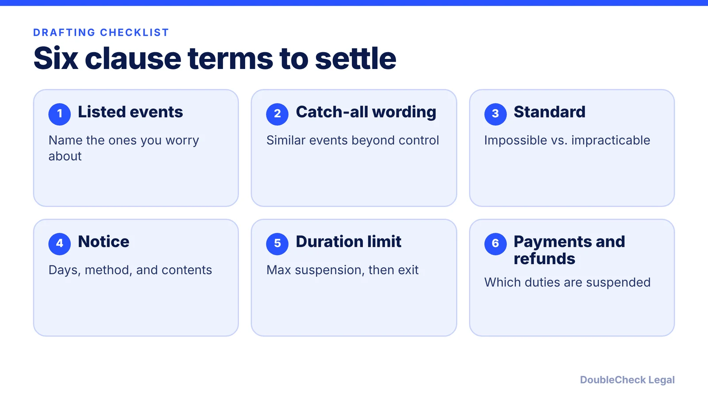

*Force majeure is not a general escape hatch. Whether it works depends on the clause's words and your facts.*

**Key takeaways:**

- Courts read force majeure clauses narrowly, per Venable; listed events and similar ones are covered.
- The event usually must prevent performance, not just make it costlier, per Holland & Knight.
- Draft the events, catch-all, standard, notice window, duration limit, and payment treatment on purpose.
- Cancelling early or missing the notice step can forfeit the excuse.

## 1. The quick answer

**Quick answer:** A force majeure clause excuses or suspends a party's performance when a listed event outside its control, such as a natural disaster or government order, prevents it from performing. Courts decide these cases one contract at a time and, per Venable, read the clauses narrowly, so the exact wording, the notice steps, and the facts decide the result. Higher cost or a worse deal usually is not enough.

## 2. How courts read these clauses

Per [Venable](https://www.venable.com/insights/publications/2020/03/interpreting-force-majeure-clauses), courts read force majeure clauses narrowly, covering only listed events and similar ones. Its example: a listed "terrorism" event may not extend to mere "threats" of terrorism. The closer your circumstance is to a listed event, the better your odds.

[Holland & Knight](https://hklaw.com/-/media/files/insights/publications/2020/08/negotiation-and-drafting-issues-surrounding-force-majeure-provisions.pdf) makes similar points:

- New York reads catch-all language narrowly, covering only events close to those listed.
- The event must actually prevent performance, and the standard is usually impossibility, not impracticality or added cost.
- Events that existed or were contemplated when the contract was signed generally do not qualify.
- Where the contract imposes a duty to keep trying, a court may ask whether you looked for alternatives, such as another supplier.

Venable also says common-law doctrines such as impracticability and frustration of purpose rarely excuse performance, which is why the written clause matters. Rules differ by state and by contract, so treat these as general patterns, not guarantees.

## 3. What to put in the clause

If you are writing or negotiating the clause, these are the choices that matter, drawn from Venable and Holland & Knight:

- **List events and add a catch-all.** Phrases like "including, but not limited to" broaden coverage; words added after a comma can narrow it. Venable suggests wording such as "any other similar event beyond the parties' reasonable control" to avoid both limits.
- **Pick the performance standard.** "Impossible" is a high threshold. A clause covering events that make performance "inadvisable, commercially impracticable, illegal, or impossible" is more flexible (Venable).
- **Set a notice window.** Venable notes clauses typically allow a short window, such as 5 or 10 days, and may specify delivery method.
- **Cap the duration.** Holland & Knight suggests limiting how long performance can be suspended, with a termination right after a set period.
- **Treat payment separately.** Parties can choose whether payment duties are suspended. Economic hardship alone may not excuse payment for goods or services (Holland & Knight).
- **Address refunds.** Some clauses require refunds of prepaid fees; others apply only to future payments (Venable).

## 4. Mistakes to avoid when an event hits

Venable's practical warnings:

- **Cancelling early.** It may be a business necessity, but it can forfeit a later force majeure excuse. For events that unfold over time, waiting until circumstances clearly fall within a listed event is generally safer.
- **Missing the notice deadline.** Follow the delivery method the clause specifies.
- **Assuming it applies.** Whether you can invoke a clause may change as circumstances evolve, and Venable stresses that "context is crucial." Get advice before invoking it or deciding it does not apply.
- **Skipping proof.** A party must show clear evidence of how the event affected its ability to perform.

Force majeure rarely stands alone. Compare it with the [termination clause](/blog/how-to-terminate-a-contract-early-termination-clause/), the [limitation of liability clause](/blog/limitation-of-liability-clause-explained/), and our [contract red flags](/blog/contract-red-flags-small-business/). If the other side is the one invoking it on your order, see the [master services agreement and SOW](/blog/master-services-agreement-and-sow-small-business/) guide for how performance obligations are structured, and consider [attorney review](/blog/how-much-does-a-lawyer-charge-to-review-a-contract/) before a high-value dispute.

## Where DoubleCheck fits

[DoubleCheck](https://www.contactdoublecheck.com) helps businesses and founders start legal work with AI, verify it, and, when professional advice is warranted, connect with an independent attorney, including for immigration questions. Attorney availability and practice areas vary. Attorneys on DoubleCheck are independent professionals; an attorney-client relationship forms only if an attorney accepts your engagement.

**Sources:** [Venable, Interpreting Force Majeure Clauses (March 2020)](https://www.venable.com/insights/publications/2020/03/interpreting-force-majeure-clauses); [Holland & Knight, Negotiation and Drafting Issues Surrounding Force Majeure Provisions](https://hklaw.com/-/media/files/insights/publications/2020/08/negotiation-and-drafting-issues-surrounding-force-majeure-provisions.pdf).

## FAQ

**What is a force majeure clause?**

A contract provision that excuses or suspends performance when a listed event outside the parties' control prevents it. Per Venable, courts read these clauses narrowly, so coverage depends on the exact events and wording.

**Does a pandemic or supply shortage automatically count?**

No. Per Holland & Knight, an epidemic alone might not be covered unless the clause says so, while an act of government such as a quarantine would likely be. Results depend on the clause and the facts.

**Does higher cost or economic hardship excuse performance?**

Usually not by itself. Per Holland & Knight, the standard is typically impossibility, not impracticality or added cost, and economic hardship alone may not excuse payment obligations. Venable adds that impracticability and frustration of purpose rarely excuse performance at common law.

**Do I need to send notice?**

Check the clause. Per Venable, clauses typically allow a short window, such as 5 or 10 days, and may specify the delivery method. Missing it can put the excuse at risk.

---

*General information only. This article is not legal, tax, investment, or accounting advice.*
