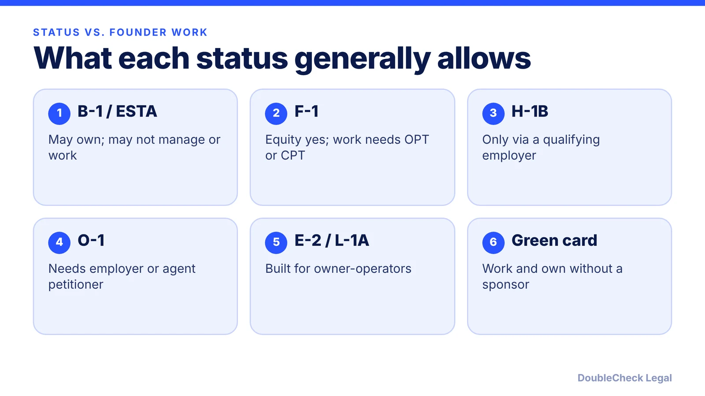
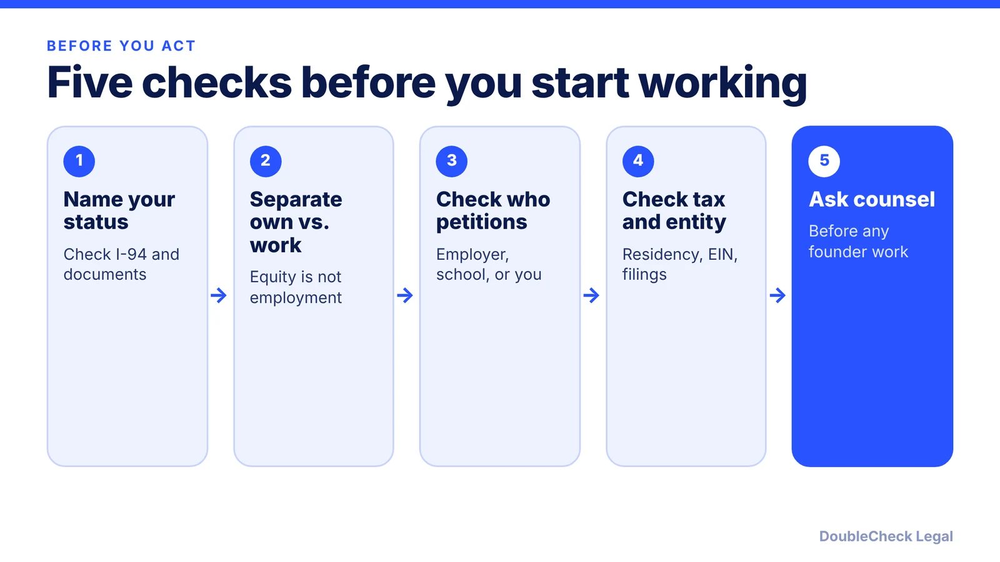

*Owning a company and working for it are different questions. Here is the line for each status.*

**Key takeaways:**

- Visitors (B-1/ESTA) and students (F-1) can generally own a company but not manage or work for it without authorization.
- H-1B, O-1, E-2 and L-1A can allow founder work only through the right petitioner or structure.
- Green card holders are not tied to employer-specific work limits.
- Spouse work rights depend on the principal status: H-4 EAD, L-2S and E-S I-94 codes, with different rules.

## 1. The quick answer

**Quick answer:** In general, owning shares of a U.S. company is one thing and working for it is another. Most nonimmigrant statuses let you hold equity; only a status that authorizes work for that company lets you run it. Visitors (B-1 or ESTA) and students (F-1) can generally own, but not manage or work without authorization, per Legal Services Incorporated and WilmerHale. Statuses built around a business (E-2, L-1A, O-1 with a qualifying petitioner, H-1B through a qualifying employer) can allow founder work, each with its own conditions. Green card holders can work for their own company. Spouses depend on the principal's status. This is a map, not a finding that you qualify.

## 2. Visitors and students: ownership, not operations

**B-1 or ESTA (visitor).** Per Legal Services Incorporated, you can set up and own a business on B-1 or ESTA, but you cannot manage the business or be an officer such as CEO without work authorization, even unpaid. A business visitor may not be on U.S. payroll; the company may only reimburse incidental expenses. Permitted activities include negotiating contracts and meeting business associates. Fisher Phillips adds that nationals of treaty countries may use a short B-1 trip for setup steps such as signing leases while an E-2 is pending. Read [what a B-1 business visitor can do](/blog/b-1-b-2-visa-business-visitor-what-founders-can-do/). Nothing in a startup schedule justifies working on a visitor visa.

**F-1 (student).** WilmerHale states a foreign student may own equity in a company and serve on its board, but may not perform work for a company without authorization from the school's foreign student office, and the rules are no different for founders. Cooley says the same in practice: passive investment is fine, active work needs authorization such as OPT, and OPT work must relate to your field of study. Fisher Phillips notes recent graduates must document a legitimate employer relationship, supervision and appropriate duties when using OPT for their own startup. See [OPT and STEM OPT for your own startup](/blog/f1-opt-stem-opt-start-your-own-startup/) and [CPT vs OPT](/blog/cpt-vs-opt-f1-students/). Talk to your designated school official (DSO) first.

**F-2 dependents.** See [F-2 dependents](/blog/f-2-dependents-spouse-children-of-f-1-students/) for what a student's spouse can and cannot do.

## 3. Work statuses: H-1B, O-1, E-2, L-1 and the green card

**H-1B.** Per Cooley, you can sponsor yourself through your own company if you meet the H-1B requirements; you must show a bona fide employment relationship, and the validity may be shortened to 18 months. An H-1B holder who launches an unrelated company can only invest passively, because H-1B work is employer-specific. Our [H-1B and your own company post](/blog/h-1b-for-founders-owning-your-own-company-employer-employee-rule/) covers the rule in detail, and [starting a company on H-1B](/blog/start-company-on-h1b-visa-ownership-vs-work/) covers the ownership-versus-work line.

**O-1.** Per Beyond Border Global (an immigration service provider, so treat it as one view), you cannot self-petition an O-1; a company you own can file if it is genuinely operational and shows an employer-employee relationship, usually with a board that can supervise and remove you, or a U.S. agent can petition instead. You still need evidence for at least three of the eight O-1A criteria. See [O-1A evidence for founders](/blog/o-1a-visa-for-startup-founders-evidence/).

**E-2.** Per Cooley, only nationals of treaty countries qualify; you must make a substantial investment, develop and direct the business, and keep at least 50% ownership, and if ownership falls below 50% you and any E-2 employees lose status. See the [E-2 guide](/blog/e-2-treaty-investor-visa-for-founders/).

**L-1A.** Per Cooley and Fisher Phillips, this is for executives or managers sent by an established foreign company to a new U.S. office, with proof of an active business abroad, a qualifying ownership relationship and a credible plan; Cooley calls it challenging for small foreign startups. See [L-1A for foreign founders](/blog/l-1a-visa-new-office-foreign-founders/).

**Green card.** WilmerHale notes that non-citizens who are not lawful permanent residents cannot work without a visa that authorizes employment, which means permanent residents are not bound by that limit. Paths to it include [EB-1A vs O-1](/blog/eb-1a-vs-o-1-founder-which-path/) and the [national interest waiver](/blog/niw-eb-2-national-interest-waiver-founders/).

For the International Entrepreneur Rule, which is parole rather than a visa, see [the 2026 guide](/blog/international-entrepreneur-rule-startup-parole-2026/).

## 4. Spouses, and how to decide

**H-4 (spouse of an H-1B holder).** Per CitizenPath, only spouses qualify for the H-4 EAD, not children, and the H-1B spouse must have an approved I-140 or qualify for H-1B extensions beyond six years. You must hold the EAD card before starting any job. Per the same source, automatic 540-day EAD extensions ended October 30, 2025, so a lapse means you stop working. See [H-4 EAD](/blog/h-4-ead-spouses-of-h-1b/).

**L-2 and E spouses.** Per Mintz, spouses entering since January 31, 2022 with an L-2S, E-1S, E-2S or E-3S I-94 designation are work authorized incident to status, without a separate EAD. See [spouse work rights](/blog/spouse-work-rights-l-2-e-visa-o-3-dependents/). A spouse with work authorization is one of the cleaner ways a couple can keep a business going.

**Handle yourself vs. get an attorney.** You can list your status, dates and documents and read the sources above on your own. Get an immigration attorney to look before you take any role, title or paycheck in a company you own, change status, or rely on a spouse's work rights. Tax residency is a separate question: see [the substantial presence test](/blog/foreign-founder-us-taxes-substantial-presence-test/). Entity steps: [starting a U.S. company as a non-resident](/blog/start-us-company-as-non-us-resident/) and [how to incorporate](/blog/how-to-incorporate-a-company-in-the-us/). See also [how to find an immigration lawyer](/blog/how-to-find-good-immigration-lawyer-startup-founder/).

## Where DoubleCheck fits

[DoubleCheck](https://www.contactdoublecheck.com) helps businesses and founders start legal work with AI, verify it, and, when professional advice is warranted, connect with an independent attorney, including for immigration questions. Attorney availability and practice areas vary. Attorneys on DoubleCheck are independent professionals; an attorney-client relationship forms only if an attorney accepts your engagement.

**Sources:** [Legal Services Incorporated on B-1 and ESTA](https://legalservicesincorporated.com/immigration/b-1-business-visitor-visa-or-esta-business-visitor-visa-waiver/); [WilmerHale on F-1 founders](https://launch.wilmerhale.com/explore/formation/founders/rules-for-foreign-founders-in-the-us-on-a-student-visa); [Cooley, foreign founders and visas](https://www.cooley.com/news/insight/2025/2025-06-03-what-foreign-founders-need-to-know-about-us-visas-and-corporate-structure); [Fisher Phillips](https://www.fisherphillips.com/en/insights/insights/visa-pathways-for-international-tech-startups); [Beyond Border Global on O-1](https://www.beyondborderglobal.com/resources/o-1-can-founder-sponsor-themselves); [CitizenPath on H-4 EAD](https://citizenpath.com/h-4-ead-work-authorization/); [Mintz on L-2 and E I-94 designations](https://www.mintz.com/insights-center/viewpoints/2806/2022-02-17-cbp-begins-issuing-new-i-94-designations-l-2-and-e). USCIS and State Department pages were not fetched, so law-firm sources are named.

## FAQ

**Can I own a U.S. company on a tourist or ESTA visit?**

Per Legal Services Incorporated, you can set up and own a business on B-1 or ESTA, but you cannot manage it or be an officer such as CEO without work authorization. Ask an immigration attorney before any activity beyond ownership.

**Can an F-1 student run their own startup?**

Per WilmerHale, a student can own equity and serve on the board but cannot perform work for a company without authorization from the school foreign student office. Cooley notes OPT work must relate to the field of study.

**Which statuses are designed for owner-operators?**

Per Cooley, E-2 requires at least 50% ownership and active direction of the business, and L-1A is for executives or managers of a new U.S. office of a foreign company. H-1B and O-1 are possible through qualifying petitioner structures.

**Can my spouse work while I run my startup?**

It depends on your status. Per Mintz, L-2 and E spouses with the S I-94 designation can work without an EAD; per CitizenPath, H-4 spouses need an EAD, available only in certain H-1B cases. Confirm with counsel.

---

*General information only. This article is not legal, tax, investment, or accounting advice.*
