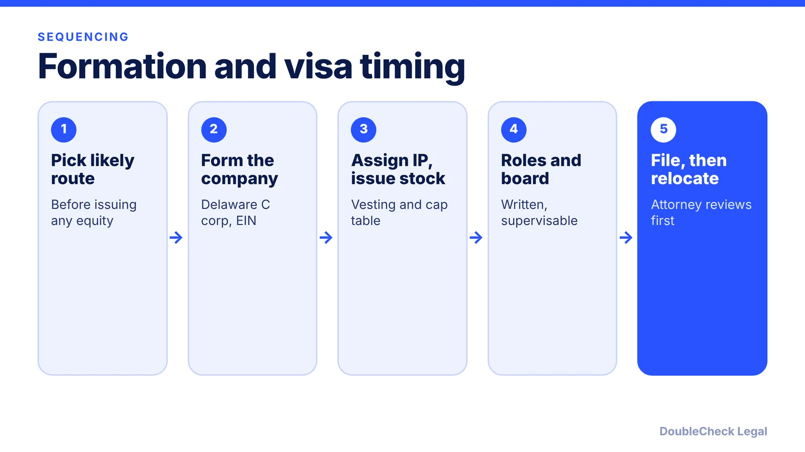
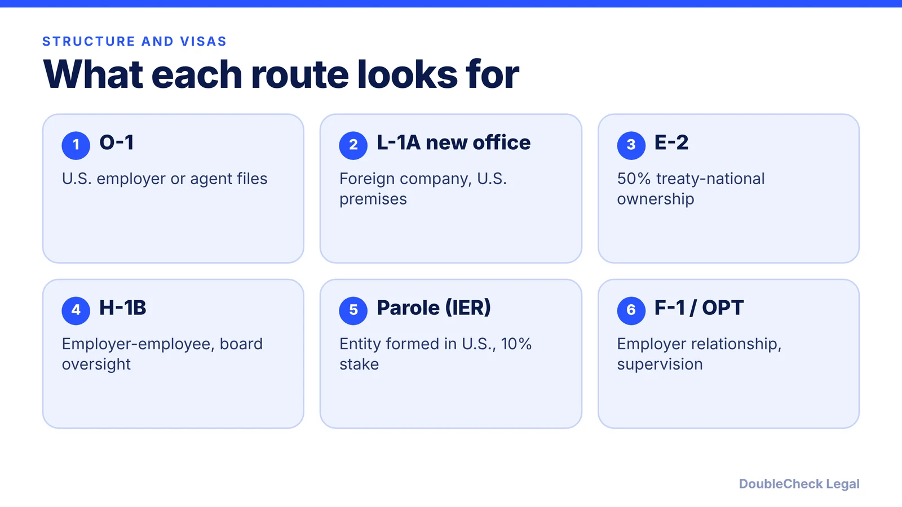

*A sequencing checklist for foreign founders who plan to form a U.S. company and later move.*

**Key takeaways:**

- Pick your likely visa route before you issue equity; ownership and board rules differ by route.
- Form the company, assign IP, issue vested stock, and file any 83(b) within 30 days.
- Write down your role and board oversight before filing immigration petitions.
- Track U.S. days from the start; the IRS substantial presence test uses 31 and 183 days.

## 1. The quick answer

**Quick answer:** For a foreign founder, the order of steps matters because company structure and immigration status affect each other. A workable sequence is: pick your likely visa route, form the company (a Delaware C corporation is what investors usually expect), assign your IP to it, issue founder stock with vesting, file any 83(b) election within 30 days, put roles and board oversight in writing, and only then file immigration petitions. Check your U.S. tax residency from the first day you spend in the U.S. Do not issue equity or change ownership without checking how it affects your visa. As of November 2026, this is general information, not legal advice.

## 2. The checklist, in order

1. **Shortlist the visa route first.** Ownership rules differ by route. Cooley says E-2 requires at least 50% treaty-country ownership and that dropping below 50% ends status for the founder and E-2 employees. H-1B self-sponsorship needs a genuine employment relationship, and Cooley says a founder with a controlling interest should have a board that is independent from the founder's control. Read the visa guides before you split equity: [E-2](/blog/e-2-treaty-investor-visa-for-founders/), [H-1B for founders](/blog/h-1b-for-founders-owning-your-own-company-employer-employee-rule/), [O-1A](/blog/o-1a-visa-for-startup-founders-evidence/).
2. **Form the entity.** Every.io says the ideal time to incorporate is when you have an investor committed or a customer contract that needs an entity, and that most VCs and angels expect a Delaware C corporation. Follow [how to incorporate in the U.S.](/blog/how-to-incorporate-a-company-in-the-us/) and [starting a U.S. company as a non-U.S. resident](/blog/start-us-company-as-non-us-resident/). Without an SSN, Every.io says an EIN by mail or fax can take 4 to 6 weeks (see [getting an EIN without an SSN](/blog/get-ein-without-ssn-foreign-founder/)).
3. **Assign your IP.** Sign an assignment so the company owns what you built. Check that nothing was built on an employer's time or equipment. See [confidentiality and IP assignment agreements](/blog/confidentiality-ip-assignment-agreements-startups/).
4. **Issue founder stock with vesting.** Every.io describes the standard schedule as 4 years with a 1-year cliff. Cooley says vesting can also help show an "at risk" investment and ongoing commitment. Document it in an [issue founder stock purchase agreement](/blog/issue-founder-stock-purchase-agreement/) and keep a clean [cap table](/blog/cap-table-basics-for-first-time-founders/).
5. **File the 83(b) election if stock is unvested.** Carta says the form must be postmarked and mailed to the IRS within 30 days, and that the benefit is lost if you miss it. Confirm current filing methods with the IRS or a tax professional. See [83(b) for founders](/blog/83b-election-startup-founders/).
6. **Write down your role and the oversight.** Cooley recommends defining the founder's role in bylaws, employment agreements, offer letters and stockholder agreements, and deciding early whether the board can supervise or remove the founder.
7. **Only then file immigration paperwork and relocate.**

## 3. How structure affects each route

Each route reads your company differently. Points are from Cooley (June 2025), Fisher Phillips, USCIS and the National Law Review.

- **O-1.** USCIS says a U.S. employer, a U.S. agent, or a foreign employer through a U.S. agent files. Cooley says structure matters less than proving achievement. See [F-1 to O-1 for founders](/blog/f-1-to-o-1-change-of-status-founders/).
- **L-1A.** The National Law Review says the qualifying relationship must exist at filing, supported by documents and not future intent, and that USCIS expects appropriate office space. Co-working and virtual addresses are generally not enough. See [L-1A for foreign founders](/blog/l-1a-visa-new-office-foreign-founders/).
- **E-2.** Ownership and control are the structure test, per Colombo & Hurd and Cooley.
- **H-1B.** Fisher Phillips says real oversight of the position is needed, and that a board is key. Fee status is in [this update](/blog/h1b-100000-fee-status-2026/).
- **IER parole.** Initial parole requires a U.S. entity formed within the past five years and at least 10% ownership. See the [IER guide](/blog/international-entrepreneur-rule-startup-parole-2026/).
- **F-1 OPT.** Fisher Phillips says graduates can run their own startup on OPT only with a documented employer relationship and supervision. See [OPT for startups](/blog/f1-opt-stem-opt-start-your-own-startup/).

## 4. Tax timing and when to call an attorney

**Tax residency.** Per the IRS, you meet the substantial presence test if you are in the U.S. at least 31 days in the current year and 183 days over three years, counting all days this year, one-third of last year's and one-sixth of the year before. Certain days are excluded, such as some transit days under 24 hours and days as an exempt individual, which requires Form 8843. The IRS also notes you can still be treated as a nonresident under a closer connection exception. Run the numbers before long stays: [foreign founder U.S. taxes](/blog/foreign-founder-us-taxes-substantial-presence-test/). Foreign-owned entity reporting is covered in [Form 5472](/blog/form-5472-foreign-owned-single-member-llc/).

**What you can handle yourself.** Drafting a timeline, listing documents, comparing routes, and reading the agencies' pages. AI can help you organize all of this quickly.

**When to get an attorney to verify.**
- Before issuing equity or changing percentages if you are targeting E-2, H-1B or L-1.
- Before filing any petition, and before accepting a role that involves working in the U.S.
- Before an 83(b) deadline if you are unsure the transfer is restricted.
- When rules in your situation are in flux (H-1B fees, parole, travel vetting).

See [how to find a good immigration lawyer](/blog/how-to-find-good-immigration-lawyer-startup-founder/) and the broader [guide to moving to the U.S. as an entrepreneur](/blog/how-to-move-to-the-us-as-an-entrepreneur-options-compared/).

## Where DoubleCheck fits

[DoubleCheck](https://www.contactdoublecheck.com) helps businesses and founders start legal work with AI, verify it, and, when professional advice is warranted, connect with an independent attorney, including for immigration questions. Attorney availability and practice areas vary. Attorneys on DoubleCheck are independent professionals; an attorney-client relationship forms only if an attorney accepts your engagement.

**Sources:** [Cooley, June 2025](https://www.cooley.com/news/insight/2025/2025-06-03-what-foreign-founders-need-to-know-about-us-visas-and-corporate-structure); [Every.io](https://www.every.io/blueprint-posts/startup-incorporation-faqs); [Carta](https://carta.com/learn/equity/stock-options/taxes/83b-election/); [IRS, substantial presence test](https://www.irs.gov/individuals/international-taxpayers/substantial-presence-test); [USCIS O-1](https://uscis.gov/o-1); [National Law Review, L-1 new offices](https://natlawreview.com/article/l-1-visa-new-offices-2026-practical-guide-companies-expanding-united-states); [Fisher Phillips](https://www.fisherphillips.com/en/insights/insights/visa-pathways-for-international-tech-startups). The Beyond Border page on Delaware C corps for O-1 founders did not cover formation timing and was not used for those points.

## FAQ

**When should a foreign founder incorporate in the US?**

Per Every.io, the ideal time is when an investor has committed or a customer contract requires an entity, since incorporating earlier adds cost. If your visa route needs a U.S. company at filing, plan the timing with an attorney.

**Should founder stock vest before filing for a visa?**

Cooley says vesting can show an at risk investment and ongoing commitment, and Every.io describes 4 years with a 1-year cliff as standard. How vesting interacts with your specific route is a question for an immigration attorney.

**What is the deadline for an 83(b) election?**

Carta says the election must be postmarked and mailed to the IRS within 30 days of the grant. Missing it loses the benefit. Confirm current filing methods with the IRS or a tax professional.

**How many days in the US make me a tax resident?**

Per the IRS, the substantial presence test requires at least 31 days this year and 183 days weighted across three years: all current-year days, one-third of last year and one-sixth of the year before. Exceptions exist.

---

*General information only. This article is not legal, tax, investment, or accounting advice.*
