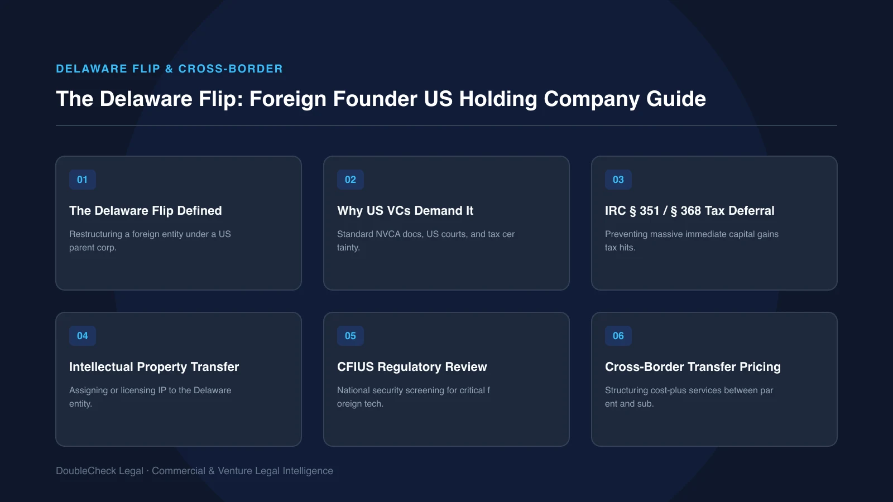
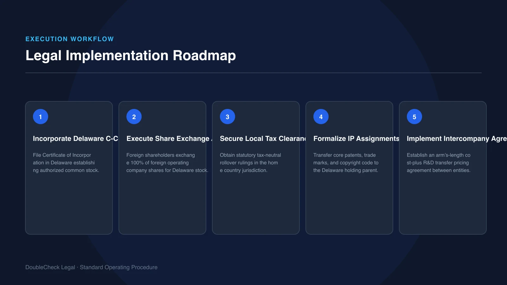

*A definitive cross-border corporate and tax law guide to executing a Delaware Flip, analyzing share-for-share exchange mechanics, IRC Section 351 tax deferral, intellectual property assignment, CFIUS compliance, and transfer pricing.*

**Key takeaways:**
- **The Venture Mandate:** Top-tier US accelerators (YC, Techstars) and venture capital funds routinely condition investment on foreign founders flipping their corporate structure into a Delaware C-Corporation.
- **The Cross-Border Tax Minefield:** Executing a flip without synchronized local and US tax planning can trigger immediate, catastrophic capital gains taxes for founders on phantom valuations.
- **IRC § 351 / § 368 Mechanics:** US tax deferral requires structuring the transaction as an exchange of property solely for voting stock, satisfying statutory control tests immediately post-exchange.
- **IP Ownership & Transfer Pricing:** The Delaware parent must own or hold exclusive global licenses to all core IP, supported by arm’s-length intercompany services agreements.

## 1. The quick answer: What is a Delaware Flip?

A **Delaware Flip** is an international corporate reorganization that elevates a Delaware C-Corporation to the top of an international startup's corporate structure:

1. **Before the Flip:** Founders and local investors own shares in a foreign operating company (e.g., in the UK, Canada, India, Germany, or Singapore).
2. **The Transaction:** A new Delaware C-Corporation is incorporated. Foreign shareholders transfer 100% of their foreign shares to the Delaware corporation in exchange for proportional Delaware shares.
3. **After the Flip:** The Delaware corporation becomes the **100% parent holding company**, and the original foreign entity becomes a **wholly owned subsidiary**. US investors invest directly into Delaware Preferred Stock.

## 2. In-depth legal analysis: Corporate restructuring, tax deferral, and IP migration

Executing a flip is complex because it requires simultaneous compliance with the corporate and tax codes of two separate sovereign jurisdictions.

### A. US Tax Deferral Mechanics: IRC § 351 vs § 368(a)(1)(B)
To prevent the share exchange from being treated as a taxable sale of stock:
- **IRC Section 351 (Transfer to Corporation Controlled by Transferor):** Provides that no gain or loss is recognized if property (foreign shares) is transferred to a corporation by one or more persons solely in exchange for stock, and immediately after the exchange, such person(s) hold **control** (at least 80% of voting power and total shares).
- **IRC Section 368(a)(1)(B) ("B" Reorganization):** Treats the transaction as a tax-free corporate reorganization where the acquiring corporation acquires stock of another corporation solely in exchange for its own voting stock, holding control immediately afterward.

### B. The Foreign Home-Country Tax Trap
While US tax deferral under Section 351 is standard, **local foreign tax rules are often the primary obstacle**:
- In the UK: Requires clearance under Section 138 of the Taxation of Chargeable Gains Act 1992 (TCGA) to secure "share-for-share" rollover relief.
- In India: Flips historically triggered angel tax and capital gains issues, requiring compliance with RBI outward remittance and FEMA regulations.
- In Germany: Can trigger exit tax liabilities unless structured carefully through double-taxation treaty provisions.

### C. Post-Flip Corporate Structure and Transfer Pricing
Once the flip is complete, the corporate group operates under a bifurcated model:

| Entity | Primary Role | Assets Held | Revenue & Tax Treatment |
|---|---|---|---|
| Delaware C-Corp (Parent) | Holding company; fundraising vehicle; commercial contracting | All core Intellectual Property; global customer contracts | Collects customer revenues; raises venture capital |
| Foreign Subsidiary (Sub) | Operating entity; regional R&D and engineering hub | Local office leases; local employee employment contracts | Funded via Cost-Plus (e.g., Cost + 8-10%) R&D service fees |

To prevent IRS Section 482 audit adjustments, the entities must execute a formal **Intercompany Master Services Agreement** setting an arm’s-length cost-plus markup.

## 3. Step-by-step: How to execute a cross-border Delaware Flip

Founding teams should follow a synchronized legal roadmap:

### Step 1: Corporate Incorporation in Delaware
Incorporate the Delaware C-Corporation under DGCL § 101. Establish authorized common stock with sufficient headroom for future Series Seed or Series A financing.

### Step 2: Local Shareholder and Regulatory Approvals
Secure 100% consent from foreign shareholders, option holders, and convertible note holders. A single holdout minority angel can block the share exchange.

### Step 3: Execute Omnibus Share Exchange Agreement
Draft a comprehensive Share Exchange and Contribution Agreement where all foreign stockholders contribute their local shares to Delaware in exchange for mirror-image Delaware common and preferred stock.

### Step 4: IP Assignment and Clean Chain-of-Title
Ensure that all founders, employees, and contractors execute Confidential Information and Invention Assignment Agreements (CIIAA) assigning all historical code and patents to the Delaware parent company.

### Step 5: Post-Closing Regulatory & Tax Filings
- Complete US IRS Form 5471 / 5472 disclosures regarding foreign-owned entities;
- Complete local stamp duty or share registry transfers in the foreign jurisdiction;
- File SEC Form D under Regulation D for the issuance of shares to founders.

## 4. CFIUS national security review: The foreign tech trap

Startups developing **critical technologies** (artificial intelligence, cybersecurity, quantum computing, semiconductors) must evaluate **CFIUS (Committee on Foreign Investment in the United States)**:
- If foreign investors retain substantial governance rights, board seats, or access to non-public technical data in the Delaware parent, mandatory CFIUS declarations may be triggered under 31 CFR Part 800.
- Failure to clear CFIUS can result in forced divestment orders by the President of the United States.

## 5. Due diligence checklist: Preparing for a Delaware Flip

1. **Verify 100% Shareholder Consent:** Ensure all foreign cap table participants have signed the master exchange agreement.
2. **Synchronize Vesting Schedules:** Confirm that Delaware stock issued to founders carries matching vesting schedules and reverse-vesting restrictions.
3. **File Section 83(b) Elections:** Ensure all founders file IRC Section 83(b) elections with the IRS within 30 days of receiving restricted Delaware stock.
4. **Execute Cost-Plus Services Agreement:** Finalize an intercompany transfer pricing agreement compliant with OECD guidelines.

## Where DoubleCheck fits

[DoubleCheck](https://www.contactdoublecheck.com) gives international startup founders, cross-border corporate counsel, and venture capital funds automated contract intelligence for international restructurings. DoubleCheck audits foreign cap tables, scans share exchange agreements, flags IP chain-of-title gaps, and verifies that cross-border Delaware Flips satisfy institutional US venture capital due diligence standards.

**Related reading:**
- [Cap Table Cleanup Before Series A Common Problems](/blog/cap-table-cleanup-before-series-a-common-problems/)
- [83b Election for Startup Founders](/blog/83b-election-startup-founders/)
- [Series A Legal Due Diligence Checklist](/blog/series-a-legal-due-diligence-checklist/)
- [Visiting the US to Meet Investors: B-1 vs ESTA](/blog/visiting-the-us-to-meet-investors-b-1-esta-startup-trip-what-is-allowed/)

**Sources:** [Internal Revenue Code § 351 (Transfer to Corporation Controlled by Transferor)](https://www.law.cornell.edu/uscode/text/26/351); [Internal Revenue Code § 368 (Corporate Reorganizations)](https://www.law.cornell.edu/uscode/text/26/368); [Delaware General Corporation Law § 101 et seq.](https://delcode.delaware.gov/title8/c001/sc01/); [U.S. Department of the Treasury, Committee on Foreign Investment in the United States (CFIUS)](https://home.treasury.gov/policy-issues/international/the-committee-on-foreign-investment-in-the-united-states-cfius).

## FAQ

**What is a Delaware Flip in startup venture capital?**

A Delaware Flip is a cross-border corporate restructuring where existing shareholders of a foreign startup exchange 100% of their shares for newly issued shares of a newly formed Delaware C-Corporation, transforming the foreign company into a wholly owned subsidiary of the US parent.

**Why do US venture capitalists require foreign startups to do a Delaware Flip?**

US venture capital funds require a Delaware Flip because their limited partnership agreements often restrict foreign investments, and they demand the legal certainty of the Delaware Court of Chancery, Delaware General Corporation Law, and standard NVCA legal documents.

**How is a Delaware Flip structured to avoid immediate taxation?**

In the US, a Delaware Flip is typically structured as a tax-deferred share-for-share exchange under Internal Revenue Code (IRC) Section 351 or Section 368(a)(1)(B). However, founders must also comply with home-country rollover relief rules to prevent local capital gains tax liabilities.

**What is an intercompany transfer pricing agreement post-flip?**

Following a Delaware Flip, the foreign subsidiary typically employs the local engineering team while the Delaware parent owns the intellectual property. An intercompany transfer pricing agreement (often a cost-plus R&D contract) establishes arm’s-length payments to satisfy IRS and local tax authorities.

**How can AI contract tools streamline a Delaware Flip?**

AI contract tools rapidly audit existing foreign shareholder agreements, identify holdout investors, check vesting acceleration triggers, and verify cross-border share exchange documentation.

---

*General information only. This article is not legal, tax, investment, or accounting advice.*
