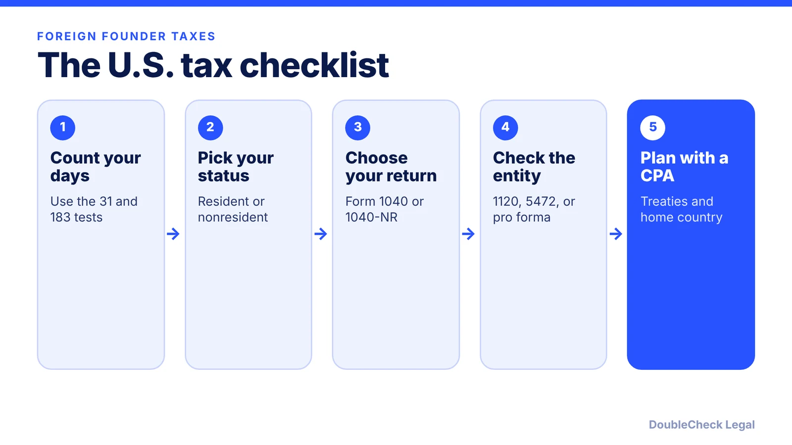

*Do you owe U.S. tax as a foreign founder? Start with the IRS substantial presence test, then see which returns and company forms apply.*

**Key takeaways:**

- Resident alien: green card test or substantial presence test (31 days now; 183 days weighted over three years).
- Residents file Form 1040 on worldwide income; nonresidents file Form 1040-NR.
- The closer connection exception uses Form 8840 and does not apply with a pending green card application.
- A foreign-owned U.S. LLC generally files Form 5472 with a pro forma Form 1120; the penalty is $25,000.

## 1. The quick answer

**Quick answer:** For U.S. tax, a non-citizen is either a resident alien or a nonresident alien. Per the IRS, you are a resident for a calendar year if you meet the green card test or the substantial presence test: at least 31 days in the U.S. this year and 183 days over three years, counting all days this year, one-third of last year's, and one-sixth of the year before. Residents file Form 1040 on worldwide income; nonresidents file Form 1040-NR on U.S.-source and effectively connected income. A foreign-owned U.S. LLC or corporation can also have its own filings, including Form 5472.

## 2. The substantial presence test, step by step

The IRS test is a formula. You meet it for a year if you were physically present in the U.S. on at least:

- **31 days** during the current year, and
- **183 days** during the three-year period that includes the current year and the two years before, counting **all** days this year, **one-third** of the days last year, and **one-sixth** of the days the year before.

The IRS example uses 120 days in each year: 120 + 40 + 20 = 180, which is below 183, so that person does not meet the test. A founder who spends 150 days in the U.S. every year would count 150 + 50 + 25 = 225 and be a resident.

Some days do not count, including certain transit days under 24 hours and days of exempt individuals such as certain students and teachers, per the IRS. You can still be treated as a nonresident if you were in the U.S. fewer than 183 days this year, kept a tax home in a foreign country, and have a closer connection to it, claimed on Form 8840. That exception does not apply if you have a pending application for permanent residence, per the IRS. The IRS also notes a treaty tie-breaker (reported on Form 8833) and a first-year choice may apply. Immigration status is separate: the IRS says someone who meets the test is a tax resident regardless of immigration status.

## 3. Resident vs. nonresident: which return

Per the IRS, a resident alien is taxed on worldwide income like a U.S. citizen and files Form 1040, with foreign tax credits possibly available. A nonresident alien files Form 1040-NR to report U.S.-source income and income effectively connected with a U.S. trade or business, and cannot use married-filing-jointly or head-of-household status. For 2025 returns, the IRS instructions give April 15, 2026 as the due date for employees with wages subject to withholding; confirm the date for your situation in the instructions. A person who changes residency during the year files a special dual-status return.

If you are an employee on a visa, your wages are withheld under special rules, and the IRS says Social Security and Medicare generally apply regardless of residency unless a totalization agreement exempts you. If you have a visa status such as H-1B, see [H-1B and your own company](/blog/start-company-on-h1b-visa-ownership-vs-work/). Taxes in your home country are a separate question for a local adviser.

## 4. Foreign-owned US companies: Form 5472 and what a founder files

The IRS Form 5472 instructions say a reporting corporation, defined as a 25% foreign-owned U.S. corporation including a foreign-owned U.S. disregarded entity, must file Form 5472 if it had a reportable transaction with a foreign or domestic related party. A foreign-owned U.S. disregarded entity, such as a single-member LLC owned by a foreigner, has no other income tax return requirement but must file a pro forma Form 1120 with Form 5472 attached by the Form 1120 due date, writing "Foreign-owned U.S. DE" across the top. The IRS says the form cannot be filed electronically.

The penalty is $25,000 for failing to file a complete and correct Form 5472 on time, plus $25,000 per 30-day period if the failure continues more than 90 days after IRS notice, and there is no maximum, per the IRS. A founder funding their own LLC is a common trigger, so ask a tax professional ([single-member LLC taxes](/blog/single-member-llc-taxes-disregarded-entity/)).

What a founder usually tracks: your day count, your personal return, the company's return, Form 5472 if applicable, and a U.S. EIN ([EIN without an SSN](/blog/get-ein-without-ssn-foreign-founder/)). See [forming a company from abroad](/blog/start-us-company-as-non-us-resident/), [China setup](/blog/set-up-us-company-from-china/), and the [visa comparison](/blog/us-visa-options-for-startup-founders-compared/).

## Where DoubleCheck fits

[DoubleCheck](https://www.contactdoublecheck.com) helps businesses and founders start legal work with AI, verify it, and, when professional advice is warranted, connect with an independent attorney, including for immigration questions. Attorney availability and practice areas vary. Attorneys on DoubleCheck are independent professionals; an attorney-client relationship forms only if an attorney accepts your engagement.

**Sources:** [IRS Publication 519](https://www.irs.gov/publications/p519); [IRS: determining tax residency](https://www.irs.gov/individuals/international-taxpayers/determining-an-individuals-tax-residency-status); [IRS: introduction to residency](https://www.irs.gov/individuals/international-taxpayers/introduction-to-residency-under-us-tax-law); [IRS: taxation by immigration status](https://www.irs.gov/individuals/taxation-of-alien-individuals-by-immigration-status-h-1b); [Instructions for Form 5472](https://www.irs.gov/pub/irs-pdf/i5472.pdf); [Instructions for Form 1040-NR](https://www.irs.gov/instructions/i1040nr); [IRS Topic 851 (archived)](https://webarchive.library.unt.edu/web/20121017091232/http://www.irs.gov/taxtopics/tc851.html).

## FAQ

**How is the 183-day substantial presence test calculated?**

Per the IRS, count all days in the U.S. this year, one-third of last year's days, and one-sixth of the year before. You must also have at least 31 days this year. A total of 183 or more means you meet the test.

**Do I file Form 1040 or Form 1040-NR?**

Per the IRS, resident aliens file Form 1040 on worldwide income, and nonresident aliens file Form 1040-NR to report U.S.-source and effectively connected income.

**Does my foreign-owned LLC have to file Form 5472?**

Per the IRS Form 5472 instructions, a foreign-owned U.S. disregarded entity must file a pro forma Form 1120 with Form 5472 attached if it had a reportable transaction with a related party. A late or incomplete filing carries a $25,000 penalty.

**Can I avoid being a US tax resident if I pass the day count?**

The IRS describes a closer connection exception (Form 8840) and a treaty tie-breaker (Form 8833), but each has conditions. Ask a tax professional.

---

*General information only. This article is not legal, tax, investment, or accounting advice.*
