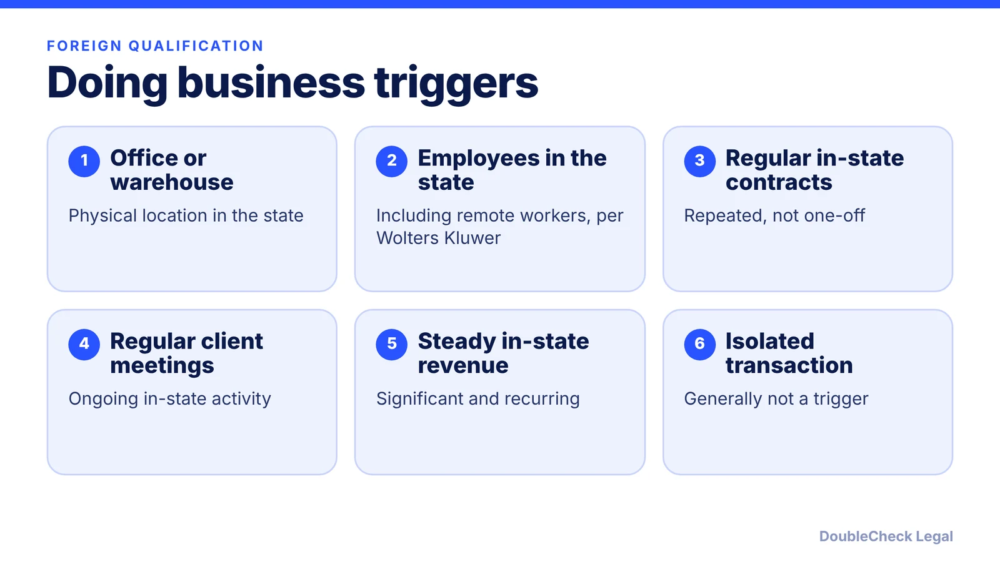
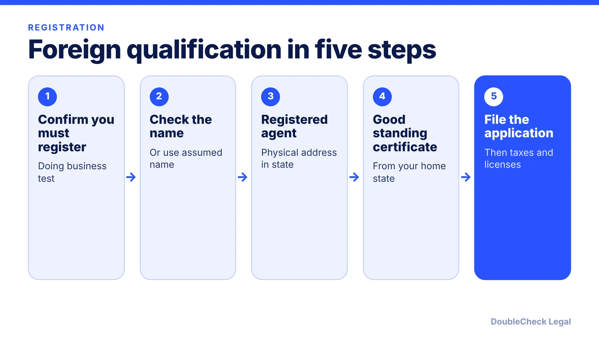

*What it means to register your LLC or corporation in another state, the steps, and the costs of skipping it, as of November 2026.*

**Key takeaways:**

- Foreign qualification means registering a business formed in one state to do business in another.
- The trigger is generally a regular, sustained presence, such as an office, employees or regular contracts, not a one-off sale; states differ.
- Steps: registered agent, good standing certificate, and the state's certificate of authority or application for registration.
- Penalties, fees and reports vary by state; verify on the Secretary of State page before filing.

## 1. The quick answer

**Quick answer:** Foreign qualification means registering your LLC or corporation with another state so it can lawfully do business there. "Foreign" here means formed in a different state, not a different country. Per LegalZoom and Wolters Kluwer, the test is generally whether you have a regular, sustained presence in the state, such as an office, employees or regularly performed contracts, rather than a one-off transaction. The usual steps are: pick the state, get a registered agent there, obtain a certificate of good standing from your home state, and file the state's application (often called a certificate of authority or application for registration). Rules differ by state, so check the Secretary of State page.

## 2. What counts as doing business

There is no single national test. Per [LegalZoom](https://www.legalzoom.com/articles/what-is-foreign-qualification), the question is whether you have a sustained, regular presence, and each state's statute differs. Per [Wolters Kluwer](https://www.wolterskluwer.com/en/expert-insights/activities-that-affect-the-foreign-qualification-requirement), these may trigger it: a physical location, employees in the state (including remote workers), regularly entering binding contracts there, regularly meeting clients there, or a steady in-state revenue stream.

Activities that generally do not count, per Wolters Kluwer: owning real property, contracts that must be approved by an out-of-state office before becoming binding, phone and email alone, and isolated transactions. LegalZoom adds that a remote employee is a gray area some states treat as a trigger. Determinations are case by case.

State examples: the Texas Secretary of State says Texas statutes do not define "transacting business," points to Business Organizations Code section 9.251 for activities that are not transacting business, and says its staff cannot decide for you whether you are. Per [Nolo](https://www.nolo.com/legal-encyclopedia/qualify-foreign-business-california.html), California generally requires registration for repeated and consecutive intrastate transactions, and the Franchise Tax Board uses a separate "doing business" test for tax purposes.

Registration is different from tax nexus. Selling online into a state may create sales tax obligations without requiring foreign qualification; see [sales tax nexus for online sellers](/blog/sales-tax-nexus-small-business-online/). If you are a Delaware entity operating in California, see [Delaware corporation doing business in California](/blog/delaware-corporation-doing-business-in-california/). For choosing where to form in the first place, see [best state to form an LLC](/blog/best-state-to-form-an-llc-comparison/) and [how to incorporate in the US](/blog/how-to-incorporate-a-company-in-the-us/).

## 3. How to register, step by step

Per [LegalZoom](https://www.legalzoom.com/articles/what-is-foreign-qualification), the process is typically:

1. **Check name availability** in the new state. If your name is taken, some states let you use an assumed name there.
2. **Appoint a registered agent** with a physical street address in that state. A P.O. box alone does not qualify, and the agent is needed for as long as you are registered. See [Delaware registered agent requirements](/blog/delaware-registered-agent-requirements/) for how agents work.
3. **Get a certificate of good standing** (also called a certificate of existence or status) from your home state. LegalZoom says some states accept only recent certificates, such as issued within 30, 60 or 90 days, and that some states, including Texas, do not require one. Per Nolo, California asks for a current certificate of good standing from your home-state agency.
4. **File the application** (certificate of authority, application for registration, or certificate of registration, depending on the state) with the fee. Texas, for example, lists its fee at $750 for most entity types and allows online filing through SOSPortal, per the Texas Secretary of State. Other states differ, so verify each fee on the state's own page.
5. **Register for state taxes and licenses** after approval. See [business license requirements](/blog/business-license-requirements-small-business/).

Keep your home-state entity in good standing, because the new state will rely on it.

## 4. Penalties, annual reports and taxes, and when to get help

**Penalties for not registering.** They vary by state. Per Wolters Kluwer, they can include fines on the entity and on individuals doing business for it, and inability to bring a lawsuit in that state's courts until you qualify. LegalZoom adds possible back fees and back taxes. Per Nolo, in California an unregistered LLC cannot file lawsuits but can defend against them, and members and managers are not personally liable for LLC debts solely because it did business there unregistered. Do not assume your state works the same way.

**Annual reports and taxes.** Per Wolters Kluwer, foreign reports are due annually in most states, biennially in some. LegalZoom stresses that an annual report and tax filings go to separate agencies and one does not satisfy the other. Some states also charge franchise or minimum taxes; check the state revenue agency. See [annual report requirements by state](/blog/annual-report-requirements-by-state-llc/). If you stop doing business there, LegalZoom notes you generally need to file a withdrawal, or reports and fees can keep accruing.

**You can handle yourself:** reading the state's page, ordering a good standing certificate, and drafting the application with AI help.

**Get an attorney or tax professional to verify when:**

- You are not sure whether remote employees or contractors create a trigger.
- You already operate there unregistered and want to fix it, and need to understand back fees or the right to sue.
- You are expanding into several states, or doing business in California or Texas, where tax and registration rules are separate.
- A contract or investor requires you to be in good standing everywhere.

See also [LLC operating agreement with AI](/blog/llc-operating-agreement-with-ai/) and [small business AI legal work, safely](/blog/small-business-ai-legal-work-safely/).

## Where DoubleCheck fits

[DoubleCheck](https://www.contactdoublecheck.com) helps businesses and founders start legal work with AI, verify it, and, when professional advice is warranted, connect with an independent attorney, including for immigration questions. Attorney availability and practice areas vary. Attorneys on DoubleCheck are independent professionals; an attorney-client relationship forms only if an attorney accepts your engagement.

**Sources:** [LegalZoom on foreign qualification](https://www.legalzoom.com/articles/what-is-foreign-qualification); [Wolters Kluwer on activities that affect the requirement](https://www.wolterskluwer.com/en/expert-insights/activities-that-affect-the-foreign-qualification-requirement); [Nolo on California](https://www.nolo.com/legal-encyclopedia/qualify-foreign-business-california.html); [Texas Secretary of State](https://www.sos.texas.gov/corp/foreign_outofstate.shtml). These are secondary sources apart from the Texas page; confirm current fees and forms with each state's Secretary of State.

## FAQ

**What does foreign qualification mean for an LLC?**

It means registering an LLC formed in one state to do business in another state. Per LegalZoom, "foreign" here means out of state. The filing is called a certificate of authority or application for registration, depending on the state.

**Do I need to register if I only sell online to customers in another state?**

Not necessarily. Per Wolters Kluwer, isolated transactions and phone or email contact alone are generally less likely to trigger it, but it depends on the state. Sales tax nexus is a separate question.

**What happens if I do not foreign qualify?**

Per Wolters Kluwer, possible fines and an inability to sue in that state's courts until you qualify. LegalZoom adds possible back fees and taxes. Specific consequences vary by state.

**Do remote employees trigger foreign qualification?**

It can. Wolters Kluwer lists employees in the state, including remote workers, as a possible trigger, and LegalZoom calls it a gray area some states treat as a trigger. Check the state's rule or ask an attorney.

---

*General information only. This article is not legal, tax, investment, or accounting advice.*
