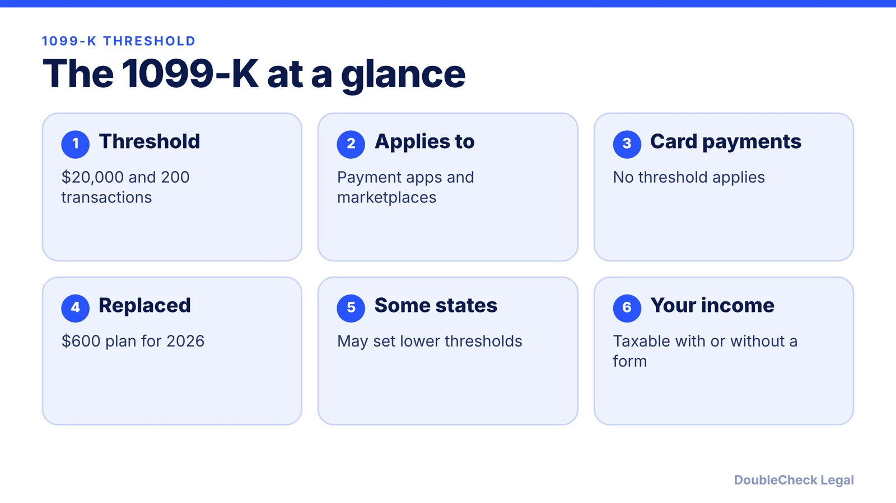
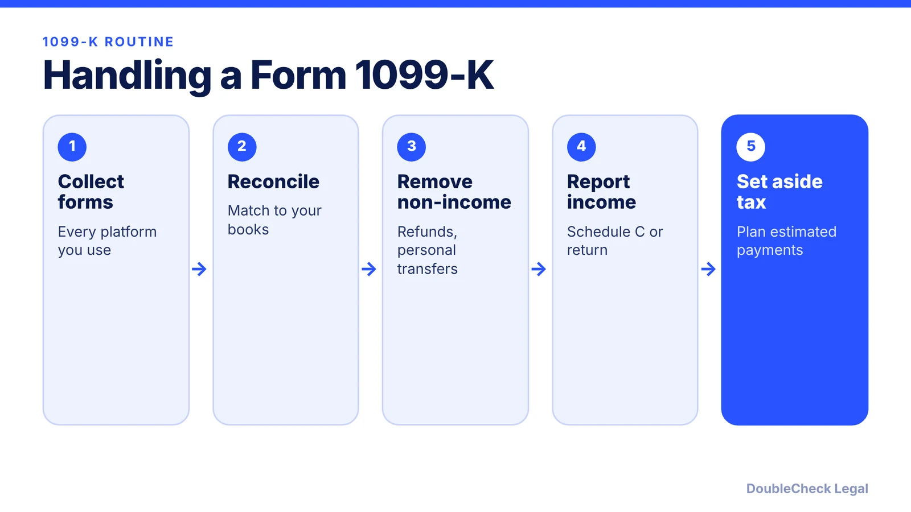

*Will you get a Form 1099-K for $600 in 2026? Here is the $20,000 and 200-transaction threshold and what to do with the form.*

**Key takeaways:**

- The 1099-K threshold for payment apps and marketplaces is more than $20,000 and more than 200 transactions.
- The $5,000, $2,500, and $600 phase-in plan no longer applies, per the IRS FAQs.
- Payment card transactions have no threshold, and some states set lower ones.
- Income is taxable with or without a form; confirm current guidance on the IRS site.

## 1. The quick answer

**Quick answer:** The Form 1099-K threshold for third-party settlement organizations, such as payment apps and online marketplaces, is back to more than $20,000 in gross payments and more than 200 transactions. The One Big Beautiful Bill Act reinstated the pre-2021 threshold retroactively, replacing the planned $5,000 (2024), $2,500 (2025), and $600 (2026 and later) levels, per the IRS and CPA Practice Advisor. Your income is taxable whether or not you get a form.

## 2. How the threshold works

The IRS newsroom release says third-party settlement organizations (TPSOs) do not have to file Form 1099-K unless a payee's gross reportable payments exceed $20,000 and the number of transactions exceeds 200. Both conditions must be met.

Per the IRS FAQs (Fact Sheet 2025-08, summarized by CPA Practice Advisor on October 23, 2025):

- **Retroactive:** the threshold applies retroactively to the 2022 tax year.
- **Payment card transactions:** no threshold applies, so even small card payments can generate a Form 1099-K.
- **State rules:** some states may set lower thresholds, so you might receive a form below the federal level.
- **Superseded plan:** the earlier $5,000, $2,500, and $600 thresholds no longer apply.

The IRS page we fetched is marked archival, so check the IRS website for the latest 1099-K guidance. We did not verify rules on backup withholding or on forms already issued, so confirm those with the IRS or a tax professional.

## 3. What it means for your business

The threshold governs who must issue a form, not what you must report. Per CPA Practice Advisor's summary of the IRS FAQs, you may have a tax obligation if you had a gain on goods sold or received payment for services, form or no form.

For a small business, practical steps are:

- **Reconcile.** If you receive a Form 1099-K, match it to your books. Gross amounts can include refunds, fees, and personal transfers that are not income.
- **Track every platform.** Keep your own record of PayPal, Venmo, Stripe, Etsy, or marketplace payments, since you must report income even from a platform that sent no form.
- **Separate personal and business money.** Mixed accounts make a reconciliation harder.
- **Report income correctly.** Sole proprietors report on Schedule C; see [single-member LLC taxes](/blog/single-member-llc-taxes-disregarded-entity/) and [self-employment tax](/blog/self-employment-tax-solo-business-owner-2026/).

## 4. Do not confuse it with 1099-NEC and 1099-MISC

Form 1099-K is issued by payment settlement companies. The forms you issue to contractors are different. Per CPA Practice Advisor's July 2025 summary of the One Big Beautiful Bill Act, the Form 1099-NEC and 1099-MISC reporting threshold rises from $600 to $2,000 for payments made in 2026, with inflation adjustments from 2027. Our dedicated post covers that rule and how it affects you: [1099-NEC and the $2,000 threshold](/blog/1099-nec-2000-threshold-hiring-freelancers/).

If you hire people, also review [employee vs. contractor classification](/blog/employee-vs-independent-contractor-classification-startups/). If you sell across state lines, read [sales tax nexus](/blog/sales-tax-nexus-small-business-online/), because marketplace payments can raise state questions. Owners who expect a tax bill should plan with [quarterly estimated taxes](/blog/quarterly-estimated-taxes-solo-business-owner/). An accountant can help you reconcile a form that looks wrong.

## Where DoubleCheck fits

[DoubleCheck](https://www.contactdoublecheck.com) helps businesses and founders start legal work with AI, verify it, and, when professional advice is warranted, connect with an independent attorney, including for immigration questions. Attorney availability and practice areas vary. Attorneys on DoubleCheck are independent professionals; an attorney-client relationship forms only if an attorney accepts your engagement.

**Sources:** [IRS FAQs on the 1099-K threshold](https://irs.gov/newsroom/irs-issues-faqs-on-form-1099-k-threshold-under-the-one-big-beautiful-bill-dollar-limit-reverts-to-20000); [CPA Practice Advisor on the IRS FAQs, October 2025](https://www.cpapracticeadvisor.com/2025/10/23/irs-issues-new-faqs-on-20000-form-1099-k-threshold-under-obbba/171575/); [CPA Practice Advisor on 1099 thresholds, July 2025](https://cpapracticeadvisor.com/2025/07/30/one-big-beautiful-bill-act-changes-1099-thresholds/165863/).

## FAQ

**What is the Form 1099-K threshold for 2026?**

Per the IRS, third-party settlement organizations file only when a payee's gross payments exceed $20,000 and transactions exceed 200. The 2025 law reinstated this threshold, replacing the $600 plan.

**Do I owe tax if I do not receive a Form 1099-K?**

Yes. Per CPA Practice Advisor's summary of the IRS FAQs, you may have a tax obligation on gains from goods sold or payments for services, whether or not you receive a form.

**Do payment card transactions have a threshold?**

Per the IRS FAQs as summarized by CPA Practice Advisor, no threshold applies to payment card transactions, so even small amounts can generate a Form 1099-K.

**Is the 1099-K threshold the same as the 1099-NEC threshold?**

No. The 1099-K threshold is $20,000 and 200 transactions. Per CPA Practice Advisor, the Form 1099-NEC and 1099-MISC threshold is $2,000 for payments made in 2026.

---

*General information only. This article is not legal, tax, investment, or accounting advice.*
