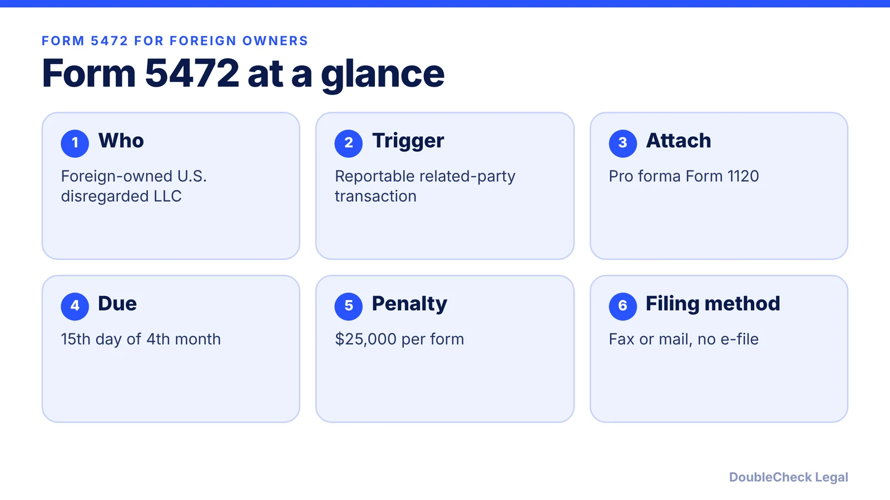
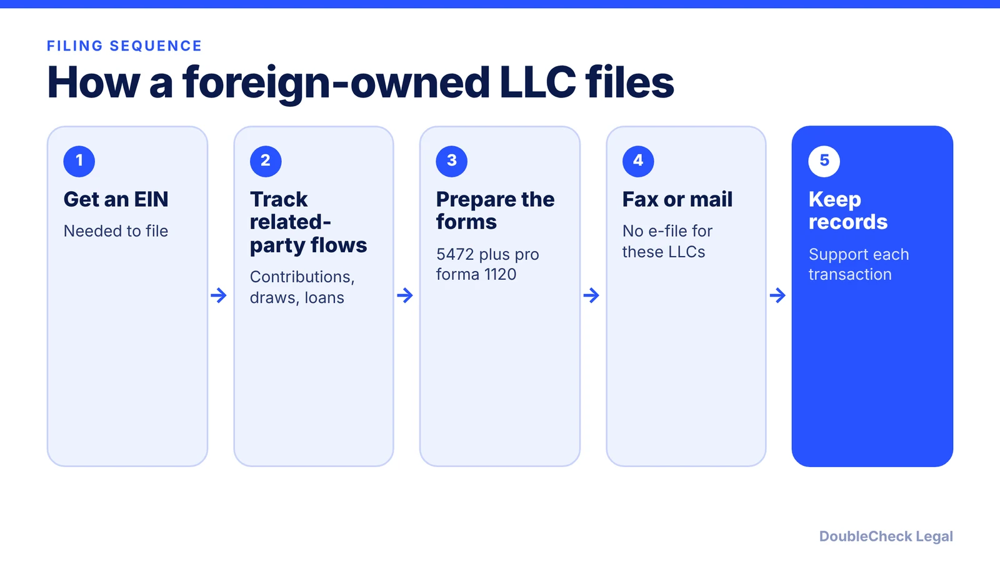

*A foreign-owned LLC can owe a $25,000 penalty for a missing form even with no income. Here is who files Form 5472, when, and how.*

**Key takeaways:**

- A foreign-owned U.S. single-member LLC files Form 5472 with a pro forma Form 1120 when it has a reportable related-party transaction.
- The base penalty is $25,000 per form, with more for each 30 days after IRS notice.
- These LLCs cannot e-file; they fax or mail the package.
- Even a small owner contribution can be reportable, so keep clean records.

## 1. The quick answer

**Quick answer:** A U.S. single-member LLC wholly owned by a foreign person and treated as a disregarded entity must file Form 5472, attached to a pro forma Form 1120, when it had a reportable transaction with a related party during the year. The base penalty for failing to file is $25,000 per form, per VJM Global and Alaz Law, with additional $25,000 penalties for each 30-day period if the failure continues more than 90 days after IRS notice. These entities cannot e-file the form, so it is faxed or mailed.

## 2. Who must file and what counts as a transaction

A single-member LLC is normally ignored for income tax, as explained in [single-member LLC taxes](/blog/single-member-llc-taxes-disregarded-entity/). The reporting rules are an exception: under Section 6038A regulations, a domestic disregarded entity wholly owned by a foreign person is treated as a separate domestic corporation for limited reporting, record maintenance, and compliance purposes, per Norton Rose Fulbright.

Per VJM Global, reportable transactions with related parties include:

- Capital contributions and distributions, including owner draws.
- Loans and advances.
- Services, rents, and royalties.
- Purchases and sales.
- Noncash transfers or transactions below full value.

Alaz Law warns that an LLC with no revenue can still have a reportable issue, and VJM Global gives the example of a $2,000 owner contribution to a foreign-owned LLC with no income. Related-party transactions include money you put into the company or take out. Because older articles describe the filing duty differently, confirm against the current IRS instructions for Form 5472.

The entity needs an EIN to file. If the owner has no SSN, see [getting an EIN without an SSN](/blog/get-ein-without-ssn-foreign-founder/).

## 3. Due date, how to file, and penalties

**Due date.** Form 5472 is filed with the pro forma Form 1120, due the 15th day of the fourth month after year-end. For a calendar-year entity that is April 15, per Alaz Law and VJM Global, and Form 7004 generally gives a six-month extension if filed by the original due date.

**Pro forma Form 1120.** Per Alaz Law, for this filing the pro forma return needs only the entity's name and address and items B and E on page one, with "Foreign-owned U.S. DE" written across the top.

**How to file.** Per VJM Global and Alaz Law, foreign-owned disregarded entities cannot e-file Form 5472. VJM Global lists a dedicated fax number (855-887-7737); Alaz Law also describes a dedicated Ogden, Utah mailing address. Confirm both in the current IRS instructions, and do not use the regular Form 1120 addresses.

**Penalties.** Per VJM Global:

- $25,000 per tax year for each required form that is late, incomplete, or missing.
- An extra $25,000 for each 30-day period (or fraction) if the failure continues more than 90 days after the IRS mails notice.
- Relief is mainly through reasonable cause, which requires documented ordinary business care. Ignorance of the rule, reliance on someone else, and lack of income rarely qualify alone.

## 4. Practical points for foreign founders

Good bookkeeping is the cheapest protection. Keep a ledger that separates the owner's personal money from the LLC's, and label every transfer as a contribution, a loan, a distribution, or a payment for services. Records must support what Form 5472 reports, per the Section 6038A record maintenance rule described by Norton Rose Fulbright.

The IRS filing is separate from your income tax position. Whether you owe U.S. tax depends on factors such as effectively connected income; see [foreign founder U.S. taxes and the substantial presence test](/blog/foreign-founder-us-taxes-substantial-presence-test/). A U.S. state may also have its own requirements; New York's reporting law is covered in the [New York LLC Transparency Act post](/blog/new-york-llc-transparency-act-beneficial-ownership/).

If the LLC's growth plans involve investors, a C corporation may be a better fit, and the filing duties change with it. See [LLC vs. C corp for startups](/blog/llc-vs-c-corp-startups/) and [starting a U.S. company as a non-U.S. resident](/blog/start-us-company-as-non-us-resident/). Missed filings from earlier years are a question for a tax professional or attorney, not something to guess at.

## Where DoubleCheck fits

[DoubleCheck](https://www.contactdoublecheck.com) helps businesses and founders start legal work with AI, verify it, and, when professional advice is warranted, connect with an independent attorney, including for immigration questions. Attorney availability and practice areas vary. Attorneys on DoubleCheck are independent professionals; an attorney-client relationship forms only if an attorney accepts your engagement.

**Sources:** [Alaz Law, Form 5472 for 2026](https://www.alazlaw.com/blog/form-5472-foreign-owned-single-member-llc-2026/); [VJM Global on Form 5472 penalties](https://www.vjmglobal.com/feeds/blog/irs-form-5472-penalty-instructions-2026); [Norton Rose Fulbright on the Section 6038A regulations](https://www.nortonrosefulbright.com/en-sg/knowledge/publications/1bd91945/form-5472-new-filing-and-recordkeeping-obligations-for-foreignowned-disregarded-us-entities).

## FAQ

**Does a foreign-owned single-member LLC have to file Form 5472?**

Generally yes if it had a reportable related-party transaction during the year, per VJM Global and Alaz Law. Reportable items include owner contributions, draws, loans, and payments for services.

**When is Form 5472 due for a foreign-owned LLC?**

With the pro forma Form 1120, by the 15th day of the fourth month after year-end, which is April 15 for a calendar-year entity. Form 7004 generally gives a six-month extension, per Alaz Law and VJM Global.

**What is the penalty for not filing Form 5472?**

Per VJM Global and Alaz Law, $25,000 per form, plus $25,000 for each 30-day period if the failure continues more than 90 days after IRS notice. Relief mainly depends on reasonable cause.

**Can I e-file Form 5472 for my foreign-owned LLC?**

No. Per VJM Global and Alaz Law, foreign-owned disregarded entities fax or mail the package, and VJM Global lists 855-887-7737 for faxes. Confirm in the current IRS instructions.

---

*General information only. This article is not legal, tax, investment, or accounting advice.*
