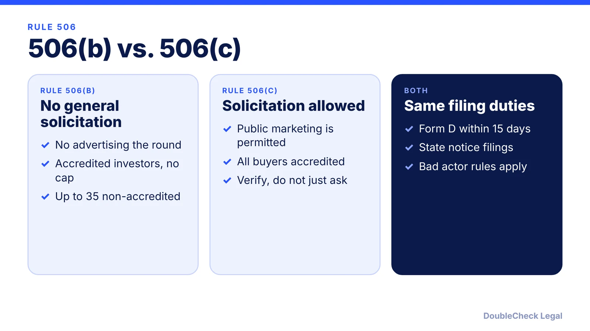
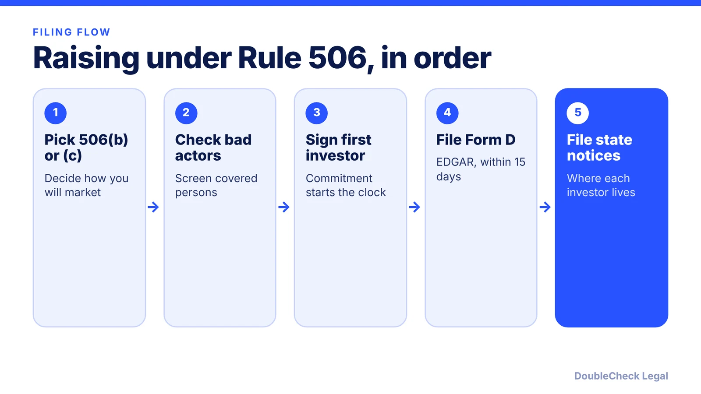

*Taking investor money triggers securities rules. Here is how Rule 506, Form D, and state notices fit together for a startup round.*

**Key takeaways:**

- Rule 506(b) bars general solicitation; Rule 506(c) allows it but requires all purchasers to be accredited and verified.
- Form D is due within 15 days after the first sale, online through EDGAR, with no SEC filing fee.
- The first sale generally means an investor is irrevocably committed, not when funds arrive.
- States may still require notice filings and fees, so an SEC filing alone is not enough.

## 1. The quick answer

**Quick answer:** Most startups that sell equity or SAFEs to investors in a private round rely on Rule 506 of Regulation D. Rule 506(b) bars general solicitation; Rule 506(c) allows it but requires that every purchaser is accredited and that you take reasonable steps to verify it. Either way, you file a Form D with the SEC within 15 days after the first sale, filed online through EDGAR with no SEC filing fee, and states may still require their own notice filings.

## 2. Rule 506(b) vs. 506(c) in plain English

Per the [SEC](https://sec.gov/smallbusiness/exemptofferings/rule506b), Rule 506(b) is a safe harbor under Section 4(a)(2) of the Securities Act. Its main conditions:

- No general solicitation or advertising to market the securities.
- No cap on the amount raised or on the number of accredited investors.
- Sales to non-accredited investors capped at 35 in any 90-calendar-day period, and each must be financially sophisticated, alone or with a purchaser representative.
- If you sell to non-accredited investors, you must give them specified disclosure documents and financial statement information.
- Offerings are subject to bad actor disqualification provisions.

Per the [SEC's exempt offerings page](https://www.sec.gov/smallbusiness/exemptofferings), Rule 506(c) permits general solicitation where all purchasers are accredited investors and the issuer takes reasonable steps to verify that. Daeryun Law notes that for 506(b) the issuer needs a reasonable belief about investor status, while 506(c) requires verification steps based on each investor's circumstances.

In practice, a founder emailing a few angels they already know is typically in 506(b) territory; a founder posting the round on social media or a demo day stage should talk to counsel about 506(c) before doing so. Purchasers in either case receive restricted securities.

## 3. Form D and state notice filings

Per the SEC, Form D is required for offerings relying on Rule 504, 506(b), or 506(c), and must be filed within 15 days after the first sale of securities. It is filed online through EDGAR, and the SEC charges no filing fee.

Daeryun Law adds that the first sale generally occurs when an investor becomes irrevocably contractually committed, not when the money arrives, and that a deadline falling on a weekend or holiday moves to the next business day. It also says ongoing offerings generally need an annual amendment.

**State notices.** The SEC says federal law preempts state registration but states may still require notice filings and collect fees. Daeryun Law says an SEC filing does not satisfy state obligations, you should check every state where purchasers are located, and state deadlines may differ from the 15-day SEC rule. Fees and deadlines vary by state, so confirm each on the state securities regulator's site.

## 4. Founder checklist before you take the first check

- **Decide your marketing approach first.** Public posts about an open round can undermine a 506(b) plan.
- **Collect investor information early.** Know each investor's state and accredited status before closing.
- **Calendar the 15 days** from the first binding commitment, not from the wire.
- **Plan state notices** alongside the Form D.
- **Keep your paper consistent.** Your instruments (see [SAFE notes explained](/blog/safe-note-explained-for-founders/) or [SAFE vs. convertible note](/blog/convertible-note-vs-safe/)) and your [cap table](/blog/cap-table-basics-for-first-time-founders/) should agree.
- **Prepare for diligence.** See the [fundraising due diligence checklist](/blog/due-diligence-checklist-for-startup-fundraising/).

For terms on a priced round, read [term sheet key terms](/blog/term-sheet-key-terms-explained/), and for the stage context, [funding stages from pre-seed to Series B](/blog/startup-funding-stages-pre-seed-to-series-b/). Securities law is technical and a late or missing filing can matter, so have a securities attorney review your approach. This article is general information, not securities advice.

## Where DoubleCheck fits

[DoubleCheck](https://www.contactdoublecheck.com) helps businesses and founders start legal work with AI, verify it, and, when professional advice is warranted, connect with an independent attorney, including for immigration questions. Attorney availability and practice areas vary. Attorneys on DoubleCheck are independent professionals; an attorney-client relationship forms only if an attorney accepts your engagement.

**Sources:** [SEC, Private Placements - Rule 506(b)](https://sec.gov/smallbusiness/exemptofferings/rule506b); [SEC, Exempt Offerings](https://www.sec.gov/smallbusiness/exemptofferings); [Daeryun Law, Form D Filing Requires Federal Deadlines and State Notices](https://www.daeryunlaw.com/us_ar/insights/form-d-filing-us).

## FAQ

**When is Form D due?**

Per the SEC, within 15 days after the first sale of securities. Per Daeryun Law, the first sale generally occurs when an investor becomes irrevocably contractually committed, and a weekend or holiday deadline moves to the next business day.

**Does it cost anything to file a Form D?**

The SEC says it does not charge any filing fee for a Form D notice or amendment. State notice filings may carry their own fees, per the SEC page on Rule 506(b).

**Can I talk about my round on social media?**

Not under Rule 506(b), which prohibits general solicitation. Rule 506(c) permits it if all purchasers are accredited and you take reasonable steps to verify. Ask a securities attorney before publicizing a round.

**Do I also file in every state?**

Possibly. Per the SEC, states cannot require registration of Rule 506 offerings but may require notice filings and fees. Daeryun Law advises checking each state where purchasers are located, since deadlines may differ.

---

*General information only. This article is not legal, tax, investment, or accounting advice.*
