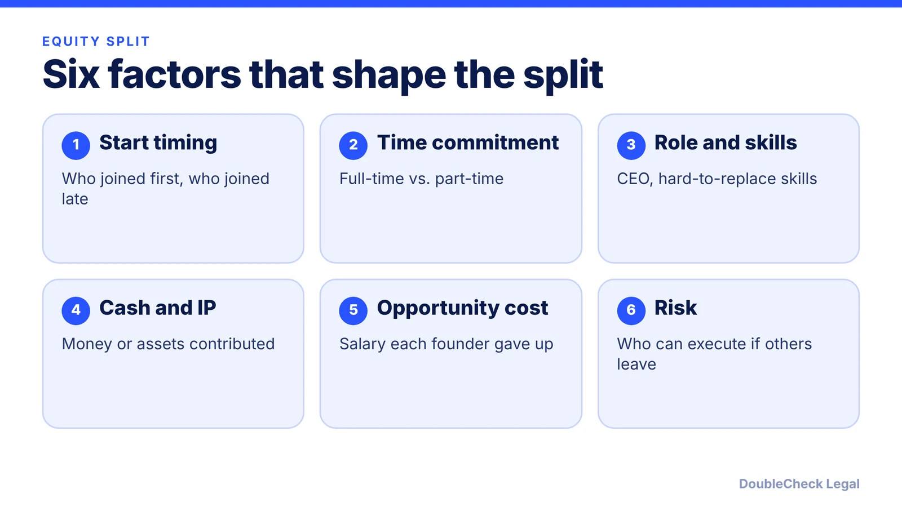
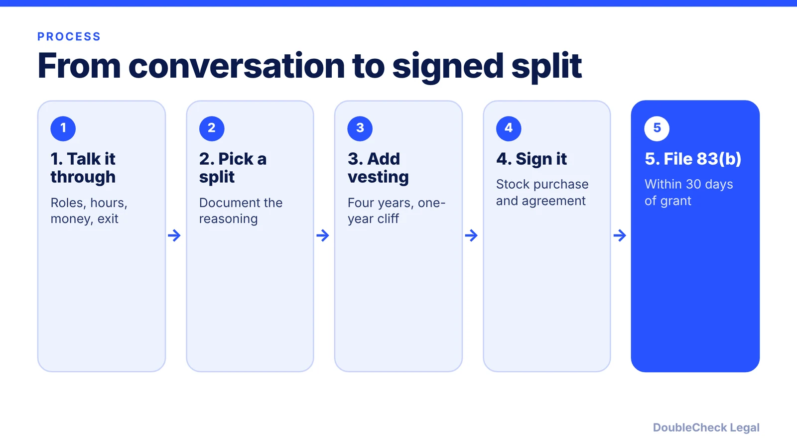

*There is no perfect split, but there is a defensible process: weigh the factors, add vesting, and write it down.*

**Key takeaways:**

- Split by expected future contribution and risk, not only past work.
- Standard vesting: four years, one-year cliff, then monthly; leaving at 18 months leaves about 37.5% vested.
- Unvested shares let you rebalance later; write any change down.
- The 83(b) election must be filed within 30 days of the stock grant and the deadline cannot be extended.

## 1. The quick answer

**Quick answer:** Divide founder equity by expected future contribution and risk, not only past work, then put vesting on every founder's shares. The standard is four years with a one-year cliff: nothing vests in year one, 25% vests at 12 months, and the rest vests monthly (1/48th a month) over the next three years. Per Terms.law, many advisors suggest avoiding a 50/50 split between two founders because it creates deadlock potential. If you receive restricted stock, check the 83(b) election, which has a 30-day deadline.

## 2. How to decide the split

Terms.law groups the factors into past contributions (prior work, IP, seed capital), future contributions (time commitment, role, hard-to-replace skills, salary foregone, network), and risk. StartupBook adds that equal splits can overpay someone who joins months later or is still working another job, and that cash is not the same as time; it suggests a SAFE or note, or extra equity, to account for money put in. Terms.law mentions a premium of roughly 5-10% for the CEO or lead founder as a common adjustment.

For benchmarks, StartupBook cites 2024 Carta data: about 46% of two-founder teams split exactly equally, with a median split near 51/49, and about 27% of three-founder teams split exactly equally. Note the sample skews toward venture-backed U.S. startups. Our post on [what Carta's data shows](/blog/how-co-founders-split-equity-data/) goes deeper.

**Dynamic splits.** StartupBook describes three ways to adjust over time: forfeit unvested shares in exchange for a redefined role, issue a new tranche of restricted stock or options to the founder carrying more load (everyone is diluted slightly), or bring in an outside voice, such as an investor or board member, to mediate. Its advice: "write the new agreement down." Unvested stock is what makes rebalancing possible, per Stripe.

## 3. Vesting and the 83(b) election

**Schedule.** Four years with a one-year cliff is typical, per Stripe, Terms.law, and StartupBook. Stripe's example: a founder who leaves at 18 months holds about 37.5%. With 4,000,000 shares, that is 1,500,000 vested shares (25% at month 12, then 1/48th of 4,000,000, or about 83,333 shares, for each of the next six months). Terms.law notes that founders who have worked together before may negotiate a shorter schedule or no cliff, and that vesting is usually enforced through reverse vesting, giving the company a repurchase right over unvested shares.

**83(b).** Per Stripe and Terms.law, a U.S. founder with restricted stock can file an 83(b) election to pay tax on the stock's value at grant, when it is typically very low, rather than as each portion vests. The window is 30 days from the grant, it cannot be extended, and a missed deadline cannot be recovered. Details are in [83(b) election for startup founders](/blog/83b-election-startup-founders/), and the election usually comes up when you incorporate ([incorporating a SaaS or AI startup as a Delaware C-corp](/blog/how-to-incorporate-saas-ai-startup-delaware-c-corp/)). For acceleration and what you keep if you leave, see [co-founder vesting explained](/blog/cofounder-vesting-cliff-explained/).

## 4. Put it in writing

Terms.law says a founders agreement should cover roles, decision-making authority, equity splits, vesting terms, IP assignment, non-compete provisions, and what happens if a founder leaves, alongside stock purchase agreements, a stockholders agreement, and board consent. Read how in [co-founder agreement for startups](/blog/co-founder-agreement-startups/).

Common failure points: a split decided on a handshake, no vesting, a 50/50 split with no deadlock plan, and equity promised but never documented. Investors will later ask for the documents, so see the [fundraising due diligence checklist](/blog/due-diligence-checklist-for-startup-fundraising/). Also see [cap table basics](/blog/cap-table-basics-for-first-time-founders/) to see how your split looks after a round.

## Where DoubleCheck fits

[DoubleCheck](https://www.contactdoublecheck.com) helps businesses and founders start legal work with AI, verify it, and, when professional advice is warranted, connect with an independent attorney, including for immigration questions. Attorney availability and practice areas vary. Attorneys on DoubleCheck are independent professionals; an attorney-client relationship forms only if an attorney accepts your engagement.

**Sources:** [Terms.law, Founder Equity Split FAQ](https://terms.law/FAQ/business-disputes/founder-equity-split-faq.html); [StartupBook, How Co-Founders Should Split Equity](https://startupbook-org.pages.dev/guides/cofounder-equity-splits/); [Stripe, Founder vesting](https://stripe.com/au/resources/more/founder-vesting).

## FAQ

**Should co-founders split equity 50/50?**

It is common but risky. Per Terms.law, many advisors suggest avoiding 50/50 for two founders because it creates deadlock potential. StartupBook cites 2024 Carta data showing about 46% of two-founder teams split exactly equally.

**What is standard founder vesting?**

Four years with a one-year cliff, per Stripe, Terms.law, and StartupBook: nothing vests in year one, 25% vests at the cliff, and the rest vests monthly over three years.

**What is a dynamic equity split?**

An approach where the split is adjusted as roles change. StartupBook describes forfeiting unvested shares for a redefined role, issuing a new vesting tranche to the founder carrying more load, or using an outside mediator, and recommends writing any change down.

**What is the deadline for an 83(b) election?**

30 days from the stock grant, per Stripe and Terms.law. The deadline cannot be extended, so confirm your dates with a tax professional.

---

*General information only. This article is not legal, tax, investment, or accounting advice.*
