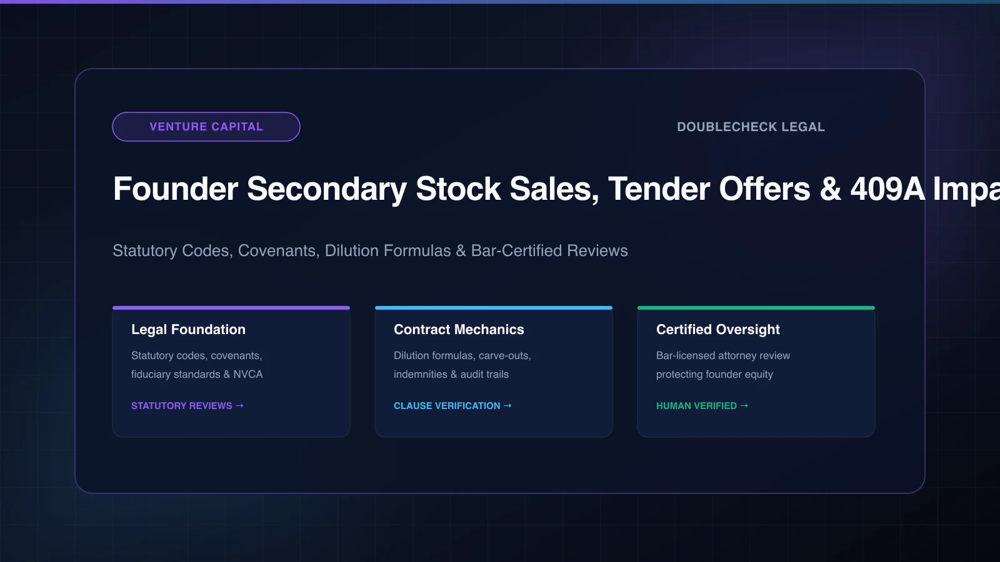
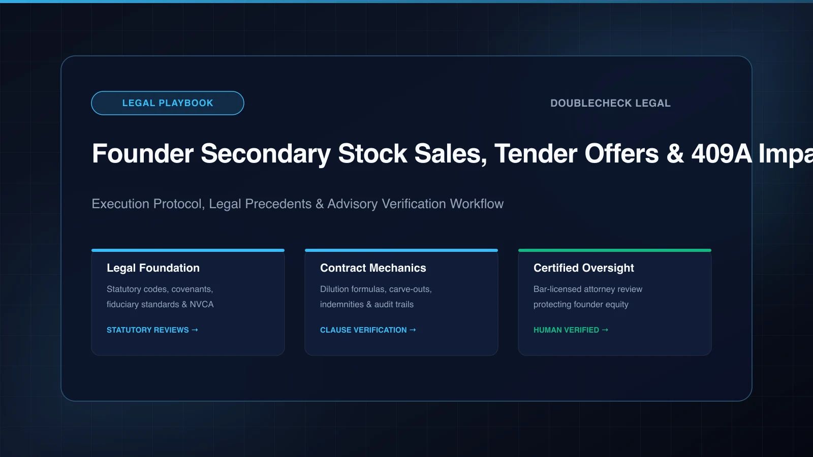

<div class="article-hero-banner mb-8">
  
</div>

## How Do Founder Secondary Stock Sales Impact 409A Valuations and Startup Equity?

A **founder secondary stock sale** occurs when a startup founder or early executive sells a portion of their already-issued common shares to an institutional investor or back to the company in exchange for personal cash liquidity. Unlike primary fundraising—where new preferred shares are issued to capitalize the corporate bank account—secondary transactions transfer existing equity ownership without increasing company working capital.

While founder secondaries have become standard in growth-stage venture rounds (Series B through pre-IPO) to alleviate personal financial pressure, they introduce **profound corporate governance, securities, and tax complexities**, most notably the risk of **Section 409A valuation contagion**.

```
Primary vs. Secondary Financing Mechanics

PRIMARY FINANCING
[New Investor] ── $10M Cash ──> [Company Treasury] ── Issues New Preferred ──> [Investor Cap Table]
(All proceeds fund corporate burn, R&D, and expansion)

SECONDARY FINANCING
[Secondary Buyer] ── $2M Cash ──> [Founder Personal Bank] 
      │
      └─────── Transfers Existing Common Stock ───────> [Secondary Buyer]
(Proceeds provide personal founder liquidity; company treasury receives $0)
```

---

## Direct Answer for Founders, CFOs & Venture Investors

- **For Founders:** Negotiate secondary liquidity as an integral, negotiated component of your **Series B or Series C primary term sheet**, rather than attempting ad-hoc, unilateral private secondary transfers. Unsanctioned sales breach company **Right of First Refusal (ROFR)** covenants and can jeopardize your board alignment.
- **For In-House Legal & CFOs:** Ensure your independent 409A valuation appraiser is informed in advance. If common stock is transacted at a price higher than the prevailing 409A fair market value, appraisers may be legally obligated to incorporate that transaction into their valuation matrix, dramatically spiking employee option exercise prices and impairing your talent recruitment leverage.

---

## 1. The 409A Contagion Problem: How Secondary Liquidity Affects Options

### The Statutory Fair Market Value Mandate
Under Internal Revenue Code (IRC) Section 409A, stock options granted to employees must carry an exercise price equal to or greater than the **Fair Market Value (FMV)** of the underlying common stock on the date of grant. If options are granted below FMV:
- The employee faces immediate taxation upon vesting,
- A **20% federal penalty tax**, and
- Significant compounding interest penalties under state and federal tax codes.

### The "Recent Transaction" Appraisal Dilemma
Independent 409A valuation firms utilize three primary methodologies: the Market Approach, Income Approach, and Asset Approach. Under the **Backsolve Method**, appraisers evaluate recent arm's-length equity transactions:
- **Normal Spread:** Historically, common stock 409A values hover between **20% to 35%** of preferred stock price due to lack of liquidation preferences and voting discounts.
- **The Secondary Spike:** If a venture investor purchases founder common stock at a price equal to 80% or 90% of the preferred share price, the appraiser may conclude that the true market value of common stock has substantially increased.
- **The Consequence:** Future engineering and executive hires must pay a significantly higher strike price to exercise their options, drastically undermining the startup's equity incentive compensation packages.

---

## 2. Mitigating 409A Impact: Legal Structuring Strategies

To protect the company's option pool while providing vital founder liquidity, corporate counsel utilizes several proven structuring techniques:

```
Structural 409A Defense Strategies

1. Volume Caps (Safe Harbor Ratios)
   └── Limiting total secondary volume to under 5%–10% of total company capitalization.
2. The "Employment Comp" Characterization
   └── Documenting that the secondary price reflected a retention/compensatory premium.
3. Preferred Conversion Transactions
   └── Converting founder common into Series Preferred prior to sale to isolate common value.
4. Company-Sponsored Tender Programs
   └── Establishing broad employee eligibility to avoid targeted founder favoritism.
```

### Strategy A: The Preferred Conversion Mechanism
Instead of selling common stock directly, the startup amends its Certificate of Incorporation to permit the founder to convert common shares into a bespoke shadow class of Preferred Stock (e.g., Series Common-Prime or Series Preferred-2) that mirrors the primary investors' rights. The secondary buyer purchases this preferred instrument, leaving the common stock valuation uninfected by the pricing benchmark.

### Strategy B: The Compensatory Premium Argument
Company counsel and tax advisors can document that the buyer paid an above-market premium specifically to incentivize key leadership retention. Because non-arm's-length compensatory premiums are excluded from fair market valuation benchmarks under Treasury Regulation § 1.409A-1(b)(5)(iv)(B), the appraiser can maintain the lower common stock valuation baseline.

---

## 3. Board Approvals and Securities Compliance: Tender Offer Rules

### Transfer Restrictions and ROFR Enforcement
Almost every venture-backed startup maintains strict transfer restrictions within its Bylaws and Right of First Refusal & Co-Sale Agreements (ROFR). A founder cannot legally transfer shares without:
1. Formal delivery of a ROFR Notice to the corporation,
2. An opportunity for the company to repurchase the shares at the proposed price,
3. A secondary opportunity for major preferred investors to exercise co-sale rights, and
4. Formal Board of Directors written consent.

### Federal Tender Offer Rules (SEC Regulation 14E)
When a secondary program is opened up to broader groups of employees, the transaction may inadvertently cross the threshold into a **tender offer** under the Securities Exchange Act of 1934. If classified as a tender offer, the company must comply with **SEC Rule 14e-1**:
- The offer must remain open for a minimum of **20 business days**,
- Comprehensive disclosures must be delivered to all eligible security holders, and
- Strict pro-rata acceptance rules must be administered without favoritism.

---

## 4. Tax Optimization: Capital Gains vs. Dividend Treatment

When a secondary transaction takes the form of a **company share repurchase** (redemption) rather than a direct purchase by a third-party investor, the founder must navigate **IRC Section 302**:
- **Exchange Treatment (Capital Gains):** If the redemption qualifies as "substantially disproportionate" or represents a "complete termination" of interest, proceeds are taxed as capital gains.
- **Dividend Treatment (Ordinary Income):** If the founder retains substantial control and constructive ownership, the entire gross redemption proceeds may be reclassified and taxed as ordinary dividend income at significantly higher personal tax rates.

---


To safeguard early equity value from unexpected IRS phantom income liabilities before secondary rounds, consult our detailed analysis on [Section 83(b) election late filing remedies and protective measures](/blog/83b-election-late-filing-remedies-irs-protective-measures/).

## Statutory Authorities and Benchmark References

- **Internal Revenue Code (IRC § 409A & § 302):** Inclusion in gross income of deferred compensation and distributions in redemption of stock.
- **Treasury Regulations (26 C.F.R. § 1.409A-1):** Fair market value determination standards and valuation safe harbors.
- **Securities Exchange Act of 1934 (Rules 13e-4 & 14e-1):** Tender offer regulations and disclosure mandates.
- **Delaware General Corporation Law (DGCL § 202):** Restrictions on transfer of securities and validity of corporate ROFR agreements.

<div class="article-steps-banner my-10">
  
</div>
