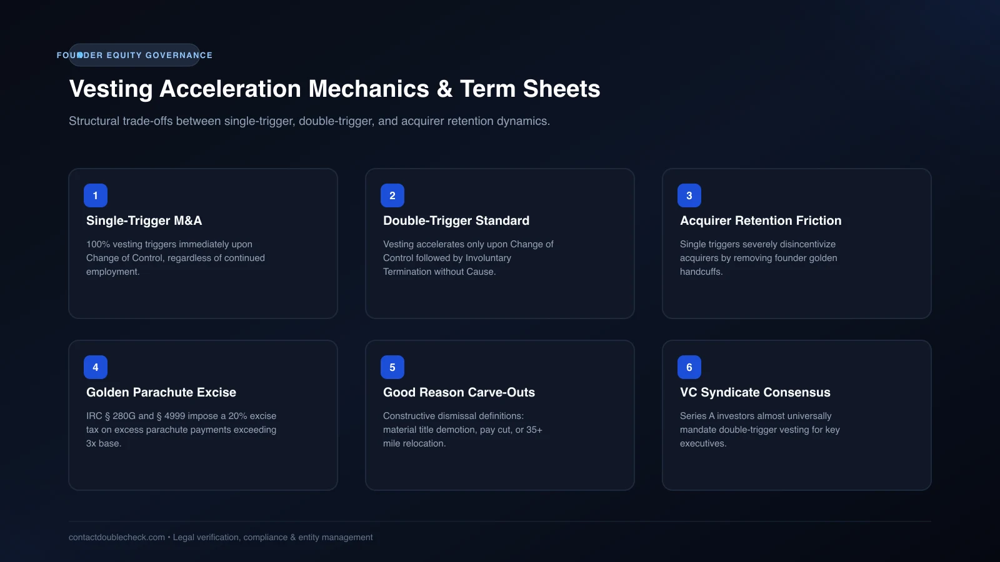
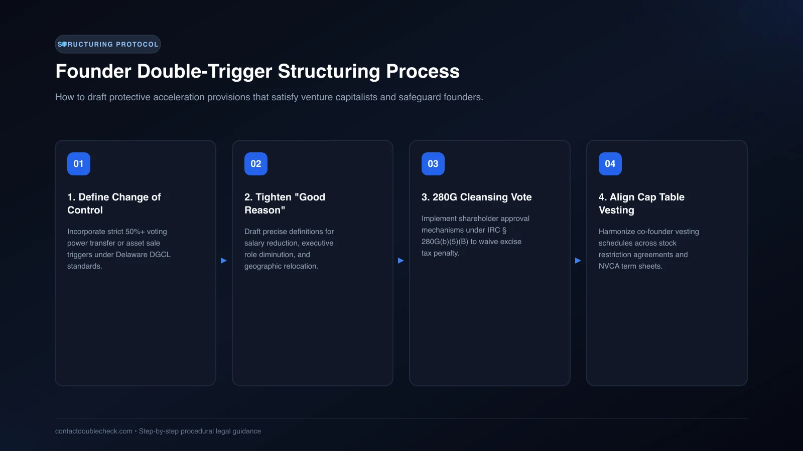

<div class="article-hero-banner mb-8">
  
</div>

## What Is the Difference Between Single-Trigger and Double-Trigger Vesting Acceleration?

The fundamental legal difference between **single-trigger** and **double-trigger** vesting acceleration lies in the number of contingent corporate events required before unvested stock or stock options automatically convert into fully vested, non-forfeitable equity.

- In a **Single-Trigger Acceleration** structure, 100% (or a specified percentage) of unvested equity accelerates immediately upon the closing of a **Change of Control** transaction (such as a merger, consolidation, or sale of substantially all assets), regardless of whether the founder continues working for the acquiring entity.
- In a **Double-Trigger Acceleration** structure, unvested equity accelerates only if **two distinct conditions** are fulfilled:
  1. **Trigger One:** The consummation of a qualified **Change of Control**; and
  2. **Trigger Two:** Within a defined "covered period" (typically 12 to 24 months post-closing), the founder experiences a termination of service **without Cause** or resigns for **Good Reason** (constructive discharge).

```
Vesting Acceleration Trigger Architecture

SINGLE-TRIGGER ACCELERATION
┌──────────────────────────────────────┐          ┌──────────────────────────────────────┐
│ Event 1: Change of Control (M&A)     ├─────────►│ 100% Unvested Equity Accelerates     │
│ (Acquisition closes)                 │          │ (Founder can leave immediately)      │
└──────────────────────────────────────┘          └──────────────────────────────────────┘

DOUBLE-TRIGGER ACCELERATION
┌──────────────────────────────────────┐          ┌──────────────────────────────────────┐
│ Event 1: Change of Control (M&A)     ├─────────►│ Equity Assumed by Acquirer           │
│ (Acquisition closes)                 │          │ (Standard vesting continues)         │
└──────────────────┬───────────────────┘          └──────────────────┬───────────────────┘
                   │                                                 │
                   ▼ (Within 12-24 Months Post-Close)                ▼
┌──────────────────────────────────────┐          ┌──────────────────────────────────────┐
│ Event 2: Involuntary Termination     ├─────────►│ 100% Remaining Equity Accelerates    │
│ (Without Cause or for Good Reason)   │          │ (Founder fully protected from firing)│
└──────────────────────────────────────┘          └──────────────────────────────────────┘
```

For founders negotiating **Stock Restriction Agreements (SRAs)**, **Executive Employment Agreements**, and **NVCA Series Seed or Series A Term Sheets**, acceleration mechanics represent the critical line of defense against post-acquisition marginalization.

---

## Why Venture Capitalists and Strategic Acquirers Resist Single Triggers

Venture capital syndicates almost universally reject single-trigger vesting acceleration for founders and key executives. The underlying financial economics explain why:

```
Venture Capital vs. Founder Incentive Alignment

┌───────────────────────────────┬───────────────────────────────┬───────────────────────────────┐
│ Perspective                   │ Single-Trigger Acceleration   │ Double-Trigger Acceleration   │
├───────────────────────────────┼───────────────────────────────┼───────────────────────────────┤
│ Strategic Acquirer            │ Disastrous: founders can cash │ Ideal: retains executive team │
│ (e.g., Google, Microsoft)     │ out and walk away on Day 1    │ during post-merger integration│
│ Venture Capital Syndicate     │ Lowers buyout purchase price; │ Maximizes acquisition price   │
│ (Series A/B Investors)        │ acquirers deduct retention pol│ by securing team continuity  │
│ Founder & Executive Team      │ Maximum personal autonomy;    │ Protection against hostile    │
│                               │ zero post-closing obligations │ firing and constructive exit │
└───────────────────────────────┴───────────────────────────────┴───────────────────────────────┘
```

When a strategic buyer evaluates an acquisition, a significant component of enterprise value resides in the technical acumen, leadership, and vision of the founding team. If all founder shares vest automatically at closing:
1. The acquirer must carve out a massive secondary **retention bonus pool** (often tens of millions of dollars) to keep key personnel;
2. That retention pool is directly deducted from the total purchase consideration that would have otherwise gone to existing common and preferred stockholders;
3. If founders refuse retention packages, the entire M&A deal frequently collapses.

Consequently, **double-trigger acceleration** has emerged as the universal institutional gold standard: it aligns founder security with investor valuation maximization.

---

## Anatomizing the Second Trigger: Cause and Good Reason Mechanics

In double-trigger drafting, the definitions of **"Cause"** and **"Good Reason"** are where battles are won or lost. A poorly drafted definition can allow an acquirer to squeeze a founder out without triggering their equity acceleration.

```
Standard Negotiation Boundaries for Key Definitions

┌───────────────────────────────┬───────────────────────────────┬───────────────────────────────┐
│ Contractual Term              │ Founder-Favorable Standard    │ Company/Acquirer Standard     │
├───────────────────────────────┼───────────────────────────────┼───────────────────────────────┤
│ Definition of "Cause"         │ • Felony conviction or fraud  │ • Any material breach of duty │
│                               │ • Willful gross misconduct    │ • Failure to meet performance │
│                               │ • Requires 30-day cure period │ • Negligence or insubordination│
│ Definition of "Good Reason"   │ • >10% reduction in base pay  │ • >25% reduction in total comp│
│                               │ • Material title/role demotion│ • Role changes within parent  │
│                               │ • >35 mile office relocation  │ • >75 mile relocation allowed │
│ Covered Period Window         │ • 3 months prior to signing   │ • 6 months post-closing only  │
│                               │ • Through 24 months post-close│ • Zero pre-signing protection │
└───────────────────────────────┴───────────────────────────────┴───────────────────────────────┘
```

### The Pre-Closing "Anticipation" Window

Sophisticated counsel must ensure the double trigger covers terminations that occur **shortly before** a deal closes. If an acquirer demands that the startup terminate a founder *as a condition precedent* to signing the merger agreement, a standard double trigger might fail because the termination occurred prior to the Change of Control. 

To prevent this evasion, the covered period must include terminations occurring within **3 to 6 months prior to the transaction** if made in contemplation of the acquisition.

---

## IRC Section 280G and Section 4999: The Golden Parachute Excise Tax

Accelerating equity vesting can inadvertently trigger severe federal tax penalties under **IRC Section 280G** and **IRC Section 4999**, known as the **"Golden Parachute"** rules.

```
IRC Section 280G Mathematical Thresholds

   Historic W-2 Base Amount                    Safe Harbor Ceiling
 (5-Year Average Historic Pay)             (3x Historic Base Amount)
     ├─────────────────────────────────────────────┤
     ▼                                             ▼
  [$200,000 Average Annual Comp]               [$600,000 Safe Harbor Limit]

If Total Accelerated Value + Severance >= $600,000:
• ENTIRE EXCESS over 1x Base Amount ($200,000) is an "Excess Parachute Payment"
• Founder pays NON-DEDUCTIBLE 20% FEDERAL EXCISE TAX (IRC § 4999)
• Corporation LOSES ALL TAX DEDUCTIONS on excess payments (IRC § 280G)
```

### The Private Company Shareholder Approval Cleansing Mechanism

Fortunately, private tech startups can completely neutralize 280G excise taxes using the statutory **Private Company Shareholder Vote Exemption** under **IRC § 280G(b)(5)(B)**:

1. **Equity Waivers:** The disqualified individual (founder) must execute a legally binding waiver agreeing to forfeit their right to the accelerated payments if shareholder approval is not obtained.
2. **Full Disclosure:** The company prepares a comprehensive 280G disclosure document outlining all accelerated equity, severance values, and potential parachute payments.
3. **Disinterested Shareholder Approval:** More than **75% of disinterested voting shares** (excluding shares held by the affected founder) must affirmatively approve the payments prior to the merger closing.

---

## NVCA Model Term Sheet Standards and Founder Negotiation Playbook

When reviewing Series Seed and Series A financing term sheets from the National Venture Capital Association (NVCA), founders should structure their acceleration provisions according to these tier-one benchmarks:

```
Institutional Acceleration Benchmarks

┌─────────────────────────────────┬───────────────────────────────┬───────────────────────────────┐
│ Executive Role                  │ Acceleration Structure        │ Recommended NVCA Standard     │
├─────────────────────────────────┼───────────────────────────────┼───────────────────────────────┤
│ CEO / Solo Technical Founder    │ Double-Trigger                │ 100% acceleration; 12-18 mo   │
│ Co-Founders / Key C-Suite       │ Double-Trigger                │ 50% to 100% acceleration      │
│ VP-Level Executives             │ Double-Trigger                │ 50% acceleration; 12 mo window│
│ Board & Outside Advisors        │ Single-Trigger (Permissible)  │ 100% upon Change of Control   │
└─────────────────────────────────┴───────────────────────────────┴───────────────────────────────┘
```

---

## Statutory Authorities and Benchmark Precedents

- **Internal Revenue Code Section 280G (26 U.S.C. § 280G):** Golden parachute payments and loss of corporate tax deduction.
- **Internal Revenue Code Section 4999 (26 U.S.C. § 4999):** 20% excise tax on excess parachute payments.
- **Treasury Regulation 26 C.F.R. § 1.280G-1:** Operational rules, base amount calculations, and shareholder vote requirements.
- **Delaware General Corporation Law (DGCL § 251):** Legal standards governing corporate merger agreements and change of control authority.
- **National Venture Capital Association (NVCA) Model Stock Purchase Agreement:** Industry benchmarks for founder vesting schedules and acceleration covenants.

<div class="article-steps-banner my-10">
  
</div>
