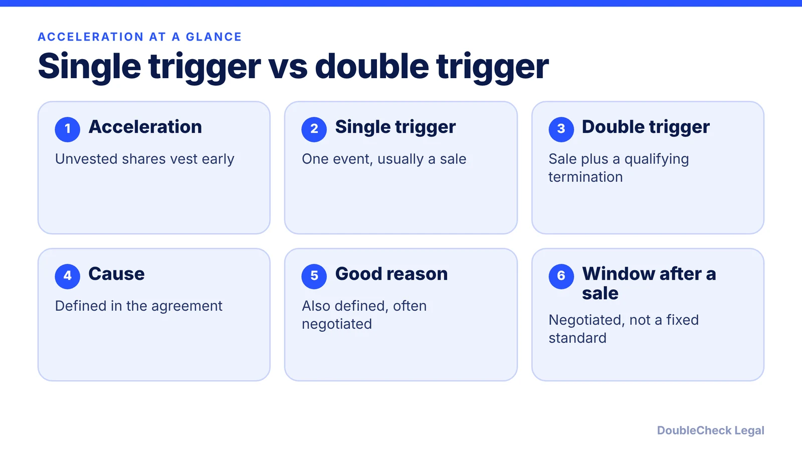
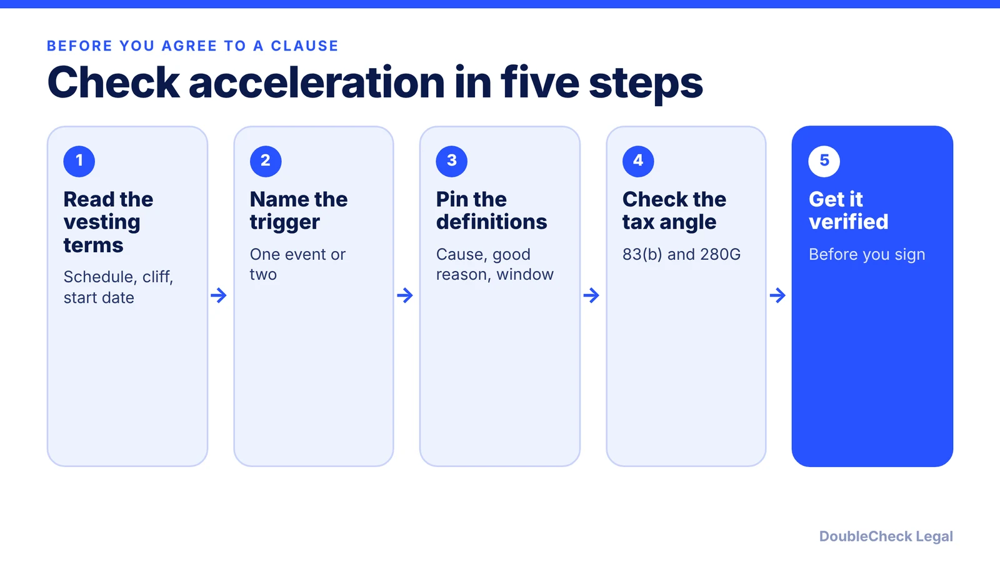

*A plain-English guide to when founder shares vest early, and what to check before you agree.*

**Key takeaways:**

- Single trigger needs one event, usually a sale; double trigger needs a sale plus a qualifying termination.
- Per Manatt, outside investors generally resist single trigger, and per Orrick (April 2026) double trigger is seen as a middle ground.
- Definitions of cause, good reason and the post-sale window are where the real negotiation happens.
- Ask a tax professional about 83(b) and Section 280G before a deal.

## 1. The quick answer

**Quick answer:** Founder vesting acceleration lets unvested shares vest early when a defined event happens. Single-trigger acceleration needs one event, usually a sale of the company. Double-trigger acceleration needs two, usually a sale plus the founder being terminated without cause or resigning for good reason within a set period afterward. Per Orrick (April 2026), double trigger is generally seen as a middle ground, while automatic full vesting on a sale is unusual because acquirers want the team to stay. Per Manatt, outside investors generally resist single trigger.

If you are asking whether a single trigger or double trigger acceleration clause is right for your founder stock, the short version is that double trigger is the more common ask and the easier one to get agreed. Terms are negotiated, so treat everything below as general information, not a market rule. For the vesting basics see [co-founder vesting and the cliff explained](/blog/cofounder-vesting-cliff-explained/).

## 2. How the two triggers work

Founder stock usually vests over time. Per Manatt (August 2020), the standard schedule is four years with a one-year cliff: 25% vests at the cliff and the rest vests monthly over the next 36 months. Vesting lets the company repurchase unvested shares if a founder leaves. Acceleration is an add-on that overrides the schedule in specific events. Per Orrick (April 2026), the two most common triggers are a change of control and termination without cause or resignation for good reason.

**Single trigger.** One event is enough. Per Manatt, it is usually tied to a change in control and, more rarely, to termination without cause. In practice a founder who has a single trigger on a sale sees unvested shares vest when the deal closes, whether or not they stay.

**Double trigger.** Two events are needed. Per Orrick (April 2026), those are typically a change in control and the holder being terminated without cause or resigning for good reason, and the second event generally has to happen within a set period after the sale closes. In practice, if a buyer already has someone in your role and lets you go after the deal, the second trigger fires and your unvested shares vest.

Orrick (April 2026) frames the practical difference. Double trigger protects someone who is fired right after an acquisition with nothing to show for their equity. Under a double trigger, an acquirer avoids a large equity payout at closing, though it may weigh the effect on the equity pool when deciding whether to terminate a person.

Two other points affect the result:

- **Partial versus full.** A clause can vest all remaining shares, a set percentage, or an additional number of months. Acceleration can be partial or full.
- **The label is not the clause.** Two documents can both say double trigger and differ on amount, window and definitions, so read the text.

## 3. What investors and acquirers usually accept

Whether you get a trigger depends on who is across the table.

**Investors.** Per Manatt (August 2020), single trigger is founder favorable and generally not accepted by outside investors, who prefer founders to stay incentivized. Investors may avoid single trigger for founders and executives because of retention risk. Per MoFo (November 2023), single-trigger acceleration tends to be more controversial. Investors may also require new or stricter vesting as a condition of funding, which is why Manatt advises adopting typical terms at the outset. See [term sheet key terms explained](/blog/term-sheet-key-terms-explained/) for where vesting shows up in a financing.

**Acquirers.** Per Orrick (April 2026), automatic full vesting on an acquisition is generally seen as unusual because buyers want the team to keep building. If you are the seller, ask how your acceleration will interact with any new equity or retention terms a buyer offers.

**Which founders ask for it.** Acceleration generally applies to founders, executives and other key employees, not most staff. If your co-founders have different roles, they may reasonably have different terms. Per Manatt, founders at the same company sometimes get different schedules based on role and contribution. Put what you agree in writing in your [co-founder agreement](/blog/co-founder-agreement-startups/) and your stock purchase documents; see [issuing a founder stock purchase agreement](/blog/issue-founder-stock-purchase-agreement/).

A related decision is how you split ownership in the first place. See [how to divide founder equity](/blog/founder-equity-split-how-to-divide/).

## 4. Terms to negotiate before you sign

The words around the trigger matter more than the trigger name. Per Manatt, the definitions of cause and good reason are heavily negotiated. Acceleration terms can be hard to add later, so negotiate them before you sign and spell out the triggering events in the equity grant.

Check these points in your documents:

- **Cause.** A narrow definition (for example serious misconduct) protects you. A broad one lets the company deny acceleration. Look for notice and cure rights.
- **Good reason.** This lets you resign and still trigger acceleration after changes such as a major pay cut or a significant change in role. Manatt and Orrick both mention resignation for good reason as part of the standard framework, but the specific list is negotiated.
- **Window.** There is no single standard period. A longer window is more generous to the holder.
- **Amount.** Full, partial or time-based credit.
- **Which events count.** Sale of the company, a merger, an asset sale, or a change in board control. Definitions vary, so read the change of control language closely.
- **Treatment of unvested stock in the deal.** Check what your documents say if the buyer does not take over your unvested shares.

**Tax interactions.** Two issues come up. First, an 83(b) election on restricted founder stock must be filed within 30 days of acquiring the shares, per Manatt, so it is usually dealt with at issuance; see [83(b) election for startup founders](/blog/83b-election-startup-founders/). Second, in a C corporation sale, large payments tied to a change of control can fall under Section 280G. Per CLA (May 2022), 280G applies when parachute payments equal or exceed three times the individual base amount, the company loses its deduction for the excess and the recipient owes a 20% excise tax. A private company can seek a cleansing vote; per CLA, more than 75% of voting power must approve, and per Lowenstein (June 2025), the shares of the affected individuals are excluded from the vote. Accelerated vesting can feed into the analysis, so ask a tax professional about it before a deal.

## 5. When you can handle it yourself and when to get a lawyer

Many early-stage founders can reasonably start with a standard four-year schedule and a one-year cliff, and add an acceleration clause only if everyone wants one. Do that with eyes open:

- **Reasonable to self-handle with AI help:** summarizing your current vesting terms, drafting a plain-English comparison of single and double trigger, listing questions for your co-founders and checking that every document uses the same dates and definitions.
- **Worth a lawyer:** a priced round where the investor proposes new vesting; an acquisition offer where acceleration, 280G and retention packages interact; founders who got different terms; any document you plan to sign that you cannot explain back in plain words.

Before you get there, a good routine is to build a one-page summary of your equity: grant date, vesting start date, cliff, schedule, trigger type, definitions, 83(b) status and who must approve changes. Compare it to [cap table basics](/blog/cap-table-basics-for-first-time-founders/), your [operating agreement clauses](/blog/startup-llc-operating-agreement-clauses-investors-vesting-and-conversion/) if you are an LLC, and your [cap table cleanup list before Series A](/blog/cap-table-cleanup-before-series-a-common-problems/). If a co-founder leaves early, see [how to remove or buy out a co-founder](/blog/how-to-remove-or-buy-out-a-co-founder/).

AI can help you read and compare these documents, but it can miss a defined term hidden in another agreement. Use [a verification step for AI-generated legal documents](/blog/verify-ai-generated-legal-document/) and, for acquisition or financing, a [qualified lawyer](/blog/how-to-choose-good-lawyer/).

## Where DoubleCheck fits

[DoubleCheck](https://www.contactdoublecheck.com) helps businesses and founders start legal work with AI, verify it, and, when professional advice is warranted, connect with an independent attorney, including for immigration questions. Attorney availability and practice areas vary. Attorneys on DoubleCheck are independent professionals; an attorney-client relationship forms only if an attorney accepts your engagement.

**Sources:** [Orrick, Single and Double Trigger Vesting Acceleration (April 6, 2026)](https://www.orrick.com/de-DE/Insights/2026/04/Single-and-Double-Trigger-Vesting-Acceleration-What-founders-and-employees-should-know); [Manatt, Founders Stock: Vesting and Acceleration (August 12, 2020)](https://www.manatt.com/insights/newsletters/manatt-for-entrepreneurs/founders-stock-vesting-and-acceleration); [Morrison Foerster, Equity Fundamentals (November 7, 2023)](https://www.mofo.com/resources/insights/231107-equity-fundamentals-single-vs-double); [CLA, Section 280G and parachute payments (May 3, 2022)](https://www.claconnect.com/resources/articles/2022/section-280g-and-parachute-payments); [Lowenstein Sandler, Section 280G unpacked (June 5, 2025)](https://www.lowenstein.com/news-insights/podcasts-listing/section-280g-unpacked-pitfalls-and-planning-for-tech-startups). Not fetched: Legal 500 and Mondaq article on negotiating acceleration (access blocked). Older pages (2020 to 2023) are attributed with dates; market practice changes.

## FAQ

**What is the difference between single and double trigger acceleration?**

Single trigger needs one event, such as a sale of the company. Double trigger needs two, usually a sale and then an involuntary termination or resignation for good reason within a set period, per Orrick and Manatt.

**Is single trigger acceleration common for founders?**

Per Manatt, it is founder favorable and generally not accepted by outside investors, and Orrick (April 2026) calls automatic full vesting on an acquisition generally unusual. Terms vary by deal, so check your own documents.

**How long is the window after a sale in a double trigger clause?**

There is no single standard period, and a longer window favors the holder. The length is negotiated and written in your grant or agreement.

**Can acceleration create tax problems?**

It can in a C corporation sale. Per CLA, Section 280G applies when parachute payments reach three times the base amount, with a 20% excise tax and a lost deduction. Private companies can seek a vote of more than 75% of voting power. Ask a tax professional.

**Should founders add acceleration to a new vesting schedule?**

Only if all founders and the investors are comfortable. Many start with four years and a one-year cliff and add double trigger later or in a financing. A lawyer can compare options before you sign.

---

*General information only. This article is not legal, tax, investment, or accounting advice.*
