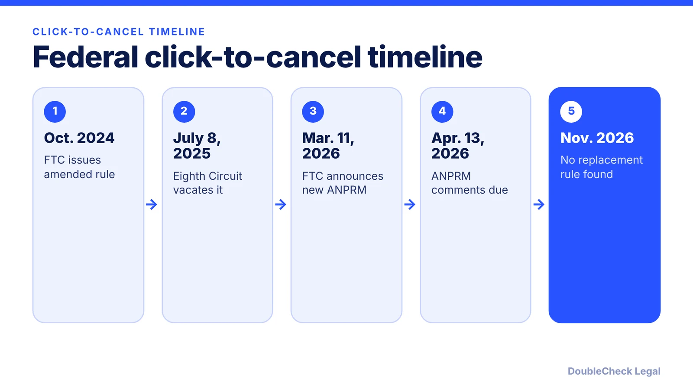
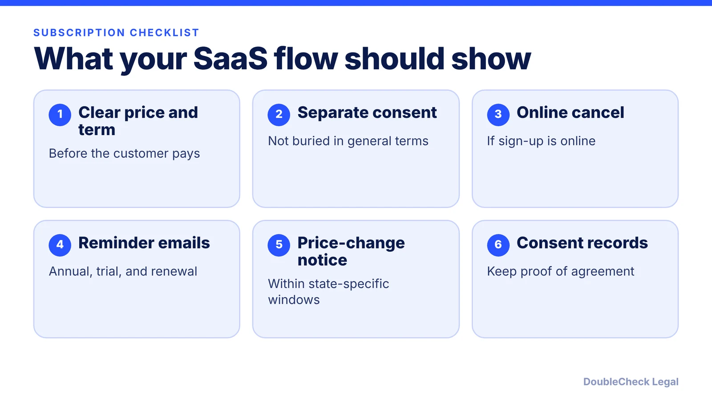

*Is click-to-cancel in force? Here is the federal status as of November 2026, what still applies to SaaS subscriptions, and a checklist.*

**Key takeaways:**

- The Eighth Circuit vacated the FTC's click-to-cancel rule on July 8, 2025.
- The FTC opened a new rulemaking in March 2026; I found no replacement rule yet.
- ROSCA and state auto-renewal laws still govern your subscription flow.
- Build to the strictest state: online cancel, separate consent, reminders.

## 1. The quick answer

**Quick answer:** As of November 2026, there is no federal click-to-cancel rule in force. The Eighth Circuit vacated the FTC's amended Negative Option Rule on July 8, 2025, on procedural grounds. In March 2026 the FTC restarted the process with an advance notice of proposed rulemaking, with comments due April 13, 2026. I did not find a proposed or final replacement rule, so check ftc.gov for updates. Meanwhile the Restore Online Shoppers' Confidence Act (ROSCA) and a growing set of state auto-renewal laws still apply to SaaS subscriptions.

## 2. What happened to the federal rule

Per BCLP, the FTC issued its Click-to-Cancel Rule in October 2024. It required clear disclosure of material terms, express informed consent before recurring charges, and a cancellation method at least as simple as sign-up. In *Custom Communications, Inc. v. FTC*, the Eighth Circuit vacated the rule because the FTC did not follow required procedural steps, per BCLP; a Mondaq summary dates the decision July 8, 2025.

Per Covington, the FTC announced a new rulemaking on March 11, 2026, published in the Federal Register on March 13, with comments due April 13, 2026. It asks how long consumers take to enroll in and cancel subscriptions, how "save" offers work, and what compliance costs sellers face. After reviewing comments, the Commission may propose rule text, propose amendments, or take no further action, per Covington.

That is an early stage. Do not plan around rule text that does not exist yet, but expect the three themes to return: clear terms, real consent, easy cancellation.

## 3. What still applies: ROSCA and state laws

**ROSCA.** Per BCLP, ROSCA remains in effect and lets the FTC challenge online negative option transactions that lack clear disclosures, express informed consent, or a simple cancellation mechanism. The statute does not define "simple." BCLP cites the Amazon Prime action (filed June 2023) and an Uber action (filed April 2025) as examples.

**State laws.** A JD Supra practitioner summary lists several 2025-2026 updates: California (July 2025), Colorado (February 2026, extending to B2B subscriptions with one-step online cancellation), Connecticut (July 2026, annual reminder), Maine (subscriptions on or after January 1, 2026), Maryland (June 2026), Massachusetts (September 2025), and New York (November 2025). Check each state's current text before relying on a summary.

Per Cooley, California's amendments effective July 1, 2025 include:

- Separate express affirmative consent to the auto-renewal terms.
- Online cancellation if you can sign up online, with a prominent link or button.
- A yearly reminder for all subscriptions.
- Notice 7 to 30 days before a price increase.
- For trials longer than 31 days that convert to paid, notice 3 to 21 days before the trial ends.

## 4. A practical SaaS checklist

Build to the strictest state you sell into, since you usually cannot tell which rules apply customer by customer.

- **Match sign-up and cancel.** If a customer can start online, let them cancel online, without forcing a call or chat.
- **Separate the renewal consent.** Use its own checkbox or clear acknowledgment, and store a record. Per Cooley, California requires consent records for at least three years or one year after termination, whichever is longer.
- **Calendar the notices.** Trials, annual renewals, and price changes each have different windows.
- **Offer save offers carefully.** Per Cooley, California permits retention offers but requires a prominent cancel button as well.
- **Align your terms.** Make your renewal and cancellation language match what the product actually does; see [website terms of service for SaaS startups](/blog/website-terms-of-service-saas-startups/) and the [terms and conditions generator guide](/blog/terms-and-conditions-generator-small-business/).

Subscription flows also collect personal data, so read the [state privacy law checklist for 2027](/blog/state-privacy-laws-2027-small-business-checklist/) and [CCPA/CPRA compliance for small businesses](/blog/ccpa-cpra-compliance-small-business/). For flow and wording review before launch, [using AI to review a contract](/blog/ai-contract-review-what-to-check-before-signing/) is a reasonable first pass, followed by an attorney for the final call.

## Where DoubleCheck fits

[DoubleCheck](https://www.contactdoublecheck.com) helps businesses and founders start legal work with AI, verify it, and, when professional advice is warranted, connect with an independent attorney, including for immigration questions. Attorney availability and practice areas vary. Attorneys on DoubleCheck are independent professionals; an attorney-client relationship forms only if an attorney accepts your engagement.

**Sources:** [BCLP](https://www.bclplaw.com/en-US/events-insights-news/im-not-dead-yet-is-the-demise-of-the-ftcs-click-to-cancel-exaggerated.html); [Covington on the 2026 rulemaking](https://www.cov.com/en/news-and-insights/insights/2026/03/ftc-launches-new-rulemaking-on-the-negative-option-rule); [Mondaq on the vacatur and revival](https://www.mondaq.com/unitedstates/consumer-law/1745320/clicking-all-the-right-boxes-ftc-moves-to-revive-click-to-cancel-rule-following-eighth-circuit-vacatur); [Cooley on California ARL](https://www.cooley.com/news/insight/2025/2025-06-04-california-automatic-renewal-law-amendments-take-effect-on-july-1-2025); [JD Supra on state ARLs](https://www.jdsupra.com/legalnews/staying-ahead-of-enforcement-practical-7039295/).

## FAQ

**Is the FTC click-to-cancel rule in effect in 2026?**

No. The Eighth Circuit vacated it in July 2025 on procedural grounds, per BCLP. The FTC began a new rulemaking in March 2026, per Covington, and I found no final replacement rule as of November 2026.

**Can the FTC still enforce against hard-to-cancel subscriptions?**

Yes. Per BCLP, ROSCA remains in effect and covers online negative option transactions without clear disclosures, express informed consent, or a simple cancellation mechanism.

**Do state laws require one-click cancellation?**

Some do. Per Cooley, California requires online cancellation if sign-up is online. A JD Supra summary says Colorado requires one-step online cancellation. Check each state you sell into.

**What should a SaaS startup do now?**

Show clear terms before payment, get separate consent to renewal, allow online cancellation, send required reminders, and keep consent records. Have an attorney check state-specific timing.

---

*General information only. This article is not legal, tax, investment, or accounting advice.*
