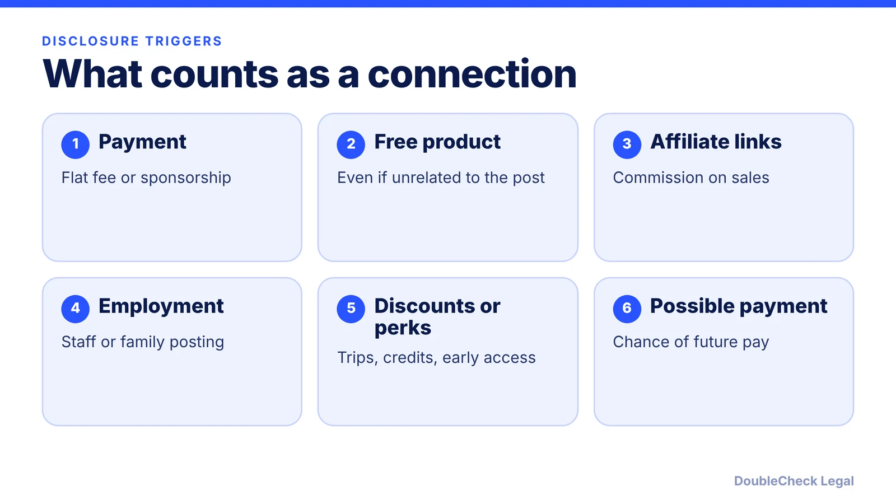
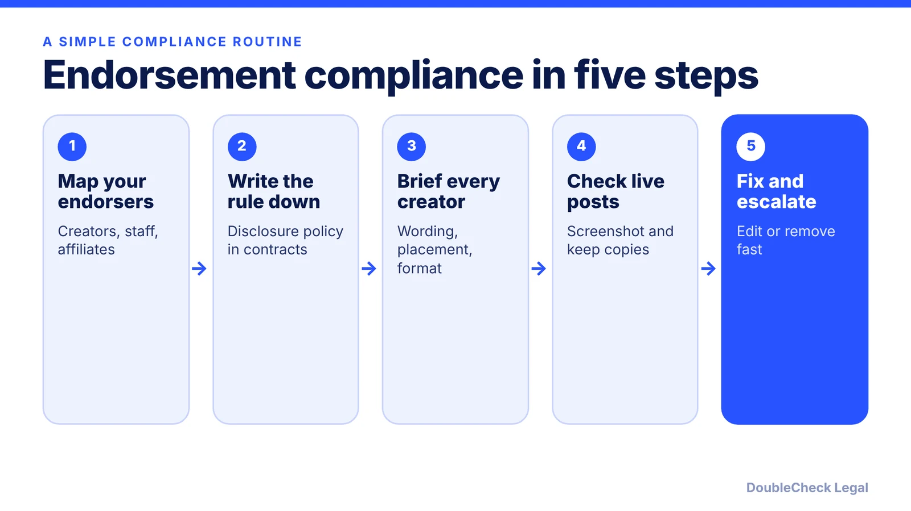

*Paid or free, a hidden connection is the problem. Here is what the FTC expects, as of November 2026.*

**Key takeaways:**

- A material connection (pay, free product, commission, employment) generally needs a clear disclosure inside the endorsement.
- Brands and influencers can both be liable.
- The FTC's fake reviews rule took effect October 21, 2024, with penalties up to $51,744 per violation (adjusted annually).
- The Consumer Review Fairness Act voids clauses that gag customer reviews.

## 1. The quick answer

**Quick answer:** If someone endorses your product and has a "material connection" to you, such as payment, free product, a commission, or employment, the FTC expects a clear disclosure in the endorsement itself. This comes from the FTC's Endorsement Guides (16 CFR Part 255, revised in 2023). Separately, an FTC rule on fake reviews and testimonials (16 CFR Part 465) took effect October 21, 2024 and carries civil penalties of up to $51,744 per violation, adjusted annually, per Morgan Lewis.

## 2. How the Endorsement Guides work

The [FTC's endorsements and reviews page](https://www.ftc.gov/business-guidance/advertising-marketing/endorsements-influencers-reviews) says the Guides cover disclosing material connections between advertisers and endorsers, including on social media. The FTC summary of the principle: make a good disclosure of your relationship to the brand.

Per [InfoLawGroup's summary of the 2023 update](https://www.infolawgroup.com/insights/2023/7/31/ftc-releases-updated-endorsement-guides-10-key-takeaways):

- **Endorsement is broad.** Tagging a brand or visibly enjoying a product in a video may count.
- **Disclosure must match the format.** Visual endorsements need visual disclosures; audio endorsements need audible ones. For video, put it in both where applicable.
- **Hashtags alone are risky.** Terms like #ad can help, but vague ones such as #ambassador or #partner alone were described as insufficient; naming the brand makes it clearer.
- **Context counts.** Consider platform, device, and language. A caption may not be enough if the post conveys the endorsement without the viewer reading it.
- **Affiliate links need disclosure.** "Paid link" next to the link is likely sufficient; "commissionable link" likely is not.
- **Both sides can be liable.** Influencers can be liable for false statements they knew or should have known were inaccurate, and advertisers are liable for misrepresentations made through endorsers.
- **Monitor.** Brands should train, monitor, and promptly address noncompliant endorsers, including those who only received free products.

The Guides do not prescribe magic words. The test is whether the connection is clear to a reasonable viewer. If you run a creator program, your agreements should say so; see [LLC for content creators and influencers](/blog/llc-for-content-creators-influencers/) for the creator side.

## 3. The fake reviews rule

Per [Morgan Lewis](https://www.morganlewis.com/pubs/2024/08/ftc-issues-final-rule-on-consumer-reviews-and-testimonials), the final rule prohibits six categories of conduct:

1. Fake or false consumer reviews, consumer testimonials, and celebrity testimonials.
2. Buying or paying for positive or negative reviews based on the sentiment expressed.
3. Insider reviews and testimonials that do not disclose a close tie to the business.
4. Presenting a company-owned or company-run review site as independent.
5. Suppressing negative reviews, except in narrow circumstances (for example, reviews with defamatory or privileged content).
6. Selling, distributing, or buying fake social media indicators, such as bought followers, where the person knew or should have known they were fake.

Per [Wilson Sonsini](https://wsgr.com/en/insights/ftc-issues-final-rule-banning-fake-and-misleading-consumer-reviews-and-testimonials.html), liability reaches companies that "knew or should have known" about prohibited conduct, so hiring a vendor does not remove responsibility. The FTC's page notes that platforms displaying reviews should have processes to confirm they come from genuine customers.

What is fine: asking real customers for honest reviews, and replying to reviews. What is not: offering a reward only for positive ratings, or hiding the bad ones.

## 4. Contracts, reviews, and a practical checklist

The Consumer Review Fairness Act (CRFA) is a separate rule. Per [JD Supra's summary of FTC guidance](https://jdsupra.com/legalnews/what-the-ftc-wants-businesses-to-know-70083/), it voids form-contract clauses that bar or restrict reviews, penalize reviewers with fees, or require them to give up IP rights in their review. It does not apply to employment or independent contractor agreements. You may still remove reviews that are libelous, harassing, or clearly false. The FTC advises checking form contracts, including website terms, and removing non-disparagement language. See [website terms of service](/blog/website-terms-of-service-saas-startups/).

Checklist for a small business:

- Disclose paid and free-product relationships in the post itself.
- Put disclosure duties in influencer and affiliate agreements.
- Do not buy reviews, followers, or "likes."
- Do not gate reviews by sentiment.
- Remove non-disparagement clauses from customer terms.
- Keep records of what endorsers were told.

For handling a bad review you think is false, read [online reviews and defamation](/blog/online-reviews-defamation-what-business-can-do/). If a regulator or competitor writes to you, see [how to respond to a cease and desist letter](/blog/how-to-respond-cease-and-desist-letter/). Subscription marketing has its own rules in [FTC click-to-cancel rules for SaaS](/blog/ftc-click-to-cancel-subscription-rules-saas/).

## Where DoubleCheck fits

[DoubleCheck](https://www.contactdoublecheck.com) helps businesses and founders start legal work with AI, verify it, and, when professional advice is warranted, connect with an independent attorney, including for immigration questions. Attorney availability and practice areas vary. Attorneys on DoubleCheck are independent professionals; an attorney-client relationship forms only if an attorney accepts your engagement.

**Sources:** [FTC, Endorsements, Influencers, and Reviews](https://www.ftc.gov/business-guidance/advertising-marketing/endorsements-influencers-reviews); [InfoLawGroup, 2023 Endorsement Guides](https://www.infolawgroup.com/insights/2023/7/31/ftc-releases-updated-endorsement-guides-10-key-takeaways); [Morgan Lewis, FTC final rule on reviews](https://www.morganlewis.com/pubs/2024/08/ftc-issues-final-rule-on-consumer-reviews-and-testimonials); [Wilson Sonsini](https://wsgr.com/en/insights/ftc-issues-final-rule-banning-fake-and-misleading-consumer-reviews-and-testimonials.html); [JD Supra, CRFA](https://jdsupra.com/legalnews/what-the-ftc-wants-businesses-to-know-70083/).

## FAQ

**Do I have to disclose free products given to influencers?**

Generally yes. Per InfoLawGroup's summary of the 2023 Endorsement Guides, free or discounted products, even unrelated ones, can be material connections that require disclosure.

**Is #ad enough?**

No specific wording is required. Per InfoLawGroup, vague hashtags like #ambassador or #partner alone were described as insufficient, and the disclosure must fit the format, for example visual and audible in video.

**Can I be fined for fake reviews?**

Yes. Per Morgan Lewis, violations of the FTC's consumer reviews rule can bring civil penalties of up to $51,744 per violation, subject to annual inflation adjustment, plus other relief such as redress.

**Can my terms ban negative reviews?**

Not in a form contract. Per JD Supra's summary of FTC guidance, the Consumer Review Fairness Act voids form-contract clauses that restrict reviews or penalize reviewers, with exceptions for employment and independent contractor agreements.

---

*General information only. This article is not legal, tax, investment, or accounting advice.*
