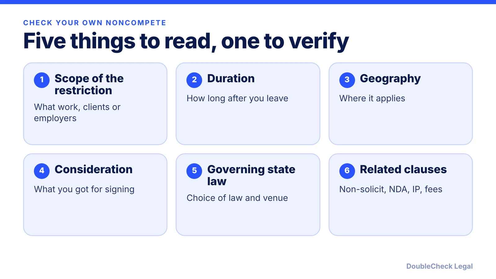
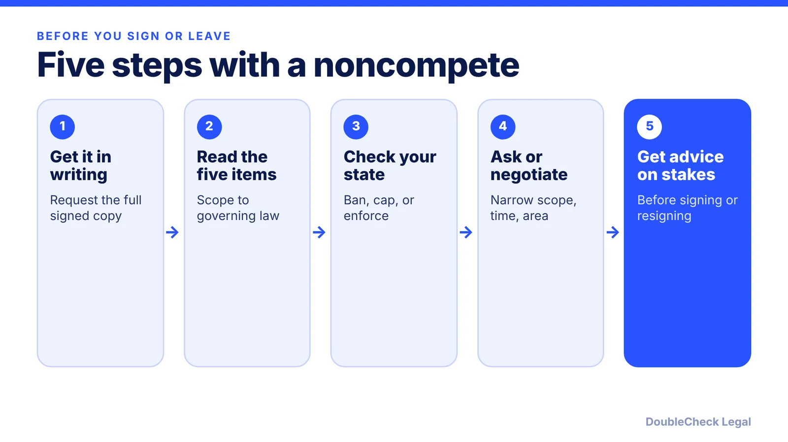

*The FTC ban is not in effect, so your state decides. Here is how to check your own noncompete, what to read, and when to get an attorney.*

**Key takeaways:**

- As of November 2026, no FTC nationwide noncompete ban is in effect; your state law and your contract decide.
- Read scope, duration, geography, consideration and governing law, plus related non-solicit and confidentiality clauses.
- State rules range from complete bans to income thresholds to friendlier enforcement, and several change in 2026-2027.
- Before signing or resigning, get the full copy, check your state, and talk to an employment attorney if the stakes are high.

## 1. The quick answer

**Quick answer:** As of November 2026, there is no FTC nationwide noncompete ban in effect, so your noncompete is judged by your state's law, not by a federal rule. Per Foley & Lardner (July 2026) and the National Law Review, the FTC's April 2024 rule was blocked by a Texas federal court in August 2024, and the FTC withdrew its appeal in September 2025. To check your own noncompete, read five things: who the covered activity is, how long it lasts, where it applies, what you received in exchange, and which state's law governs. Then compare them with your state's rules before you sign, resign or start a new job.

This guide is written for the employee holding the agreement. If you are the employer deciding what to keep in your forms, see [FTC noncompete rule status 2026: what small businesses can still do](/blog/ftc-noncompete-rule-status-2026-what-small-businesses-can-still-do/). For state-by-state detail, see [non-compete agreements by state in 2026](/blog/non-compete-agreements-by-state-2026/).

## 2. What the FTC rule status means for you right now

**The short timeline.** The FTC issued a final rule in April 2024 that would have banned nearly all employer-employee noncompetes. A federal court in Texas blocked it nationwide on August 20, 2024 (McDermott Will & Schulte), and the agency appealed in October 2024. After the change in FTC leadership, the appeal ended: Foley and the National Law Review say the FTC withdrew its appeal in September 2025, and McDermott says the rule never took effect and the agency no longer defends it.

**What the FTC does now.** The FTC has shifted to case-by-case enforcement. Per Morrison Foerster, the FTC announced a proposed consent order with Rollins, Inc., a pest control company, in April 2026 that would bar Rollins from enforcing noncompetes against more than 18,000 current or former workers, and it sent warning letters to 13 other pest-control companies. McDermott also describes a 2025 action against Gateway Services involving noncompetes covering about 1,800 workers.

**What that means for an individual.** Those actions target employers that apply noncompetes broadly, often to lower-paid staff. They do not cancel your agreement. Your noncompete is still a contract, and a court in your state decides whether it is enforceable.

**Where to report.** McDermott says workers can send complaints to noncompete@ftc.gov, an address the FTC set up in 2024. Confirm the current process on ftc.gov.

For the employer-side view of the same events and a practical comparison of restrictive covenants, see [non-compete vs non-solicit vs NDA: which to use after the FTC rule](/blog/non-compete-vs-non-solicit-vs-nda-which-to-use-after-the-ftc-rule/) and [noncompete agreements in 2026 for small business](/blog/noncompete-agreements-2026-small-business/).

## 3. State law decides your noncompete: how much it varies

With no federal ban, the state you live and work in matters most. Per Foley and the National Law Review (both 2026), the picture looks like this:

- **Complete bans:** California and Minnesota (since July 1, 2023), plus North Dakota, Oklahoma and Wyoming (Wyoming's took effect July 1, 2025, with exceptions) are listed as complete bans by the National Law Review. Washington's ban is set to take effect in 2027: under HB1155, noncompetes become unenforceable on or after June 30, 2027.
- **Income-based limits:** Illinois bans noncompetes for workers earning under $75,000, rising to $80,000 on January 1, 2027. The District of Columbia generally bans them below roughly $162,164 in 2026. Maryland, Maine, Oregon, Rhode Island and Virginia also limit them by income, wage or job type, each with different cutoffs and rules.
- **Friendlier to enforcement:** Florida's CHOICE Act, effective July 1, 2025, strengthens noncompetes for higher earners, allows up to four years, requires seven days to review before signing, and per the National Law Review shifts the burden to the employee to show unenforceability. Georgia, Michigan, North Carolina, Ohio and Wisconsin are listed as generally enforceable, subject to reasonableness requirements.
- **Moving targets:** Foley lists a Tennessee law (H.B. 1034, signed May 7, 2026, effective July 1, 2026) and several pending bills in other states. Check whether anything changed after those articles.

Two practical points follow. Your agreement may name a different state in a choice-of-law clause, and whether a court honors that depends on the state. And even a ban usually has exceptions, so do not assume it covers every restriction in the agreement.

**Quick state check:**

1. Where do you live and where do you physically work?
2. Does your state ban, cap by income, or enforce noncompetes subject to reasonableness?
3. Which state does the agreement say governs it, and where must disputes be filed?
4. Was the agreement signed before or after your start date?

Our [state-by-state guide](/blog/non-compete-agreements-by-state-2026/) is a starting point; confirm anything that affects a real decision.

## 4. What to read in the agreement: scope, duration, geography, consideration

Fisher Phillips (a 2012 piece for employers, so use it for the framework, not current law) lists the building blocks courts commonly examine: a legitimate business interest, and restrictions tailored to the role in scope, time and geography.

**Scope.** What exactly are you barred from doing? Working for any competitor, or only in a role like yours? Soliciting customers, soliciting coworkers, or just using confidential information? Fisher Phillips distinguishes noncompetition, customer non-solicitation, employee non-solicitation and non-disclosure as separate restraints. A blanket "any business similar to ours" clause covers more than a targeted one. See [non-solicitation agreements explained](/blog/non-solicitation-agreements-explained/) and [confidentiality and IP assignment agreements](/blog/confidentiality-ip-assignment-agreements-startups/) because these often sit in the same document.

**Duration.** How long does the restriction run after your last day, and does the clock pause or extend if you breach? Some state rules cap duration (for example, Foley reports DC enforceable noncompetes cannot exceed two years and Rhode Island has a one-year maximum; Washington's will be limited to 18 months before the 2027 ban). Short and specific is better for you than long and vague.

**Geography.** Is the area tied to where you actually worked or sold, or is it "anywhere in the United States" for a remote role? Fisher Phillips says geographic limits should be tailored to the position.

**Consideration.** What did you receive for agreeing? Fisher Phillips notes that covenants signed before employment starts are generally supported, while some states treat agreements signed after an offer is accepted, or after employment begins, differently and may require additional consideration. If you were handed it on day one, or months in with no raise or bonus, note that.

**Other terms worth finding:**

- Choice of law, venue and who pays attorney fees if there is a dispute.
- Whether it transfers to a buyer if the company is sold (Fisher Phillips notes some states will not enforce after an employer change unless the agreement permits assignment).
- Whether it applies if you are laid off, or only if you resign, and whether you are paid during the restricted period.

## 5. What to do before you sign, and before you leave

**Before you sign.** You can usually ask questions and propose edits; employers sometimes agree, especially for narrower scope. Foley notes Florida requires a review period of seven days, so if you are there, use it. Anywhere, ask for time to read it and a copy to keep. Practical edits to ask for:

- Narrow the scope to competing roles and named competitors rather than the whole industry.
- Shorten the duration and shrink the geography to where you actually work.
- Confirm what you receive in return, in writing.

**Before you leave.** Do not guess whether you are bound. Gather the agreement, any equity or bonus documents that reference restrictions, and your offer letter. Then:

1. Check your state rule and the governing law clause.
2. Do not take company files or customer lists; confidentiality and IP terms usually survive even where a noncompete is void.
3. Tell a new employer about the restriction early.
4. Avoid soliciting former customers or coworkers until you know what your non-solicit says.

**If you get a cease-and-desist letter.** A letter is a demand, not a court order. Keep it, do not ignore deadlines, and talk to an employment attorney before replying.

For how the paperwork looks from the employer side, see [how to hire your first employee: legal checklist](/blog/how-to-hire-first-employee-legal-checklist/).

## 6. When to talk to an attorney, and where AI helps

AI is useful for a first read: summarize the clause and draft questions. It can miss state-specific rules and recent changes, so verify anything you act on. See [AI contract review: what to check before signing](/blog/ai-contract-review-what-to-check-before-signing/) and [can a lawyer review a ChatGPT contract](/blog/lawyer-review-chatgpt-contract/).

Consider an employment attorney when:

- You are about to resign to join a competitor, start a competing business or raise money for one.
- The restriction is long, nationwide or paired with a large fee-shifting or liquidated-damages clause.
- You received a demand letter or lawsuit.
- Equity, severance or a bonus is tied to complying with the restriction.

To choose counsel, see [how do I know if my lawyer is good](/blog/how-do-i-know-if-my-lawyer-is-good/).

**Related reading:** [Employee Confidentiality vs Whistleblower Rights: What You Cannot Restrict](/blog/employee-confidentiality-vs-whistleblower-rights-what-you-cannot-restrict/)

## Where DoubleCheck fits

[DoubleCheck](https://www.contactdoublecheck.com) helps businesses and founders start legal work with AI, verify it, and, when professional advice is warranted, connect with an independent attorney, including for immigration questions. Attorney availability and practice areas vary. Attorneys on DoubleCheck are independent professionals; an attorney-client relationship forms only if an attorney accepts your engagement.

**Sources:** [Foley & Lardner, Noncompete Agreements in 2026: A Federal and State Overview (July 2026)](https://www.foley.com/insights/publications/2026/07/noncompete-agreements-federal-state-overview/); [National Law Review, Noncompete Agreements in 2026: A Federal and State Overview](https://natlawreview.com/article/noncompete-agreements-2026-federal-and-state-overview); [Morrison Foerster, FTC Steps Up Targeted Enforcement Against Employee Noncompetes (Apr. 2026)](https://www.mofo.com/resources/insights/260429-ftc-noncompete-enforcement); [McDermott Will & Schulte, The FTC strategy on noncompetes in 2026](https://www.mcdermottlaw.com/?p=359178); [Fisher Phillips, Top Ten Things to Consider When Drafting a Non-Compete Agreement (2012, framework only)](https://www.fisherphillips.com/Non-Compete-and-Trade-Secrets/Top-Ten-Things-to-Consider-When-Drafting-A-Non-Compete-Agreement). We did not load ftc.gov directly; confirm current FTC status there.

## FAQ

**Is the FTC noncompete ban in effect in 2026?**

No. Per Foley and the National Law Review (2026), the April 2024 rule was blocked by a Texas federal court in August 2024 and the FTC withdrew its appeal in September 2025. The FTC now acts case by case, so check ftc.gov for the latest.

**How do I check my own noncompete?**

Read the scope, duration, geography, consideration and governing law, then compare them with your state rules. Also read any non-solicit, confidentiality and attorney-fee clauses, and get advice if you plan to leave for a competitor.

**Is my noncompete void if my state bans noncompetes?**

Not automatically. Per the National Law Review, California, Minnesota, North Dakota, Oklahoma and Wyoming are listed as complete bans, but exceptions exist and other clauses in your agreement, such as non-solicits and confidentiality, may still apply. Check before acting.

**Can I report an employer noncompete to the FTC?**

McDermott Will & Schulte says workers can send complaints to noncompete@ftc.gov, an address the FTC set up in 2024 and monitors. Reporting does not resolve your own dispute, so confirm the current process on ftc.gov and consider legal advice.

**Should I talk to a lawyer before signing a noncompete?**

If the role, pay or equity is significant, or the restriction is broad or long, a short attorney review is often worth it. Ask for time to read the agreement and a copy to keep.

---

*General information only. This article is not legal, tax, investment, or accounting advice.*
