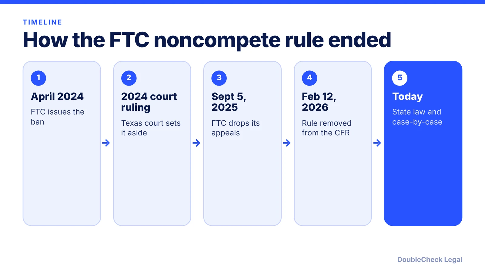
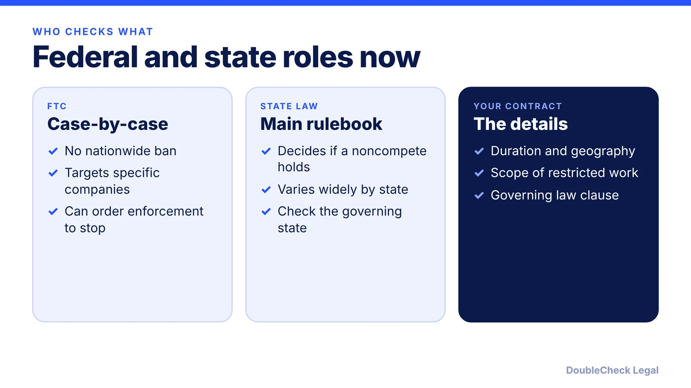

*A short status update on the FTC noncompete rule and the practical steps that remain.*

**Key takeaways:**

- The FTC noncompete rule was set aside in court, the appeals were dropped on September 5, 2025, and the rule was removed from the CFR on February 12, 2026.
- State law, not federal law, decides most noncompete disputes.
- The FTC can still challenge specific noncompetes case by case.
- Employers should audit and narrow agreements; employees should check state rules and have agreements reviewed.

## 1. The quick answer

**Quick answer:** As of November 2026, the FTC noncompete ban is not in effect and will not be. A Texas federal court set the rule aside in 2024, the FTC voted 3-1 on September 5, 2025 to drop its appeals, and a Federal Register notice published February 12, 2026 removed the rule from the Code of Federal Regulations. That means state law decides whether a noncompete is enforceable, and the FTC can still challenge specific noncompetes case by case. Employers should audit and narrow their agreements; employees should check their state's rules before signing or leaving.

## 2. What happened to the rule, step by step

- **April 2024.** The FTC finalized a rule to ban nearly all noncompete agreements. It never took effect (per NPR's September 2025 report).
- **2024 court decision.** In *Ryan, LLC v. FTC* (N.D. Tex.), the court held the rule unlawful and set it aside, concluding the FTC exceeded its statutory authority and that the rule was arbitrary and capricious, per the Federal Register notice.
- **September 5, 2025.** The FTC voted 3-1 to dismiss its appeals in the Fifth and Eleventh Circuit cases and accept the vacatur, per the same notice. NPR reported that Chair Andrew Ferguson said the rule's illegality was "patently obvious."
- **February 12, 2026.** The FTC removed the rule, 16 CFR part 910, from the Code of Federal Regulations, effective the date of publication. The Commission described the step as conforming the regulations to the court outcomes.

I did not find a 2026 source suggesting the FTC is trying to revive a nationwide ban. The FTC's own approach, per NPR, is case-by-case enforcement.

For the state-by-state picture this post does not repeat, see [noncompete agreements in 2026 for small businesses](/blog/noncompete-agreements-2026-small-business/) and [non-compete agreements by state](/blog/non-compete-agreements-by-state-2026/).

## 3. What the FTC can still do

Removing the rule did not end FTC interest in noncompetes. It shifted the tool from a rulemaking to individual enforcement:

- **Pet cremation case (2025).** Per NPR, the FTC ordered the country's largest pet cremation business to stop enforcing noncompetes against about 1,800 employees, and opened a public request for information on noncompetes.
- **Rollins (2026).** Per a policyrisk.com summary of the Federal Register notice, the FTC published a proposed order against pest-control company Rollins, Inc. on April 22, 2026, with comments due May 22, 2026. It would bar Rollins from enforcing noncompetes against covered employees, require written notice that they are not bound, and last ten years if finalized. It is a proposed order, and I did not verify whether it has since been finalized.

The pattern in these matters is broad noncompetes imposed on large numbers of workers. A single well-drafted agreement for a senior hire is a different situation, but it still has to satisfy state law.

## 4. What employers and employees can do now

**Employers**

1. **Audit existing noncompetes.** Ask whether each person truly has access to trade secrets or key client relationships, per a July 2026 beancount.io guide, and tailor restrictions by role instead of using one template.
2. **Check every state where you have people**, including remote workers. The governing state, not your headquarters, often decides.
3. **Consider lighter tools first.** [Non-solicitation agreements](/blog/non-solicitation-agreements-explained/), [confidentiality and IP assignment](/blog/confidentiality-ip-assignment-agreements-startups/) and [trade secret practices](/blog/trade-secret-protection-small-business-startups/) protect a business without barring someone from working.
4. **Ask candidates** about existing restrictive covenants before an offer, and fix this in your [first-hire checklist](/blog/how-to-hire-first-employee-legal-checklist/).

**Employees**

1. Read the duration, geography, restricted work and governing-law clauses before signing.
2. Find out whether your state limits or voids noncompetes. Do not assume a clause is enforceable or unenforceable because you saw a headline.
3. Do not ignore a signed noncompete when changing jobs. Have it reviewed first.

You can use AI to summarize an agreement and list questions (see [AI and small business legal work](/blog/ai-lawyer-small-business/)). Get an attorney licensed in the relevant state to verify before you enforce a noncompete, sign one that restricts your livelihood, or leave a job that has one.

**Related reading:** [Non-compete vs non-solicit vs NDA](/blog/non-compete-vs-non-solicit-vs-nda-which-to-use-after-the-ftc-rule/)

## Where DoubleCheck fits

[DoubleCheck](https://www.contactdoublecheck.com) helps businesses and founders start legal work with AI, verify it, and, when professional advice is warranted, connect with an independent attorney, including for immigration questions. Attorney availability and practice areas vary. Attorneys on DoubleCheck are independent professionals; an attorney-client relationship forms only if an attorney accepts your engagement.

**Sources:** [Federal Register notice 2026-02866 (GovInfo)](https://www.govinfo.gov/content/pkg/FR-2026-02-12/html/2026-02866.htm); [FTC public comment page for the final action](https://www.ftc.gov/policy/public-comments/revision-negative-option-rule-withdrawal-cars-rule-removal-non-compete-rule-conform-these-rules-0); [NPR via WAMC, Sept 5, 2025](https://www.wamc.org/2025-09-05/under-trump-the-federal-trade-commission-is-abandoning-its-ban-on-noncompetes); [policyrisk.com on the Rollins proposed order](https://policyrisk.com/federal-register/2026-07844); [beancount.io, July 2026](https://beancount.io/blog/2026/07/09/ftc-noncompete-ban-withdrawn-small-employer-enforcement-guide). The ftc.gov page loaded only as a comment-page summary.

## FAQ

**Is the FTC noncompete ban in effect in 2026?**

No. The rule never took effect, a federal court set it aside, the FTC dropped its appeals on September 5, 2025, and it was removed from the Code of Federal Regulations on February 12, 2026, per the Federal Register.

**Are noncompete agreements still legal?**

Generally yes, subject to state law. Some states void or limit them, and others enforce reasonable ones. Check the state that governs the work and have an attorney review.

**Can the FTC still go after noncompetes?**

Yes, case by case. NPR reported a 2025 order involving about 1,800 employees of a pet cremation company, and the FTC published a proposed order against Rollins, Inc. in April 2026, per a policyrisk.com summary.

**What should a small business do about its noncompetes now?**

Audit who really needs one, narrow the terms by role, check each state where employees work, and consider non-solicitation and confidentiality agreements as alternatives. Have an attorney verify before enforcing.

---

*General information only. This article is not legal, tax, investment, or accounting advice.*
