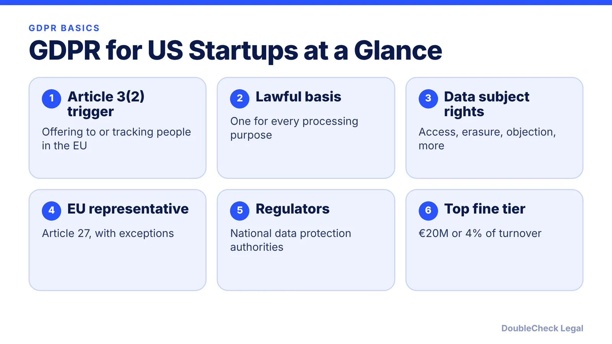
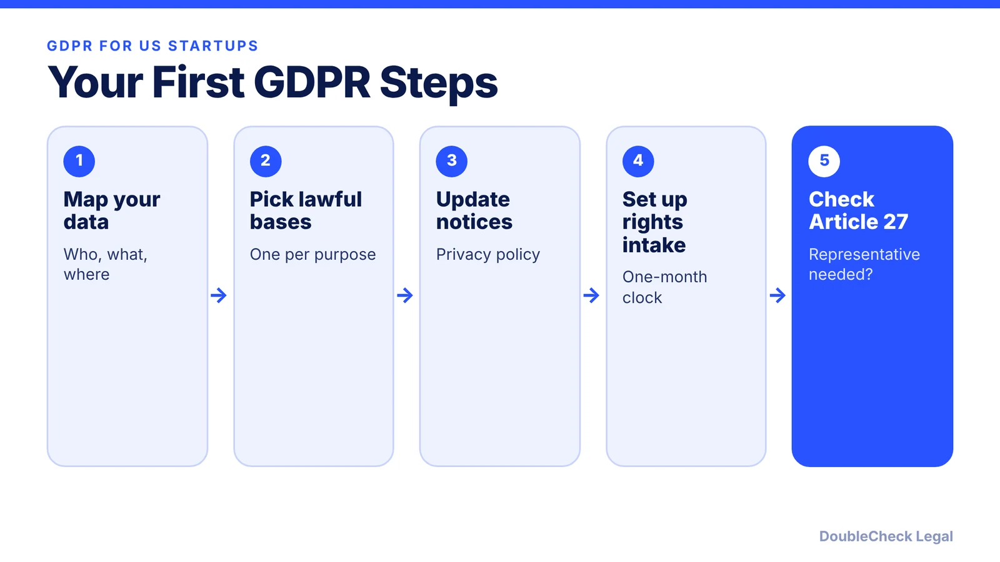

*GDPR is not just for European companies. Here is when it reaches a US startup and what you have to do about it.*

**Key takeaways:**

- GDPR applies to non-EU companies that offer goods or services to people in the EU or monitor their behavior there (Article 3(2)).
- You need a lawful basis for each purpose and a process for access, erasure, and other rights, usually answered within one month.
- Article 27 may require an EU representative unless processing is occasional and low risk.
- Fines run up to €10M/2% or €20M/4% of worldwide turnover, whichever is higher.

## 1. The quick answer

**Quick answer:** GDPR can apply to a US startup with no EU office. Under Article 3(2), it covers non-EU companies that process personal data of people in the EU when they offer goods or services to those people (paid or free) or monitor their behavior in the EU. If it applies, you need a lawful basis for each use of data, a way to honor data subject rights, and possibly an EU representative under Article 27. The top fine tier is up to €20 million or 4% of worldwide annual turnover, whichever is higher.

## 2. When GDPR applies to a US company

Per the text of Article 3 as published by rgpd.com, the regulation reaches controllers and processors outside the EU when they process data of people who are in the EU and the activities relate to:

- **Offering goods or services** to those people, whether or not payment is required; or
- **Monitoring their behavior**, as far as that behavior takes place in the EU.

TechGDPR lists practical signals that you are targeting the EU: prices in euros, shipping to EU addresses, EU-targeted email campaigns, and a site in a widely spoken EU language. It also says analytics, cookies, and targeted advertising can count as tracking. Simply having a website that an EU resident could open is a weaker signal than these, so look at who you are actually aiming at. If you have EU-based employees, their data can also bring you into scope.

If you are still setting up the company, see [how to incorporate in the US](/blog/how-to-incorporate-a-company-in-the-us/) and think about data flows early.

## 3. Lawful bases, rights, and the EU representative

**Lawful bases.** Each processing purpose needs one of six bases under Article 6. Per a CompliDog summary these are consent, contract, legal obligation, vital interests, public task, and legitimate interests. Legitimate interests requires a documented balancing test. For most startups, the realistic options are consent, contract, and legitimate interests.

**Data subject rights.** TechGDPR lists access, rectification, erasure, restriction, and objection. CompliDog notes that access and erasure requests generally must be answered within one month, extendable by two further months for complex requests if you explain why within the first month. Build a simple intake process (a privacy email address and a log) before your first request arrives.

**EU representative.** Article 27(1) requires a controller or processor covered by Article 3(2) to designate a representative in the EU in writing. Under Article 27(2), this does not apply to public authorities or to processing that is occasional, does not involve large-scale special-category or criminal-conviction data, and is unlikely to risk people's rights and freedoms. All three conditions must be met, so a startup with regular EU users should not assume it is exempt.

## 4. Regulators, fines, and what to do next

GDPR is enforced by national supervisory authorities, often called data protection authorities (DPAs). TechGDPR points to Clearview AI, a US company that faced action and fines from several EU DPAs for processing EU residents' data without a sufficient legal basis, as proof that US companies are in reach.

Article 83 sets two tiers, per gdpr-info.eu:

- **Lower tier:** up to €10 million, or up to 2% of total worldwide annual turnover of the preceding year, whichever is higher.
- **Higher tier:** up to €20 million, or up to 4%, whichever is higher.

These are maximums. Authorities must weigh factors such as intent, steps taken to limit harm, and cooperation, and fines must be effective, proportionate, and dissuasive. Most startups will not face the maximum, but the cost of a regulatory inquiry is real.

Practical next steps: decide honestly whether you target the EU, write a privacy notice that matches what you do ([how to write a privacy policy with AI](/blog/ai-write-privacy-policy/), [privacy policy generators](/blog/privacy-policy-generator-small-business/)), sign data processing terms with vendors, and compare with California's rules in our [CCPA/CPRA guide](/blog/ccpa-cpra-compliance-small-business/). Pair this with solid [website terms](/blog/website-terms-of-service-saas-startups/).

## Where DoubleCheck fits

[DoubleCheck](https://www.contactdoublecheck.com) helps businesses and founders start legal work with AI, verify it, and, when professional advice is warranted, connect with an independent attorney, including for immigration questions. Attorney availability and practice areas vary. Attorneys on DoubleCheck are independent professionals; an attorney-client relationship forms only if an attorney accepts your engagement.

**Sources:** [Article 3, rgpd.com](https://rgpd.com/gdpr/chapter-1-general-provisions/article-3-territorial-scope/); [Article 27, gdpr-info.eu](https://gdpr-info.eu/art-27-gdpr/); [GDPR fines, gdpr-info.eu](https://gdpr-info.eu/fines/); [TechGDPR](https://techgdpr.com/blog/does-the-gdpr-apply-to-my-us-company/); [CompliDog](https://complydog.com/blog/6-key-articles-of-the-gdpr).

## FAQ

**Does GDPR apply to a US company with no EU office?**

Yes, if it offers goods or services to people in the EU or monitors their behavior there, per Article 3(2) as published by rgpd.com.

**What are the GDPR fines?**

Article 83 sets up to €10 million or 2% of worldwide annual turnover for the lower tier and up to €20 million or 4% for the higher tier, whichever is higher, per gdpr-info.eu.

**Do I need an EU representative?**

Article 27 requires one for companies covered by Article 3(2), unless processing is occasional, avoids large-scale sensitive data, and is unlikely to risk individuals' rights, per gdpr-info.eu.

**How fast must I answer an access request?**

Generally within one month, extendable by two months for complex requests if you explain within the first month, per CompliDog's summary of Article 15.

---

*General information only. This article is not legal, tax, investment, or accounting advice.*
